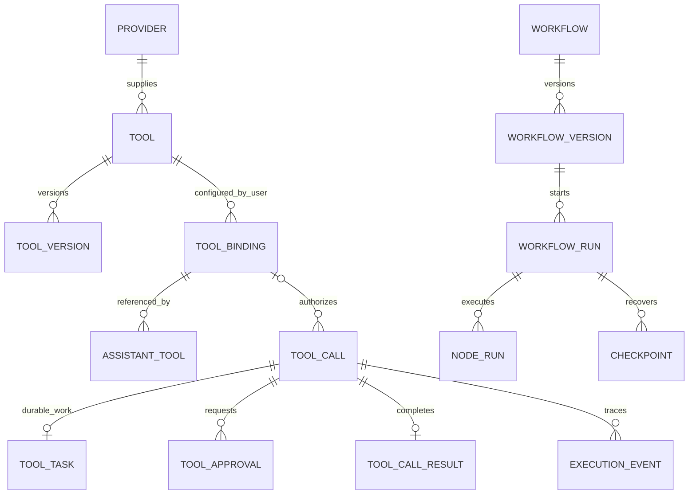
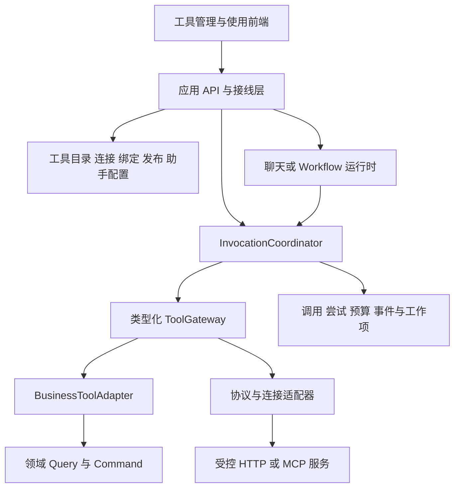
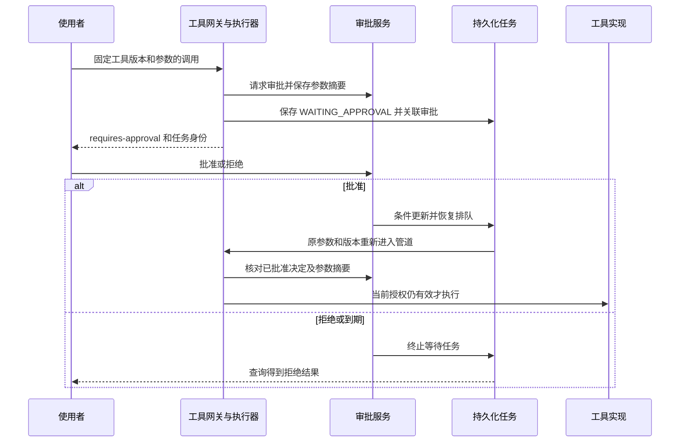

# ARTE AI TOOL 需求及设计

> 整理日期：2026-10-17。用途：作为另一份代码中重构 AI Tool 的需求、设计、配置、操作和验收基线。
>
> 本文依据当前工作区的文档、后端实现、前端页面与测试源码整理。“现有实现”表示已经找到相应代码，不表示已经在某个运行环境验收通过。本次未启动应用、执行测试、连接数据库或调用真实远端工具。

## 目录

1. [文档范围与实现状态](#1-文档范围与实现状态)
2. [目标、角色与完整需求](#2-目标角色与完整需求)
3. [核心概念与数据模型](#3-核心概念与数据模型)
4. [总体架构与重构边界](#4-总体架构与重构边界)
5. [工具开发、发现与接入](#5-工具开发发现与接入)
6. [配置体系与生效规则](#6-配置体系与生效规则)
7. [发布与版本升级](#7-发布与版本升级)
8. [调用、任务、审批与恢复](#8-调用任务审批与恢复)
9. [权限、安全与数据边界](#9-权限安全与数据边界)
10. [工作流需求与设计](#10-工作流需求与设计)
11. [前端页面与使用指南](#11-前端页面与使用指南)
12. [接口与请求示例](#12-接口与请求示例)
13. [存储、部署与运维](#13-存储部署与运维)
14. [观测、统计与评估](#14-观测统计与评估)
15. [重构差距、实施顺序与验收](#15-重构差距实施顺序与验收)
16. [源码与文档索引](#16-源码与文档索引)

## 1. 文档范围与实现状态

### 1.1 三类内容的含义

| 标记               | 含义                                                                 | 重构时如何使用                                                 |
|--------------------|----------------------------------------------------------------------|----------------------------------------------------------------|
| **现有实现**       | `backend/arte-ai` 及对应前端中能够找到的行为                         | 提取需要保留的产品能力和兼容规则，结合差距清单判断是否沿用实现 |
| **目标约束**       | 根目录《ARTE顶层需求及设计.md》及 `arte-ai-new` 文档声明的架构和语义 | 作为新实现必须满足的边界，不当作已有功能                       |
| **重构要求／建议** | 为满足目标约束而需要补充或调整的行为                                 | 纳入重构任务和验收；推荐数值及方案需在目标项目落地时确认       |

正文中“应”“必须”用于描述目标需求；现状说明以“当前”“现有”明确限定。未找到实现闭环的能力不因存在数据库表、枚举、接口或页面文案而视为完成。

### 1.2 范围依据

- `backend/arte-ai-new`：新 AI 的类型化能力、绑定、连接、执行协调、业务工具端口及最小模型调用边界。
- `backend/arte-ai`：现有工具注册、版本发布、绑定、执行、安全、审批、任务、工作流和观测实现。
- `frontend/src/pages/AI/ToolManagement`：现有 AI 工具中心及各子页面。
- `frontend/src/features/ai-tool`、`frontend/src/components/AITool`、`frontend/src/services/ant-design-pro/ai.tool*`
  ：前端状态、表单、结果展示和接口契约。
- 根目录《ARTE顶层需求及设计.md》与 `docs/tool-version-upgrades.md`：目标约束和现有版本升级规则。

### 1.3 当前能力矩阵

| 能力                                       | 现有 `arte-ai` 与前端                                   | `arte-ai-new` 当前状态                           |
|--------------------------------------------|---------------------------------------------------------|--------------------------------------------------|
| 本地工具发现、目录、发布与停用             | 有提供者、注册表、生命周期服务和管理页面                | 尚无对应 Tool 管理闭环                           |
| 用户绑定、版本策略、助手工具集合           | 有服务、接口与页面                                      | 有通用定义和职责声明，不能等同于 Tool 配置已实现 |
| REST 工具调用、审批、持久化任务            | 有统一网关和执行管道                                    | `ToolGateway` 仍为空接口声明                     |
| 工作流可视化、发布、运行和检查点           | 有一期 DAG 实现及页面                                   | `WorkflowRuntime` 等为后续扩展契约               |
| 工具调用明细、轨迹和近期统计               | 有查询服务及页面                                        | 未形成 Tool 专属运行闭环                         |
| HTTP／OpenAPI 工具                         | 有适配框架和 `RemoteToolLoader` 端口                    | 后续实现                                         |
| MCP 工具                                   | 有 `ToolCallbackProvider` 适配框架；具体连接需另行接线  | 后续实现                                         |
| Agent、Skill、远程应用                     | 不因枚举或类型存在而视为已实现完整产品                  | 顶层区分其职责，后续按需实现                     |
| 模型请求工具、执行工具、回传模型的完整循环 | 助手定义解析已实现；旧聊天仍直接 `.tools(arteMcpTools)` | 最小模型调用明确拒绝工具及 TOOL 消息             |
| 通用凭据托管、动态安全策略、长期报表       | 部分表和 Mapper 已声明，未发现完整管理与运行闭环        | 目标约束，不能宣称已有                           |

依据：S01—S04、S08、S10、S13、S20、S26、S27。

## 2. 目标、角色与完整需求

### 2.1 产品目标

AI Tool 把本地领域操作或远端服务包装成可描述、可配置、可授权、可执行、可追踪的受控工具。工具既可由用户直接调用，也可被助手或工作流选择；模型提出调用请求，程序决定是否执行。

重构应保留以下完整使用链路：

```text
开发或接入工具 → 发现并同步为草稿 → 管理员审核并发布
  → 用户创建绑定与配置 → 按需关联助手或工作流
  → 调用前校验与审批 → 执行／后台任务 → 查询结果和轨迹
  → 兼容升级或显式迁移 → 废弃／停用
```

### 2.2 角色与职责

| 角色               | 职责                                                         | 主要限制                                                       |
|--------------------|--------------------------------------------------------------|----------------------------------------------------------------|
| 工具开发者／集成者 | 实现工具、声明 Schema、风险、幂等性、版本和兼容承诺          | 不能靠声明自动获得用户权限；业务写入仍遵守领域规则             |
| 平台管理员         | 同步、审核、发布、启用／停用提供者和工具版本                 | 全局管理权限不自动获得其他用户绑定、审批或运行数据的所有权     |
| 普通使用者         | 配置自己的绑定、使用助手工具、直接调用、查询自己的任务和结果 | 仅能使用已发布、可执行且获准使用的工具                         |
| 审批者             | 对其有权处理的固定调用作出批准或拒绝                         | 当前实现为具有审批权限的发起者处理自己的审批，不是多人审批中心 |
| 工作流作者         | 配置并发布工作流，启动和查看自己的运行                       | 节点执行不能绕过工具授权与审批                                 |
| 运维人员           | 数据库迁移、受控连接、Secret、Redis、恢复扫描和运行监测      | 不通过业务配置传播明文凭据                                     |

### 2.3 功能需求清单

| 编号  | 需求           | 关键规则与异常路径                                                                                   |
|-------|----------------|------------------------------------------------------------------------------------------------------|
| FR-01 | 提供者管理     | 查看类型、状态、端点、同步结果；支持单个／全部同步、启用、禁用；同步失败保留原可用快照并报告错误     |
| FR-02 | 工具目录与详情 | 搜索、分页、提供者和状态筛选；查看身份、版本、Schema、能力、风险、默认配置、策略、校验和及版本历史   |
| FR-03 | 工具发布与下架 | 新发现版本为草稿；发布前校验；废弃或禁用版本不能继续作为可执行版本；保存原因并提示影响范围           |
| FR-04 | 用户工具绑定   | 在个人或指定空间作用域保存配置、凭据引用、策略、启用状态和版本策略；更新检查行版本，绑定身份保持稳定 |
| FR-05 | 兼容升级       | 默认跟随显式兼容链，也可锁定；不兼容升级由用户在原绑定中确认；不得丢失配置和助手关系                 |
| FR-06 | 助手工具配置   | 从可用绑定中选择、启用、排序、收紧策略；预览模型可见定义，拒绝重名和跨主体引用                       |
| FR-07 | 直接调用       | 按 Schema 填参，指定绑定、模式、超时、重试和幂等键；服务端验证真实身份及生效版本                     |
| FR-08 | 结果展示       | 区分成功、受理、等待审批、暂停、拒绝、失败、取消、超时；结构化输出、文本和产物分别表达               |
| FR-09 | 持久化任务     | 查询状态、进度和结果；支持受控取消、审批后恢复、失败重试和重启恢复；终态不可被过期执行者覆盖         |
| FR-10 | 人工审批       | 固定工具版本和参数摘要；批准、拒绝、到期、重复决策和参数变化均有明确结果                             |
| FR-11 | 安全管道       | 入口权限、绑定和资源权限、Schema、输入大小、风险、护栏、限流、网络和外发检查；失败时不给执行后门     |
| FR-12 | 工作流定义     | 可视化编辑 START／END／TOOL／ROUTER／PARALLEL／JOIN；保存草稿、校验、发布不可变版本                  |
| FR-13 | 工作流运行     | 固定版本、映射参数、按依赖执行、限制并行／步数／时长；查询节点、任务和检查点，支持取消及恢复         |
| FR-14 | 观测与统计     | 按当前用户查询调用、错误、耗时、Token、重试及事件轨迹；明确统计窗口和非终态口径                      |
| FR-15 | 接入扩展       | 保留本地、HTTP、OpenAPI、MCP 的提供者扩展点；未接通的协议、认证和能力明确显示不可用                  |
| FR-16 | 质量评估       | 保留代码级用例与评分端口；评估仍经网关；后台管理和自动发布门禁属于后续扩展                           |
| FR-17 | 部署与运维     | 配置有默认值、单位和生效范围；迁移分清新库与已有库；数据库为状态权威，通知可通过对账补齐             |
| FR-18 | 故障与结果未知 | 区分未派发、可能派发和确认完成；不安全的外部副作用不得因超时、断线或租约过期直接重做                 |

FR-01—FR-17 包含现有能力及其需要补齐的目标约束；FR-18 是新设计明确要求、现有 Tool 状态尚未完整表达的重构要求。

### 2.4 非功能需求

1. **可靠性**：受理后可查；持久化任务跨重启可恢复；结果、终态与事件应一致提交或通过可靠机制收敛。
2. **安全性**：客户端不自报 owner／subject 权限；凭据不进入模型和普通日志；权限撤销在后续敏感操作前生效。
3. **并发一致性**：唯一约束、事务、行版本及租约令牌共同维护状态；Redis 锁不能替代数据库约束。
4. **容量**：限制输入、输出、并发、排队、调用速率和总期限；虚拟线程不是无限并发的准入方案。
5. **可扩展性**：领域契约独立于 Spring AI、MCP 和供应商 SDK；已有协议内的配置变化可配置接入，新协议需要适配开发。
6. **可操作性**：页面区分“提交成功”和“执行成功”；错误应说明原因及下一步，不能只显示通用失败。
7. **性能验收**：当前材料未提供可复用的 Tool 延迟或吞吐实测结论；目标项目应分别测量同步耗时、任务受理耗时、队列等待和恢复耗时，不能将模型
   TTFT 指标直接作为 Tool 指标。

## 3. 核心概念与数据模型

### 3.1 概念与标识

| 对象                | 关键字段／标识                                                                | 语义                                                                 |
|---------------------|-------------------------------------------------------------------------------|----------------------------------------------------------------------|
| Provider            | `providerId`、类型、端点、状态、最后同步时间／错误                            | 工具实现的来源；数据库元数据不能代替进程内可执行实现                 |
| Tool                | `toolId`、`namespace`、`name`、`providerId`                                   | 稳定工具身份，目录按 namespace + name 唯一                           |
| ToolReference       | `namespace`、`name`、`version`                                                | 精确执行契约引用，版本字符串不天然具有大小和兼容语义                 |
| ToolVersion         | Schema、能力、风险、默认配置、默认策略、校验和、发布信息                      | 不可变契约快照；草稿可由提供者更新，发布后变更契约需新版本           |
| ToolBinding         | `bindingId`、owner、workspace、基准版本、版本策略、配置、凭据引用、rowVersion | 当前用户使用工具的稳定配置；不是工具定义，也不替代资源授权           |
| AssistantTool       | assistantId、bindingId、启用、排序、策略覆盖                                  | 助手允许暴露的工具集合，不复制用户绑定和凭据                         |
| ToolCall            | `callId`、精确版本、bindingId、来源、参数摘要、策略快照、状态                 | 一次逻辑工具调用；`traceId` 用于关联链路，不充当调用主键             |
| ToolTask            | `taskId`、callId、精确版本、参数、策略、attempt、租约和状态                   | 后台或等待审批的持久化任务；不等于工作流 Run                         |
| ToolApproval        | `requestId`、callId、taskId、版本、参数摘要、状态和到期时间                   | 对固定调用的人工决定，不授予通用工具权限                             |
| ToolResult          | 成功、受理、挂起、未成功四种变体                                              | 互斥结果形态，避免一张对象中堆放大量无语义空字段                     |
| ToolArtifact        | 产物身份、类型、位置及元数据                                                  | 工具产物引用；存在返回类型不代表已有完整上传、鉴权下载和生命周期服务 |
| WorkflowVersion     | workflowId + version、DSL、编译计划、校验和                                   | 已发布的预定义图及契约基准                                           |
| WorkflowRun         | `runId`、固定定义版本、实际工具版本、预算和状态                               | 一次多步骤运行；不拥有目标领域正式保存状态                           |
| NodeRun／Checkpoint | 节点尝试、callId；runId + sequence + state                                    | 节点执行历史和恢复依据                                               |

新模块的 `DefinitionRef`、`StructuredValue`、`ToolCall`、`ToolInvocation`、`ToolResult`
只声明新契约。旧模块中的同名类型不一定字段兼容，迁移应显式映射，不能直接按类名替换。

### 3.2 对象关系



图表达逻辑引用，不表示现有 DDL 已定义所有外键。助手工具集合和工作流工具节点均引用绑定；具体工具执行版本在实际调用／运行时固定。

### 3.3 工具定义字段

- `inputSchema`／`outputSchema`：以 `dialect + schema` 表达，schema 是 JSON 字符串。
- `capabilities`：`supportsStreaming`、`executionModes`、`supportsCancellation`、`supportsDryRun`、`inputModes`、
  `outputModes`。
- `riskProfile`：风险等级及只读、破坏性、可逆、幂等、开放外部访问、必需 scopes、允许网络目标。
- `defaultConfiguration`：非敏感运行配置，不是本次业务输入。
- `defaultPolicy`：默认执行模式、超时、重试次数、退避、输出 Token 上限、审批和缓存开关。
- `tags`、描述和标题用于发现与展示；`deprecated` 与管理态生命周期应在迁移时统一含义。

风险字段是需要实现和验证的承诺。例如“只读”不代表“无外发”，“可逆”不代表平台已经实现补偿，“幂等”不代表所有超时都可立即重试。

### 3.4 现有定义校验范围

| 项目               | 当前规则                                                                                        |
|--------------------|-------------------------------------------------------------------------------------------------|
| namespace、name    | `[A-Za-z][A-Za-z0-9_.-]{0,99}`                                                                  |
| version            | `[A-Za-z0-9][A-Za-z0-9._-]{0,63}`，不是强制 SemVer                                              |
| title／description | trim 后长度分别为 2—200／8—1000                                                                 |
| 标签               | 最多 32 个，每个非空且不超过 64 字符                                                            |
| 默认超时           | 不超过 30 分钟，且为正数                                                                        |
| 默认输出 Token     | 1—32768                                                                                         |
| 输入 Schema        | 根为 object，properties 为对象，required 引用已声明字段；属性需有 type／$ref／oneOf／anyOf 之一 |
| 风险一致性         | readOnly 与 destructive 不可同时为真；破坏性或 critical 默认需审批；openWorld 必须声明网络目标  |

**现有运行时 Schema 校验器是子集实现**：覆盖基本类型、required、enum、对象属性、数组 items／maxItems、字符串
minLength／maxLength。根对象存在 properties 时，未显式允许 additionalProperties 默认拒绝未知字段；嵌套对象仅在显式 false
时拒绝未知字段。

当前不能据此承诺支持完整 JSON Schema：定义校验接受 `$ref`／oneOf／anyOf，不等于运行时会解析和完整验证；数值范围、pattern、format
等也不能仅凭前端校验视为后端已保障。重构应选定明确的 Schema 子集并拒绝不支持的关键字，或接入完整校验器，并保证前后端一致。

依据：S05、S06、S07、S18、S19。

## 4. 总体架构与重构边界

### 4.1 当前可复用的职责划分

```text
管理页面／调用控制台／工作流页面
  → Controller：入口权限、当前用户、请求和返回封装
    → 管理服务：提供者、生命周期、绑定、助手工具、工作流定义
    → ToolGateway：精确解析、绑定、输入校验、策略、幂等及调用记录
      → ToolExecutor：授权、护栏、审批、限流、超时、重试、工具执行、输出校验
        → Tool 实现／Spring AI Callback／远端适配器

ToolTaskManager：持久化排队、租约、扫描、恢复 → 再进入执行管道
WorkflowRunner：按依赖推进图 → ToolGateway；检查点、节点历史和运行租约
MySQL：权威状态、配置及结果；Redis：同步通知、锁、限流和取消协调
```

REST 和工作流已进入现有统一工具网关；旧聊天是否走同一管道必须单独判断，不能由上述期望关系推断。

### 4.2 面向新实现的模块边界



目标依赖方向遵循 `app → ai-new → base`。协议、JSON 序列化、Spring Security、数据库和现有身份系统在接线／适配层组合；AI 核心不依赖旧
`arte-ai`、`arte-core` 或文章模块。

### 4.3 必须维持的责任边界

1. **控制面与运行面分开**：目录发现、连接配置、使用绑定、发布审批各自有权威状态；配置健康不等于可调用授权。
2. **五类 Gateway 并列**：模型、向量、媒体、工具、远程应用保留类型化请求结果，不合并成 `execute(Object)`。
3. **模型调用与工具执行分开**：模型返回工具请求；运行时检查任务限制后，通过协调入口执行工具，再构建工具结果消息。
4. **业务写入归领域所有**：文章等业务工具调用领域 Query／Command，校验资源权限、expectedVersion 和事务；AI 不直接写领域数据库。
5. **绑定不替代资源权限**：有某工具的绑定只说明可以尝试使用该能力，不能据此读取任意文章或修改其他用户资源。
6. **执行状态与业务采纳分开**：生成文本、工具完成、领域正式保存和成果采纳分别记录，避免“执行成功”被解释为“已保存文章”。
7. **公共任务与 AI 编排分开**：普通调用、后台工作项、Workflow Run 和业务事务不能用一张状态表混合代替。
8. **缺失提供者显式不可用**：未注册的业务适配器不出现在可用目录；显式请求返回不支持，不使用空实现伪装成功。

### 4.4 模型调用闭环的重构要求

```text
按助手／任务解析允许工具及精确映射
  → 模型只看到允许的描述与输入 Schema
  → 模型返回 tool call
  → 严格按本轮映射查找工具，不回退全局同名工具
  → 校验调用 ID、参数、资源权限、外发、预算、步数和剩余期限
  → InvocationCoordinator → ToolGateway
  → 校验、裁剪或引用化工具结果
  → 以关联调用 ID 回传模型，继续或停止
```

当前 `DefaultAssistantToolManager.resolveForModel` 已返回模型名、bindingId、精确版本和生效策略，但未形成新聊天运行时的完整循环。
`BackEndChatServiceImpl` 仍在部分场景直接注册 `arteMcpTools`；最小新模型路径拒绝 Tool
请求。重构时应明确替换旧自动调用路径，避免生成了新管理中心而实际聊天仍绕开治理。

依据：S01—S04、S08、S10、S13、S26。

## 5. 工具开发、发现与接入

### 5.1 本地工具的三种来源

当前 `LocalToolProvider` 汇总：

1. 实现原生 `Tool<I extends ToolRequest, O extends ToolResponse>` 的 Bean。
2. 注册的 Spring AI `ToolCallback` Bean。
3. 由 `SpringAiToolObjectLocator` 找到的包含公开 `@Tool` 方法的对象，通过 `MethodToolCallbackProvider` 转成 Callback。

原生 Tool 负责提供定义、输入类型和异步执行结果，适合需要明确领域契约、独立多版本或后台能力的工具。Callback 适配器负责 JSON
参数、ToolContext 和输出包装，不应夹带平台授权。

### 5.2 注解工具示例

下面是工具 Bean 中的方法片段，表示开发接入方式，不是新增生产工具，也不是已经发布的目录数据：

```java

@Tool(name = "text-length", description = "Count Unicode code points in the supplied text")
@ToolRelease(version = "1.0.0")
@ToolRisk(readOnly = true, level = ToolRiskLevelEnum.LOW, idempotent = true)
public int textLength(@McpToolParam(description = "Text to count") String text) {
    return text.codePointCount(0, text.length());
}
```

相关类型：`org.springframework.ai.tool.annotation.Tool`、`org.springframework.ai.mcp.annotation.McpToolParam`、
`com.arte.ai.common.annotation.ToolRelease`、`com.arte.ai.common.annotation.ToolRisk`、
`com.arte.ai.common.enums.tool.ToolRiskLevelEnum`。

开发要求：

- 工具名、参数名及参数描述应稳定，行为变化时更新自己的版本。
- `@ToolRelease.version` 优先于提供者的全局默认版本；`compatibleWith` 是执行器兼容旧契约的显式承诺，不是自动发布指令。
- `@ToolRisk` 的只读、幂等和资源范围必须与真实行为相符。默认风险不是自动低风险。
- 读写业务对象时使用领域服务；工具里收到的资源 ID 不能作为已经授权的证明。

### 5.3 当前 Spring AI 适配默认值

| 项目                | 当前默认                                                                                       |
|---------------------|------------------------------------------------------------------------------------------------|
| 风险                | medium，readOnly=false，destructive=false，reversible=false，idempotent=false，openWorld=false |
| 模式                | blocking 与 non-blocking；不声明 deferred                                                      |
| 流式／取消／dry-run | 均声明不支持                                                                                   |
| 执行策略            | blocking，30 秒，重试 0，退避 0，maxOutputTokens=4096，默认不要求审批、不允许结果缓存          |
| 输出                | `DynamicToolResponse(value, rawContent)`；先尝试解析 JSON，否则保留字符串                      |

虽然默认策略中的 requiresApproval 为 false，执行管道仍会因 `readOnly=false` 强制审批。不能只看默认开关判断是否免审批。

`non-blocking` 是契约中的模式标签。当前执行器和 Callback 都使用虚拟线程及等待 Future 的方式，不据此声明网络 I/O 已完全非阻塞。需要
durable 后台任务时应实现并声明相应能力，不能给所有 Callback 无条件加 deferred。

### 5.4 远程接入的现状与目标

| 类型          | 当前基础                                                                              | 重构接入需补齐                                                                                    |
|---------------|---------------------------------------------------------------------------------------|---------------------------------------------------------------------------------------------------|
| HTTP／OpenAPI | `HttpToolProviderAdapter` 保存端点和配置，调用 `RemoteToolLoader.load` 得到 Tool 列表 | 注册受信 Provider Bean、实现 Loader 和具体调用、错误映射、鉴权、网络限制、超时、Schema 及结果验证 |
| MCP           | `SpringAiToolCallbackProviderAdapter` 可包装 `ToolCallbackProvider`                   | 创建 MCP 客户端并显式注册适配 Provider，确定协议版本、传输、会话、认证、发现、取消与恢复能力      |
| Agent／应用   | 存在相关类型及顶层设计                                                                | 保留远端会话和任务语义，作为远程应用能力接入；不因返回文本而当成普通模型                          |

当前提供者页面是列表、详情、同步、启停入口；不存在“输入任意 URL 即创建任意远端工具”的完整通用管理流程。数据库已有 Provider
行也不表示本实例具有相应执行器。

当前 MCP CallbackProvider 适配器关闭启动自动刷新（supportsStartupRefresh=false），需按部署接线和管理同步加载；其默认画像是
medium、非只读、非幂等、openWorld=true，网络目标记录为 endpoint。它会因非只读触发审批，不能把远端声明直接当成本地低风险授权。

### 5.5 发现与同步规则

1. 启动自动同步由 `auto-sync-enabled` 与提供者是否支持启动刷新共同决定，也可手工同步。
2. 同一实例同一提供者的在途同步合并；集群模式可使用 Redis 分布式锁协调。
3. 先刷新提供者并验证定义，再更新数据库目录；新发现版本为 draft，不自动发布。
4. runtime 注册表仅装入已发布且实际可执行的版本，提供者快照整批替换。
5. 刷新失败记录错误并保留原快照；已发布契约发生漂移不能直接覆盖。
6. 发布、禁用或同步事件通知各节点刷新；周期对账补偿丢失通知。

依据：S06、S07、S09、S12、S25。

## 6. 配置体系与生效规则

### 6.1 配置分层

| 层级             | 保存内容                                                       | 当前生效方式                                               |
|------------------|----------------------------------------------------------------|------------------------------------------------------------|
| 系统配置         | 发现、命名空间、默认版本、限流、输入大小、租约、扫描和集群参数 | Spring 配置与运行基础设施                                  |
| Provider 配置    | 端点、非敏感连接配置、默认凭据引用                             | 提供者／适配器使用；不是所有配置都会自动合并进工具用户配置 |
| 工具版本默认配置 | 工具运行默认参数                                               | 与用户 binding.configuration 递归合并                      |
| 用户绑定配置     | 用户非敏感配置、凭据引用、策略覆盖、启用、版本策略             | 绑定解析得到 effectiveConfiguration／effectivePolicy       |
| 助手工具配置     | bindingId、enabled、sortOrder、policyOverride                  | 模型定义解析时进一步收紧策略                               |
| 工作流节点配置   | bindingId、workspaceId、输入映射、节点执行策略                 | 通过工作流调用网关使用，节点参数仍须授权与校验             |
| 单次调用         | arguments、executionMode、timeout、maxRetries、idempotencyKey  | 只作用于本次调用，不能反向修改持久化绑定                   |

业务输入 `arguments`、非敏感 `configuration`、安全 `policyOverride` 和 `credentialReference` 必须分别表达。REST
调用请求当前没有任意配置覆盖或任意端点字段。

### 6.2 配置与凭据的解析

```text
effectiveConfiguration = deepMerge(版本.defaultConfiguration, 绑定.configuration)
credentialReference = 绑定引用非空 ? 绑定引用 : Provider 默认引用
```

当前 deepMerge：嵌套 Map 递归覆盖；标量和 List 整体替换；不会对数组元素按索引合并。空值覆盖没有“删除字段”的独立语义，不应在迁移时自作主张解释成
JSON Merge Patch。

保存绑定时检查配置中递归出现的敏感键名，包括 password、secret、token、api-key、private-key、credential 等模式；凭据引用长度不超过
128。用户应提交完整配置和引用，更新不是自动保留省略字段的 PATCH：当前保存代码会用请求值替换配置、策略覆盖及凭据引用。

**当前只证明凭据引用的保存、选择和传递**，没有据此证明通用 Secret
解密、归属校验、轮换和远端注入闭环。目标实现应由受控凭据服务按当前主体和目标连接解析引用，不让客户端构造引用绕过授权。

### 6.3 策略覆盖规则

默认策略字段：`executionMode`、`timeout`、`maxRetries`、`retryBackoff`、`maxOutputTokens`、`requiresApproval`、
`allowsResultCache`。

| 字段              | 绑定／助手覆盖约束                          | 单次调用说明                                               |
|-------------------|---------------------------------------------|------------------------------------------------------------|
| executionMode     | 不可改变上一层模式                          | 网关单独允许在工具声明的支持模式中选择；并非放开其他策略   |
| timeout           | 只能更短或相同                              | 不超过绑定生效值，实际等待还受上下文 deadline 限制         |
| maxRetries        | 只能更少或相同                              | 非幂等工具不因数值大于 0 获得重试资格                      |
| retryBackoff      | 只能更长或相同                              | REST 当前不暴露此覆盖字段                                  |
| maxOutputTokens   | 只能更小或相同                              | 当前存在字段与校验，不能据此推断已有通用输出截断和费用预算 |
| requiresApproval  | true 不能改成 false；允许 false 收紧为 true | 风险和 Guardrail 仍能额外要求审批                          |
| allowsResultCache | false 不能改成 true；允许关闭缓存           | 当前不应宣称通用缓存命中／失效链路已实现                   |

绑定策略从工具版本默认策略收紧；助手策略再从绑定策略收紧。助手解析返回的 effectivePolicy 需要模型运行时实际传入执行入口，不能只生成预览后在调用时丢失。

### 6.4 用户绑定字段与作用域

| 字段                | 规则                                                                      |
|---------------------|---------------------------------------------------------------------------|
| bindingId           | 新建可由服务端生成；更新保持原 ID                                         |
| workspaceId         | 为空为个人作用域；已有绑定不能换空间                                      |
| tool                | 保存基准 namespace／name／version；同一绑定可显式升级版本，不能换工具身份 |
| versionPolicy       | 默认 `follow-compatible`；另一个值为 `pinned`                             |
| configuration       | 非敏感 JSON 对象，覆盖工具默认配置                                        |
| credentialReference | 引用标识，不填明文密钥                                                    |
| policyOverride      | 可省略；仅填写需要收紧的字段                                              |
| enabled             | 新建默认 true；停用后不能再作为有效绑定                                   |
| expectedRowVersion  | 更新必须提交；并发冲突后重新加载，不静默覆盖                              |

当前唯一约束为 owner + 规范化 workspace + toolId + 基准版本；允许同一工具不同基准版本分别存在绑定。升级时若目标版本已有另一个绑定，当前实现拒绝并提示使用已有绑定或选择其他版本。

当前空间过滤不是完整工作空间成员授权。重构必须接入目标项目的真实成员／资源授权，不能认为用户提交某个 workspaceId 就拥有该空间。

当前解析时个人绑定（workspaceId 为空）可以在指定空间的调用上下文中使用，空间绑定则必须匹配对应空间；这也不代表个人绑定可以突破该空间的资源权限。目标项目若调整此继承规则，应作为显式的兼容变更处理。

### 6.5 系统配置清单

以下为当前代码及 `backend/profile/app.properties.example` 中的配置，前缀均为 `arte.ai.tool.`。构建后的`application-ai.yml`
使用 profile 占位值；目标项目可改用自己的部署配置机制，但需保留含义和单位。

| 配置后缀                                  | 当前默认／示例值            | 用途                                         |
|-------------------------------------------|-----------------------------|----------------------------------------------|
| auto-sync-enabled                         | true                        | 启动时自动发现并同步支持启动刷新的提供者     |
| local.namespace                           | local                       | 本地 Callback 默认命名空间                   |
| local.version                             | 1.0.0                       | 无独立版本声明时的默认版本                   |
| execution.binding-required                | true                        | 默认要求当前用户／空间存在有效绑定           |
| execution.rate-limit-per-minute           | 60                          | 按 owner + 精确工具版本限流；小于等于 0 关闭 |
| execution.maximum-input-bytes             | 262144                      | 序列化后参数字节上限，约 256 KiB             |
| execution.rate-limit-key-prefix           | arte:ai:tool:rate:          | Redis 限流键前缀                             |
| execution.recovery-batch-size             | 100                         | 每批任务恢复扫描数量                         |
| execution.worker-lease                    | 60s                         | 工具任务 Worker 租约                         |
| execution.lease-renew-interval            | 20s                         | 工具任务续租间隔                             |
| execution.recovery-initial-delay          | 5s                          | 首次任务恢复扫描延迟                         |
| execution.recovery-interval               | 10s                         | 任务恢复扫描周期                             |
| execution.approval-timeout                | 24h                         | 人工审批有效期，不等于工具执行超时           |
| execution.approval-expiry-scan-interval   | 30s                         | 到期扫描及审批与任务对账周期                 |
| execution.workflow-lease                  | 60s                         | 工作流运行租约                               |
| execution.workflow-lease-renew-interval   | 20s                         | 工作流续租间隔                               |
| execution.workflow-recovery-initial-delay | 10s                         | 工作流首次恢复扫描延迟                       |
| execution.workflow-recovery-interval      | 10s                         | 工作流恢复扫描周期                           |
| execution.workflow-recovery-batch-size    | 100                         | 每批工作流恢复数量                           |
| cluster.enabled                           | true                        | 集群目录广播、同步协调等开关                 |
| cluster.instance-id                       | 空                          | 空时每次启动生成 UUID；多节点不可共用同一 ID |
| cluster.topic                             | arte:ai:tool:catalog-events | 目录变更通知主题                             |
| cluster.sync-lock-prefix                  | arte:ai:tool:provider-sync: | 提供者同步锁前缀                             |
| cluster.sync-lock-wait-millis             | 10000                       | 同步锁等待毫秒数                             |
| cluster.management-lock-prefix            | arte:ai:tool:management:    | 发布／绑定／助手配置锁前缀                   |
| cluster.management-lock-wait-millis       | 10000                       | 管理写锁等待毫秒数                           |
| cluster.subscription-retry-ms             | 30000                       | 订阅失败重试间隔，由相关组件读取             |
| cluster.reconcile-initial-delay-ms        | 60000                       | 首次本地目录对账延迟                         |
| cluster.reconcile-interval-ms             | 60000                       | 本地目录周期对账间隔                         |

`cluster.enabled=false` 不表示工具所有组件都不再访问 Redis。限流器有 Redisson 时仍使用集群限流；无 Redisson
时当前回退进程内固定窗口，不能宣称多实例总额度仍受控。调整 Redis 限额配置还应验证实际 RateLimiter 是否更新，不能只检查配置绑定成功。

### 6.6 最小配置示例

```properties
arte.ai.tool.auto-sync-enabled=true
arte.ai.tool.local.namespace=local
arte.ai.tool.local.version=1.0.0
arte.ai.tool.execution.binding-required=true
arte.ai.tool.execution.maximum-input-bytes=262144
arte.ai.tool.execution.rate-limit-per-minute=60
arte.ai.tool.execution.worker-lease=60s
arte.ai.tool.execution.lease-renew-interval=20s
arte.ai.tool.execution.approval-timeout=24h
arte.ai.tool.cluster.enabled=true
# 每个运行实例使用不同值，或留空自动生成
arte.ai.tool.cluster.instance-id=
```

这只是工具配置片段，不包含应用启动必需的数据库、Redis、身份、模型或具体远程连接配置。租约必须显著大于续租间隔，并结合目标环境的暂停、网络延迟和时钟情况验证。

依据：S08、S10、S11、S14、S24、S25、S28。

## 7. 发布与版本升级

### 7.1 生命周期

| 状态       | 含义                         | 是否用于正常新调用                                   |
|------------|------------------------------|------------------------------------------------------|
| draft      | 提供者发现、待审核的契约快照 | 否                                                   |
| published  | 已校验并发布                 | 仍需提供者启用、本节点执行器可用、绑定和当前授权有效 |
| deprecated | 已废弃版本                   | 否；当前实现不会继续解析为实际可执行版本             |
| disabled   | 已禁用版本                   | 否                                                   |

废弃不是“只提示但继续运行”的软标志。停用提供者会使其工具不可用；恢复提供者可重新同步，但当前禁用／废弃版本不能简单重新
publish 复活，需按生命周期规则处理。

### 7.2 发布流程

1. 部署真实工具实现并同步，产生或更新草稿。
2. 管理员查看 Schema、风险、默认策略和定义校验结果。
3. 独立发布，或选择另一个已发布版本作为兼容基准，填写升级说明。
4. 兼容发布时校验契约和权限差异，预览自动跟随与保持锁定的绑定数量。
5. 发布事务写入版本状态、时间及兼容信息，再刷新运行时注册表并通知其他节点。
6. 已发布契约不直接修改；代码变化需新版本，或显式证明新执行器可承接旧契约。

当前允许为尚无兼容关系的已发布版本补充一次兼容基准，且只能指向更早发布的版本；已有兼容关系不可改写，不改变原定义快照与发布时间。

### 7.3 兼容判定

当前判定保守要求输入／输出 Schema、默认配置、执行能力一致；执行策略除允许移除原默认审批要求外保持一致，新增审批要求不作为自动兼容升级。风险不得提高，不得新增破坏性／openWorld，不得降低
readOnly／reversible／idempotent 保证，不得扩大必需 scopes 和网络范围。

兼容关系来自 **显式声明 + 服务端检查**，不能凭 `1.0.1 > 1.0.0` 推断。检查只验证声明契约，无法证明实现代码的业务语义；开发者仍需验证行为兼容。

### 7.4 两种用户版本策略

| 策略              | 解析规则                                                                                 | 用户体验                                                   |
|-------------------|------------------------------------------------------------------------------------------|------------------------------------------------------------|
| follow-compatible | 由绑定基准沿经过校验的兼容链选择已发布、可用且本节点有执行器的候选，按发布时间与 ID 排序 | 兼容发布自动使用新版，配置、凭据、bindingId 和助手关系保持 |
| pinned            | 仅选择绑定基准版本                                                                       | 固定契约；该版本下架后显示不可用，不偷偷切换               |

兼容链可跨过已下架的中间节点，但中间下架版本自身不会被选中。没有可执行候选时显示 unavailable。

绑定视图区分：`baselineTool`、实际 `tool`、`latestPublishedVersion`、`versionPolicy`、`updateStatus` 和 `releaseNotes`
。当前更新状态包括 up-to-date、auto-upgraded、requires-review、unavailable；它是展示结果，不替代实际调用时再次解析与授权。

### 7.5 稳定绑定与执行固定

- 不兼容升级由用户在原 bindingId 内选择新基准，提交完整配置及 expectedRowVersion；空间和工具身份不变。
- 助手关联 bindingId，不因兼容升级重新选择工具。
- 已产生的调用、审批、持久化任务保持精确版本；恢复时版本已撤销则失败，不临时换版。
- 工作流每次新运行解析实际版本写入 resolvedTools；后续恢复使用该记录。新发布只影响新运行。
- Callback 明确声明兼容旧契约时，可由新实现承接旧快照；pinned 固定的是契约，不一定是原始代码二进制。需要保留原实现时应并行注册独立旧版实现。

依据：S12、S14、S15、S16、S17、S29。

## 8. 调用、任务、审批与恢复

### 8.1 现有统一调用顺序

```text
入口认证及 aiTool:invoke
  → 服务端构建 owner／subject／trace／deadline
  → owner + idempotencyKey 查询既有调用
  → 校验输入字节上限、精确解析工具版本、验证 bindingId 和作用域
  → 合并并收紧策略，检查执行模式支持
  → 输入 Schema 校验、转换 ToolRequest，注入生效配置和凭据引用
  → 写 ToolCall 及事件
  → 授权器 → INPUT Guardrail → PRE_EXECUTION Guardrail
  → 按风险／策略决定是否创建审批并挂起
  → deferred 入持久化任务，或执行限流和调用
  → 超时／取消／允许的重试 → POST_EXECUTION／OUTPUT Guardrail
  → 输出 Schema 校验 → 结果、调用状态与事件记录
```

上面描述旧模块当前职责顺序。新实现还需在协调层补齐当前权限、外发同意、预算、可靠受理和派发状态等目标约束，不能把模型路径已实现的机制自动算给
Tool。

### 8.2 三种执行模式

| 模式         | 当前语义                                                          | 不可误解为                                 |
|--------------|-------------------------------------------------------------------|--------------------------------------------|
| blocking     | 请求等待管道返回最终结果或挂起结果                                | 直接在 HTTP 事件循环执行任意长阻塞任务     |
| non-blocking | 以 CompletionStage 表达调用完成；当前仍使用虚拟线程和 Future 等待 | 必然快速返回 taskId，或底层所有 I/O 无阻塞 |
| deferred     | 保存 ToolTask、返回 accepted 和 taskHandle，由 Worker 执行        | 已执行成功，或任何工具都天然支持此模式     |

审批可能使原本 blocking／non-blocking 的调用也产生持久化等待任务。REST 入口包装为 ResultContext，不应把新模型入口的 HTTP
202 和 Location 语义直接套到旧 Tool API。

### 8.3 结果与状态

| ToolResult 变体 | JSON status                          | 关键内容                                                  | 前端下一步                                       |
|-----------------|--------------------------------------|-----------------------------------------------------------|--------------------------------------------------|
| Succeeded       | succeeded                            | output、content、artifacts、usage、metadata               | 展示结果，按工具契约说明是否已产生业务副作用     |
| Accepted        | accepted                             | taskHandle、metadata                                      | 跟踪 taskId，查询任务及结果                      |
| Suspended       | requires-approval／paused            | approvalRequestId、resumeToken、metadata.taskId           | 展示审批入口或受控恢复入口                       |
| Unsuccessful    | failed／denied／cancelled／timed-out | error(code、category、message、retryable、details)、usage | 显示可解释错误；retryable 不是浏览器自动重发授权 |

任务状态采用 QUEUED、RUNNING、WAITING_APPROVAL、PAUSED、SUCCEEDED、FAILED、CANCELLED、TIMED_OUT；数据库通常存小写，前端任务类型用大写。ToolResult
的 status 是另一套小写／连字符形式，重构不能混用。

```text
QUEUED → RUNNING → SUCCEEDED / FAILED / CANCELLED / TIMED_OUT
             └→ 可重试失败 → QUEUED（nextAttemptAt）
WAITING_APPROVAL / PAUSED → 有效决定或令牌 → QUEUED
WAITING_APPROVAL → 拒绝 / 到期 → 任务 FAILED，调用结果 denied
```

当前没有通用“暂停正在执行工具”的 REST 命令。PAUSED 类型、resume 接口与能力声明的存在，不能解释为任意工具均支持暂停和从中间指令继续。

### 8.4 幂等要求与当前差距

**当前行为**：网关按 ownerId + idempotencyKey 查询已有记录，配合锁和数据库唯一约束；已有终态返回保存结果，有任务返回
accepted，尚无结果或任务则返回 TOOL_CALL_IN_PROGRESS。空键可以发起不去重的新调用。

**必须补齐**：当前 existing 分支没有比较新请求与原调用摘要。目标重构应将幂等身份限定为租户／空间／主体／操作等完整作用域，并生成覆盖工具与版本、绑定、参数、策略的规范化请求摘要：

- 同键同输入返回原受理或结果；不重复执行、不重复占用预算。
- 同键不同输入返回明确冲突，不返回另一个请求的旧结果。
- 去重查询也要检查当前权限，不因持有旧幂等键绕过撤销。
- 明确保留期，覆盖客户端重试及恢复窗口。

浏览器因超时或丢失响应重试时复用原键和原输入；用户明确发起一次新操作时生成新键。更改参数后不能复用旧键。

### 8.5 超时、重试与取消

当前即时调用的等待超时取 policy.timeout 与 context.deadline 的较小值；仅幂等工具启用执行器重试。Worker 调用把内层
maxRetries 置 0，由任务层统一决定重试，避免任务层和执行器双重叠加。当前退避为固定时长。

重构要求：

1. 参数、授权、业务冲突不自动重试；依赖故障按类别决定。
2. 一次逻辑调用的总期限包括排队、等待、重试及实际执行；任务恢复不能每次无条件重新获得完整期限。
3. 稳定外部操作键跨安全重试复用；SDK 自动重试纳入同一预算。
4. 对非幂等写操作，可能派发后的超时或节点失联进入结果未知／待核对路径。
5. 取消请求、取消确认、工具本地终态和远端实际停止分别记录。Future.cancel 或页面显示 cancelled 不证明远端副作用已撤销。
6. HTTP 断线只影响观看／等待，不应被解释为业务操作已回滚；刷新后优先查询原调用和任务。

### 8.6 持久化任务

当前 ToolTask 保存精确工具版本、参数、策略、owner／subject、trace、幂等键、bindingId、attempt、nextAttemptAt、workerId、leaseUntil
和元数据。恢复时按原版本解析工具，并重新验证绑定可用性，取当时绑定的生效配置与凭据引用。

注意两类快照差异：工具版本、参数和任务策略保持固定，但当前绑定配置和凭据可能在恢复时重新解析；当前角色和 scopes
又来自持久化快照。目标实现应明确配置固定与凭据轮换的规则，并在执行前查询当前授权，不能宣称旧实现已经实现“所有配置完全固定且权限实时刷新”。

当前扫描会选择 queued 或租约已过期的 running；认领后 attempt 增加，定期续租，结束时更新结果与状态。不能仅因存在租约与
rowVersion 就推断具备完整 fencing、派发判定及恰好一次副作用保障，相关差距见第 15 节。

### 8.7 人工审批完整流程



现有强制审批条件为：生效策略 requiresApproval、destructive、非 readOnly、风险 high／critical，或 Guardrail
要求审批。前端关闭审批选项不能降低这些要求。

审批要点：

- 审批记录保存真实输入摘要，展示内容经过脱敏；恢复前核对护栏处理后的参数，变化则拒绝执行。
- 同一审批只允许 pending 状态下决策，到期或已决定时再次提交失败。
- 当前批准后自动恢复，不要求用户必须再点击 resume；决策与恢复之间有周期对账，补偿两步间宕机。
- 到期扫描也对账已批准／拒绝／过期的关联任务，默认 30 秒周期不是实时到期承诺。
- resumeToken 只保存哈希、使用时验证归属和状态，恢复后清空；普通任务查询不重新暴露令牌。
- resume 返回 succeeded 表示恢复命令被接受，不表示原业务工具已经成功完成。
- 当前审批者限定为审批 createBy 与登录用户相同且具有 aiTool:approve，不是管理员可审批所有人的实现。

依据：S08、S09、S18、S20、S21、S22、S23、S30。

## 9. 权限、安全与数据边界

### 9.1 入口权限

前端菜单码为 `AITool`；管理员身份或菜单／操作权限影响页面可见及按钮可操作性，后端方法级鉴权才是最终入口约束。

| 权限            | 当前受控操作                                                           |
|-----------------|------------------------------------------------------------------------|
| aiTool:list     | 提供者、目录、版本、绑定列表、工具任务、固定护栏链、调用明细和轨迹查询 |
| aiTool:manage   | 提供者同步／启停、版本发布／废弃／禁用、兼容升级预览                   |
| aiTool:invoke   | 工具调用、取消、恢复；可保存自己的绑定和助手工具配置                   |
| aiTool:approve  | 查询与决定自己有权处理的审批                                           |
| aiTool:workflow | 工作流列表、定义、发布、运行、查询和控制                               |

绑定和助手工具保存允许 `manage OR invoke`；列表仍要求 list。普通用户通常至少授予 list + invoke，不能为配置自己的工具而强迫授予全局
manage。需要审批或工作流时另行授予相应权限。

### 9.2 当前身份与目标身份

当前工具多数接口从 `UserContext.getUserName()` 得到 owner，REST 工具调用把 owner 和 subject 都设为用户名，roles／scopes
为空；工作流入口从登录信息复制角色和 menuOperations 为 scopes。两条路径身份细节不一致，工具声明 requiredScopes 时可能表现不同。

目标实现应复用目标项目已验证的身份和 RBAC，使用服务端构建的稳定主体及租户／空间上下文；不照搬旧用户名作为全局稳定主键，不创建与原权限体系脱节的第二套授权来源。

### 9.3 授权分层

```text
允许执行 = 入口操作权限
         ∩ 当前用户／租户／空间权限
         ∩ 工具与连接启用状态
         ∩ 绑定及助手／任务允许范围
         ∩ 具体资源的读／写／导出／外发权限
         ∩ 风险与审批规则
         ∩ 时间、次数及预算限制
```

当前 ScopeToolAuthorizer 仅检查 requiredScopes 是否包含于 principal.scopes；它不是完整资源授权器。业务工具的 Query／Command
仍需自行执行领域权限和并发校验。恢复、结果查询、产物访问和外部副作用前均应检查当前权限。

### 9.4 固定护栏链

| 顺序 | 名称                     | 阶段           | 当前行为及边界                                                                                |
|------|--------------------------|----------------|-----------------------------------------------------------------------------------------------|
| 100  | unsafe-input             | input          | 拒绝明显 JNDI、script、路径穿越字符串；属于固定模式规则，不是完整注入防护                     |
| 200  | parameter-normalization  | input          | 受信上下文 `tool.normalize-strings=true` 时 trim 动态输入的顶层字符串；不是默认对所有输入启用 |
| 300  | risk-approval            | pre-execution  | 高风险、破坏性或非只读要求审批                                                                |
| 350  | post-execution-integrity | post-execution | 检查成功结果 envelope 与非空输出                                                              |
| 400  | sensitive-output         | output         | 对支持的动态结构化输出按键名脱敏                                                              |

INPUT／PRE_EXECUTION 的参数转换后会再次校验 Schema；OUTPUT 转换后验证输出 Schema。当前动态输出变换面向
DynamicToolResponse；强类型输出需要工具专属拦截器，不能声称自动适配任意类型。

安全页面展示注入的固定 Bean 链。虽然存在 guardrail、binding、access_policy 表，当前执行器不是从数据库加载任意动态策略和插件代码的通用策略平台。

### 9.5 脱敏、凭据与保留

- 参数、上下文和结果的持久化／事件使用递归脱敏器；password、secret、token、API key、authorization、cookie 等键脱敏，凭据引用键从部分快照中移除。
- 键名脱敏不能证明字符串正文、rawContent 或未知字段无敏感信息；输出给模型和浏览器前仍需按工具契约处理。
- 当前任务需要保存真实业务参数以恢复执行，这些参数属于敏感业务数据，不应把“日志脱敏”理解为“任务内容不含敏感数据”。
- 目标部署应明确参数、结果、审批、事件、产物和备份的保留期、删除策略、访问审计和加密需求。
- 当前存在 credential 表和 Mapper，不等于通用 Secret 服务已上线。凭据明文不允许放进 configuration、模型上下文、URL、普通日志或浏览器响应。

### 9.6 远端网络与外发

目标约束包括：受控端点、域名和端口白名单；重定向、DNS 解析与实际连接一致性检查；阻止未授权私网／元数据地址；令牌限定目标和
scope；回调验证签名、时间、归属和重复事件。

当前 riskProfile.allowedNetworkTargets 只是声明与部分校验数据，不能据此认为每个 Callback 发起的网络访问均被统一出口拦截。HTTP
Adapter 也是框架而非已经实现所有 SSRF 和认证防护的客户端。

新模型调用已存在明确外发同意与网络限制，但不自动覆盖旧 Tool；目标工具链需按最终数据、目的地与用途记录授权及同意。只读远端工具同样可能向第三方发送数据。

依据：S02、S03、S06、S08、S10、S18、S21、S22、S24、S27。

## 10. 工作流需求与设计

### 10.1 范围和节点

当前为预定义、有向无环图的一期运行时，不是任意代码执行环境，也不是 Agent 自主规划循环。

| 节点     | 当前语义                                                                |
|----------|-------------------------------------------------------------------------|
| start    | 唯一入口，输出运行 inputs                                               |
| end      | 至少一个，按输入映射组合工作流最终输出                                  |
| tool     | 通过 ToolGateway 调用，指定契约基准、bindingId、可选 workspaceId 与策略 |
| router   | 结合出边条件控制后续节点启用                                            |
| parallel | 通过图结构启用可并行分支                                                |
| join     | 等待已启用依赖完成，按映射汇聚数据                                      |

ROUTER／PARALLEL／JOIN 本身主要是结构节点，条件筛选与依赖调度由运行器处理，不是各自完整独立的脚本执行器。其他枚举类型不在一期允许集合内，应在校验时拒绝。

### 10.2 DSL 核心字段

- 定义：workflowId、version、name、description、inputSchema、outputSchema、nodes、edges、tags、executionPolicy。
- 节点：nodeId、name、type、inputBindings、outputNames、configuration；Tool 节点另有 tool、executionPolicy。
- 边：edgeId、sourceNodeId、targetNodeId、可选 sourceOutput／targetInput、conditionExpression。
- 画布坐标当前放在 `configuration._ui`，应视为编辑元数据，不参与授权或业务执行。

输入表达式支持 `inputs.xxx`、变量或节点输出路径，运行时也识别 `${...}` 包裹；节点输出存入 variables。应使用 `节点ID.输出字段`
这类清晰路径，不把普通任意字符串当作可执行表达式。

```json
{
  "inputBindings": {
    "text": "inputs.text"
  },
  "outputNames": [
    "value"
  ],
  "configuration": {
    "bindingId": "实际绑定ID"
  },
  "tool": {
    "namespace": "local",
    "name": "text-length",
    "version": "1.0.0"
  }
}
```

此片段仅说明 Tool 节点的映射字段；完整节点还需 nodeId、name、type 等。当前运行器把 DynamicToolResponse 解包为内部 value：若
value 是对象，使用其中业务键作为节点输出；若是标量，放入声明的一个输出名（未声明时使用 result）。示例工具返回标量，因此只声明
value。rawContent 不会作为包装字段自动一并传给后续节点。

这里存在需要重构统一的契约边界：发布校验检查的是工具输出
Schema，运行器却可能解包动态结果。目标实现应固定节点输出形态，使发布校验、变量映射与运行结果一致；多输出名的标量映射也应采用确定顺序或直接拒绝，不能依赖
Set 的遍历顺序。

### 10.3 发布前校验

1. 输入和输出 Schema 根为 object。
2. 节点和边 ID 唯一，恰好一个 START，至少一个 END。
3. START 无入边、END 无出边；边端点和端口存在，无重复或冲突输入映射。
4. 节点从 START 可达，无循环。
5. 引用的工作流输入和上游输出存在，不允许引用非祖先节点的未就绪输出。
6. Tool 基准与绑定兼容、已发布且可执行；必需参数已绑定，输出名和模式符合声明。
7. scopes 与空间作用域满足要求；实际执行仍需再次授权。
8. 步数、期限、并行数不超过服务端限制。

校验通过后编译并发布不可变计划。已发布版本不直接修改，复制或创建新版本；并发保存和发布使用
expectedRowVersion。启动直接读取已发布计划，不应因无语义的 Map／Set 序列化顺序差异要求用户重新发布。

### 10.4 预算与表达式边界

| 配置                    | 当前默认 | 当前校验上限                                                                 |
|-------------------------|----------|------------------------------------------------------------------------------|
| maximumSteps            | 100      | 10000，且不能小于节点数                                                      |
| timeout                 | PT30M    | 24 小时                                                                      |
| maximumNodeRetries      | 0        | 非负；节点实际重试还受幂等限制                                               |
| maximumParallelism      | 8        | 64                                                                           |
| checkpointAfterEachNode | true     | 当前运行器固定在推进边界保存检查点，不能据字段推断关闭后已有另一套持久化策略 |

启动请求可进一步减小 maximumSteps，不能大于发布预算。条件表达式仅有简单布尔、变量真值及字符串形式相等比较；不是
JavaScript、SpEL 或通用逻辑语言，不承诺算术、正则、复杂比较与循环。

目标实现还应按资源冲突和副作用限制写操作并发；当前依赖就绪批量并行不能代替资源级写冲突调度。

### 10.5 运行和恢复

1. 启动验证输入 Schema，记录发布计划、执行期限、主体、初始变量和预算。
2. 按绑定兼容链解析所有工具实际版本，保存检查点 `resolvedTools`；后续使用同一版本集合。
3. 按依赖挑选就绪节点，在 maximumParallelism 范围内执行；每个节点写 NodeRun。
4. Tool 节点通过网关调用，关联 workflowRunId 与 traceId；成功后写变量并启用出边。
5. 返回 accepted 的节点登记 pendingTasks；等待审批的登记审批任务和恢复状态。
6. 等待期间释放运行租约；扫描恢复时查询工具任务结果，继续推进，不凭页面刷新重建运行。
7. 节点／批次推进保存 completedNodes、enabledNodes、variables、pendingTasks、主体上下文和 resolvedTools 等检查点状态。
8. 取消传播到相关工具调用；终态不代表已回滚此前成功的节点副作用。

运行状态在数据库中使用
created、running、waiting_tool、waiting_approval、paused、succeeded、failed、cancelled、timed_out；前端转为相应大写展示。恢复令牌只在相关动作响应中返回，普通详情不恢复明文令牌。

现有工作流节点调用幂等键包含 runId + nodeId + attempt。重构需进一步明确“失败后的新尝试”与“崩溃后恢复同一次可能已派发操作”的身份，避免恢复时换
attempt 导致副作用重复。检查点存在不等于任意崩溃点均实现恰好一次。

### 10.6 兼容升级对工作流的影响

- 节点保存契约基准和 bindingId；兼容升级影响下一次新运行，无需重发工作流。
- 运行中的恢复、工具任务与重试使用 resolvedTools 固定版本，版本被撤销则失败。
- 老检查点缺少 resolvedTools 时使用原发布计划中的精确版本，不能迁移时自动选最新。
- 用户把绑定换到不兼容基准后，需要修改节点契约、映射并发布新工作流版本。

依据：S13、S16、S17、S23、S29、S31。

## 11. 前端页面与使用指南

### 11.1 页面清单

以下均以 `/AI/ToolManagement` 为基础路径，详情入口由页面内部导航或抽屉承载。

| 页面／后缀                | 核心展示                                                      | 主要操作                                         |
|---------------------------|---------------------------------------------------------------|--------------------------------------------------|
| 概览 `/`                  | 工具中心能力入口                                              | 跳转各功能                                       |
| 工具提供者 `/Providers`   | 类型、状态、同步时间、错误及详情                              | 单个／全部同步、启用、禁用                       |
| 工具目录 `/Tools`         | 工具身份、发布状态及最新版本                                  | 搜索筛选、进入版本详情                           |
| 工具版本详情              | Schema 表单预览、能力、风险、默认配置／策略、校验和、版本历史 | 发布、设置兼容升级、升级预览、废弃、禁用         |
| 用户绑定 `/Bindings`      | 个人／空间、基准与执行版本、版本策略、更新状态、可用性        | 新建、配置、查看更新、锁定或跟随、启停           |
| 助手工具 `/Assistants`    | 助手、绑定列表、模型启用、顺序、策略、可用性                  | 添加／移除绑定、排序、保存整组配置、预览模型定义 |
| 调用控制台 `/Calls`       | 绑定、Schema 参数表单、调用选项和结果                         | 发起、生成幂等键、恢复、跳转任务／审批           |
| 异步任务 `/Tasks`         | 固定版本、状态、进度、taskId、callId、更新时间                | 查看详情和结果、取消、提交恢复令牌               |
| 审批安全 `/Approvals`     | pending 等审批、参数摘要、到期时间；固定护栏链                | 批准／拒绝、查看安全链                           |
| 工作流 `/Workflows`       | 定义、版本、画布、节点、映射、预算和运行                      | 编辑、保存、校验、发布、运行、详情、取消、恢复   |
| 轨迹统计 `/Observability` | 当前用户调用、状态、耗时、Token、重试和事件链                 | 筛选、详情、查看 trace 和近期统计                |

### 11.2 管理员首次发布一个本地工具

1. 开发者按第 5 节在受管 Bean 中实现工具并部署；先完成 Schema 与领域行为测试。
2. 管理员进入“工具提供者”，找到 local 提供者并点击同步，确认同步成功；失败先看错误原因，不反复发布。
3. 在“工具目录”找到工具并进入目标草稿版本，核对输入输出、风险和策略。
4. 首版独立发布；已有基准时按是否真实兼容选择发布方式，填写升级说明。
5. 确认版本为 published，并在当前运行节点有执行器；目录中存在记录还不足以证明可运行。
6. 分配普通用户 list + invoke；工具会触发审批时确保有适当审批处理入口。

当前草稿由提供者维护，管理页面不支持直接编辑任意工具定义和可执行代码。

### 11.3 普通用户配置并调用

1. 进入“用户绑定”，选择个人作用域，或填写自己获授权的 workspaceId。
2. 点击新建，选择已发布工具和基准版本；默认使用“跟随兼容版本”，需要固定契约时选择锁定。
3. 填写非敏感 configuration；需要远端凭据时填写受控凭据引用，不能在 JSON 中放 token。
4. 按需收紧超时、重试、输出等策略并保存；记录 bindingId，查看 available 和实际执行版本。
5. 进入“调用控制台”，加载同一作用域绑定，选择可用绑定。
6. 按输入 Schema 填参，选择工具支持的模式；检查超时与重试不超过绑定限制。
7. 为本次业务操作生成幂等键并调用，根据结果分流。

| 返回情况                  | 正确操作                                                                 |
|---------------------------|--------------------------------------------------------------------------|
| succeeded                 | 查看 output；若工具是业务写操作，按结果中的领域身份／版本核对实际保存    |
| accepted                  | 进入异步任务，使用 taskId 查询；不重新调用同一操作                       |
| requires-approval         | 进入审批安全查看固定请求；批准后任务自动恢复，继续查询                   |
| paused                    | 仅在对应工具和任务支持时使用本次动作返回的 resumeToken                   |
| failed／denied／timed-out | 按错误原因处理；先核对是否已可能执行，不能盲目换键重发                   |
| 请求响应丢失              | 复用原键与原输入恢复查询／重放；当前旧实现缺少摘要冲突判断，重构必须补齐 |

### 11.4 助手工具配置

1. 先配置好自己可用的绑定，再进入“助手工具”。
2. 选择可管理的助手和作用域，加入需要的 bindingId。
3. 设置启用、顺序和助手级收紧策略；保存的是整组配置，移除后需保存才能生效。
4. 保存后预览模型可见定义；模型名按 `namespace__name` 生成，并把非法字符替换为下划线。
5. 同一助手不能暴露重名工具，包括多版本或名称规范化后发生碰撞的情况。

该操作完成“工具集合配置与定义解析”。要在聊天中真正按这些绑定执行，还需第 4.4 节所述模型运行时接线；当前不应把页面保存成功解释为新聊天已支持工具调用。

### 11.5 升级与下架操作

- 管理员发布兼容版后，跟随绑定自动解析新版；用户在绑定页查看实际版本和升级说明。
- 不兼容版显示需审核更新，用户在原绑定内选择新基准并调整必要配置。
- 更新遇到行版本冲突，重新加载后比较修改，不覆盖别人的最新设置。
- 下架前查看锁定用户、运行任务和工作流影响；已停用版本的旧审批或恢复不能偷换新版继续。
- 紧急禁用属于当前安全状态变化，应阻止后续操作；已经发生的外部副作用需另行核对。

### 11.6 工作流使用

1. 创建草稿，定义输入／输出 object Schema。
2. 从 START 到 END 建图，添加 Tool 节点并选择工具基准和有效绑定。
3. 用 inputs 和上游输出映射参数；设置 router 条件，配置并行和汇聚。
4. 配置步数、期限、重试、并行数，先校验再保存／发布。
5. 运行已发布版本并填写 inputs；每次运行是新的 Run，不因双击或刷新自动合并。
6. 查看节点、实际工具版本、待完成任务和检查点；遇审批在审批入口处理。
7. 取消后检查已完成节点的业务影响，不能假定自动撤销。

### 11.7 前端行为要求

- 菜单与按钮权限分别控制；服务端拒绝时显示明确错误，不能以隐藏按钮代替鉴权。
- Schema 表单支持常见字符串、数值、布尔、枚举、对象和 JSON 输入；具体格式校验需与服务端能力对齐。
- 异步任务和工作流详情通过轮询刷新，组件关闭后清理定时器；当前 Tool 不提供可重放的专属 SSE 协议。
- 处理 HTTP／网络错误、ResultContext 业务错误，以及 envelope 成功但 ToolResult.failed 三个层次。
- 禁止因统一“提交成功”提示就显示工具成功；状态和结果以权威查询为准。
- 查询不再次暴露明文恢复令牌；如需输入令牌，使用本次动作获得的受控值，避免写入 URL 或普通日志。

依据：S24、S26、S27、S31、S32。

## 12. 接口与请求示例

### 12.1 通用约定

- 本节列出 **当前旧 Tool 接口**，不是 `arte-ai-new` 已实现 API。
- Controller 路径以 `/ai/...` 开始，前端请求层加 `/arte`；示例使用前端可见路径 `/arte/ai/...`。实际部署 context path
  以目标项目为准。
- 返回使用 ResultContext；前端要求 `success === true` 才解包 data。工具业务执行结果还需检查 `data.status`。
- 路径参数逐段 URL encode；Duration 推荐 ISO-8601，如 PT10S、PT5M；部分策略存储兼容 timeoutMillis／retryBackoffMillis。
- 分页请求以 current、size 为准；前端表格的 pageSize 需在服务层转换。
- 查询不存在对象时，部分当前接口返回 data=null，不可统一假设都是 HTTP 404。目标项目应确定一致的错误规范。

### 12.2 提供者与工具目录接口

下表前缀为 `/arte/ai/tools`。

| 方法 | 路径                                          | 参数／请求                                                               | 权限   |
|------|-----------------------------------------------|--------------------------------------------------------------------------|--------|
| GET  | /providers                                    | status、providerType                                                     | list   |
| GET  | /providers/{providerId}                       | 提供者身份                                                               | list   |
| POST | /providers/{providerId}/synchronize           | 单个同步                                                                 | manage |
| POST | /providers/synchronize                        | 全部同步                                                                 | manage |
| POST | /providers/{providerId}/enable                | 启用                                                                     | manage |
| POST | /providers/{providerId}/disable               | 可选 query reason                                                        | manage |
| GET  | /catalog                                      | keyword、providerId、lifecycleState、current、size                       | list   |
| POST | /search                                       | ToolQuery：namespace、keyword、tags、maximumRiskLevel、includeDeprecated | list   |
| GET  | /{namespace}/{name}/{version}                 | 精确运行态定义；不可用可能为 null                                        | list   |
| GET  | /{namespace}/{name}/{version}/management      | 管理态详情，包含草稿等                                                   | list   |
| GET  | /{namespace}/{name}/versions                  | 全部版本                                                                 | list   |
| GET  | /{namespace}/{name}/{version}/upgrade-preview | query baseVersion                                                        | manage |
| POST | /{namespace}/{name}/{version}/publish         | 可选 ToolPublishCommand                                                  | manage |
| POST | /{namespace}/{name}/{version}/deprecate       | 可选 query reason                                                        | manage |
| POST | /{namespace}/{name}/{version}/disable         | 可选 query reason                                                        | manage |

表内权限为 `aiTool:` 后缀简写。提供者当前没有通用 REST 新建／编辑／删除接口，工具版本也没有页面随意编辑定义的接口。

发布请求：

```json
{
  "compatibilityBaseVersion": "1.0.0",
  "releaseNotes": "保持输入输出与权限范围，修复内部实现问题"
}
```

首版或不兼容版本独立发布时不填写兼容基准；需遵守服务端实际兼容检查，不能仅复制示例就认为兼容。

### 12.3 用户绑定与助手接口

| 方法 | 完整路径                                            | 关键字段                          | 权限             |
|------|-----------------------------------------------------|-----------------------------------|------------------|
| GET  | /arte/ai/tool-bindings                              | 可选 workspaceId                  | list             |
| POST | /arte/ai/tool-bindings                              | ToolBindingCommand                | manage 或 invoke |
| GET  | /arte/ai/assistants/tool-options                    | 可配置助手选项                    | list             |
| GET  | /arte/ai/assistants/{assistantId}/tools             | 当前保存的工具配置                | list             |
| POST | /arte/ai/assistants/{assistantId}/tools             | workspaceId、tools 数组，整组替换 | manage 或 invoke |
| GET  | /arte/ai/assistants/{assistantId}/tools/definitions | 可选 workspaceId，模型可见定义    | list             |

新建绑定示例（工具需先实际接入并发布）：

```json
{
  "tool": {
    "namespace": "local",
    "name": "text-length",
    "version": "1.0.0"
  },
  "versionPolicy": "follow-compatible",
  "configuration": {},
  "policyOverride": {
    "timeout": "PT10S",
    "maxRetries": 0
  },
  "enabled": true
}
```

更新在上述完整请求中带上 bindingId 和 expectedRowVersion；需要保留的 configuration、credentialReference 和 policyOverride
也必须按原值提交。workspaceId、工具 namespace／name 不可变。

助手配置示例：

```json
{
  "tools": [
    {
      "bindingId": "替换为返回的bindingId",
      "enabled": true,
      "sortOrder": 0,
      "policyOverride": {
        "timeout": "PT5S"
      }
    }
  ]
}
```

### 12.4 调用、任务与审批接口

| 方法 | 完整路径                                     | 参数／请求                         | 权限    |
|------|----------------------------------------------|------------------------------------|---------|
| POST | /arte/ai/tools/invoke                        | RestToolInvokeRequest              | invoke  |
| GET  | /arte/ai/tools/tasks                         | status、current、size              | list    |
| GET  | /arte/ai/tools/tasks/{taskId}                | 当前用户任务                       | list    |
| GET  | /arte/ai/tools/tasks/{taskId}/result         | 当前用户任务结果                   | list    |
| POST | /arte/ai/tools/calls/{callId}/cancel         | 注意参数是 callId，不是 taskId     | invoke  |
| POST | /arte/ai/tools/resume                        | resumeToken                        | invoke  |
| GET  | /arte/ai/tool-approvals                      | status 默认 pending、current、size | approve |
| GET  | /arte/ai/tool-approvals/{requestId}          | 自己的审批详情                     | approve |
| POST | /arte/ai/tool-approvals/{requestId}/decision | approved、reason                   | approve |
| GET  | /arte/ai/tool-security/guardrails            | 只读固定执行链                     | list    |

工具调用示例：

```json
{
  "tool": {
    "namespace": "local",
    "name": "text-length",
    "version": "1.0.0"
  },
  "bindingId": "替换为返回的bindingId",
  "arguments": {
    "text": "ARTE"
  },
  "idempotencyKey": "text-length-demo-001",
  "executionMode": "blocking",
  "timeout": "PT5S",
  "maxRetries": 0
}
```

这里幂等键是 JSON 字段，不是新模型接口的 Idempotency-Key 头。真实调用中的 tool 应使用绑定当前解析出的实际版本；不要长期缓存“最新版本”后忽略绑定策略。

成功示意仅展示 data 内核心字段，metadata 和其他字段以实际序列化为准：

```json
{
  "status": "succeeded",
  "output": {
    "value": 4,
    "rawContent": "4"
  },
  "content": [],
  "artifacts": [],
  "metadata": {}
}
```

审批与恢复请求：

```json
{
  "approved": true,
  "reason": "已核对工具版本、参数和操作影响"
}
```

```json
{
  "resumeToken": "本次挂起动作返回的恢复令牌"
}
```

恢复命令不携带一份可替换原参数的 arguments；参数改变应发起新的受控调用和审批。

### 12.5 工作流接口

前缀为 `/arte/ai/workflows`，全部要求 aiTool:workflow，并检查当前用户归属。

| 方法 | 路径                                     | 参数／请求                                                |
|------|------------------------------------------|-----------------------------------------------------------|
| GET  | /                                        | keyword、status、current、size                            |
| POST | /drafts                                  | WorkflowDraftRequest，更新带 expectedRowVersion           |
| POST | /validate                                | 同一 DSL 请求，返回校验问题                               |
| GET  | /{workflowId}/versions                   | 版本列表                                                  |
| GET  | /{workflowId}/versions/{version}         | 版本详情                                                  |
| POST | /{workflowId}/versions/{version}/publish | query expectedRowVersion                                  |
| POST | /runs                                    | workflowId、version、inputs、variables、可选 maximumSteps |
| GET  | /runs                                    | workflowId、status、current、size                         |
| GET  | /runs/{runId}                            | 运行、节点、检查点详情                                    |
| POST | /runs/{runId}/cancel                     | 返回运行视图和动作结果                                    |
| POST | /runs/resume                             | resumeToken                                               |

### 12.6 观测接口与错误约定

前缀 `/arte/ai/tool-observability`，要求 aiTool:list，始终按当前用户过滤。

| 方法 | 路径              | 参数                               |
|------|-------------------|------------------------------------|
| GET  | /calls            | toolId、status、current、size      |
| GET  | /calls/{callId}   | 单次调用明细                       |
| GET  | /statistics       | 可选 toolId、limit，默认／上限 500 |
| GET  | /traces/{traceId} | 轨迹查询                           |

常见 Tool 错误包括
TOOL_ARGUMENT_INVALID、TOOL_OUTPUT_INVALID、TOOL_FORBIDDEN、TOOL_UNAUTHORIZED、TOOL_GUARDRAIL_DENIED、TOOL_OUTPUT_GUARDRAIL_DENIED、TOOL_APPROVAL_UNAVAILABLE、TOOL_APPROVAL_ARGUMENTS_CHANGED、TOOL_APPROVAL_REJECTED、TOOL_RATE_LIMITED、TOOL_TIMEOUT、TOOL_CANCELLED、TOOL_CALL_IN_PROGRESS、TOOL_RESUME_REJECTED、TOOL_REMOTE_ERROR、TOOL_SYSTEM_ERROR。不同层的异常和
envelope 错误可能采用其他业务码；重构应保留可判别类别和结构，不依赖英文 message 文本分支。

依据：S08、S20、S22、S23、S24、S33。

## 13. 存储、部署与运维

### 13.1 核心表与约束

以下来自当前 `arte-ai-tool-ddl-mysql-1.sql`，并非新模块的模型执行表。

| 表                           | 用途／重要唯一约束                                                                   |
|------------------------------|--------------------------------------------------------------------------------------|
| arte_ai_tool_provider        | 提供者元数据，provider_id 唯一                                                       |
| arte_ai_tool                 | 工具目录，tool_id 及 namespace + name 唯一                                           |
| arte_ai_tool_version         | 版本契约，tool_id + version、tool_id + checksum 唯一                                 |
| arte_ai_tool_binding         | 稳定用户配置，binding_id 唯一；owner + workspace_scope + tool_id + tool_version 唯一 |
| arte_ai_assistant_tool       | 助手工具关联，assistant_id + binding_id 唯一                                         |
| arte_ai_tool_call            | 调用及策略快照，call_id 唯一；owner_id + idempotency_key 去重                        |
| arte_ai_tool_task            | 后台／审批任务，任务身份、调用关联、租约及行版本                                     |
| arte_ai_tool_call_result     | 调用／任务最终结果，按对应调用及任务约束避免重复                                     |
| arte_ai_tool_approval        | 固定参数审批、状态、到期时间和关联任务                                               |
| arte_ai_tool_execution_event | 调用轨迹事件                                                                         |
| arte_ai_workflow             | 工作流稳定身份与归属                                                                 |
| arte_ai_workflow_version     | DSL、已发布编译计划和乐观锁                                                          |
| arte_ai_workflow_run         | 运行身份、预算、租约、状态及恢复令牌哈希                                             |
| arte_ai_workflow_node_run    | 节点尝试、输入输出、错误及关联 callId                                                |
| arte_ai_workflow_checkpoint  | runId + sequence 检查点                                                              |

`workspace_scope` 为 coalesce (workspace_id, '') 的生成列，用于个人作用域唯一性。迁移时要保留空值归一化语义，不能只照搬一条在
NULL 上不等价的唯一索引。

当前时间列多为 DATETIME (3)，部分服务使用系统时区的 LocalDateTime。目标项目应统一 UTC、时间精度和 JSON
表达，并显式转换既有数据；不能把其他模块的 UTC／微秒方案当成这些表已经具备的事实。

### 13.2 扩展表不等于已上线功能

脚本 2 定义
access_policy、guardrail、guardrail_binding、credential、artifact、evaluation_suite／case／run／result、audit_log、metric_daily
等表。当前已看到基础 PO／Mapper 以及代码级评估器，但不能据建表脚本宣称以下闭环已经完成：

- 数据库动态授权策略和 Guardrail 编辑／发布管理。
- 通用凭据创建、加密托管、轮换、归属校验及调用注入。
- 产物隔离存储、扫描、签名下载、权限撤销和删除。
- 评估套件管理页面、任务调度、持久化历史与自动发布门禁。
- 每日聚合、长期运营报表及完整独立审计后台。

目标项目应先根据实际运行代码确定必要表，不把所有规划表列为首期必须上线的产品能力。

### 13.3 新库与已有库的迁移区别

**当前仓库存在脚本重叠，必须按实际 Schema 判断。**

| 环境起点                                | 处理方式                                                                                                                                    |
|-----------------------------------------|---------------------------------------------------------------------------------------------------------------------------------------------|
| 使用当前脚本的新库                      | 脚本 1 已包含 binding.version_policy、version.compatibility_base_version、version.release_notes；创建所需核心及扩展表后，不再盲目执行脚本 3 |
| 使用旧版脚本 1 建立且缺少三个字段的库   | 备份并核对三个字段后，使用脚本 3 或迁移工具生成等价增量，再部署依赖新字段的代码                                                             |
| 部分字段已存在的库                      | 先对比列、默认值和索引，生成缺失部分的定向迁移；脚本 3 不是幂等脚本                                                                         |
| 已有另一个 AI／Tool Schema 的目标代码库 | 做数据与身份映射、唯一约束和业务状态迁移，不直接覆盖已有表                                                                                  |

`docs/tool-version-upgrades.md` 中“新环境按 1、2、3 顺序执行”的历史说明与当前脚本内容不一致：直接重复 ADD COLUMN
会失败。本文依据当前文件修正部署指导，不声称已经修改或执行这些 SQL。

数据库变更应由部署迁移执行，运行时不得擅自 DDL。已有库迁移涉及停止相关写入、备份、字段／索引校验、演练及回退；回退代码前需确认旧版本是否能读新数据，不默认删除新增列。

### 13.4 部署前提与顺序

1. 确认目标项目的 JDK、应用框架、数据库及 Redis 兼容；当前代码使用 JDK 21 能力及虚拟线程。
2. 检查登录、RBAC、用户／空间和领域权限接线，准备需要的表及迁移。
3. 配置受控 Provider、域名、Secret 引用、限额和唯一实例 ID。
4. 注册工具真实实现及协议适配器，确认启动同步不会把草稿自动发布。
5. 启动并核对目录同步、运行时装载、扫描及 Redis 订阅／对账。
6. 管理员发布最小只读工具，配置测试用户绑定，完成直接调用和权限隔离验收。
7. 再验收审批、后台任务、取消、跨节点恢复和工作流，最后逐个启用写工具与远程副作用。

新 AI 的 chat／action 开关只控制相应新入口，不是旧 Tool 中心的启用开关；没有证据证明打开某个 ai-new 开关会迁移旧工具功能。

### 13.5 集群与故障运维

- 数据库是发布、绑定、任务、运行和结果的权威；Redis Pub/Sub 不能代替耐久消息。
- 注册表是节点内可执行快照，所有节点应部署兼容实现；同一数据库中 published 不保证每个节点都可解析。
- 目录通知丢失依赖周期对账收敛；同步失败保留旧快照，但当前授权／禁用检查仍必须阻止被撤销工具继续执行。
- 监测排队时长、过期租约、续租失败、审批到期积压、结果写入失败、同步错误和对账延迟。
- Worker 重启恢复与写工具对账分开，不能把所有 running 租约过期任务都作为安全重试。
- 运维诊断优先用 callId／taskId／runId／traceId 和稳定错误码，避免输出用户正文和凭据。

本次没有连接或修改任何配置环境的数据库，也没有验证已有脚本在生产 MySQL 上的执行结果。

依据：S23、S25、S28、S30、S34。

## 14. 观测、统计与评估

### 14.1 调用与事件

调用记录保留来源 REST／WORKFLOW
等、精确版本、绑定、主体、trace／span、参数摘要、脱敏快照、生效策略、状态、耗时、错误及用量。事件覆盖解析、校验、授权、护栏、审批、排队、开始、重试、恢复、成功、失败、拒绝、取消与超时。

目标设计应沿 HTTP → 运行时 → 工具网关 → Worker → Provider → 领域服务使用同一 trace 关联，独立保留
callId、attempt、taskId、runId。普通观测事件默认不改变业务决策；会阻断调用的授权／护栏／预算应明确属于治理环节。

当前 Tool 轨迹是持久化事件查询，不等于新模型的 SSE sequence、游标恢复或正文增量协议。若目标项目要实时进度订阅，应新增有身份与序号的事件流和重放语义，不直接复用文字生成事件含义。

### 14.2 统计口径

当前 statistics 只对当前用户、可选 toolId 的近期调用明细计算，limit 默认且最多 500，并非全量历史或按天聚合。

- total：选中的全部调用数，包含尚未终态的记录。
- succeeded：status=succeeded。
- denied：status=denied，单独计数。
- failed：failed、cancelled、timed-out 合计。
- successRate：succeeded / total，因此在途和审批等待会影响当前比例。
- averageLatencyMs：对 latencyMs 非空的记录求平均。
- inputTokens／outputTokens：当前记录中的用量合计，不代表统一价格和账单结算。
- retries：根据对应 retried 事件汇总；failureReasons 按 errorCode 计数。

前端必须标注“近期样本统计”和样本上限；目标项目需要长期指标时另建聚合、保留与核对机制，不能用现有值充当完整月度成本或全历史成功率。

### 14.3 评估能力

现有 DefaultToolEvaluationRunner 运行代码级 suite／cases，经真实网关调用后交给 evaluator；BaselineToolEvaluator
检查工具选择、参数、预期输出、成功、耗时、Token、错误率及安全拒绝准确性。

当前没有据此证明完整评估管理后台、自动持久化报告或发布阻断已经接入。异步 accepted
或等待审批不能被评估器立即当作最终成功率结论；若扩展到这些模式，需等待任务终态再评分。

### 14.4 建议的运行指标

目标部署至少记录：工具／版本受理量与终态数、排队时长、执行时长分布、审批等待时长、限流拒绝、重试放大倍数、过期租约、恢复次数、结果未知数量、外发与费用待核对数量、目录同步和版本漂移。阈值以目标环境容量测试确定，不在本文虚构
SLA。

依据：S20、S25、S33、S35。

## 15. 重构差距、实施顺序与验收

### 15.1 不能直接照搬为目标保证的现状

| 编号   | 已确认的实现差距／边界                                                                                       | 目标重构处理                                                                   |
|--------|--------------------------------------------------------------------------------------------------------------|--------------------------------------------------------------------------------|
| GAP-01 | ai-new ToolGateway／BusinessToolAdapter 尚无方法；最小模型调用拒绝工具，旧聊天直接注册 arteMcpTools          | 补齐类型化工具执行、模型循环和唯一治理入口，迁移旧自动调用路径                 |
| GAP-02 | 网关 existing 只按 owner + 幂等键返回旧记录，不比较新请求摘要                                                | 完整作用域 + 规范化输入摘要，不同输入明确冲突，重放也验当前权限                |
| GAP-03 | Tool 状态没有明确 OUTCOME_UNKNOWN；过期 running 会被重新认领，认领 SQL不按派发事实区分                       | 记录派发状态、稳定外部键、结果未知／对账；可能发生副作用时不盲重做             |
| GAP-04 | 有租约与 rowVersion，但任务结果插入和状态更新未统一体现当前 Worker／租约令牌校验；续租结果未形成完整提交屏障 | 每次提交校验 fencing token；结果、终态和事件原子提交或可靠收敛，失租者停止提交 |
| GAP-05 | Worker 从旧元数据恢复 scopes／roles，REST 与工作流身份构建不同；workspace 主要作为过滤维度                   | 使用同一稳定身份和 RBAC，敏感执行前复查当前权限与成员关系                      |
| GAP-06 | HTTP／MCP 主要为适配框架；凭据、安全策略和产物等有声明而缺少完整产品闭环                                     | 按选定协议补实现与接线；页面和文档只暴露已验收能力                             |
| GAP-07 | 轻量 Schema 与前端表单校验范围不同，部分定义可声明运行时未完整支持的关键字                                   | 统一受支持子集并拒绝未知约束，或采用完整校验器及契约测试                       |
| GAP-08 | maxOutputTokens、缓存、网络范围等字段存在，不等于通用截断、预算账本、缓存与出口控制已执行                    | 为每个字段定义实际执行点；预算／费用与新协调层集成，未实现的能力不标可用       |
| GAP-09 | Worker 恢复重新解析绑定配置／凭据并刷新工具等待期限；并非全部固定配置和总期限                                | 固定非敏感执行配置，允许受控 Secret 轮换；持久化原总期限，明确动态安全撤销规则 |
| GAP-10 | 工作流按依赖并行，未表达资源冲突调度；节点重试键随 attempt 变化                                              | 为写操作加资源顺序／冲突校验；区分恢复与新尝试，避免重复副作用和多层重试       |
| GAP-11 | 调用／任务／结果／观测多处独立更新，不能由“都写入 MySQL”推断原子一致                                         | 规定终态事务、唯一结果和补偿扫描，失败时不把未持久化本地值公布为成功           |
| GAP-12 | 当前建表脚本 1 已带新字段，而脚本 3 无条件再 ADD COLUMN                                                      | 使用版本化迁移，新库基线与旧库增量分开，禁止机械重复执行                       |
| GAP-13 | 工作流校验参考包装输出 Schema，运行时又解包 DynamicToolResponse.value；标量多输出名使用 Set 取首项           | 统一节点输出契约与映射，拒绝不确定映射，并覆盖对象／标量两类端到端用例         |

以上是源码可确认的重构关注点，不是本次运行故障实测或对生产状态的结论。对每项差距都应在目标项目给出实现或明确延期，并调整页面能力声明。

### 15.2 建议的重构阶段

| 阶段                  | 交付内容                                                                  | 完成门槛                                                               |
|-----------------------|---------------------------------------------------------------------------|------------------------------------------------------------------------|
| A：契约与边界         | 术语、状态、类型化 Tool 请求结果、控制面对象、稳定身份映射、能力矩阵      | 明确旧概念到新模型的映射，不把 Tool 与模型／应用混成统一 Object 执行   |
| B：最小管理与只读调用 | 本地 Provider、目录、发布、绑定、Schema、入口权限、网关、结果和轨迹       | 一个真实只读工具完成开发 → 发布 → 绑定 → 调用 → 查询闭环，拒绝绕过路径 |
| C：可靠执行与安全     | 摘要幂等、统一预算／外发、持久化任务、fencing、取消、审批、未知结果与对账 | 崩溃、超时、跨节点和权限撤销场景不重复执行不安全副作用                 |
| D：助手与模型循环     | 助手工具配置、任务允许集、模型调用映射、结果回传、步数／预算停止          | 模型不能通过重名、未声明工具、篡改参数或注入越权                       |
| E：远程接入与运维     | 按实际需要接入 HTTP／MCP、Secret、网络出口、协议测试和部署监测            | 一条真实远端工具在目标部署满足认证、隔离、取消／未知结果及数据用途要求 |
| F：工作流与运营扩展   | 一期 DAG、运行固定版本、检查点、资源冲突、观测、评估                      | 审批／后台等待恢复不重复已完成操作；长期报表等扩展单独验收             |

阶段 C 的可靠性是写工具上线前提。阶段顺序可按业务优先级微调，但不能把未实现阶段标记成已完成。

### 15.3 功能验收清单

| 编号  | 验收场景                             | 通过标准                                                              |
|-------|--------------------------------------|-----------------------------------------------------------------------|
| AC-01 | 发现新工具、同步失败、重复身份       | 新工具为草稿；失败不清空可用快照；重复身份明确失败                    |
| AC-02 | 草稿、已发布、禁用和节点缺失实现     | 草稿／下架／无执行器均不可调用；管理视图和运行视图区分                |
| AC-03 | 绑定配置合并及策略覆盖               | Map 递归、List 替换规则一致；拒绝密钥配置和放宽策略                   |
| AC-04 | 绑定跨用户、空间、工具身份及并发修改 | 不能跨主体引用，空间需真实授权；旧 rowVersion 更新冲突                |
| AC-05 | 兼容、非兼容、锁定与下架             | 仅显式兼容自动升级；稳定 bindingId；锁定不偷换；不可用状态明确        |
| AC-06 | 助手集合、排序和重名                 | 保存整组配置，预览只含允许工具；规范化重名和多版本冲突被拒绝          |
| AC-07 | 参数 Schema、输入大小及输出 Schema   | 服务端独立校验，超限／不支持关键字明确失败；不依赖前端兜底            |
| AC-08 | 同键同输入与同键不同输入             | 前者复用同调用和结果；后者明确冲突；并发不重复派发                    |
| AC-09 | 不同执行模式                         | 仅支持的模式可选；accepted 不显示成功；非阻塞标签不虚构底层能力       |
| AC-10 | 审批批准、拒绝、到期、重复和篡改     | 一次决定；批准自动续跑；参数变化拒绝；无权者不能读／决策              |
| AC-11 | 恢复令牌                             | 哈希存储、归属检查、单次状态迁移；详情和日志不泄露明文                |
| AC-12 | 取消与超时                           | 区分停止请求、已取消、结果未知；已发生副作用和费用不伪装撤销          |
| AC-13 | 重试次数、退避和总期限               | 只有允许故障及幂等操作重试；无层层叠加；等待和重试受原期限限制        |
| AC-14 | 派发前／后崩溃及租约过期             | 未派发可恢复；可能派发先核对；失租 Worker 不能写终态                  |
| AC-15 | 终态事务与持久化失败                 | 查询不出现成功无结果；持久化失败不能返回伪成功；补偿机制可收敛        |
| AC-16 | 权限／绑定／连接撤销                 | 下一次敏感读取、写入、外发和恢复前生效，重放幂等不绕过                |
| AC-17 | 模型工具调用                         | 仅接受本任务映射；不存在全局名称回退；回传调用 ID 一致，超预算停止    |
| AC-18 | 远端认证、SSRF、Secret 和输出脱敏    | 连接受控，令牌目标正确；无明文进入模型或普通日志；真实出口验证通过    |
| AC-19 | DAG 校验、变量与分支                 | 循环、不可达、未声明／非祖先引用、端口冲突被拒绝；分支和汇聚语义一致  |
| AC-20 | 工作流发布与版本固定                 | 已发布不可变；新运行解析 actual 版本；运行中恢复固定，撤销则失败      |
| AC-21 | 工作流恢复与并发写                   | 复用已完成结果，不因新 attempt 重做未知写入；冲突写操作按领域规则处理 |
| AC-22 | 页面刷新、轮询和多层错误             | 刷新查询原任务；无重复受理；定时器清理；业务失败不显示成功            |
| AC-23 | 统计与评估                           | 标明近期样本上限与非终态口径；异步评估等终态；不夸大长期报表能力      |
| AC-24 | 新库／旧库迁移及多节点部署           | 不重复加列；身份和唯一性映射正确；多节点注册表及当前授权可收敛        |

### 15.4 现有测试参考与本次验证范围

可参考现有 `backend/arte-ai/src/test/java/com/arte/ai/service/tool` 下的注册表、提供者、定义、配置／策略、版本升级、任务状态、审批、Schema、观测、Workflow
等测试，以及 `ToolControllerSecurityTest` 和 `ToolResultSerializationTest`。

前端可参考 `frontend/src/features/ai-tool/*.test.ts`、`ai.tool.test.ts`、`WorkflowEditorDrawer.test.tsx` 和 AITool
组件测试。它们是回归资产及用例来源，不证明新项目已满足目标约束；崩溃、真实 MySQL、Redis、多节点、网络出口和真实协议仍需专门集成验收。

**本次只进行了源码与文档核对、文档结构和引用检查；没有运行这些测试，没有执行
SQL，没有调用真实模型／工具，没有做浏览器页面验收。**

## 16. 源码与文档索引

以下路径针对本工作区。迁移到其他代码库时，以“职责与行为”为映射依据，不要求保留旧包名和类名。

| 编号 | 文件／目录                                                                                                                                                                                                                                                                                                                                                                                                                                                                                                                                                                                                                                                                           | 用途                                     |
|------|--------------------------------------------------------------------------------------------------------------------------------------------------------------------------------------------------------------------------------------------------------------------------------------------------------------------------------------------------------------------------------------------------------------------------------------------------------------------------------------------------------------------------------------------------------------------------------------------------------------------------------------------------------------------------------------|------------------------------------------|
| S01  | [arte-ai-new README](/Users/cylj126/Workspace/my_project/arte_dev_tool/backend/arte-ai-new/README.md)                                                                                                                                                                                                                                                                                                                                                                                                                                                                                                                                                                                | 新模块范围、类型及依赖                   |
| S02  | [ARTE 顶层需求及设计](/Users/cylj126/Workspace/my_project/arte_dev_tool/ARTE顶层需求及设计.md)                                                                                                                                                                                                                                                                                                                                                                                                                                                                                                                                                                                       | 工具治理、模块边界、安全、恢复等目标约束 |
| S03  | [MINIMUM_MODEL_CALL](/Users/cylj126/Workspace/my_project/arte_dev_tool/backend/arte-ai-new/MINIMUM_MODEL_CALL.md)                                                                                                                                                                                                                                                                                                                                                                                                                                                                                                                                                                    | 新模型当前拒绝 Tool，预算与外发语义      |
| S04  | [新 ToolGateway](/Users/cylj126/Workspace/my_project/arte_dev_tool/backend/arte-ai-new/src/main/java/com/arte/ai/api/gateway/ToolGateway.java)、[BusinessToolAdapter](/Users/cylj126/Workspace/my_project/arte_dev_tool/backend/arte-ai-new/src/main/java/com/arte/ai/spi/business/BusinessToolAdapter.java)                                                                                                                                                                                                                                                                                                                                                                         | 职责声明，当前未定义操作方法             |
| S05  | [现有工具模型](/Users/cylj126/Workspace/my_project/arte_dev_tool/backend/arte-ai/src/main/java/com/arte/ai/pojo/tool)、[ToolResult](/Users/cylj126/Workspace/my_project/arte_dev_tool/backend/arte-ai/src/main/java/com/arte/ai/api/tool/ToolResult.java)                                                                                                                                                                                                                                                                                                                                                                                                                            | 对象与互斥结果                           |
| S06  | [DefaultToolDefinitionValidator](/Users/cylj126/Workspace/my_project/arte_dev_tool/backend/arte-ai/src/main/java/com/arte/ai/service/tool/DefaultToolDefinitionValidator.java)                                                                                                                                                                                                                                                                                                                                                                                                                                                                                                       | 定义与风险校验                           |
| S07  | [LocalToolProvider](/Users/cylj126/Workspace/my_project/arte_dev_tool/backend/arte-ai/src/main/java/com/arte/ai/service/tool/provider/LocalToolProvider.java)、[SpringAiToolAdapter](/Users/cylj126/Workspace/my_project/arte_dev_tool/backend/arte-ai/src/main/java/com/arte/ai/service/tool/provider/SpringAiToolAdapter.java)                                                                                                                                                                                                                                                                                                                                                     | 本地发现与默认能力                       |
| S08  | [DefaultToolGateway](/Users/cylj126/Workspace/my_project/arte_dev_tool/backend/arte-ai/src/main/java/com/arte/ai/service/tool/DefaultToolGateway.java)                                                                                                                                                                                                                                                                                                                                                                                                                                                                                                                               | 解析、绑定、幂等、策略与调用记录         |
| S09  | [DefaultToolExecutor](/Users/cylj126/Workspace/my_project/arte_dev_tool/backend/arte-ai/src/main/java/com/arte/ai/service/tool/DefaultToolExecutor.java)                                                                                                                                                                                                                                                                                                                                                                                                                                                                                                                             | 授权、护栏、审批、执行和输出             |
| S10  | [DefaultAssistantToolManager](/Users/cylj126/Workspace/my_project/arte_dev_tool/backend/arte-ai/src/main/java/com/arte/ai/service/tool/DefaultAssistantToolManager.java)                                                                                                                                                                                                                                                                                                                                                                                                                                                                                                             | 助手集合与模型定义映射                   |
| S11  | [DefaultToolConfigurationMerger](/Users/cylj126/Workspace/my_project/arte_dev_tool/backend/arte-ai/src/main/java/com/arte/ai/service/tool/DefaultToolConfigurationMerger.java)、[DefaultToolPolicyMerger](/Users/cylj126/Workspace/my_project/arte_dev_tool/backend/arte-ai/src/main/java/com/arte/ai/service/tool/DefaultToolPolicyMerger.java)                                                                                                                                                                                                                                                                                                                                     | 配置合并和策略收紧                       |
| S12  | [DefaultToolProviderManager](/Users/cylj126/Workspace/my_project/arte_dev_tool/backend/arte-ai/src/main/java/com/arte/ai/service/tool/DefaultToolProviderManager.java)                                                                                                                                                                                                                                                                                                                                                                                                                                                                                                               | 同步、草稿、注册表与集群通知             |
| S13  | [现有工具接口](/Users/cylj126/Workspace/my_project/arte_dev_tool/backend/arte-ai/src/main/java/com/arte/ai/api/tool)、[WorkflowNode](/Users/cylj126/Workspace/my_project/arte_dev_tool/backend/arte-ai/src/main/java/com/arte/ai/api/tool/workflow/WorkflowNode.java)                                                                                                                                                                                                                                                                                                                                                                                                                | 端口和节点契约                           |
| S14  | [DefaultToolBindingManager](/Users/cylj126/Workspace/my_project/arte_dev_tool/backend/arte-ai/src/main/java/com/arte/ai/service/tool/DefaultToolBindingManager.java)                                                                                                                                                                                                                                                                                                                                                                                                                                                                                                                 | 绑定保存、作用域、配置和凭据选择         |
| S15  | [ToolVersionCompatibilityService](/Users/cylj126/Workspace/my_project/arte_dev_tool/backend/arte-ai/src/main/java/com/arte/ai/service/tool/ToolVersionCompatibilityService.java)、[ToolBindingVersionSelector](/Users/cylj126/Workspace/my_project/arte_dev_tool/backend/arte-ai/src/main/java/com/arte/ai/service/tool/ToolBindingVersionSelector.java)                                                                                                                                                                                                                                                                                                                             | 兼容链与实际版本选择                     |
| S16  | [DefaultWorkflowRunner](/Users/cylj126/Workspace/my_project/arte_dev_tool/backend/arte-ai/src/main/java/com/arte/ai/service/tool/workflow/DefaultWorkflowRunner.java)                                                                                                                                                                                                                                                                                                                                                                                                                                                                                                                | 运行、版本固定、检查点与恢复             |
| S17  | [DefaultToolLifecycleManager](/Users/cylj126/Workspace/my_project/arte_dev_tool/backend/arte-ai/src/main/java/com/arte/ai/service/tool/DefaultToolLifecycleManager.java)、[ToolRuntimeVersionLoader](/Users/cylj126/Workspace/my_project/arte_dev_tool/backend/arte-ai/src/main/java/com/arte/ai/service/tool/ToolRuntimeVersionLoader.java)                                                                                                                                                                                                                                                                                                                                         | 发布、下架和兼容执行器                   |
| S18  | [DefaultToolSchemaValidator](/Users/cylj126/Workspace/my_project/arte_dev_tool/backend/arte-ai/src/main/java/com/arte/ai/service/tool/DefaultToolSchemaValidator.java)                                                                                                                                                                                                                                                                                                                                                                                                                                                                                                               | 当前 Schema 子集                         |
| S19  | [新工具类型](/Users/cylj126/Workspace/my_project/arte_dev_tool/backend/arte-ai-new/src/main/java/com/arte/ai/model/tool)                                                                                                                                                                                                                                                                                                                                                                                                                                                                                                                                                             | 与旧类型区分的新契约                     |
| S20  | [ToolGatewayController](/Users/cylj126/Workspace/my_project/arte_dev_tool/backend/arte-ai/src/main/java/com/arte/ai/web/controller/ToolGatewayController.java)                                                                                                                                                                                                                                                                                                                                                                                                                                                                                                                       | REST 调用、身份、任务及恢复              |
| S21  | [工具安全实现](/Users/cylj126/Workspace/my_project/arte_dev_tool/backend/arte-ai/src/main/java/com/arte/ai/service/tool/security)                                                                                                                                                                                                                                                                                                                                                                                                                                                                                                                                                    | Scope、护栏、脱敏与审批                  |
| S22  | [DatabaseToolApprovalService](/Users/cylj126/Workspace/my_project/arte_dev_tool/backend/arte-ai/src/main/java/com/arte/ai/service/tool/security/DatabaseToolApprovalService.java)、[ToolApprovalController](/Users/cylj126/Workspace/my_project/arte_dev_tool/backend/arte-ai/src/main/java/com/arte/ai/web/controller/ToolApprovalController.java)                                                                                                                                                                                                                                                                                                                                  | 审批决定、到期、归属和对账               |
| S23  | [DefaultToolTaskManager](/Users/cylj126/Workspace/my_project/arte_dev_tool/backend/arte-ai/src/main/java/com/arte/ai/service/tool/DefaultToolTaskManager.java)、[DatabaseToolTaskRepository](/Users/cylj126/Workspace/my_project/arte_dev_tool/backend/arte-ai/src/main/java/com/arte/ai/service/tool/DatabaseToolTaskRepository.java)                                                                                                                                                                                                                                                                                                                                               | 任务恢复、策略及结果写入                 |
| S24  | [前端 access](/Users/cylj126/Workspace/my_project/arte_dev_tool/frontend/src/access.ts)、[前端接口类型](/Users/cylj126/Workspace/my_project/arte_dev_tool/frontend/src/types/ai.tool.type.ts)                                                                                                                                                                                                                                                                                                                                                                                                                                                                                        | 菜单操作权限和前后端契约                 |
| S25  | [集群实现](/Users/cylj126/Workspace/my_project/arte_dev_tool/backend/arte-ai/src/main/java/com/arte/ai/service/tool/cluster)、[RedissonToolRateLimiter](/Users/cylj126/Workspace/my_project/arte_dev_tool/backend/arte-ai/src/main/java/com/arte/ai/service/tool/RedissonToolRateLimiter.java)                                                                                                                                                                                                                                                                                                                                                                                       | 通知、锁、取消协调和限流                 |
| S26  | [BackEndChatServiceImpl](/Users/cylj126/Workspace/my_project/arte_dev_tool/backend/arte-ai/src/main/java/com/arte/ai/service/BackEndChatServiceImpl.java)                                                                                                                                                                                                                                                                                                                                                                                                                                                                                                                            | 旧聊天直接注册工具的实际路径             |
| S27  | [前端工具中心](/Users/cylj126/Workspace/my_project/arte_dev_tool/frontend/src/pages/AI/ToolManagement)、[前端业务辅助](/Users/cylj126/Workspace/my_project/arte_dev_tool/frontend/src/features/ai-tool)                                                                                                                                                                                                                                                                                                                                                                                                                                                                              | 页面、状态、轮询和错误处理               |
| S28  | [配置示例](/Users/cylj126/Workspace/my_project/arte_dev_tool/backend/profile/app.properties.example)、[ToolExecutionProperties](/Users/cylj126/Workspace/my_project/arte_dev_tool/backend/arte-ai/src/main/java/com/arte/ai/config/ToolExecutionProperties.java)、[ToolClusterProperties](/Users/cylj126/Workspace/my_project/arte_dev_tool/backend/arte-ai/src/main/java/com/arte/ai/config/ToolClusterProperties.java)、[ToolRuntimeConfiguration](/Users/cylj126/Workspace/my_project/arte_dev_tool/backend/arte-ai/src/main/java/com/arte/ai/config/ToolRuntimeConfiguration.java)                                                                                               | 配置、默认值和虚拟线程                   |
| S29  | [工具版本与稳定用户配置](/Users/cylj126/Workspace/my_project/arte_dev_tool/docs/tool-version-upgrades.md)                                                                                                                                                                                                                                                                                                                                                                                                                                                                                                                                                                            | 版本规则；部署顺序需结合当前脚本修正     |
| S30  | [ToolTaskMapper SQL](/Users/cylj126/Workspace/my_project/arte_dev_tool/backend/arte-ai/src/main/resources/com/arte/ai/mapper/tool/ToolTaskMapper.xml)、[ToolCallMapper SQL](/Users/cylj126/Workspace/my_project/arte_dev_tool/backend/arte-ai/src/main/resources/com/arte/ai/mapper/tool/ToolCallMapper.xml)                                                                                                                                                                                                                                                                                                                                                                         | 租约认领、状态条件和幂等查询             |
| S31  | [DefaultWorkflowValidator](/Users/cylj126/Workspace/my_project/arte_dev_tool/backend/arte-ai/src/main/java/com/arte/ai/service/tool/workflow/DefaultWorkflowValidator.java)、[WorkflowPersistenceCodec](/Users/cylj126/Workspace/my_project/arte_dev_tool/backend/arte-ai/src/main/java/com/arte/ai/service/tool/workflow/WorkflowPersistenceCodec.java)、[工作流页面](/Users/cylj126/Workspace/my_project/arte_dev_tool/frontend/src/pages/AI/ToolManagement/Workflows)                                                                                                                                                                                                             | DSL、约束和画布                          |
| S32  | [AITool 组件](/Users/cylj126/Workspace/my_project/arte_dev_tool/frontend/src/components/AITool)、[工具请求封装](/Users/cylj126/Workspace/my_project/arte_dev_tool/frontend/src/services/ant-design-pro/ai.tool.request.ts)、[工具接口](/Users/cylj126/Workspace/my_project/arte_dev_tool/frontend/src/services/ant-design-pro/ai.tool.ts)                                                                                                                                                                                                                                                                                                                                            | Schema 表单、结果与 HTTP 封装            |
| S33  | [ToolManagementController](/Users/cylj126/Workspace/my_project/arte_dev_tool/backend/arte-ai/src/main/java/com/arte/ai/web/controller/ToolManagementController.java)、[WorkflowController](/Users/cylj126/Workspace/my_project/arte_dev_tool/backend/arte-ai/src/main/java/com/arte/ai/web/controller/WorkflowController.java)、[ToolObservabilityController](/Users/cylj126/Workspace/my_project/arte_dev_tool/backend/arte-ai/src/main/java/com/arte/ai/web/controller/ToolObservabilityController.java)、[ToolCallQueryService](/Users/cylj126/Workspace/my_project/arte_dev_tool/backend/arte-ai/src/main/java/com/arte/ai/service/tool/observability/ToolCallQueryService.java) | 接口与统计真实口径                       |
| S34  | [核心建表脚本 1](/Users/cylj126/Workspace/my_project/arte_dev_tool/backend/arte-ai/scripts/arte-ai-tool-ddl-mysql-1.sql)、[扩展建表脚本 2](/Users/cylj126/Workspace/my_project/arte_dev_tool/backend/arte-ai/scripts/arte-ai-tool-ddl-mysql-2.sql)、[兼容升级增量 3](/Users/cylj126/Workspace/my_project/arte_dev_tool/backend/arte-ai/scripts/arte-ai-tool-ddl-mysql-3.sql)                                                                                                                                                                                                                                                                                                         | Schema 与迁移重叠检查                    |
| S35  | [工具评估实现](/Users/cylj126/Workspace/my_project/arte_dev_tool/backend/arte-ai/src/main/java/com/arte/ai/service/tool/evaluation)、[后端测试](/Users/cylj126/Workspace/my_project/arte_dev_tool/backend/arte-ai/src/test/java/com/arte/ai/service/tool)                                                                                                                                                                                                                                                                                                                                                                                                                            | 代码级评估与回归参考                     |
