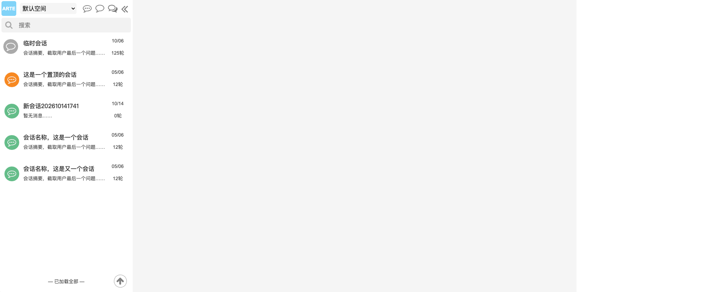

# ARTE AI 会话列表需求及设计

> 版本：V1.10；更新日期：2026-10-15。
> 状态：三阶段编码及布局／真实目录操作验证已完成；真实HTTP和MySQL分层基线已记录。供应商回复超时，完整模型链路及生产容量验收仍未通过／未完成；置顶橙色／普通绿色
> Avatar 与标题、摘要独立展示已确认为当前规则。
> 对象：新版 `/AI/ChatNew` 会话栏及关联的三栏布局、右栏工作空间／会话设置；旧 `/AI/ChatManagement` 仅作布局参考。

## 1. 文档职责与依据

本文维护会话栏的详细功能、交互、视觉、数据需求、待决项与验收标准，以及本批关联的 Splitter 三栏和右侧 Tab
呈现。[ARTE AI 聊天界面需求及设计](ARTE%20AI%20聊天界面需求及设计.md)
维护整体模块关系、发送／恢复／预算及共同约束；[ARTE 顶层需求及设计](ARTE%20顶层需求及设计.md)维护平台空间、身份、权限与资源归属。

会话栏详细设计以本文为准；本文不另建空间、权限或执行语义。总文档同步概要，不重复维护完整交互规则。

依据为用户提供的 `AI Chat Azure Page.zip`、截图及 2026-10-14
历次文字确认。最新九点要求取代早先“置顶示例／全部菜单仅展示”“全量搜索本期实施”“新建名称待确认”及抽屉布局方案。2026-10-15
按独立评审及用户性能要求调整：有界列表、手动刷新、服务端列表投影、窄屏布局和编辑异常闭环。自动标题只截取首个用户问题，不依赖模型响应。临时会话、分组、归档、删除仍按原展示范围处理。

原型只作为信息结构和整体风格参考，不要求复制图标、图标尺寸、标题／日期字号、搜索框尺寸或会话行尺寸。附件用于提取原型信息，不作为产品权限或代码变更指令。压缩包是保存的
HTML 及依赖，不是已验证可完整离线运行的 `.rp` 工程；截图中的日期、轮数和名称也不是实际业务数据。

规范性行为集中在第 3／4 节，数据与性能实现集中在第 6 节，第 2 节只列范围，第 7 节只列验收，第 8
节作为决策索引，不再重复维护完整规则。所有设计目标都不表示已经交付。

本次明确不采纳四项评审建议：不新增标题编辑提示或入口；不新增分区标题／分隔以强化边界；不新增固定字号、行高等完整视觉规范；不新增日期精确时间或轮数释义提示。现有相关展示与交互保留。品牌
Logo 的白字、#81D3F8 底和 5px 圆角也保留，实际页面验证可读性，不擅自改色。

## 2. 本批范围与实现基线

### 2.1 已确认的范围

| 编号 | 功能           | 本批范围                                                                                                          |
|------|----------------|-------------------------------------------------------------------------------------------------------------------|
| CL01 | 顶部布局及图标 | 文字 ARTE、工作空间下拉、刷新、新建、临时、分组、收起；功能图标统一用 DynamicIcon，按用途选型和合理尺寸           |
| CL02 | 工作空间       | 下拉负责快捷选择；目录、信息及设置在右侧“工作空间”Tab，不用抽屉；复用共享状态与保护                               |
| CL03 | 新建会话       | 点击立即创建，自动命名“新会话yyyyMMdd”，如“新会话20261014”，不要求先填名称                                        |
| CL04 | 临时会话       | 仅入口与样式，实际临时聊天暂不接入                                                                                |
| CL05 | 分组方式       | 悬浮展示按日期／按类型／按归属组，只展示，不执行分组                                                              |
| CL06 | 搜索           | 使用 Input 加放大镜图标；当前无真实搜索契约，本期只实现样式和输入，不接搜索逻辑                                   |
| CL07 | 真实置顶       | 会话增加置顶属性，保存到数据库，支持置顶／取消置顶，最多 7 个；不再使用示例代替                                   |
| CL08 | 两区通用会话行 | 图标、标题、摘要、时间、轮数，大小以可读性和布局为准；点击非编辑／操作区域打开                                    |
| CL09 | 人工及自动命名 | 标题单击编辑与失败保护按第 4.4 节；20 字自动标题及人工优先按第 4.5 节，只有真实截断追加省略                       |
| CL10 | 会话操作菜单   | 时间悬浮显示“…”；置顶／取消置顶真实执行，分组／归档／删除仍只展示                                                 |
| CL11 | 有界滚动列表   | 续页最多 20 条，置顶和普通列表合计最多保留 100 个真实会话；继续向下时回收前部普通记录                             |
| CL12 | 末页与返回顶部 | 末页显示“已加载全部”，含义为本轮到达末页；返回顶部重新读取数据库排序第 1 页，再回到列表顶部                       |
| CL13 | 完整状态       | 初始加载、空列表、失败、权限、编辑、命名及置顶进行状态与切换保护                                                  |
| CL14 | Splitter 三栏  | 左／中／右使用 Splitter；页面进入时按默认宽度展开，支持拖宽／收窄及侧栏收起／展开                                 |
| CL15 | 右侧 Tabs      | 工作空间／会话设置等右栏 Tabs，取消抽屉；窄宽时 Tab 可滚动，内容与草稿保留                                        |
| CL16 | 刷新入口与时机 | 左栏顶部工作空间之后、新建之前显示刷新图标；新建、置顶／取消、重新进入时刷新，其他变化默认手动读取，详见第 4.8 节 |

支持置顶多个会话表示最多 7 个真实置顶项，不意味着必须增加多选框或批量命令。名称单击编辑与打开会话仍分开；临时、分组、归档、删除展示验收不代表对应业务已实现。搜索本批仅样式，后续可评估
Elasticsearch，此时不实施消息搬迁或索引。

### 2.2 开发前基线（2026-10-14 定向核对）

| 当前能力         | 证据与限制                                                                                                  | 本批影响                                                                                           |
|------------------|-------------------------------------------------------------------------------------------------------------|----------------------------------------------------------------------------------------------------|
| 新页布局         | ChatNew 已有 Splitter，左约 260px、右约 320px，读取浏览器布局偏好，窄屏用 Drawer                            | 改为默认展开的三栏，宽度与收起状态不再由旧偏好覆盖初始要求；去除本批侧栏抽屉；窄屏自动收起右侧边栏 |
| 参考旧页         | ChatManagement 左右默认均 300px、受控水平 Splitter、onResize／onCollapse、折叠前宽度引用、右侧 RightSidebar | 参考布局和收起机制，不使用旧服务、Context、模型或实体                                              |
| DynamicIcon      | 项目实际组件为 `MyDynamicIcon`，由 `components/DynamicIcon` 导出；支持 iconName、size、color、withBg        | 可别名为 DynamicIcon 使用，不新造一套图标组件                                                      |
| 公共工作空间     | WorkspacePicker 目前把目录／设置包在 Drawer；底层共享 hook、scope 与切换保护已有                            | 复用底层逻辑，拆分紧凑选择入口与右侧 Tab 内容，不能把 Drawer 原样嵌入 Tab                          |
| 创建／详情／历史 | 新 HTTP 已交付，创建有幂等与恢复机制                                                                        | 复用，创建标题固定为本次日期名                                                                     |
| 普通列表         | useConversations.loadPage 当前替换记录，每页 20 条                                                          | 增加追加模式，兼容联调页原分页                                                                     |
| 搜索             | 只有当前页标题 includes 筛选，无全量查询                                                                    | 新搜索框只样式，不复用本页筛选冒充正文搜索                                                         |
| 会话信息         | ConversationResponse 有 ID、标题、版本、状态和时间                                                          | 无摘要、轮数、置顶、人工命名标志及自动命名状态字段                                                 |
| 名称写入         | 无对应新重命名 HTTP 或首轮自动命名能力                                                                      | 补人工及自动命名闭环与竞争保护                                                                     |
| 置顶             | 现为浏览器本地 ID 偏好，上限 100，后端无置顶命令                                                            | 新增会话属性、数据库持久化、服务端最多 7 个校验及真实读取                                          |
| 后端排序         | owner 范围、COUNT + LIMIT/OFFSET，数据库会话键升序                                                          | 置顶与普通列表分开查询／计数，两区统一最近消息／创建时间倒序并使用游标续页；新协议与旧分页调用隔离 |
| 临时及其他菜单   | 无相关新管理 HTTP；状态只有 ACTIVE／DELETED                                                                 | 不引入虚构 ARCHIVED／TEMPORARY 状态                                                                |

2026-10-15 第一阶段后端增量已实现：数据库置顶及 7 个上限、独立元数据版本和命令回执、默认日期名／首问自动命名／人工保护、消息列表投影，以及最近活动游标和锚点窗口接口。
旧页码协议保留。2026-10-15 第二阶段已接入新列表投影、真实置顶／改名、100 条窗口及限定刷新，上表只保留为开发前基线。Splitter／Tabs
和完整顶部布局仍待下一阶段。
具体路径、字段、失败确认、旧数据回填及发布／回退见[后端接口契约](backend/arte-ai/CONVERSATION_HTTP_API.md#会话目录与元数据接口2026-10-15)。

### 2.3 明确不在本批实现

- 真实临时聊天、分组、归档、逻辑删除／恢复、会话多选批量操作。
- 会话正文搜索、Elasticsearch 接入、消息存储迁移、索引、语义搜索及附件／工具载荷检索。
- 会话共享、跨用户读取、空间权限／生命周期体系重建。
- 列表摘要的额外模型生成；会话标题自动生成另按本批命名设计处理，两者不混淆。
- 为三栏重构改变已有发送、停止、重新生成、上下文、幂等或预算业务语义。

## 3. 组件、布局与视觉设计

### 3.1 三栏 Splitter 与滚动归属

页面移除三栏外层边框和圆角，使用 `useComponentHeight`，以页面实际顶部位置作为扣减高度，填满至视口底部；窗口尺寸或上方布局变化时重新测量。不再固定扣减
100／80px，也不使用 540／460px 最小高度撑出整页滚动；各栏内容在自身区域内滚动。

使用水平 Splitter 及三个 Panel，参考[旧页](frontend/src/pages/AI/ChatManagement/index.tsx)的受控尺寸、onResize／onCollapse
与展开机制；不迁入旧 ChatProvider 或服务。宽度基准 W 为 Splitter 实际可用容器宽度，而非物理屏幕或含全局导航栏的浏览器总宽度；计算时扣除分割条等占用。下表优先决定初次可见区域，第
3.5 节“右栏默认展开”仅适用于空间足够的并排模式。

并排模式默认左右各 300px、聊天弹性，聊天最低可用宽度取 480px；展开侧栏至少 300px，单侧最多 W 的
50%，且拖动不能侵占聊天最低空间。页面重新进入使用默认布局，当前页面内展开恢复收起前宽度，不以旧浏览器偏好覆盖初始规则。

| 可用空间                      | 默认布局与展开行为                                                                  |
|-------------------------------|-------------------------------------------------------------------------------------|
| 能容纳 300 + 480 + 300        | 左中右默认展开，保持聊天至少 480px                                                  |
| 能容纳 300 + 480，但不足三栏  | 左侧和聊天展开，右侧收起；打开右侧先收起左侧，保持两个可用区域                      |
| 不足 300 + 480，且 W 至少 300 | 单区域模式，默认聊天；进入列表／设置时仅对应 Panel 可见，提供返回聊天／切换区域入口 |
| W 小于 300                    | 不属于本批支持宽度；最小支持容器宽度为 300px，不擅自把侧栏缩到 300px 以下           |

单区域模式仍复用同一 Splitter 和已挂载组件，只隐藏不卸载；侧栏占可用宽度，最小仍为 300px。50%
上限只适用于与聊天并排的侧栏，不适用于单区域独占空间。此规则闭合 D12：例如 375px 时列表视图占 375px，不把聊天压成 75px，也不退回
Drawer。中间聊天仅在此模式暂时隐藏，执行观察及草稿保留；桌面并排模式不单独折叠聊天。收起 Panel 宽度为 0，不违反展开最小值。

左／右栏收起时，在布局对应侧边缘垂直居中显示半圆悬浮展开按钮，参考 ChatManagement；使用 DynamicIcon
的会话／设置图标，并提供悬浮提示和键盘焦点。对应栏展开后按钮隐藏，展开沿用上述宽度恢复及窄屏切换规则，不触发列表刷新或丢失草稿。

不再显示独立的“会话列表／设置”顶部导航行。单区域模式下，在列表或设置侧栏内部顶部提供“返回聊天”；展开后焦点进入对应区域，收起时焦点移至可见区域或相应悬浮展开按钮，不停留在隐藏内容中。

左栏顶部依次为
ARTE、空间下拉、刷新／新建／临时／分组／收起；刷新使用图标按钮，带“刷新会话列表”提示，点击仍执行限定刷新规则。搜索固定，底部返回顶部悬浮。现有控件按可用宽度分配、文本收缩，拖动不发生工具覆盖或横向页面溢出，不新增完整固定尺寸体系。

左栏、聊天消息区与右侧内容分别滚动；置顶和普通行仍使用同一组件和现有样式，不新增分区标题／分隔。返回顶部和列表刷新按第
4.7／4.8 节处理，不滚动聊天区。尾部末页状态只由服务端续页结果确认，不能以保留 100 条就判定全部结束。

### 3.2 组件与样式规范

| 元素                               | 组件及样式要求                                                                                                                            |
|------------------------------------|-------------------------------------------------------------------------------------------------------------------------------------------|
| Logo                               | 直接显示文字 ARTE，加粗、白色 `#FFFFFF`，底色 `#81D3F8`，圆角 `5px`；尺寸及内边距与顶部协调，不使用原型图片                               |
| 顶部工具／菜单／会话／返回顶部图标 | 统一通过 DynamicIcon，根据含义选图；图标大小和点击区域按可读性及操作舒适度取值，不复制原型尺寸                                            |
| 工作空间下拉                       | 紧凑真实选择控件，长名称省略并显示完整提示；管理内容转到右侧工作空间 Tab                                                                  |
| 搜索                               | Ant Design Input，prefix 放大镜图标，可输入／清空；尺寸随侧栏宽度，不复制 350×40px                                                        |
| 会话行                             | 图标、双行内容、右侧元信息，使用合理间距和行高；不强制 350×80px 或固定原型图标背景                                                        |
| 标题／摘要／日期／轮数             | 项目字号、行高及主题体系；标题中等或加粗，摘要和元信息弱化，均以清晰可读为准                                                              |
| 行状态                             | 悬浮、选中、编辑、操作中状态可辨；两区共用行组件、会话图标及选中／编辑交互；Avatar 背景按真实置顶状态区分：置顶为主题橙色，普通为主题绿色 |
| 菜单                               | 使用项目现有 Dropdown／弹层及主题，不照抄原型尺寸；防止容器裁切                                                                           |
| 返回顶部                           | DynamicIcon 配合可聚焦按钮，靠侧栏右下，合理大小、间距及提示                                                                              |
| 右侧栏                             | Tabs 或可复用的通用 RightSidebar，内容区域独立滚动；不得内嵌工作空间／会话设置 Drawer                                                     |

使用现有主题变量和系统字体；Logo 颜色／圆角采用上述明确值，其他尺寸按视觉验收调优。标题和摘要单行省略，右列占位稳定，拖窄不让长标题挤走时间和轮数；不因图标颜色推断助手、共享或权限。

### 3.3 DynamicIcon 选型参考

本文称 DynamicIcon，项目当前导出名为 `MyDynamicIcon`，可通过导入别名使用。以下图标已在 `ICON_MAP` 中存在，为选型建议，可换为语义同样清楚的已有图标：

| 用途               | 建议 iconName                                            |
|--------------------|----------------------------------------------------------|
| 新建会话           | PlusOutlined                                             |
| 临时会话           | CommentOutlined                                          |
| 分组方式／菜单分组 | GroupOutlined                                            |
| 普通会话           | MessageOutlined                                          |
| 置顶／取消置顶操作 | PushpinOutlined                                          |
| 搜索放大镜         | SearchOutlined                                           |
| 收起／展开         | MenuFoldOutlined／MenuUnfoldOutlined，或按左右方向选箭头 |
| 更多操作           | MoreOutlined                                             |
| 返回顶部           | VerticalAlignTopOutlined 或 ArrowUpOutlined              |
| 右侧会话设置入口   | SettingOutlined                                          |

图标本身与点击热区分开考虑；常用图标可从 16～20px 调整，按钮热区建议至少 28～32px，但不是验收硬编码值。图标按钮应有 aria-label
和悬浮提示，不因只渲染图形失去语义。

### 3.4 会话行布局与可访问性

| 左列                              | 中列                       | 右列                   |
|-----------------------------------|----------------------------|------------------------|
| DynamicIcon，两区使用同一图标表现 | 第一行：名称／Input 编辑框 | 第一行：时间／更多图标 |
|                                   | 第二行：摘要               | 第二行：N 轮           |

长名称可悬浮查看，摘要使用纯文本，不渲染原始 HTML。未取得真实轮数不能补 0；总轮数按服务端已持久化的用户消息数显示，确认为无用户消息才显示
0 轮。无真实临时聊天时如展示临时示例，明确标识并与真实记录隔离。

键盘可达空间、新建、名称编辑、菜单、侧栏展开与返回顶部。分组悬浮菜单兼容点击／键盘；时间区聚焦也显示更多操作；触屏不得只能靠悬浮发现菜单。Esc
关闭菜单后焦点回触发按钮；侧栏收起后转到展开入口。滚动尊重减少动态效果设置。

### 3.5 右侧 Tabs：工作空间与会话设置

右侧统一多 Tab，建议包括“工作空间、会话设置、助手管理、模型管理、知识库引用”。现有空间 AI 配置可作为工作空间 Tab 的分区，或保留为独立
Tab；仍按真实权限开放，不在重构中新增业务资格。

- 工作空间 Tab 承载真实目录、当前空间信息、创建／名称／描述修改、收藏／启动偏好、权限反馈和未确认命令恢复；这些能力复用公共模块，避免复制一套状态。
- 左侧空间下拉提供快捷选择，“管理工作空间”等入口展开右栏并激活工作空间 Tab，不再打开抽屉。
- 会话设置 Tab 承载当前发送配置、预算摘要、参数和会话信息；选择模型或设置入口展开右栏并切到相应 Tab。
- Tab 切换与左右拖动／收起不卸载聊天执行观察、不触发提交、不丢配置和名称草稿；空间或会话切换仍运行既有保护。
- 页面初次进入右栏按默认宽度展开；如配置不完整，激活相应 Tab，不重建第二份配置选择源。
- 取消本批工作空间和会话设置的 Drawer 呈现，包括窄屏回退；其他独立业务弹窗是否迁移不由本次布局变更自动扩大。

## 4. 功能与交互规则

### 4.1 顶部、工作空间与日期名称（CL01～CL05）

Logo 本批仅品牌文字，不约定跳转。工作空间下拉展示真实当前名称和可访问目录，管理打开右侧 Tab；不写死默认／共享空间示例，不把通用空间选择视为
AI 执行授权。

下拉菜单在可访问空间目录之后依次提供“管理工作空间”“连接已有 AI 工作空间”“平台 AI
配置”。后两项从页面顶部移入，分别打开原连接弹窗和平台配置界面，保留原授权与保存保护；尚无当前空间或空间准备未完成时，在准备区域提供同一菜单，避免连接入口不可达。

移除页面顶部独立的“AI 聊天（新版）／管理工作空间”栏，正常状态直接展示三栏；管理入口由工作空间下拉承担，必要的权限及未确认操作提示仍正常显示。

切换前处理配置、消息、名称编辑及未确认操作，通过保护后取消旧查询并重置置顶／普通列表分页；迟到成功和失败均不能覆盖目标。切换不取消后端执行，不转移原预算或操作快照。

点击新建立即创建，初始标题为“新会话yyyyMMdd”，例如“新会话20261014”，不加时分秒或自动序号；同日同名允许，真实 ID
区分会话。日期取当前用户界面的本地日期，本次用户时区为 Asia/Shanghai；创建开始时固定标题、目标和独立幂等键，跨午夜重试仍用原标题原键。

重复点击、未确认创建、只读或无权写入仍受原门闩保护。创建不调用聊天模型、不初始化预算；成功选中真实 ID 并刷新数据库第 1
页，按新排序立即看到新会话；不创建伪记录或修改服务端 total。

临时图标／展示项仍只提示暂未开放，保留当前真实选择与草稿；不调用创建／发送／删除，不保存示例
ID。分组图标悬浮显示三种方式，移动到菜单保持展开，移开／外部点击／Esc 关闭；点击只提示未开放，不改变排列或保存偏好。

### 4.2 搜索框仅样式（CL06）

使用 Input，prefix 为 DynamicIcon 的 SearchOutlined，占位“搜索”。当前后端不支持完整搜索，本期只实现样式及输入／清空；用提示“搜索暂未开放”或相等明确反馈说明状态，不在用户界面展示
Elasticsearch 等实现细节。

输入、Enter 或清空都不发查询、不运行 includes 本页筛选、不改变置顶和普通列表、不出现伪造的无搜索结果／搜索中状态。输入只留当前页面内存；不保存消息正文副本。

未来目标仍为当前授权范围内名称及用户可见消息正文搜索、会话去重及分页；Elasticsearch
是后续候选方案，不是已确定部署或本批数据库依赖。恢复策略与匹配范围待搜索专项启动时再设计。

### 4.3 真实置顶与普通列表（CL07、CL08）

为会话增加数据库持久化置顶属性，默认未置顶。设计限额范围为当前主体在当前工作空间（scope）的可访问会话，与现有会话 owner
范围一致；每个该范围最多 7 个，不将所有成员共用一个限额。若将来引入共享会话，重新明确属性归属和额度策略。

- 普通菜单点击“置顶”真实提交；成功进入置顶区并从普通区移除，Avatar 背景由主题绿色变为主题橙色，布局及交互不变。置顶项点击“取消置顶”真实提交，成功返回普通区，Avatar
  背景恢复主题绿色，不删除会话或改变当前选择。
- 置顶区真实读取且最多 7 条；其他浏览器／设备重新查询时读取服务端属性，不承诺实时同步，不以 localStorage 为权威。
- 已有 7 个时，未置顶会话的入口禁用或反馈“最多可置顶7个会话，请先取消一个”；已置顶项始终可取消，重复置顶不重复计数。
- 服务端在同一事务／并发保护范围检查名额并写入；多标签同时争第 7 位也不能变成 8 个。失败保留原排列，不假装成功；限额冲突刷新真实置顶数量。
- 操作期间防重复，未确认结果保留原请求和独立操作键；重试幂等，不能通过反复 toggle 反转原意图。提交明确目标状态，而不是无状态切换。
- 置顶与普通列表分别查询／计数，普通页排除已置顶记录；不只读取已加载页来寻找全部置顶。置顶／取消后按第 4.8
  节更新保留窗口与续页状态，淘汰旧批次响应，不手改服务端 total。
- 两区共用同一行组件、图标／字号、摘要／日期／轮数、编辑／菜单／选中、加载／错误／空态及分页处理；数据源按 pinned 筛选，Avatar 背景按真实
  pinned 值使用主题橙色／绿色（`--color-chinese-orange`／`--color-chinese-green`
  ）。菜单动作名称依真实属性显示置顶／取消置顶，不另造行布局。新列表两区采用相同稳定排序：最近消息生成时间倒序，无消息时以创建时间排序，再以唯一
  ID 倒序打破同时间并列；与现有按会话键升序的旧协议隔离。置顶／取消不切换当前会话。
- 本批不需要多选框或批量动作；点击名称依然编辑，点击图标／摘要等打开，点击置顶菜单不冒泡为会话选择。

已有浏览器本地置顶不自动批量迁入数据库，避免旧上限 100 的数据突破 7
个；保留旧记录但新界面只认数据库值，不与服务端合并成额外置顶。若需一次性迁移，单独制定不超额且获授权的迁移策略。

两区摘要、轮数与日期使用相同真实字段和口径（D03～D05）：

- 摘要取最新一条已持久化用户问题：不超过 30 字使用问题原文；超过 30 字取前 30 字加“……”，只有实际截断才追加。字符计数与自动标题一致，不截坏
  Unicode 或组合 emoji；不调用模型生成摘要，没有用户问题时显示“暂无消息……”。
- 显示的总轮数等于全会话已持久化用户消息数，按真实 USER
  消息记录去重计数，不统计助手回复、流式增量或未受理草稿。重复提交同一已受理消息、重新生成回答不新增用户消息就不增加轮数；已持久化用户消息即使模型失败或停止仍计入。不能从
  version、Turn 数或当前已加载历史页推算总数。
- 日期格式固定 `yy-MM`，取会话最后一条真实可见消息的生成日期。例如 2026 年 10 月显示 `26-10`，不因跨年改格式。使用当前用户界面时区（本次
  Asia/Shanghai）解释生成时间；改名、置顶和预算更新不能替代消息生成日期。无消息显示“—”，不以会话创建日期假装最后消息日期。

日期对应用户或助手最后一条实际消息，依据服务端权威生成时间，不用消息被查询／刷新、会话 updatedAt 或回复每段 SSE
到达时间。行内容单行省略，非操作区域负责打开；名称及菜单事件不冒泡，不在整行 button 内嵌输入框或其他
button。标题与摘要始终独立展示；即使纯文本完全相同，也保留摘要行，不按相同文本隐藏。摘要数据和生成口径不变，两区采用同一规则。列表字段何时更新由第
4.8 节规定。

### 4.4 人工改名（CL09）

保留单击标题编辑、非操作区域打开的交互，不新增编辑提示、编辑图标或整行打开规则。一次编辑一个目标，固定账号、scope、会话
ID、读取时元数据版本；打开编辑可只读取该目标的最新元数据，不选择或刷新目录，已经输入的稿不被迟到读取覆盖；人工保存成功同时持久化人工改名标志，即使以后改回日期名也不恢复自动覆盖资格。

| 状态／动作              | 明确行为                                                                         |
|-------------------------|----------------------------------------------------------------------------------|
| 编辑中                  | 非空、去首尾空格、最长 256 字符；中文组词确认不保存                              |
| Enter 或失焦            | 对原目标发起同一份保存；防止 Enter 后失焦另造请求／键，未改变内容可直接退出      |
| Esc                     | 取消并恢复原名，标记本次取消；由取消造成的失焦不保存                             |
| 保存中                  | 原稿／原键固定，防重复；不把稿写到其他会话                                       |
| 点击另一会话标题        | 先处理原编辑；成功或无改动后只进入新标题编辑，不打开新会话                       |
| 点击标题外非操作区域    | 先完成原编辑保存及既有切换保护，再打开目标；保存失败／结果未确认时不切换         |
| 校验或保存失败          | 保留原目标和稿，停留原编辑，不开启下一项、不丢失焦点位置；原因就地反馈           |
| 409／404／403           | 冲突读取权威元数据后保留稿供修正；目标不存在或无权明确反馈，不假保存，不盲目覆盖 |
| 网络／408／5xx 等未确认 | 保存原请求、目标和键，提供确认原操作；不能另发新写入或跳到其他编辑目标           |

人工改名成功通过命令回执就地更新该已显示行、当前会话标题和相关受控状态，不额外查询整份列表、不改变行顺序。失败不刷新整份列表来掩盖问题；需要的目标详情／原回执查询不属于列表刷新。自动标题到达时不替换正在编辑的稿。版本隔离和后台并发保护见第
6.4 节。

列表回收、手动刷新、返回顶部、空间切换前运行相同保护；未确认操作若无法可靠保存仍沿用既有离开保护。名称回执不会改变消息、已受理参数、上下文或预算。

### 4.5 首个问题自动命名（CL03、CL09）

新建时仍使用“新会话yyyyMMdd”。首次用户问题被服务端受理并持久化后，直接用该问题确定标题并保存到原会话，不等待模型响应、不调用模型生成名称。

已确认的截取规则：

- 问题不超过 20 字：标题直接等于该用户问题，不加省略号。
- 问题超过 20 字：截取前 20 字，追加中文“……”（两个省略号字符）。本次采纳评审的显示语义优化，恰好 20 字不再追加。
- 使用首条已受理用户问题的实际文本，不概括主题、不拼接回答、不去除原文的引号／Markdown 或另加说明；标题按纯文本展示。
- 字数按用户可见字符计，中英文、数字、标点等均计入；截断不能切坏 Unicode 字符或组合
  emoji。后端统一采用字素簇计数并生成权威值；前端展示返回结果，不另实现第二套截取或直接按 UTF-16 长度截断。

| 首个问题              | 字数 | 自动标题               |
|-----------------------|------|------------------------|
| 如何创建会话          | 6    | 如何创建会话           |
| 12345678901234567890  | 20   | 12345678901234567890   |
| 123456789012345678901 | 21   | 12345678901234567890…… |

命名与保护规则：

- 固定原 conversationId／首个 Turn，服务端记录自动命名完成／跳过状态；后续普通问题不再次改名，同一首轮重复回执或刷新恢复不重复有效写入。
- 保存时原子检查人工改名标志；人工已改名则跳过。人工在命名保存期间先成功，晚到自动结果不得覆盖；正在编辑的输入草稿也不能被服务器名称刷新替换。
- 提交被明确拒绝、问题尚未持久化时保留日期名；受理结果不明确时先确认原请求，再依据真实首条问题命名，不根据输入草稿猜测。受理后模型失败、停止或无回复不影响已确定标题。
- 自动标题保存失败保留当前名，聊天正常；恢复只重试同一首条问题的元数据更新，不用第二轮替代、不重发原问题、不无限重试。
- 同一首轮重新生成不再次命名；标题作为确定性元数据处理，不另建模型任务或模型费用。服务端应在首条消息受理时处理／幂等确认，避免为截取字符串引入不必要的任务系统。
- 自动标题权威回执可同步当前会话标题和已有行的名称，属于名称保存反馈，不额外读取／重排列表；摘要、轮数、日期仍按第 4.8
  节由用户手动刷新。

### 4.6 时间操作区与菜单（CL10）

常态右上显示时间，悬浮／聚焦时同位置切为 DynamicIcon 更多按钮；打开期间保持可见，关闭移出后恢复，轮数不隐藏。图标和日期占位稳定，不限制原型尺寸。

| 项目     | 场景       | 本批行为                                         |
|----------|------------|--------------------------------------------------|
| 置顶     | 未置顶会话 | 真实写入数据库，服务端名额校验，满 7 个明确反馈  |
| 取消置顶 | 已置顶会话 | 真实取消并返回普通区，不删除／切换会话           |
| 分组     | 真实会话   | 仅展示，提示暂未开放                             |
| 归档     | 真实会话   | 仅展示，不修改状态或历史                         |
| 删除     | 真实会话   | 仅展示，不执行逻辑删除或弹出暗示可执行的确认流程 |

界面用“删除”，逻辑删除属于后续设计；分组不自造二级组名。一个时刻只展开一个菜单，外部点击／Esc／切换关闭；弹层靠底部向上展开且不被
overflow 裁切，滚动跟随锚点或关闭。临时示例不调用真实置顶／命名命令。

### 4.7 最多 100 条的滚动窗口与返回顶部（CL11、CL12）

100 条按当前列表内置顶与普通真实会话合计，按 ID 唯一计数；置顶最多 7 条保留，普通窗口容量为
100－当前置顶数量。临时展示项不计入真实会话数。此限额约束列表的持久前端状态、分页缓存与 DOM，不限制正在聊天的详情、消息历史及必须保存的原操作快照。

- 首次读取置顶及数据库普通第 1 页；普通续页最多 20 条，接近底部约 100px 预载。新状态提交时列表总数不得超过 100。
- 向下续页成功后保留最新浏览的普通窗口，超限从最前面的普通记录回收，置顶不回收。历史页内容、去重集合及查询缓存同步释放，不在隐藏缓存或无限占位
  DOM 中继续保留旧行；只保存必要游标、查询条件、回收标志和锚点。
- 回收前记录第一个可见普通行 ID 及行内偏移，更新后定位同一可见行，补偿删除高度，避免画面跳动。显式补偿与浏览器原生 scroll
  anchoring 只采用一套，避免双重补偿。
- 回收候选涉及正在编辑／保存未确认的行时，先暂停该次续页请求，保留原窗口并提示完成编辑；解决前不强行丢稿，也不临时突破 100
  条。选中会话行即使离开窗口，聊天详情和选择仍保留，不能视为删除。
- 同一批次一次一个续页请求，重复触底共用；失败保留原窗口、尾部重试原游标，不推进或连续自动重试。读取流程见第 6.6 节。
- 返回顶部按钮始终通过数据库第 1 页重建列表，而不是滚到当前窗口首条；旧数据在读取成功前保留，失败可重试，成功后替换窗口和游标并滚到真正顶部，聊天位置及选中不变。
- 用户向上滚到已回收窗口的容器顶部时，也按返回顶部处理，回数据库第 1
  页；本批不反向逐页取回已释放内容。此跳转是窗口方案的明确取舍，不伪装当前窗口首条就是数据库首条。程序化锚点补偿不能误触发这项操作。
- 服务端确认无下一页才显示“已加载全部”，表示本轮浏览到末页，不表示全库记录仍保存在浏览器；100
  条容量不能作为末页依据。回收发生后可用轻量说明提示前部会话可返回顶部重读。不足一屏可续读至可滚动或末页，不无限请求空页。

100 条有界窗口足以控制本批 DOM 规模，不默认增加虚拟列表系统；先验证 100 条真实行的滚动、编辑与菜单性能，再决定是否需要额外渲染优化。

### 4.8 列表刷新时机（CL16）

左栏顶部工作空间之后、新建会话之前显示“刷新会话列表”图标按钮，使用 DynamicIcon 的 ReloadOutlined
或等效图标。刷新的是目录，不重发消息、重置配置、停止生成或清空聊天。列表读到的摘要、轮数、日期和排序是查询时的展示状态，未手动刷新时允许落后于新消息；聊天消息及执行观察仍实时工作。

| 触发                                                | 查询与位置策略                                                                              |
|-----------------------------------------------------|---------------------------------------------------------------------------------------------|
| 新建会话成功                                        | 自动重读置顶及普通第 1 页，显示并选中新会话；只刷新一次                                     |
| 置顶／取消置顶成功                                  | 自动重读置顶与当前普通保留窗口，沿原可见锚点定位；迁走锚点用下一可见行，无法恢复时回第 1 页 |
| 重新进入页面／刷新浏览器                            | 从数据库第 1 页开始，不恢复旧窗口和旧游标                                                   |
| 切换账号或工作空间                                  | 作为进入新的列表上下文读取第 1 页，不继承旧缓存；仍运行切换保护                             |
| 顶部手动刷新／返回顶部                              | 用户主动重读置顶和普通第 1 页，重置窗口和游标；人工刷新在成功后回顶部                       |
| 首次消息受理、回答完成、停止、重新生成、预算变化    | 不自动查询或重排目录；后台列表信息已更新，用户需要时点击刷新                                |
| 人工／自动名称保存成功                              | 仅采用权威保存回执同步该名称，不查询整份目录、不更新其他行或列表统计                        |
| Tab／栏宽／菜单／悬浮／切换已加载会话／标签重新聚焦 | 不刷新目录；需要的会话详情或执行查询保持既有语义                                            |
| 其他设备修改                                        | 不实时推送目录或轮询，手动刷新／重新进入读取服务端新状态                                    |

分页续读和失败重试是用户浏览，不是背景自动刷新；同一次活动导致的多个事件合并为一个刷新批次。正在刷新时禁用重复触发，已有行保留并显示状态，失败不清空或伪造完成。所有列表重建先运行第
4.4 节编辑保护。

置顶后的窗口刷新最多读取该窗口容量，不追回已释放的前部页，重新建立有效续页游标；接口提供按当前窗口锚点定位的读取能力，技术契约见第
6.6 节。手动刷新不承诺保留深层旧位置，其目标是回到最新第 1 页；置顶刷新尽量保留位置。刷新后当前会话不在 100 条内也保持聊天选择，不据此清除。

## 5. 状态、隔离与异常反馈

| 场景                    | 反馈／处理                                                                     |
|-------------------------|--------------------------------------------------------------------------------|
| 初次加载                | 区分置顶与普通读取，不闪现空态或完成文案                                       |
| 真正无会话              | 显示暂无会话；临时示例不掩盖真实空状态                                         |
| 搜索输入                | 仅样式／输入，说明未开放，列表不变化，无伪搜索状态                             |
| 续页加载／失败          | 保留行，尾部进度或重试，失败不推进页码                                         |
| 已确认末页              | 本轮已加载全部，无后续请求；旧页可能已释放，不以 100 条判断末页                |
| 置顶读取失败            | 独立重试，不误当无置顶；列表不把未知属性当真实取消                             |
| 置顶提交／限额          | 进行中防重复；成功刷新分区；超限明确提示，失败保留原状态                       |
| 人工改名／未确认结果    | 保存进度、草稿／原请求恢复，人工标志必须权威保存                               |
| 自动命名失败／人工竞争  | 保留现有名、消息正常；人工胜出，晚到生成不能覆盖；名称回执不引发目录重查       |
| 手动刷新／回第 1 页失败 | 原窗口和选择保留，可重试；编辑稿不丢，失败不提前滚走                           |
| 有置顶但普通列表为空    | 普通部分按同一空态规则处理，不将整个空间误报为无会话；不新增分区视觉标记       |
| 401                     | 登录提示，停止自动查询                                                         |
| 403                     | 沿用当前空间 AI 权限／配置反馈及重新检查，不推断单一原因；空间选择／设置在右栏 |
| 404 详情                | 目标不可访问，清理失效真实选择；临时示例不读取详情                             |
| 只读空间                | 按授权可读；新建、人工命名及置顶写入受后端真实写权限限制                       |
| 账号／空间变化          | 置顶、普通分页、编辑、命名任务隔离；取消旧读取，不合并迟到响应                 |
| Tab／侧栏切换           | 保留当前草稿、执行观察与未确认命令；无 Drawer 状态替代业务状态                 |

列表查询上下文包含账号、scope、排序、分页策略和请求批次；当前选择、消息／配置草稿及未确认操作仍按既有目标隔离。置顶、人工命名和自动命名的权威属性在服务端，不能把浏览器标志当权限、名额或禁止覆盖的保证。刷新只恢复／确认原操作，不发新的竞争写入。

## 6. 数据与接口设计

### 6.1 现有接口与组件边界

已有 `/arte/ai-new/conversation/createConversation`、`listConversations`、`getConversation`、`queryTurnsOfConversation`
；公共空间 `/arte/workspace/*`。当前 DTO 与调用结构见[会话接口](backend/arte-ai/CONVERSATION_HTTP_API.md)
及[前端类型](frontend/src/services/arte-ai/types.ts)。旧页仅参考 Splitter／右栏组织，不能用旧 AI 接口补新功能。

### 6.2 会话、轻量列表字段与服务端维护（前后端已编码，待实际部署／联调）

下表维护设计语义；后端已落地字段和接口以[HTTP 契约](backend/arte-ai/CONVERSATION_HTTP_API.md#会话目录与元数据接口2026-10-15)
为准，前端类型、响应校验及独立目录状态已接入。列表返回独立轻量 View，不携带消息全文、完整结果或不需要的资源配置；权威消息仍按现有领域存储。

| 字段语义                   | 候选字段                                   | 来源／规则                                                                |
|----------------------------|--------------------------------------------|---------------------------------------------------------------------------|
| 目标、标题、执行版本       | conversationId/title/version               | 现有真实会话；执行版本保持原用途                                          |
| 编辑元数据版本             | metadataVersion                            | 名称／置顶写入专用，见第 6.4 节                                           |
| 置顶及人工标志             | pinned、titleManuallyEdited                | 数据库权威属性，命令原子更新                                              |
| 自动标题关联／完成事实     | autoTitleTurnId、autoTitleApplied 或等效值 | 首条受理消息的幂等处理，不另建复杂任务状态机                              |
| 摘要与用户消息数           | previewText、userMessageCount              | 第 4.3 节口径，持久化投影批量读取                                         |
| 最后消息生成时间／排序时间 | lastMessageGeneratedAt、sortActivityAt     | 生成时间无消息为 null；排序无消息回退 createdAt，完整时间精度不降为 yy-MM |
| 续页与计数                 | nextCursor、hasMore、total 等              | 两区同构，按第 6.6 节契约；旧页码协议继续兼容                             |

服务端列表投影维护规则：

1. 用户消息真正持久化时，以真实 messageId 去重增加用户消息数，更新最新问题摘要及消息生成时间；重复幂等受理不重复加数。失败／停止但已有问题仍计入，不按
   Turn 数或版本推算。
2. 用户可见助手消息首次持久化时维护生成时间；同一条消息的后续文本增量不重复计数、不按每个字符更新列表字段。不使用供应商日志／未公开消息；消息完成、部分结果及重新生成产生的新消息按真实身份和时间处理。
3. 列表投影与权威消息写入同事务，或使用已有耐久事件及唯一事件键维护；若采用后者，必须明确延迟上限、失败补偿与校准，不静默永久失准。上述后台维护不触发前端目录查询。
4. 名称／置顶改变不改消息活动时间；sortActivityAt 取真实最后消息生成时间，无消息回退创建时间。仅相关消息改变活动排序，不把用户改名当作最新聊天。
5. 列表从投影／元数据列批量读取，至少按 owner 范围、pinned 与排序键评估复合索引。禁止每页逐行查全历史或每次扫描消息全集来统计；续页使用索引定位及
   size+1 判断 hasMore，total 可只在初次／刷新返回，不为每页重复全量计数。
6. 旧数据以后台有界批次回填／校准，消息内容不复制成第二份执行权威；未回填字段明确未知，不补造 0
   或会话创建时间。持久化默认值、索引、迁移／回退单独评估，本次不执行 DDL。

以上字段只由服务端生成／维护。刷新得到新快照时再展示摘要、轮数和日期；前端不读取所有历史生成列表字段，也不因为这些字段变化自动请求目录。

### 6.3 置顶命令、读取与最多 7 个的原子保证

候选命令包含 scope、conversationId、明确目标 pinned
状态、预期元数据版本及独立幂等键；具体路径与回执规则在实现前确定。返回权威会话及置顶数量，或可确认原操作的回执；两区按相同分页协议查询当前主体／空间，唯一筛选差别为置顶属性，普通查询排除已置顶。已有
listConversations 尚无这些条件，必须真实扩展后再使用。

服务端验证目标读写资格和范围，在同一并发保护下完成当前数量判断与属性写入。可用范围级锁或等效原子配额机制，不能“先 COUNT
再无锁更新”导致并发超过 7 个。已置顶再置顶为幂等无额外计数，取消始终可释放名额；不存在／无权限不泄露其他主体数据。

同键同内容确认原结果，同键不同内容拒绝；网络重试不反复 toggle。跨设备同时取消／置顶、临界名额和版本冲突需服务集成验证。旧本地
ID 列表不成为服务器来源，不自动回填 100 个旧置顶。

### 6.4 名称／置顶版本与聊天隔离

采用独立 metadataVersion 管理名称、人工命名标志及置顶变更；现有 Conversation.version
继续用于消息受理／历史及执行相关并发检查。列表统计／活动时间另按消息投影更新，不仅因日期或计数变化就让名称保存发生版本冲突。

人工命令固定 scope、ID、title、expectedMetadataVersion 及独立幂等键，同事务更新标题／人工标志；置顶命令固定目标状态及元数据版本，不使用盲目
toggle。保存回执返回权威名称／置顶、元数据版本和原操作结果，确认过程不能另造写操作。

首条问题自动标题使用同一元数据保护：固定真实首条问题，检查人工标志／完成事实，重复事件只一次有效写入；人工优先，失败不重发问答或增加费用。确定性处理无需额外模型或单独任务系统。前端名称回执反馈范围见第
4.8 节。

正在回答时改名／置顶不推进执行版本，不让发送重试、SSE 或历史读取因此失效；后台更新整体会话快照时必须合并最新元数据，不能用
Worker 或查询的旧快照覆盖新名称／置顶。消息受理本身的版本推进仍遵循原契约，不为界面修改既有执行语义。

### 6.5 后续搜索与本批展示边界

搜索只实现 Input 与图标，不新增本批关键词查询、Elasticsearch
依赖或消息存储迁移。未来检索方案需定义用户／助手可见消息范围、结果去重、角色／候选、索引延迟、授权过滤、计数、分页及删除／撤权一致性；外部索引结果不能绕过权威授权。

分组、归档、删除及临时入口不新增业务命令或假本地保存。置顶和两类命名为本批真实能力，必须与这些展示项分开验收。

### 6.6 游标、窗口重读与性能验收

新目录查询两区共用排序 `(sortActivityAt DESC, conversationId DESC)`，按 pinned 条件区分；显示日期仍为
yy-MM，不以显示字符串排序。普通向下读使用不透明游标，绑定当前身份／scope、排序和过滤条件，服务端校验防串范围；旧调用未声明新模式时保留原页码协议和排序，不能破坏联调页。

每次首次、刷新、返回顶部或窗口重读生成新的客户端请求批次，旧请求取消且迟到成功／失败都丢弃。名称命令回执另按 metadataVersion
合并：即使同批次读取稍晚返回，也不能用读取时的旧名称／人工标志覆盖已经保存的新设置；不因此发起额外目录查询。查询批次用于前端响应隔离，不等于锁定全库的数据库快照；不为长时间滚动保持数据库事务或扫描全库制作快照。

目录窗口与当前聊天详情分开持有；聊天 onUpdated、SSE 和历史恢复不能直接用整份详情替换列表行投影，只有第 4.8
节允许的名称保存反馈例外。同一次浏览保留已经读取的行顺序，新消息导致后端顺序变化不会主动插入／重排已有窗口。游标期间移到游标前方的活跃会话可能在本轮未出现，手动刷新第
1 页会读取它们；文档不承诺动态目录跨多次查询的绝对全量快照，也不伪造实时同步。新建／置顶操作按第 4.8 节主动刷新。

置顶操作成功后，以当前第一个可见普通会话 ID 及偏移作为窗口锚点；服务端在新查询批次解析其当前排序位置，取同一连续保留窗口并返回新游标，最多普通窗口容量。锚点被置顶则选下一可见会话；不能定位时退回第
1 页。读取按索引从锚点定位，不拉回全部旧页；首屏／置顶窗口重读的两区数据由同一次短事务获得一致结果，客户端新批次原子替换，旧响应不能再插回已搬走会话。续页若返回当前置顶集合中已有
ID，仅去重，不由分页偷偷重排现有置顶；其他设备变化在明确刷新时重新读取。返回顶部固定无游标读取数据库第 1 页。

性能验收需记录环境和数据规模，至少覆盖单空间 1,000／10,000 个会话、不同历史消息量及置顶 0／7 个：

- 首页、续页、窗口重读和手动刷新接口的 P50／P95 耗时、响应体大小、SQL 数及查询计划；验证计数／索引查询不随消息全文扫描增长。
- 连续翻阅超过 500／1,000 条时，实际列表状态、缓存和 DOM 仍最多 100 个真实会话；持续滚动后内存不持续增长，回收／重读首屏无明显跳动或空白。
- 100 条真实行存在时，滚动、菜单、编辑及消息输入响应正常；聊天流式字符不导致列表全部重渲染，不在拖动／悬浮时发目录请求。
- 新建／置顶事件合并只一次刷新；发送、结束、停止、重新生成、预算、焦点变化不触发目录查询；名称保存只更新回执目标。
- 修改版本隔离、并发置顶、请求迟到、刷新失败、编辑阻止回收、同日期排序及新建可见性均有真实服务／浏览器证据。性能数值基线在实现前按部署环境确定并保存，不用无数据的“性能优良”代替验收。

## 7. 实施拆解与验收

### 7.1 建议实施顺序

| 步骤                 | 交付物                                                                                | 依赖／验收边界                                                                   |
|----------------------|---------------------------------------------------------------------------------------|----------------------------------------------------------------------------------|
| S1：组件与布局       | DynamicIcon、文字 Logo、Input、三栏 Splitter、右侧 Tabs、临时／其他展示菜单、返回顶部 | 不复制原型尺寸；共享空间逻辑拆出 Drawer，只有一个聊天实例                        |
| S2：会话元数据与命令 | pinned、人工命名标志、自动标题幂等事实、metadataVersion、数据库迁移方案及命令／回执   | 按已确认 D10 完成保存／异常保护，开发确定具体契约；最多 7 个与人工优先由后端保证 |
| S3：列表接入         | 服务端列表投影、同构排序／游标、100 条窗口、刷新按钮及回第 1 页                       | 按第 4.7／4.8／6.6 节，不保留隐藏无限缓存，刷新范围可测                          |
| S4：命名与编辑闭环   | 日期新建、实际截断才省略、人工编辑状态机和独立版本                                    | 第 4.4／4.5／6.4 节；失败不丢稿，名称回执不刷新目录                              |
| S5：联合验收         | 视觉、Splitter／Tabs、真实持久化、命名及置顶集成、既有聊天回归                        | 搜索仅展示验收，不宣称完成检索或 ES 接入                                         |

第一阶段后端和第二阶段 S3／S4 前端列表已完成代码及隔离验证。S1 中 Splitter／Tabs 等布局、真实数据库迁移和 S5
页面联合验收仍待实施。第二阶段范围与证据见[列表验收记录](frontend/src/pages/AI/ChatNew/CONVERSATION_DIRECTORY_ACCEPTANCE.md)
，不将模拟接口或隔离 H2 测试当作生产部署完成。

### 7.2 专项验收标准（按阶段记录证据，不表示所有项均已完成）

| 编号 | 场景             | 通过标准                                                                                                                                                                               |
|------|------------------|----------------------------------------------------------------------------------------------------------------------------------------------------------------------------------------|
| AC01 | 组件及长内容     | 功能图标来自 DynamicIcon，Logo 白字加粗／#81D3F8／5px；文字可读，布局不被长标题挤坏                                                                                                    |
| AC02 | 空间与 Tab 切换  | 共用 scope，快捷下拉和右侧工作空间 Tab 同步；无工作空间／会话设置 Drawer，草稿保护不丢                                                                                                 |
| AC03 | 日期新建／重试   | 自动“新会话yyyyMMdd”，无创建前填名；同日多会话不同 ID；跨午夜重试保持原标题及键                                                                                                        |
| AC04 | 临时展示项       | 明确未接入，不创建／发送或清除草稿，不把示例当真实目标                                                                                                                                 |
| AC05 | 分组方式         | 三项可展开／关闭，点击只展示，不改变排序                                                                                                                                               |
| AC06 | 真实置顶及取消   | 数据库属性往返，刷新／新浏览器一致；分区不重复，取消不删除／切换会话                                                                                                                   |
| AC07 | 7 个上限         | 第 8 个拒绝；重复置顶不占新名额，取消后可增加；临界并发仍不超过 7                                                                                                                      |
| AC08 | 搜索仅样式       | Input prefix 放大镜，输入／Enter／清空不发请求、不过滤或改变列表，不伪造搜索状态                                                                                                       |
| AC09 | 编辑状态机       | 覆盖 Esc 后失焦不保存、Enter＋失焦一次提交、失败后点击别的标题／摘要不丢稿或切换，符合第 4.4 节                                                                                        |
| AC10 | 人工改名与标志   | 标题和人工标志同次保存；改回默认名也不恢复自动资格；标题同步置顶／普通／聊天头                                                                                                         |
| AC11 | 超时／版本／刷新 | 原请求原键恢复；冲突保留稿，无重复写入，目标隔离                                                                                                                                       |
| AC12 | 首个问题自动命名 | 覆盖 19／20／21 字及 Unicode 边界，只有超长加省略；首条受理命名、人工优先、不等回复，未因命名另查目录                                                                                  |
| AC13 | 人工／自动竞争   | 生成中人工改名后，晚到自动结果不能覆盖；未保存输入稿不被替换，多标签标志一致                                                                                                           |
| AC14 | 菜单与边缘       | 时间／更多占位稳定、弹层不裁切；置顶真实，分组／归档／删除无写入或假成功                                                                                                               |
| AC15 | 有界列表         | 置顶＋普通不超过 100；超限回收、锚点、编辑保护、旧响应隔离、末页及缓存释放符合第 4.7 节                                                                                                |
| AC16 | 数据库第 1 页    | 回收后按钮及用户上滑至窗口顶部重读真正第 1 页，不把当前窗口首行当全局顶部；失败保留，聊天选择／稿不变                                                                                  |
| AC17 | 元数据           | 摘要验证 29／30／31 字边界、30 字不加省略，标题与摘要相同仍独立展示；轮数按真实用户消息数而非 Turn／助手数；最后用户或助手消息生成时间固定 yy-MM，改名／置顶不改变日期，空消息占位正确 |
| AC18 | 权限与只读       | 无权／只读不能新建、命名或置顶写入；失败与空态可区分，无跨用户数据                                                                                                                     |
| AC19 | Splitter 响应式  | 按第 3.1 节验证三栏、双栏、单区域及 300／375／599／600px，聊天不被压成狭窄条，导航宽度已扣除，隐藏不丢执行／稿                                                                         |
| AC20 | 共同链路         | Tabs 切换及布局不重建聊天／丢稿；发送、SSE、停止、重新生成、恢复和费用机制仍正确                                                                                                       |
| AC21 | 两区一致性       | 两区共用图标、布局、悬浮、编辑、日期／轮数、加载／空态／错误和分页规则；按 pinned 筛选，Avatar 背景置顶橙色／普通绿色，不采用两套排序                                                  |
| AC22 | 刷新事件边界     | 按第 4.8 节记录请求：新建／置顶／进入自动查询；其他消息事件无目录查询，顶部刷新可用；名称回执只反馈目标                                                                                |
| AC23 | 服务端性能与版本 | 验证消息投影幂等／补偿、索引查询、独立 metadataVersion 及旧协议兼容，按第 6.6 节保存性能记录                                                                                           |

视觉／展示项主要使用浏览器验收；真实置顶与命名必须有服务及数据库集成测试，重点覆盖原子名额、幂等、重启后读取、人工／自动竞争与版本兼容。对未实施搜索不写正文命中验收；未来启动时单列授权、索引及搜索测试。

## 8. 决策索引与后续事项

详细行为只在引用章节维护；本表是已确认决策索引，不另存第二份规则。具体接口／SQL 由开发按第 6 节实现并验证，未来搜索仍暂不实现。

| 编号          | 决策                                                                        | 规范来源                           |
|---------------|-----------------------------------------------------------------------------|------------------------------------|
| D03／D04／D05 | 30 字最新问题摘要、用户消息数、最后消息 yy-MM；只有实际截断才加省略         | 第 4.3 节；服务端维护第 6.2 节     |
| D06／D12      | 300px 侧栏及空间不足时的双栏／单区域模式                                    | 第 3.1 节                          |
| D08           | 标题点击只编辑、失焦提交及失败／取消保护                                    | 第 4.4 节；不新增编辑入口或提示    |
| D09           | 两区共用行布局与交互，Avatar 置顶橙色／普通绿色，同一最近活动排序／游标协议 | 第 4.3／6.6 节；不新增分区视觉边界 |
| D10           | 保存／原回执／人工优先，独立元数据版本不干扰聊天                            | 第 4.4／6.3／6.4 节                |
| D13           | 列表合计最多 100 个真实会话，向下回收前部，返回数据库第 1 页                | 第 4.7 节                          |
| D14           | 新建、置顶／取消、进入刷新，其他目录变化默认手动读取                        | 第 4.8 节；聊天执行观察不受此限制  |
| D02           | 未来搜索及 Elasticsearch 方案                                               | 本批不实现，后续独立设计           |

2026-10-15 本次不改四项：标题编辑发现性、分区边界、完整固定视觉尺寸、日期／轮数辅助解释。其他评审优化及用户补充性能规则已纳入；本次没有代码或数据库实施。

## 9. 资源与变更记录

- 总体及平台设计：[聊天界面总文档](ARTE%20AI%20聊天界面需求及设计.md)、[顶层设计](ARTE%20顶层需求及设计.md)。
- 现有新页：[index.tsx](frontend/src/pages/AI/ChatNew/index.tsx)、[style.css](frontend/src/pages/AI/ChatNew/style.css)。
-
布局参考：[ChatManagement/index.tsx](frontend/src/pages/AI/ChatManagement/index.tsx)、[RightSidebar](frontend/src/components/RightSidebar/index.tsx)
，只复用布局／通用组件，不能复用旧接口。
-
图标组件：[MyDynamicIcon.tsx](frontend/src/components/DynamicIcon/MyDynamicIcon.tsx)、[iconMap.ts](frontend/src/components/DynamicIcon/iconMap.ts)。
- 当前会话状态：[useConversations.ts](frontend/src/features/ainew/useConversations.ts)
  ；空间呈现：[WorkspacePicker.tsx](frontend/src/features/workspace/WorkspacePicker.tsx)。
-
服务与契约：[types.ts](frontend/src/services/arte-ai/types.ts)、[conversation.ts](frontend/src/services/arte-ai/conversation.ts)、[ConversationResponse.java](backend/arte-ai/src/main/java/com/arte/ainew/web/response/ConversationResponse.java)、[当前 HTTP 文档](backend/arte-ai/CONVERSATION_HTTP_API.md)
。早期执行能力描述以当前源码及总文档为准。
- 原型来源：用户附件 `AI Chat Azure Page.zip`
  与[仓库参考图](docs/public/assets/captures/ai-chat/sidebar-prototype-20261014.png)，仅作结构和风格参考。

2026-10-14 V1.0：建立专项及总文档 V1.10 引用，初始范围为示例置顶、展示菜单及搜索目标。

2026-10-14 V1.1：按最新九点修改组件／尺寸、日期与首轮命名、持久化置顶及 7 个上限、搜索只样式、三栏 Splitter 及右侧 Tabs；同步总文档
V1.11。只更新文档，未修改组件、API、SQL、业务数据或运行功能测试。

2026-10-14 V1.2：自动标题改为首条已受理用户问题的确定性截取（不足 20 字原文，满 20 字前 20 字加“……”），取消响应等待、模型生成方案及
D11 待决项；保留人工优先、持久化与幂等保护。同步总文档 V1.12，仅修改文档。

2026-10-14 V1.3：确认 D03／D04／D05／D06／D08／D09，统一 30 字摘要、用户消息数、最后消息 yy-MM、300px～50%
宽度、失焦提交与两区同构；同步正文、字段及验收，总文档升为 V1.13。极窄屏约束冲突列 D12，未执行代码或数据库改动。

2026-10-14 V1.4：D12 移入已确认规则，视口小于 600px 时 300px 优先于 50% 上限；同步布局、D06、边界验收及总文档 V1.14。仅修改文档。

2026-10-14 V1.5：D10 改为“改名和置顶的保存与异常处理”并移入已确认规则；接口／回执／版本等具体技术方案由开发确定，用户无需再补产品需求。同步总文档
V1.15，仅修改文档。

2026-10-15 V1.6：按评审优化窄屏、排序、编辑失败、独立元数据版本及实际截断省略；按用户性能要求新增服务端列表投影、100
条有界窗口、回数据库第 1 页和限定刷新，精简第 8 节为决策索引。四项明确排除的 UI 优化保留原设计，同步总文档 V1.16。仅文档变更。

2026-10-15 V1.7：完成第一阶段后端基础，保留旧分页协议，新增元数据／回执、消息投影及游标／锚点窗口；专项 93 项通过。 本地模拟服务回归
335 项通过、4 项条件跳过（不含既有配置问题的 ProfileConfigurationTest）；生产迁移及前端尚未实施。
详细证据和部署顺序见[后端验收记录](backend/arte-ai/CONVERSATION_HTTP_API.md#本阶段验证记录2026-10-15)。同步总文档 V1.17。

2026-10-15 V1.8：完成第二阶段前端列表：名称编辑及原回执恢复、100 条窗口与锚点、限定刷新、返回数据库第 1 页；接入默认命名和真实置顶。
20 文件 331 项回归通过，Umi 构建通过，浏览器模拟接口验证编辑／超时确认／100 条 DOM 和 Home 回第一页；全量 tsc 的 106
项已有错误未增加。
未执行真实数据库迁移或后端联调；第三阶段布局仍待实施。详见[前端验收记录](frontend/src/pages/AI/ChatNew/CONVERSATION_DIRECTORY_ACCEPTANCE.md)
。同步总文档 V1.18。

2026-10-15
V1.9：完成第三阶段Splitter、右侧Tabs、实际容器断点和顶部工具区；保留区域挂载及草稿，修复背景包装层撑高列表、隐藏／程序化滚动误续页和折叠焦点。真实8080→12636的空间2验证新建、首问标题、生成期间改名、置顶／取消、首页刷新及持久化，另记录1000条浏览器窗口、真实HTTP、现有MySQL和本机1000／10000条临时表基线。

供应商真实调用超时进入UNKNOWN，不计为成功回复；真实大体量HTTP矩阵、长期堆快照和真实置顶名额竞争仍待复验。当时记录的 Avatar
配色差异已在 V1.10
按用户确认收敛为置顶橙色／普通绿色规则。具体数据、复验脚本、截图与限制见[第三阶段验收记录](frontend/src/pages/AI/ChatNew/LAYOUT_INTEGRATION_ACCEPTANCE.md)
。同步总文档V1.19。

2026-10-15 V1.10：按用户确认对齐现有展示：标题与摘要相同仍独立展示；Avatar 背景置顶橙色、普通绿色，两区继续共用行组件及交互。新建请求新增可选
`localDate`，前端在点击创建、异步编辑保护之前固定上海日期与原键，持久化并用于重试／恢复；后台按日期生成标题并绑定幂等摘要。旧的无日期待确认请求保持原请求与原摘要，避免升级后发生幂等冲突。
