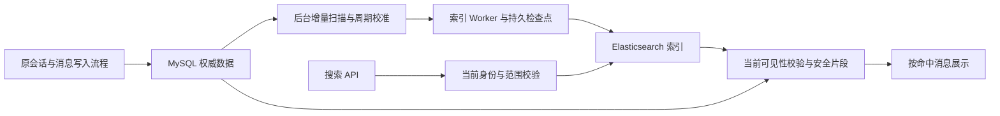

# ARTE AI 会话搜索需求及设计

> 版本：V0.6；日期：2026-10-15。
> 状态：设计草案，尚未编码、安装 Elasticsearch、执行 DDL 或回填数据。
> V0.6 新增确认：后端沿请求方向有界补页；更换关键词清除旧结果并异步释放旧 PIT，Enter 可主动重查；搜索空闲 10 分钟／最长 30
> 分钟／每主体最多 3 个，首版不加心跳；标题两行／片段三行及有界 Popover；建立标注样例和质量验收。实现细节归技术附录，质量数值是待部署测试验证的目标，不表示功能或指标已经交付。
> 已确认调整：按命中消息展示独立组件及双入口；搜索直接读取 ES 当前可搜索数据，不等待写入或同步任务；同步采用后台增量扫描＋周期校准，不新增业务事务内搜索通知。MySQL
> 保留权威，ES 为可重建索引。优先沿用 IK，预留 groupIds 且空值不追加过滤；普通索引排除归档会话，归档后物理删除相关检索记录。新增确认：归档可取消并恢复原会话，fork
> 后续独立设计；预留归档接口与默认空查询实现，写命令默认明确未开放。归档管理及专门检索后续独立建设。其余未明确确认的数值仍为建议值，不表示功能已交付。

## 1. 目标、范围与首版建议

从左侧搜索框找回会话与具体消息：按命中消息展示结果，同一会话命中多条消息时允许多行重复会话标题；每行精确对应一个消息／候选。标题命中单独作为会话型结果，不伪造消息定位。

| 项目     | 规则                                                                                                                                               |
|----------|----------------------------------------------------------------------------------------------------------------------------------------------------|
| 范围     | 当前登录主体、当前租户／工作空间、本人可读且未归档的真实会话；不新增共享读取能力                                                                   |
| 内容     | 当前会话名称、持久化用户问题、已持久化且当前历史界面可访问的助手回答                                                                               |
| 结果粒度 | 每条命中消息一条结果；同消息按 entryKey 去重，不按 conversationId 合并；每个会话另有最多一条标题匹配结果                                           |
| 回答候选 | 包括用户有权浏览的历史候选；内部保留 invocationId 和候选序号，不要求该候选被后续上下文采用                                                         |
| 部分回答 | 有可读耐久结果的部分回答可搜索；正在生成的预览暂不索引；不在结果行增加额外状态标签                                                                 |
| 分词     | 优先沿用 IK，版本与实际 ES 匹配；索引／查询分析器组合经样例验证后固定                                                                              |
| 分组预留 | 实体与 ES mapping 声明 groupIds，当前写入 []、查询传空且不追加组过滤；后续非空按任意组匹配                                                         |
| 归档边界 | 普通索引仅维护未归档会话；归档时删除 TITLE 和全部 MESSAGE，取消归档恢复原会话并异步重建；预留接口及空查询实现，归档管理／检索与 fork 后续交付      |
| 匹配     | 中文／中英混合关键词；同一条标题或消息满足全部分析后词项，不跨多消息拼接满足 AND                                                                   |
| 排序     | 相关性优先、名称加权；相同分数按命中时间和稳定记录键排序，不按置顶分区或加权                                                                       |
| 分页     | 建议每页最多 20 个命中记录；PIT＋search_after，支持前后浏览与同快照回到首页，不设置固定命中总数上限                                                |
| 前端状态 | 普通目录行、临时定位行与搜索结果行合计最多保留 100 行；同会话多条消息分别计行                                                                      |
| 一致性   | 只搜索 ES 当时已可搜索的数据，允许漏掉尚未同步的内容；新数据需重新发起搜索才能进入新快照                                                           |
| 不包含   | 跨空间／跨用户搜索、归档会话检索、分组／归档管理功能、语义／向量搜索、复杂筛选、跨会话去重、附件 OCR、工具载荷、系统指令、模型内部推理、知识库检索 |

不设置固定命中总数上限不表示单请求全量读取：每次读取仍有预算，前端缓存仍有界，搜索会话仍会到期。索引覆盖和最新程度由后台扫描改善，不以“没有命中”承诺所有
MySQL 历史均已加入 ES。

## 2. 搜索交互

### 2.1 输入、状态与结果组件

1. 使用现有 Input 与放大镜，有效关键词变化后 300ms 防抖查询，Enter 立即查询并取消尚未执行的防抖。中文 IME 组词期间不查询，组词中的
   Enter 只确认组词；去首尾空白，最长 128 个用户可见字符，前后端统一校验。全停用词明确反馈，不转换为 match_all。
2. 进入搜索前运行现有名称编辑保护。查询按账号、scope、关键词和批次隔离，取消旧读取并丢弃迟到成功／失败。搜索状态由账号／scope
   层持有，不随右侧聊天 conversationId 切换而重新挂载。
3. 单独创建 `ConversationSearchItem`，视觉上只包含会话标题、命中内容的截取片段及高亮、右侧上下两个图标按钮。标题／片段不隐含跳转或改名；不显示
   Avatar、置顶、日期／轮数、角色／候选／部分回答标签或管理菜单。内部仍保留角色和候选等定位字段。
4. 两个按钮统一使用 DynamicIcon，上方建议 AimOutlined、下方建议
   LoginOutlined；可按现有图标库调整，但必须带悬浮提示、aria-label、键盘操作、进行中／禁用状态，点击不冒泡。
5. 每条消息最多展示一个片段；一个会话多条消息命中时分别显示。纯标题命中也保留标题匹配片段，上方按钮禁用并提示“仅会话名称匹配”，下方可用，不伪造一个消息
   ID。
6. 搜索、无命中、请求失败、权限失败和依赖不可用分别反馈；续页失败保留已有行和原游标。允许扫描／回填未完成时搜索已有数据，不显示必须等任务完成的阻塞加载态；可用轻量说明“新消息可能稍后出现在搜索中”。
7. 同词不重复提交指不自动重复查询、不重复发送进行中的同条件请求；进行中连续 Enter 合并。请求已经完成或失败后再次 Enter
   是用户主动新搜索：异步释放旧会话，创建新 PIT 并从首页读取，不因词相同忽略。
8. 从关键词 A 改为 B 时，立即撤下 A 的结果及预览、取消旧请求、使旧批次失效，异步释放 A 的 Redis 会话与 PIT；不等待关闭完成才查询
   B，迟到响应不得恢复 A。搜索结果区域显示动态加载遮罩，旧行及两个入口不可点击；输入框和聊天区继续可用。B
   成功后显示其结果，失败后结束遮罩并反馈，不自动重试、不恢复 A 的片段；用户按 Enter 重查。只对实际防抖／查询过渡显示加载，不在等待输入或
   Enter 时持续转圈。
9. 空白或仅包含不可见字符的输入不发搜索；键盘删空或输入此类内容后按 Enter，返回普通目录数据库第 1
   页，不增加临时定位行。清空按钮是显式退出动作，直接返回普通列表，无须再按 Enter。空格、换行、制表符、不换行空格及独立零宽／格式控制字符等按空判定；合法
   emoji 中的连接符不能被简单删除或将整个符号误判为空。此规则只用于查询校验，不改写原消息。
10. 首屏／更换词失败不增加独立搜索重试按钮，由 Enter
    发起新搜索；续页／回看失败保留原边界，用户再次显式加载可重试，均不自动请求。搜索态不增加自动刷新或独立刷新入口，现有顶部刷新按钮禁用并提示“按
    Enter 重新搜索”；普通态刷新按原规则。交互状态使用前端内存与既有 Redis 会话，不新增数据库交互状态表，也不另建重复的状态规则表。

### 2.2 上方按钮：查看命中消息，保留搜索

- 提示为“查看命中消息”。先运行当前聊天草稿、配置、名称编辑及未确认操作保护；通过后读取目标会话及目标消息附近历史，选择其真实候选并定位、临时高亮目标消息。
- 只切换聊天区域：保留关键词、搜索结果内容与顺序、滚动位置、已加载窗口、游标和搜索会话。不清空、不重排、不重新执行搜索，也不因此刷新普通目录。允许按钮显示进行状态和局部失败反馈。
- 同会话的不同消息分别可跳转；定位后沿用历史浏览滚动规则，流式新内容不强制将视口拉到末尾。窄屏切到聊天后，返回列表仍是原搜索窗口和位置。
- 聊天标题／统计／候选状态变化不自动覆写搜索快照。权限失效或会话已归档仍必须拦截，保留结果不代表失效后继续放行。PIT
  到期不自动重搜；已有有效结果保留，上方定位可按真实消息身份重新授权读取，续页／回到搜索首页按第 5.2 节提示 Enter 重搜。
- 网络或暂时读取失败时保留原行、搜索与分页边界，局部反馈；已确认无权、删除、归档或具体消息失效时，按第 2.5
  节清理对应内容并保留失效占位，不跳到任意同文消息。浏览旧候选不改变服务端 selectedInvocationId 或下一轮上下文。
- 定位须完成“目标附近轮次 → 命中候选正文 → 精确 messageId 锚点 →
  渲染后滚动及临时高亮”。助手正文沿用调用快照接口读取，不把轮次引用当成正文；多个输出消息即使连续呈现，也须保留各自锚点。目标详情、候选归属及正文核验成功后才提交本次定位；失败不得切到别的候选。具体契约见第
  7 节及附录 A.3。

### 2.3 下方按钮：进入会话并回到普通列表

- 提示为“打开会话并退出搜索”。先运行同一保护，准备目标会话及默认目录首页；成功后再清空关键词、搜索结果和搜索会话，展示普通列表并选中／高亮目标。失败或用户取消保护时保留搜索，不提前清空。
- 聊天使用正常打开会话的行为，不执行具体消息定位；清除之前的跳转目标，避免同一会话先点上方再点下方时仍停留在旧定位模式。不修改服务端消息或上下文。
- 普通列表是“目标可见＋默认列表”：默认首页已包含目标时，直接高亮并滚动到它；未包含时，顶部临时补入真实目标记录，再显示默认置顶及普通首页，按
  conversationId 去重。
- 临时定位行不是数据库置顶，不改 pinned／活动排序、不占 7 个置顶名额、不修改 total、不参与普通续页游标；后续页遇到该会话只保留一份，不影响服务端游标推进。临时行也计入
  100 行限制。
- 下一次普通手动刷新、新选择其他会话或切换账号／scope
  时移除临时定位行；即使因此当前会话离开窗口，聊天选择与草稿仍保留。不得用置顶／取消置顶命令实现定位。打开前已归档的目标按不在普通搜索范围处理，保留搜索并反馈，不临时插入默认列表，也不自动取消归档。

### 2.4 共同规则

- 普通目录仍保持单击标题改名；搜索行没有改名／置顶／归档／删除菜单，也不显示会话 Avatar。
- 进入搜索释放普通目录行缓存，保留当前聊天／草稿。搜索按方向维护最多 100 行的滑动窗口：加载后部结果时回收前部，加载前部结果时回收后部，均补偿可见锚点；只按窗口内
  entryKey 去重，不保存全历史 seen-ID 集合。
- 搜索窗口提供“加载前部结果”和“回到搜索首页”：前部仍在缓存时直接回看，已回收时使用当前 PIT 的前部边界读取并重新校验权限。“回到搜索首页”读取同一
  PIT 的相关性首页，不等同于刷新搜索、不创建新 PIT。过期或规则不兼容时保留当前有效窗口并明确要求重新搜索，不静默拼接新快照。
- 点击清空按钮或空输入按 Enter 返回普通数据库第 1 页，不额外插入定位行；只有下方按钮产生临时定位项。搜索态由 Enter
  主动创建新搜索，顶部刷新不发查询；普通态刷新保持原规则。
- 新建成功退出搜索，选中新会话并读取普通首页；失败或结果未确认保留搜索状态。所有列表导航不停止后台执行，不丢当前保护中的草稿。
- 关键词、片段、Popover 预览与高亮只在当前内存，不保存到 localStorage／sessionStorage；账号／scope
  切换清空。操作不提交聊天、不创建预算、不改变上下文。首版只提供相关性排序，不预放未实现筛选项。

### 2.5 已知失效结果与片段清理

保留搜索指保留关键词、其余有效结果的相对顺序、窗口位置和分页边界，不表示继续展示已确认失效的片段。网络超时或依赖暂不可用不能当成无权／删除；只有权威校验明确目标失效后才执行本节。

- 单条消息或候选失效：清除该 entryKey 对应的标题／片段及高亮，以统一“该结果已不可用”占位，禁用两个入口，不披露目标的更多信息。
- 整个会话已归档、删除或无读取资格：清理当前窗口该 conversationId 的全部结果内容与相关内存副本，保留稳定高度的失效占位，其他结果不重排。
- 已确认登录或当前 scope 读取资格失效：清空该范围搜索内容，终止未完成请求并尝试释放搜索会话，不继续保留可读片段；普通导航和草稿保护仍按既有规则执行。
- 不为此增加持续权限轮询；首次返回、翻页／回看、跳转校验及已收到的明确失效事实均应用同一规则。已读内容无法追回，客户端负责清理已知失效的显示与内存副本。

### 2.6 片段、高亮与 Popover 预览

结果行标题最多两行、片段最多三行，超出省略；片段围绕命中位置截取，避免高亮全部落在截断部分。右侧上下两个图标固定，不被长标题或代码挤走；不增加
Avatar、角色／候选标签或第三个操作图标。高亮使用适配主题的底色，保证文字对比度。

服务端每条记录返回一份最多约 800 个用户可见字符的有界预览及高亮区间；列表从中派生较短的命中片段，Popover 展示完整预览。首版上限配置为
800，按样例验证后调整；不返回整条任意长度回答，不为悬浮新增查询接口。每条结果仍只对应一个连续片段，不跨多消息拼接。接口字符与区间约定见附录
A.2。

- 鼠标在片段上停留约 300ms、键盘聚焦或触屏点击片段时打开；片段只打开预览，不隐含聊天跳转或改名。键盘可聚焦片段并用 Esc 关闭。
- 同时只打开一个 Popover；移入浮层可继续阅读、选字和复制，不能鼠标刚离开触发区就关闭。点击外部、Esc 或离开整个预览区域时关闭。
- 浮层宽度适应视口、最多约 480px，留出视口边距；最大高度约 360px 且受可用视口约束，超出内部滚动。小屏不得溢出视口，长代码允许换行。
- 使用纯文本与受控高亮，不执行原始 HTML、不完整渲染 Markdown；命中但没有可用高亮时仍显示有界普通文本，不编造高亮，也不因此丢弃有效结果。
- 切换关键词／scope、退出搜索、所属行移出缓存窗口或确认结果失效时，关闭并清理预览；预览正文和高亮同样受第 2.5
  节约束，不另建持久缓存。阅读完整消息使用上方定位按钮。

## 3. 存储和模块分工



- 普通目录、详情、历史、执行状态、预算和审计继续使用 MySQL。ES 是搜索副本，不作为执行状态或权限权威。
- 搜索不新增业务事务，不建立 MySQL／ES 跨库事务；不检查待写任务或等待 Worker／扫描／回填，也不临时补写或强制 refresh。返回 ES
  当前快照中已可搜索且当前有权读取的命中；未同步、正在写入或正在重试的内容可以暂时搜不到。
- 不新增业务事务内搜索 Outbox、源状态更新或搜索通知，不扩展原聊天受理／结果保存事务。后台自行扫描已提交数据，保存独立的进度、重试和索引同步状态；这些后台状态的原子更新不是业务与
  ES 的联动提交，搜索查询不依赖它们先追平。
- 当前身份、空间资格、会话归属、未归档资格及可见性仍按业务规则校验。不要将允许索引滞后解释为允许泄漏已撤权／已删除内容；此校验不以等待索引写入完成为前提。
- 新 AI 模块提供搜索应用服务、DTO、索引 SPI 和扫描／校准 SPI；app 装配 ES client、检查点存储及公共权限适配。不向 core 公共空间
  API 泄露 ES 类型，不调用旧 AI 服务。
- 建议组件／服务为 `ConversationSearchService`、`ConversationSearchIndex`、`SearchScanStore`、`useConversationSearch`、
  `ConversationSearchItem`。具体命名编码时按仓库约定。
- 配置默认关闭，ES 凭据只在服务端；ES、Java client、IK 插件锁定匹配版本并真实测试；不要求为了本方案改用
  SmartCN。查询开放、扫描／重试、回填／校准采用独立开关，关闭查询入口不必停止后台追赶。

### 3.1 归档扩展接口与默认实现

搜索实现阶段一并声明新 AI 会话归档的内部接口及默认实现；本节是待编码契约，本次文档调整不表示接口已落地。不先增加归档表、ARCHIVED
枚举、归档索引或可执行菜单，也不开放占位 HTTP 接口。接口归新 AI 模块，app 负责装配；未来真实实现读取 MySQL
权威归档事实，搜索模块不直接依赖其表结构。

| 接口／方法（建议命名）                                  | 输入／结果                                                     | 默认行为                                                                    |
|---------------------------------------------------------|----------------------------------------------------------------|-----------------------------------------------------------------------------|
| `ConversationArchiveReader.findArchivedConversationIds` | 可信 `ExecutionOwner`、有界会话 ID 集合 → 其中已归档 ID 的集合 | `NoopConversationArchiveReader` 返回不可变空集合，不查库、不写库、不访问 ES |
| `ConversationArchiveCommands.isSupported`               | 无业务输入 → 能力是否开放                                      | 默认 `false`；真实实现可用后才开放入口                                      |
| `ConversationArchiveCommands.archive`                   | 当前命令上下文、会话 ID → 权威归档回执                         | 默认明确拒绝：归档功能未开放；不返回伪成功                                  |
| `ConversationArchiveCommands.unarchive`                 | 当前命令上下文、会话 ID → 权威恢复回执                         | 默认明确拒绝：归档功能未开放；不创建新会话                                  |

接口示例及默认空实现代码见附录 A.1；本节保留业务边界与扩展要求。

这里的“空”仅表示归档能力尚未启用，不表示所有输入会话都存在、有效或有权读取。调用方仍按原规则验证身份、scope、归属、ACTIVE／DELETED
及可见性；结果未包含某 ID 不能替代这些校验。空输入返回空集合；输入数量按当前请求／扫描批次限制，返回集合必须是输入集合的子集，不能返回其他主体或空间的
ID。

普通搜索返回片段前、两个跳转入口放行前，以及增量扫描／回填／校准／重建抽取和重试写入前，统一通过该读接口批量判断归档资格；不逐条查询，也不在多个模块各自硬编码“未归档”。后台全量校准须检查已收录会话，不能只处理近期消息，以便未来发现归档及取消归档变化，仍不要求业务事务内通知。

默认命令实现可命名 `UnsupportedConversationArchiveCommands`：能力查询返回
false，两个命令统一抛出明确的“归档功能未开放”业务错误。命令上下文沿用现有可信身份／scope；真实写入的权限、幂等键、并发版本及回执字段在归档专项落实，不由空实现模拟保存。不能只写一个无动作、却返回成功的
archive／unarchive 方法。

装配时每个端口只有一个生效实现。空查询与未开放命令只用于归档功能尚未交付的环境；接入真实归档后，查询失败必须反馈失败或阻止相关结果放行／写入，不能捕获异常后退回空集合。开启归档写入之前，先保证所有搜索、跳转及后台实例已切换到真实读实现；已有归档数据的环境不得回退使用空实现。具体持久模型、普通目录过滤和聊天写入拦截随归档功能一并交付。

## 4. 索引结构

### 4.1 一个统一索引，两类检索记录

本索引是普通会话搜索索引，只维护未归档会话的 TITLE 和 MESSAGE。未来归档检索是否采用独立 ES 索引另行设计，本次不先建立归档索引，也不从
MySQL 删除归档消息。

物理索引建议 `conversation-search-v1-<generation>`，业务通过读／写 alias 访问；每次新建搜索记录 PIT 对应的具体索引代际。PIT
保留该次搜索的文档视图，索引结构及查询／分词规则的兼容由代际和规则版本共同管理。代际切换后的既有搜索处理见第 5.1 节。

| recordKind | 记录粒度         | 唯一源键组成                                                      | 内容来源                           |
|------------|------------------|-------------------------------------------------------------------|------------------------------------|
| TITLE      | 每个会话一条     | owner + conversationId + TITLE                                    | 当前权威名称，含空会话的日期名     |
| MESSAGE    | 每条可见消息一条 | owner + conversationId + turnId + invocationId（助手）+ messageId | 用户 `Text`、助手耐久结果的 `Text` |

两类记录放在同一索引里统一排名，不按会话键 collapse。MESSAGE 每条命中独立返回，TITLE
作为无消息定位的会话型结果；同一会话的标题和多条消息可以同时出现。名称单独一条，扫描发现改名时只重建它，不需更新所有正文。每会话的
TITLE 是标题检索记录，不是整份会话列表，也不是完整会话文档；例如 1 个标题和 100 条可见消息对应 101 个检索
document。不要把完整会话拼成不断膨胀的一份文档，也不要复制完整执行 JSON／凭据／系统指令。

### 4.2 字段建议

| 字段                                            | 类型／用途                                                                                                                              |
|-------------------------------------------------|-----------------------------------------------------------------------------------------------------------------------------------------|
| entryKey、conversationKey                       | keyword；由可信 owner 和真实 ID 组成并作稳定编码／哈希；entryKey 唯一、是结果行及分页的稳定身份；conversationKey 只用于关联会话和过滤   |
| tenantId、workspaceId、subjectId                | keyword；强制范围过滤，不能由客户端声明 owner                                                                                           |
| conversationId、turnId、messageId、invocationId | keyword；真实回源及定位标识，标题记录不带消息定位                                                                                       |
| recordKind、role                                | keyword；TITLE／MESSAGE 和 USER／ASSISTANT                                                                                              |
| groupIds                                        | keyword；实体中为字符串集合，ES 同字段可接收数组；当前每条 TITLE／MESSAGE 写 []，不写空字符串或占位组名                                 |
| title、body                                     | text；TITLE 只填 title，MESSAGE 只填 body；IK 中文主分析字段，索引／查询 analyzer 及英文／代码辅助 multi-fields 经实际样例确定          |
| generatedAt                                     | date；标题记录用当前名称版本的权威时间，消息用真实生成时间；未知为 null 并按 missing-last／稳定键排序，不伪造时间；不是普通目录排序字段 |
| turnSequence、candidateOrdinal                  | long／integer；定位辅助，最终仍由 MySQL 校验                                                                                            |
| partial、searchable                             | boolean；部分回答标记及有效／删除墓碑过滤；归档记录物理移出普通索引，不以 searchable=false 保留归档正文                                 |
| sourceRevision、extractorVersion                | long／keyword；后台同步状态分配的单调写入版本与抽取器版本；不要求业务事务维护                                                           |
| contentHash、sourceRef                          | keyword；供后台校准与真实定位使用；搜索不为等待最新正文而比较全部源摘要，不把内部引用返回客户端                                         |

映射使用明确白名单，禁止任意 JSON 自动展开字段。正文保留用户可见的 Markdown／代码文本进行检索，不执行 HTML。只抽取 `Text`
，附件不自动读取全文；结果片段按纯文本展示。

建议使用适合长文本片段提取的 offsets 配置，并测试现有输入／输出最大长度，不能因为高亮分析长度限制静默漏搜长消息。

### 4.3 匹配语义

- 后端构造固定 Query DSL；不把用户原文直接交给 `query_string`，首版不解释通配符、正则或特殊查询语法。
- `title` 名称查询与 `body` 正文查询组成 should，至少一项匹配；各字段内部采用分词后的 AND。名称权重可先以正文的约 3
  倍作为试验起点，需样例验证，不承诺所有名称命中必然排在正文前面。
- 关键词搜索不是任意子串包含，也不是语义相似。例如输入多个词要求它们出现在同一条标题或消息中，不因不同轮次各出现一个词就命中。首版不启用自动拼写纠错或模糊扩展。
- 验证中文、英文大小写、缩写、数字、UUID、下划线代码符号和短关键词；若需要任意子串／前缀搜索，另增限定字段和明确模式，不对整份正文无条件建立高膨胀
  ngram。

优先沿用 IK，支持自定义业务词典。ik_max_word 与 ik_smart 的切分粒度不同，可先测试“索引 ik_max_word、查询
ik_smart”等组合，但不直接将其作为无需验证的默认；项目说明明确 ik_smart 词项不保证是 ik_max_word 的子集。使用 _analyze
及真实匹配样例验证中文、中英、代码和编号，并锁定
ES／插件／词典版本。已有文档若变更索引分词规则，需新代际回填重建，不宣称换查询参数即可改变旧词项。[IK 项目说明](https://github.com/infinilabs/analysis-ik/blob/master/README.md)

### 4.4 groupIds 预留与空值语义

建搜索实体、请求 DTO 和索引 mapping 时即声明 groupIds：实体／DTO 为字符串集合，ES 为 keyword 字段。TITLE 与 MESSAGE
都具有相同的会话分组关联。分组业务本期尚未实现，文档统一写 []，查询调用方不传或传空；不创建示例组、不显示分组筛选
UI，也不把预留字段称为分组功能已交付。

| 查询 groupIds                  | 语义与 DSL                                                                                |
|--------------------------------|-------------------------------------------------------------------------------------------|
| 未传、null、[]                 | 统一规范化为空集合，不追加任何组过滤，搜索当前范围内全部未归档会话                        |
| 有效非空集合                   | 分组能力开放后校验真实 ID，再追加 terms(groupIds)，匹配其中任意一个；仍受主体／scope 约束 |
| 空字符串、空白 ID 或虚构占位值 | 非法，不能当成未分组或默认组                                                              |
| 只搜索未分组会话               | 后续通过独立明确参数设计，不复用 []                                                       |

查询构造预留非空分支，但本期未开放分组目录／归属校验前，非空业务请求明确反馈分组筛选未开放，不静默忽略或虚构分组。空值请求照常搜索，不发送
terms (groupIds:[])，也不加 exists 过滤。ES 中 null／[]
不产生该字段的索引值，空字符串语义不同。[Elastic exists 说明](https://www.elastic.co/docs/reference/query-languages/query-dsl/query-dsl-exists-query)

关键词与游标绑定包含规范化 groupIds：非空按去重排序后的 ID 计算指纹，三种空值等价；将来修改组筛选必须新建搜索，不能沿用旧
PIT。分组名称变化通过稳定 ID 关联，不重建全部正文；归组／移组后异步更新该会话所有 TITLE／MESSAGE 的
groupIds。未来启用非空过滤时，按需核验当前组归属以处理索引滞后，不等待同步完成。

### 4.5 归档与普通搜索的边界

归档用于整理会话，保留 MySQL 会话／消息，支持取消归档，不表示永久封存。未来归档期间允许按权限只读查看，继续聊天须先显式取消归档；仅查看不自动恢复。取消归档保留原
conversationId、原消息及关联关系，不复制历史、不新建会话。fork 作为后续可选的“基于此处创建新会话”能力单独设计，不作为恢复原会话的必经路径，本期不声明或实现
fork API。

当前尚无真实归档命令；搜索实现阶段按第 3.1 节预留内部读／写接口、默认空读实现及明确未开放的命令实现，不创建虚假 ARCHIVED
状态或调用旧接口。未来归档功能交付时替换默认实现，并按其权威模型接入：

1. 归档成功后该会话立即不符合普通搜索资格；普通搜索不提供 includeArchived／仅归档参数，不实现归档检索入口。
2. 后台发现归档后，从普通索引物理删除该 owner／conversationId 的 TITLE 及全部
   MESSAGE，包括历史候选；删除按完整归属过滤，不误删其他主体或空间。不是仅删标题，也不是保留归档正文靠 searchable=false 隐藏。
3. 后台同步状态保留“归档、停止普通索引”的事实和待删除／重试进度，正常增量、历史回填、周期校准及新索引重建一律跳过归档内容。它是后台状态，不接入业务事务内通知，也不是在普通
   ES 索引里保留归档检索文档。
4. ES 删除的可见性及旧 PIT 均不能代替当前归档校验；返回片段前和两个打开入口执行前，按 MySQL
   当前状态排除已归档目标。无需等待索引删除完成；不能为了完成跳转自动取消归档或插入普通临时定位项。[PIT 官方说明](https://www.elastic.co/docs/api/doc/elasticsearch/operation/operation-open-point-in-time)
5. 取消归档恢复同一会话的普通目录资格及继续聊天资格，普通目录仍按默认排序／分页，不自动强制置顶。后台以当前权威内容重建
   TITLE 和 MESSAGE，允许同步后才重新搜到；必须识别旧归档删除任务已失效，不能无条件重放旧删除去清除恢复后的新文档。
6. 将来归档检索通过专门需求决定索引、界面、权限及恢复路径；需要时可从 MySQL 重建，不要求现在实现另一套归档索引。

本轮不要求在普通 ES 文档新增 archived 筛选字段；普通索引的成员资格由当前归档状态决定。物理删除是索引维护，归档业务自身的权限、版本及事务仍在后续归档专项确定，搜索不替它另造规则。

## 5. 按命中消息排序与游标分页

### 5.1 PIT＋search_after

查询强制过滤可信身份／scope 和 searchable=true，统一检索 TITLE／MESSAGE，按 `_score DESC, generatedAt DESC, entryKey ASC`
稳定排序。不按 conversationKey 去重；同一消息仅一条固定 entryKey，同会话不同消息允许多条。

使用 PIT＋search_after，按固定的正向／反向排序规则读取后部及前部结果；同一方向续读保持相同查询及排序，使用 ES 返回的完整 sort
数组（含实际 tie-breaker），不自行删减或按返回条数推算。反向读取后按原相关性顺序返回前端，方向与边界不能混用；技术规则见附录
A.2。不使用会话 collapse、父子 join
或固定命中总数上限。深分页仍受搜索会话有效期、每次预算及有界客户端缓存约束。[Elastic 分页说明](https://www.elastic.co/docs/reference/elasticsearch/rest-apis/paginate-search-results)

每页建议最多 20 个命中；用户修改关键词、规范化 groupIds、size 或选择不同搜索规则时新建搜索。alias 切换后，仅新建搜索使用新代际；既有搜索继续原
PIT、原代际和原规则直至到期，不能因为 alias 切换就强制换代或拼入新结果。旧规则无法兼容或旧代际不可用时明确反馈需重新搜索，保留当前有效窗口，不静默创建新
PIT。

新 ES refresh 后的消息不插入旧 PIT，用户按 Enter 主动重搜才建立新快照。“回到搜索首页”和前后浏览沿用当前快照；点击上方图标只定位聊天，不重新建立
PIT。

### 5.2 搜索会话与游标

本方案明确使用 Redis 管理短期搜索会话，作为搜索查询的配套依赖，不采用仅依靠客户端携带全部状态的方案。Redis
保存主体、scope、规范化关键词与 groupIds 摘要、规则版本、最新 PIT ID、索引代际及到期信息，不缓存正文、片段或授权决定。游标绑定会话、方向及完整扫描边界；Redis
不累积全历史命中 ID 或无界分页书签，详见附录 A.2。

首版空闲有效期为 10 分钟，最长存续期为自创建起 30 分钟，每主体最多 3
个活动搜索，均通过配置管理。成功创建搜索、前后分页或回到同快照首页才更新搜索活动时间；仅浏览聊天、点击消息定位、查看 Popover
或普通鼠标键盘活动不续期。首版不增加定时心跳。

保存每次 ES 返回的最新 PIT ID，并协调 Redis 到期时间与 ES keep_alive，均不超出本次搜索硬截止时间。关键词变更、Enter
主动重搜、退出搜索或下方入口成功后释放原会话；Redis 记录靠自身 TTL 清理，ES PIT 主动关闭或由其 keep_alive 到期释放，两者不能互相替代。达到
3 个上限时明确提示先关闭一个活动搜索，不静默关闭其他标签页或设备的搜索；新建失败不应遗留占用名额的会话，清理细节见附录 A.2。

到期不自动清空已有有效结果、不自动重搜：上方定位仍可依真实消息 ID 重新校验并打开，不依赖旧 PIT；分页、前部回看请求及回到搜索首页返回
410，并提示“搜索已过期，按 Enter 重新搜索”。缓存内滚动可继续，已知失效内容仍清理。Enter 新建 PIT 并从首页开始，不能将新结果接到旧窗口末尾。

重试从同一游标边界重新计算，不消费式推进共享游标。每次重新校验权限，因此权限变化可以缩短结果；不得将新 PIT 静默接到旧页。Redis／ES
失败明确反馈，不退回浏览器无限去重或 MySQL 正文补搜。

### 5.3 每页预算、可见性和计数

1. ES 返回消息／标题命中，批量验证当前会话归属、生命周期、未归档资格和空间权限；有单消息或候选可见性规则时也核验对象，校验成功后才返回标题／片段。
2. 不要求索引 sourceRevision 与 MySQL 最新版本完全相等，不等最新改名／正文同步完成，也不逐条回源比较正文摘要来实现强一致搜索。普通内容的新旧差异允许存在；权限、归档、删除及内容访问资格仍必须拦截。
3. 无权／归档／删除等候选跳过，按请求方向继续读取本次预算内的候选。前后游标使用实际消费区间的完整 sort
   边界，不按成功返回条数推算；预读但未消费的命中不得跳过，反向读取后仍按原相关性顺序展示。
4. 后端在同一对外分页请求内，沿请求方向继续内部读取、过滤并尽量补足本页；加载后部只补后部，加载前部只补前部，不能因下一页为空就退回上一页。每次对外请求有统一候选总数、内部读取次数及总耗时预算，不能每轮重置；候选数初始建议最多
   100，返回最多
   20，其余预算部署测试确定。预算耗尽仍可少返或空页：方向未结束时保留对应游标、partialPage=true，前端提示“本次尚未找到可展示结果，可继续查找”并提供显式继续操作，不显示最终无结果，不依赖空列表滚动触发，也不自动无界追扫。
5. 仅当完整 ES 响应确认请求方向已没有后续候选时，对应方向游标为
   null、endReason=END；向后结束提示“当前搜索结果已加载完”，向前结束提示“已到搜索结果开头”。反方向仍可继续时保留其游标。不承诺
   MySQL 中尚未入索引的内容也无命中。
6. total=null，不显示精确会话总数。若将来展示数量，应区分标题命中与消息命中及权限过滤，不把 ES hits.total 说成会话数。
7. 创建 PIT 及每次查询均不接受缺失分片的部分结果，检查超时、分片失败及意外提前终止。不完整响应使本次页整体失败：不发布该页记录、不推进前后分页边界、不宣告
   END，保留原窗口与重试边界。partialPage 仅表示完整正常查询下业务过滤／预算导致的少返，不能表示 ES 查询失败；技术配置见附录
   A.2。

搜索不访问扫描任务队列来决定是否执行，不以覆盖状态阻塞结果。只有当前搜索确实没有可展示命中且已确认扫描方向到头，才提示“未找到当前可检索内容”；已有结果后的方向终点按第
5 项提示结束。预算空页、依赖失败和确定无结果分开呈现；索引未建成或服务不可用明确反馈未就绪／失败，不能伪装为零结果。

## 6. 后台增量扫描、周期校准与重建

### 6.1 不接入业务事务的同步方式

原消息／名称写入流程不新增搜索事务、搜索源状态表写入或 Outbox 通知。后台独立读取已提交的权威数据，仅对未归档且符合当前可见范围的源抽取
Text 并更新普通 ES 索引。索引延迟不影响业务提交，搜索也不等待扫描或回填。

后台独立维护可恢复进度与重试状态，不增加业务写入步骤；检查点字段、批次确认及持久化约定见附录 B。新增存储须提供独立迁移。

不消费或 ACK 现有 DISPATCH／EVENT 来抢占通知。若未来引入 CDC，应独立评估，当前方案不要求 Kafka／binlog 订阅。

### 6.2 扫描来源与内容处理

| 权威事实             | 后台处理                                                                                      |
|----------------------|-----------------------------------------------------------------------------------------------|
| 新会话或名称变化     | 创建／更新 TITLE；空会话仍可按名称搜到                                                        |
| 用户问题持久化       | 固定真实 messageId 建 MESSAGE；重复扫描覆盖同一记录                                           |
| 助手结果可读         | 抽取耐久结果 Text，关联真实 invocationId／messageId；部分正文保留 partial 内部字段            |
| 新的重新生成候选     | 用户问题不重复，新可读候选新增自己的 MESSAGE                                                  |
| 仍在生成             | 不索引瞬时流式预览；现有用户问题可先进入 ES                                                   |
| 置顶／取消置顶       | 不改匹配文本、不重排搜索；搜索结果行不展示置顶                                                |
| 分组关联变化（后续） | 当前写 groupIds=[]；分组开放后异步更新该会话 TITLE 和全部 MESSAGE 的真实组 ID                 |
| 会话归档（后续）     | 查询先排除；后台物理删除普通索引 TITLE 和全部 MESSAGE，记录停止收录／重试状态，不保留归档正文 |
| 取消归档（后续）     | 当前源重新具备资格后重建普通索引，阻止旧归档删除任务覆盖恢复                                  |
| 会话／消息删除或失效 | 当前查询先按可见性拦截；扫描校准后清除索引正文并写不可搜索墓碑                                |
| 成员撤权／退出空间   | 查询立即拒绝，不等待删除索引文档                                                              |

增量候选必须覆盖创建／改名、Turn 候选变化、Invocation
终态／结果引用及部分结果变化，以及后续接入的分组关联、归档／取消归档来源，不能只检查最近消息活动时间；否则改名或晚到结果可能被漏掉。优先处理近期活动范围，按批次／时间预算节流，扫描不触发模型调用。

### 6.3 检查点、补扫与周期校准

增量处理近期变化，周期完整校准覆盖非活跃会话、晚提交、历史候选及归档／恢复变化。重启可重扫，失败可重试；不能因单批未见某项就删除，也不能把扫描状态当成授权结论或搜索必须等待的门槛。检查点、补扫与校准实现见附录
B.1。

### 6.4 并发、乱序与删除

索引更新须处理重复、乱序、删除和归档／取消归档竞态，旧任务不得覆盖已确认的新内容。查询与跳转仍按当前资格放行，不建立跨库事务。版本、租约、逐项确认及重试实现见附录
B.2。

### 6.5 历史回填和索引代际

首次部署按源数据有界扫描，过滤归档源；历史回填期间即可搜索已有 ES 内容；查询是否开放取决于索引可用和灰度设置，不要求全部历史先完成。

重建写入明确的新代际，独立保存该代际的扫描／确认进度；完成未归档源的目标回填、归档残留清理与至少一轮校准后原子切
alias。扫描不建立跨业务提交的全局快照，切换后继续增量和周期校准，明确可能存在新鲜度差异，不宣称切换瞬间零漏差。旧代际 ACK
不能证明新代际已写入。

抽取器／分析器变化通过新代际重建。alias 切换后既有搜索继续原
PIT／原规则，当前权限与归档资格仍重新校验；新搜索使用新代际。旧代际在其有效搜索结束前保留，无法继续服务时明确失效，不能静默换代。扫描目标、代际保留与回退步骤见附录
C。

## 7. API 草案与双入口定位

以下均为拟新增契约，尚不可调用；沿用 `/arte/ai-new` 登录、scope、错误包装和读授权，不增加搜索跨库事务。

归档相关内部接口见第 3.1 节，随搜索实现预留；本节不发布 archive／unarchive 占位 HTTP。归档入口仍只展示未开放，未来真实归档管理交付后再确定
HTTP 契约；不能把空查询实现当成已具备归档能力。

| 接口                                  | 职责                                                                                   |
|---------------------------------------|----------------------------------------------------------------------------------------|
| POST conversation/searchConversations | 创建搜索或按游标读取前部／后部／同快照首页，返回有界命中窗口与导航边界                 |
| POST conversation/closeSearch         | 释放本主体该 scope 的 Redis 搜索会话及 PIT，重复关闭可成功                             |
| POST conversation/queryTurnsAround    | 按目标轮次或历史边界读取附近轮次；正文沿用调用快照读取，支持精确消息定位与前后历史浏览 |

请求／响应、片段结构及错误契约统一见附录 A.2～A.3。

上方入口按以下顺序完成定位：

1. 运行原草稿／配置／名称编辑及未确认操作保护，读取当前目标会话，取得权威 conversationVersion；不能使用 ES 同步版本代替会话读取版本。
2. queryTurnsAround 返回包含目标 turnId 的有界窗口、读取版本与前后历史边界。版本冲突时刷新目标详情并重试一次，仍冲突则局部反馈，保留搜索，不拼接冲突轮次。
3. 用户问题从轮次取得；助手回答先验证 invocationId 属于目标 Turn，再通过既有调用快照读取命中候选，并验证 messageId 存在于其可见
   outputs。不只加载最新／已采用候选，也不按相同文本替代目标。
4. 目标与候选正文核验成功后提交聊天定位视图。渲染层为每个真实 messageId 建立稳定锚点，多个 outputs
   连续显示时仍分别保留锚点；目标渲染及布局完成后滚动并临时高亮该消息，重复布局不反复抢滚动。
5. 定位浏览模式通过较早／较晚历史边界继续读取，按 turnId
   合并并维持可见锚点；SSE、终态刷新或普通历史初始化不得覆盖窗口或拉回最新。返回最新历史由用户显式触发。读取版本改变时重新获取包含当前锚点的窗口，不能拼接不同版本。
6. 历史候选只改变浏览状态，不修改 selectedInvocationId、下一轮上下文、执行／预算或消息。网络失败与已知失效分别按第 2.5
   节处理；纯标题结果不调用定位接口。

下方入口复用会话详情及普通目录首页读取，不调用消息定位；两份读取及保护成功后再提交“打开会话＋清空搜索＋列表定位”的视图状态。临时定位行由真实详情／列表元数据构造，在前端派生并按
ID 合并，不新增置顶命令、索引写入或数据库定位属性。

## 8. 验收与实施顺序

### 8.1 验收重点

- 名称能命中空会话，纯标题结果上方按钮禁用、下方可用；问题／回答超出列表 30 字摘要的正文也可命中。
- 同会话多条命中分别展示，entryKey 唯一；重新生成不重复用户问题，历史候选和部分回答能够通过内部身份准确定位。
- 独立组件只展示标题、截取／高亮片段及右侧两个图标；标题最多两行、片段最多三行，长内容不挤走按钮。Popover
  支持悬浮／键盘／触屏、复制、Esc／外部关闭、视口约束及唯一展开；不增加行标签或第三个图标，不发悬浮查询。切词、失效、移出窗口时关闭并清理。
- 验证 A 改 B 立即撤下旧结果、异步关闭旧会话、局部遮罩且输入／聊天可用；迟到 A 不恢复，失败不自动重查。IME Enter
  只确认组词；同条件进行中合并，完成／失败后 Enter 新建搜索；空白／仅不可见输入 Enter 退出，清空按钮直接退出，合法 emoji 不误判空。
- 验证后台同方向补齐且所有内部读取共用预算；方向不回退、预算空页不当最终无结果并有显式继续入口。内部任一 ES
  批次不完整则整个业务页失败，不提交半页或推进边界。
- 验证 10 分钟空闲、30 分钟硬截止、3 个名额、无心跳、Redis／ES 有效期协调及资源清理；超限不挤掉其他搜索。到期结果可在授权后定位，继续分页提示
  Enter 重搜，不能拼接新旧 PIT。
- 上方打开不同会话／消息时，搜索关键词、顺序、窗口、滚动和游标均保留；验证多个 outputs、非最新候选和部分回答的正文读取及
  messageId 锚点，前后历史／版本冲突／SSE 不丢定位，也不改变服务端候选采用关系。
- ES 超时、分片失败或提前终止时不发布半页、不推进边界、不宣告 END；partialPage 不混用为 ES
  失败。已知失效结果清除内容与内存副本，暂时网络错误保留原行；会话级失效清理同会话全部窗口行。
- alias 切换后新搜索使用新代际，既有搜索继续原 PIT／原规则；旧代际保留到其有效搜索结束，无法兼容则明确失效，不静默接入新结果。
- 下方成功后清空搜索、关闭 PIT、正常打开聊天，不执行消息定位；默认首页有目标时直接高亮，没有时临时补入并去重。失败／保护取消保留搜索。
- 临时定位项不占真实置顶、不改排序／total、不干扰续页游标，按约定移除，合计行缓存不超过 100；同会话多条搜索消息分别计行。
- PIT＋search_after 在同分、多候选及超过 10,000 命中时可按快照前后浏览，过滤／边界重试不跳记录。超过 100 行仍可加载前部及回到同
  PIT 首页，前后读取均不突破缓存上限或累积全历史书签。
- 中文、中英、单字、停用词、emoji、代码、Markdown、长正文、恶意 HTML；没有高亮执行或长文本静默漏搜。
- 新消息未入 ES、正在写索引、扫描积压和回填时，搜索只返回当前可见数据，不等任务、不触发补写／refresh；Enter
  主动重搜才读取新快照。有效命中没有高亮时不丢弃，高亮区间、Unicode／emoji 截断与主题对比度正确。
- groupIds mapping 为 keyword，实体集合当前写 []；查询未传／null／[] 等价且不生成 terms ([])
  ／exists；空字符串拒绝，非空当前未开放明确反馈，未来任意组匹配仍受主体／scope 限制。
- IK／ES 版本匹配，验证索引与查询分词组合、词典、AND 与高亮；不默认假设 ik_max_word 覆盖所有 ik_smart 词项。
- 默认归档读实现返回空集合且无存储副作用，原有权限／生命周期检查仍有效；默认命令能力为 false，归档／取消归档明确未开放，无伪成功或占位
  HTTP。
- 用可替换的归档读测试实现覆盖同主体／跨主体、批量归档集合、旧 PIT／双入口／扫描过滤与查询失败；真实适配失败不降级为空集合。空实现测试不等于真实归档功能通过验收。
- 归档排除 TITLE／全部 MESSAGE 和历史候选，删除失败可重试；旧 PIT 与删除尚未可见时仍不返回或打开归档目标，且不能临时插入普通列表／自动取消归档。
- 增量、回填、周期校准、代际重建／回退不复活归档源；在途旧写入、取消归档与旧删除竞态可收敛，MySQL 历史保留。归档检索仍未实现，不把它算入搜索交付。
- 真实归档专项后续验证：归档只读查看不自动恢复；取消归档保留 conversationId／历史并恢复原会话，不产生
  fork，不因归档或恢复重新执行模型。搜索阶段通过替换实现验证接入逻辑，不宣称真实归档流程已交付。
- 双用户／双空间、撤权、归档、删除、旧 PIT 和目标失效不泄漏；普通内容滞后允许存在，不要求搜索为了最新正文读遍 MySQL。
- 后台扫描重启、晚提交、同时间变化、重扫重复、租约丢失、旧批次乱序、bulk 部分失败、漏掉的非活跃会话，由检查点／周期校准恢复，不靠业务事务内通知。
- ES／Redis 故障不影响聊天；校准／重建不修改权威消息、不触发模型、不产生重复费用。记录索引实际新鲜度、扫描周期、覆盖及限制，不宣称无事务扫描具备强一致快照。

### 8.2 固定样例、搜索质量与可信度

准备约 80 条人工标注查询，覆盖会话标题（含空会话）、用户问题、助手回答、中文／中英混合、错误码／编号、代码符号、长回答、历史候选／部分回答及空白／停用词等边界。每条记录查询词、owner／scope、应命中与明确不应命中的真实
entryKey／消息／候选、期望靠前结果和定位目标；不能只标会话 ID 来替代消息定位正确性。

匹配与排序测试先确保固定源数据已同步至 ES，并冻结分析器／词典／规则版本；这只是测试准备，不要求线上搜索等待索引。另用独立用例验证尚未入索引、回填未完成和旧
PIT 下允许暂时搜不到。固定查询的目标以人工标注为准，不从本次查询输出反向生成答案。

| 维度       | 验收标准／目标                                                                                                                                         |
|------------|--------------------------------------------------------------------------------------------------------------------------------------------------------|
| 匹配正确性 | 对规则明确、已进入索引的确定性样例，应命中／不应命中全部符合标注；全部结果分页范围内校验，不仅检查首页                                                 |
| 排序可用性 | 对标注有明确目标的有效查询，至少一个指定目标进入前 5 条命中的比例，首轮目标 ≥90%；纯空／无结果用例不计入分母，同会话其他非目标消息不冒充指定目标       |
| 定位正确性 | 所有指定目标准确打开对应 messageId／invocationId，部分回答及非最新候选同样覆盖；不能用同文消息替代                                                     |
| 浏览稳定性 | 相同 PIT 与固定资格下前后浏览不因边界出现跳过／重复，100 行回收后仍可回看；SSE 不抢定位，权限变化按失效规则处理                                        |
| 权限与失效 | 跨用户／空间、撤权／归档／删除用例全部通过，不泄漏内容；已确认失效的片段、预览及内存副本按规则清理                                                     |
| 索引新鲜度 | 正常负载下，消息持久化／可读耐久结果提交或标题改名成功，到新 PIT 首次能够检索相应内容的 P95，首轮候选目标 ≤30 秒；通过部署测试验证，不作为当前实测承诺 |

新鲜度分别记录用户问题、助手可读结果及标题改名，不能用旧 PIT 是否更新或当前标题展示是否变更替代索引可检索性。记录样例数、数据规模、并发负载、扫描配置、测试环境与统计窗口；P95
目标不等于全部历史同步完成的时限。达不到目标须如实记录原因并在部署验收时评估调整，不可仅以 ES 返回成功或允许最终一致就宣称通过。

### 8.3 分步交付

| 阶段              | 交付物                                                                                                               | 完成条件                                                                                                          |
|-------------------|----------------------------------------------------------------------------------------------------------------------|-------------------------------------------------------------------------------------------------------------------|
| S1 契约与原型     | 消息粒度、双入口、IK、groupIds 空值／非空分支、映射、PIT＋search_after、安全片段；归档内部接口、空读及未开放命令实现 | 真实 ES 验证大规模命中稳定续页和纯标题结果；默认归档无副作用且可替换，无 collapse 依赖                            |
| S2 后台扫描／校准 | 独立进度、扫描／校准、版本、归档物理清理及防回写接入点、重试与重建；不实现真实归档写入                               | 不改原业务事务，真实 MySQL＋ES 验证漏扫恢复、重启和并发旧任务保护；归档状态以替换读实现验证，真实归档专项另行验收 |
| S3 搜索后端       | Redis 会话、前后游标／同快照首页、完整响应检查、精确消息定位及前后历史                                               | 权限矩阵、失效清理、版本冲突、代际延续及故障不推进边界通过，不依赖同步追平                                        |
| S4 前端双入口     | ConversationSearchItem、两类定位、有界回看／空页继续、失效占位、输入遮罩及 Popover                                   | 浏览器验证消息锚点、双入口、输入／IME／Enter、失效与预览清理、可访问性及原草稿保护                                |
| S5 灰度验收       | 固定标注样例、排序／定位／新鲜度、回填监控、真实规模及回退                                                           | 按第 8.2 节记录实测目标与限制；索引可用即可按范围开放，不阻塞等待全历史                                           |

部署顺序、迁移及代际维护见附录 C；本节只定义交付范围和完成条件。

本次只改设计文档，未编码、安装 ES、执行 DDL／扫描／回填或部署。后续如需新增后台进度表，单独提供迁移与环境状态说明，不迁移消息权威存储、不引入业务／ES
联动事务。

## 9. 变更记录

- V0.1（2026-10-15）：首次提出按会话去重、PIT＋有界 from/size 和业务事务内同步通知的草案。
- V0.2（2026-10-15）：按用户确认改为消息结果独立组件、上下双入口、PIT＋search_after；取消会话去重及前 1,000 候选上限。搜索只读
  ES 当前可见数据、不等待写入；同步采用后台增量扫描＋周期校准，移除业务事务内 Outbox／源状态更新要求。现有业务事务、权限和普通目录语义保留。

- V0.3（2026-10-15）：按用户确认优先沿用 IK；实体、DTO、mapping 预留 groupIds，当前写空集合、空查询不追加过滤。普通索引仅维护未归档会话，归档时物理删除
  TITLE／全部 MESSAGE，补齐扫描排除、旧 PIT／导航过滤、迟到写入校准、取消归档恢复；归档检索和管理仍独立后续交付。本次仅文档调整。

- V0.4（2026-10-15）：明确归档可取消并恢复原会话，归档期间只读查看，fork
  后续独立设计。搜索实现预留归档批量读取／归档／取消归档内部接口，默认读返回空集合、写明确未开放，不发布占位
  HTTP；补齐统一接入、真实适配失败不降级、替换顺序及分阶段验收。此次只改文档，接口与默认实现尚未编码。

- V0.5（2026-10-15）：补齐精确消息定位链路、ES 不完整响应不推进边界、100 行窗口回看／同快照首页、已知失效片段清理及索引切换时旧搜索延续；明确使用
  Redis。接口示例、扫描并发及部署细节移入技术附录，旧方案取消记录集中于本节。不新增语义搜索、复杂筛选、归档管理或跨会话去重。空页补查、输入状态、PIT
  有效期、片段／Popover 与搜索质量标准本轮仅讨论，未作为新规则写入。本次仅文档调整。

- V0.6（2026-10-15）：按后续确认将五项讨论落文：后端同方向有界补页与空页兜底，A→B 清理／异步关闭／局部遮罩与 Enter 重查及空输入退出，10
  分钟空闲／30 分钟硬截止／3 个名额且无心跳，标题两行／片段三行／约 800 字预览及 Popover，固定约 80
  条标注查询与排序／定位／权限／新鲜度验收。目标数值待部署测试验证，非当前能力承诺。同步列表 V1.16、总文档 V1.26；本次仅改文档。

## 附录 A. 接口与分页技术契约

### A.1 归档接口示例

读接口与空实现示意（类型及包名编码时对齐仓库）：

```java
public interface ConversationArchiveReader {
    Set<String> findArchivedConversationIds(
            ExecutionOwner owner, Set<String> conversationIds);
}

public final class NoopConversationArchiveReader implements ConversationArchiveReader {
    @Override
    public Set<String> findArchivedConversationIds(
            ExecutionOwner owner, Set<String> conversationIds) {
        return Set.of();
    }
}
```

归档接口职责、装配及默认命令未开放的行为以第 3.1 节为准，此示例不表示已经编码。

### A.2 搜索与关闭接口

| 接口                                  | 请求                                                                                   | 主要响应                                                                                                                         |
|---------------------------------------|----------------------------------------------------------------------------------------|----------------------------------------------------------------------------------------------------------------------------------|
| POST conversation/searchConversations | scope、query、可选 groupIds（本期空）、size（1～20）、cursor（后部／前部／同快照首页） | searchSessionId、records、previousCursor、nextCursor、firstCursor、endReason（null／END，针对请求方向）、partialPage、total=null |
| POST conversation/closeSearch         | scope、searchSessionId                                                                 | 释放本主体该 scope 的搜索会话／PIT；重复关闭可成功                                                                               |

游标绑定同一主体、scope、query、规范化 groupIds、size、固定双向排序、方向和原索引代际，跨范围不能复用。关键词非法 400，登录失效
401，无权 403，PIT／旧规则失效 410，依赖不可用或查询不完整 503；错误不携带其他主体存在性、索引名或原文。后台未追平不是等待理由。非空
groupIds 在分组未开放时返回 400／分组筛选未开放，不接收归档检索参数。

达到活动搜索数量限制返回明确业务错误（HTTP 429），不自动驱逐已有有效搜索。Redis 原子检查并占位，已到期会话不占名额；PIT
创建或首次查询失败后释放占位并尝试关闭 PIT。关闭先使会话不可续读，再异步清理 ES 资源；不能为等待旧 PIT
关闭阻塞新关键词查询，已关闭占位也不能被迟到响应复活。

Redis 保存 createdAt、lastSuccessfulSearchAt、hardExpiresAt 与逻辑空闲截止，逻辑到期为 min (lastSuccessfulSearchAt＋10 分钟,
createdAt＋30 分钟)；请求开始及发布结果前均检查关闭／到期状态。ES keep_alive 与 Redis TTL
按剩余期限协调，不单独延长客户端可用期；成功的正常补页（含预算空页）更新活动时间，读取失败／前端缓存滚动／消息定位／Popover
不续期。没有续期心跳或额外交互状态表。

续读向 ES 请求的保留期须覆盖本次成功后的新空闲窗口，并受硬截止约束，Redis 对外有效期不得晚于已确认的 PIT
可用期限；不能只按旧空闲期的剩余几秒续期 ES，却把 Redis 重置为新的 10 分钟。具体计时与安全余量通过真实 ES 的临界到期测试验证。

不透明游标由服务端签名或采用等效防篡改保护，包含会话标识、规则版本、方向与候选扫描边界；Redis 保存最新 PIT ID
和固定条件摘要，不由客户端自报 PIT、物理索引或任意 sort。firstCursor 是同一搜索的起点标识，不带 cursor 才新建搜索。前端仅保留有界窗口的页段边界与
firstCursor，服务端不累积每个历史页的书签。

正向排序明确为 `_score DESC, generatedAt DESC missing-last, entryKey ASC, _shard_doc ASC`；反向使用同一
PIT、相同匹配查询及严格相反排序（含 missing-first 和 `_shard_doc DESC`），结果反转后按原相关性顺序展示。两个方向规则在搜索创建时固定，同方向续读的
query／sort 不变；不把正向 search_after 原样套给反向查询。边界保存 ES 完整 sort 的原始类型、精度和空值，不重算分数或反转数值本身。真实
ES 必须验证同分、缺失时间、多分片及方向切换。

游标表达实际消费的候选区间：读取后部从区间末端继续，读取前部从区间起点向前继续，严格排除已消费边界。无界起点／终点显式编码，不造分数或
ID 哨兵；空页也须基于扫描区间返回边界。不能以最后可见记录代替已过滤候选边界，不能消费预读但未处理的命中。回看重新验证当前资格，权限变化后不承诺逐条恢复同一页。

每个搜索同一时刻仅进行一个分页／回看请求，前端合并重复读取并丢弃迟到响应；服务端用会话级序列或等效并发保护更新 PIT
引用，防止迟到写回覆盖状态。重试按原方向／边界重算，不消费式推进共享位置；已关闭会话不能被迟到响应重新建立。

创建 PIT 和查询均显式 `allow_partial_search_results=false`，同时检查 `timed_out`、`_shards.failed` 及非预期
`terminated_early`。任一不完整响应使该业务页失败，不提交暂存记录及新分页边界；先前内部批次已经返回的新 PIT ID
可保存用于重试／清理，但不代表业务分页推进。PIT 丢失则明确要求重新搜索，不在旧游标接入新
PIT。[Search API](https://www.elastic.co/docs/api/doc/elasticsearch/operation/operation-search)、[PIT API](https://www.elastic.co/docs/api/doc/elasticsearch/operation/operation-open-point-in-time)

每个对外请求建立统一的候选计数、内部查询次数和截止时间，补页各轮共用，不重置预算；只沿原请求方向查询直到凑足
size、确认结束或耗尽预算。任何内部批次 ES 不完整都使整页失败。正常预算耗尽保留已确认记录及真实扫描边界；0 条但仍可继续时
partialPage=true 并给出该方向游标，由显式“继续查找”发起下一次请求，禁止向相反方向补旧页。

每条记录包括稳定 `entryKey`、`conversationId`、`title`、`matchKind`、`snippet{text, highlights}`、`canLocateMessage`，正文记录另有
`turnId`／`messageId`／`invocationId`／`candidateOrdinal`／`partial`。角色、候选及部分标记只用于定位，不作为额外行标签；不要求
pinned，不返回 ES hit、完整正文或内部引用。

会话标题可复用可见性批量读取取得的当前名称；预览来自 ES 快照，允许与未同步的最新名称／正文不同，不等待同步。snippet 是每条至多约
800 个用户可见字符的一份连续预览，供列表和 Popover 共用；列表从中围绕命中位置派生较短片段（通常约 120～240
个可见字符，并受三行限制），不再单独请求完整预览。只返回结构化文本和高亮区间，不发送可执行的原始高亮
HTML。[Elastic 高亮说明](https://www.elastic.co/docs/reference/elasticsearch/rest-apis/highlighting)

highlights 统一为相对 snippet.text 的 UTF-16 下标、左闭右开区间；字符数量限制按用户可见字形计数，与区间单位区分。服务端验证范围合法、排序并合并重叠区间；截取及前端再次裁剪时映射区间并避免拆开
emoji／字形簇，省略号不计为原文匹配。无法生成高亮不影响有效命中返回，允许 highlights=[] 和有界普通文本，不据此重写查询或丢弃命中。正文及预览不得执行
HTML。

### A.3 目标附近轮次与消息定位

`POST conversation/queryTurnsAround` 首次请求含 scope、conversationId、turnId、expectedVersion、size（最多 10）；继续浏览使用返回的
historyCursor，与首次 turnId 模式互斥。historyCursor 绑定主体、scope、会话、读取版本、方向和稳定轮次边界，不能跨会话／版本复用。

返回 conversationVersion、按历史顺序的轮次 records、earlierCursor、laterCursor。首次窗口必须包含目标 turnId，较早侧先取 floor
((size-1)/2) 轮，较晚侧取剩余名额，一侧不足再补另一侧；size=1 时仅目标。缺失目标明确失败，不能改为任意最新窗口。10
轮是读取窗口上限，不改变模型上下文选择策略。

轮次沿用现有响应，提供用户消息及候选引用，不复制回答为第二份权威。前端按搜索结果 invocationId 使用 getInvocationSnapshot，核对
invocation 归属当前会话／轮次且在候选列表中，再确认 messageId 属于可见 outputs。优先加载命中候选，其他正文按现有有界策略加载，不必先读取所有候选。

前后历史按 turnSequence／turnId 和读取版本稳定导航，每次校验当前身份、可见性及未归档资格。版本冲突不返回混合历史，按第 7
节有界重试并恢复锚点。消息定位只决定浏览位置，模型上下文仍沿用现有独立规则。

queryTurnsAround 及调用快照读取不要求原 searchSessionId 仍活动；搜索 PIT 到期后，只要目标和当前读取资格有效，仍可依真实 ID
定位。此读取不会重建或延长原搜索会话。

## 附录 B. 后台扫描与并发技术约定

后台需要可恢复的扫描检查点和同步状态，可由专用存储维护：分区／owner、扫描边界、校准轮次、索引代际、entryKey、源指纹／版本、已确认的索引版本、失败及重试位置、领取租约／fencing。它们只由后台维护，不增加业务写入步骤；实现时提供独立迁移。

### B.1 检查点、补扫与周期校准

- 增量读取使用稳定排序边界并设置重扫窗口，但不能把更新时间、自增 ID 或消息时间当作全局提交序；晚提交事务、同时间变化和回填并发都可能落到已扫边界之前。
- 定期按
  owner／会话／轮次稳定键做完整校准，覆盖非活跃会话、旧名称与历史候选，补齐未归档会话的缺失或过期索引；归档对象用于判定并清理普通索引残留，不重新抽取写入。不能只依赖有限时间窗口承诺不漏；增量负责及时性，周期校准负责最终补齐。
- 每批 ES bulk 逐项检查。成功后推进可恢复进度；失败先持久化可重试位置／范围，不得直接跳过。程序重启允许重扫，固定 entryKey
  保证幂等。
- 校准发现未见过的旧索引项时，重新确认源确实已不存在或不可见再按规则处理；已归档时物理删除普通索引记录，其余业务删除／失效可采用墓碑。不能因某一批未扫描到就判删除。
- 按 owner 保存后台状态 NOT_READY／SCANNING／READY／DEGRADED／ERROR、检查点、失败与缺失计数。READY
  只表示最近一轮约定范围的扫描完成，不保证与最新业务提交实时一致；状态供运维观察，不作为每次搜索的阻塞前提。
- 缺失耐久结果或裁剪历史不能补造文本，记录可解释的降级。查询和错误不泄漏其他用户的扫描数量、正文或内部存储信息。

### B.2 并发、乱序与删除

源身份和索引 _id 固定。标题可核对原元数据版本，用户消息及助手耐久结果使用不可变身份／引用和指纹；不同类型的业务版本不拼成一个序列。后台对每个
entryKey 分配持久单调的同步版本，只有指纹或期望状态变化时推进。

同分区／同源工作按租约和 fencing 串行仲裁，丢失领取资格的旧任务不能分配新版本或确认进度；旧读不能在新扫描后分配更高版本覆盖新值。ES
采用版本保护的完整替换，并逐项识别重复和真正冲突；需要真实并发测试验证，不能仅靠节点时钟排序。

业务删除／其他失效可使用保留版本、清除正文的墓碑；归档按第 4.5 节物理删除普通索引记录，停止收录事实留在后台同步状态。写入和每次重试前核对当前资格与领取状态；归档后不得重新发出旧源
UPSERT。删除逐项确认并保存可重试范围，版本冲突后按当前状态重新判定，不能盲目重放。

已在途的旧请求仍可能迟到，单次删除完成不能当成永不重现的保证；后台校准须再次清理归档残留，查询与打开前的 MySQL
归档检查始终拦截。取消归档后的恢复使用更高同步版本及适用的并发条件，旧删除失效；并发导致的索引暂缺由重建／校准恢复，不通过跨库事务强求即时一致。

任务退避重试，超过阈值记录可见失败，后续由重试／校准恢复；不将丢失后无法发现的纯内存通知作为唯一同步来源。监控扫描延迟、完整校准周期、失败量及积压；实际新鲜度取决于扫描／校准计划，需部署时记录，不作为搜索请求等待条件。

## 附录 C. 部署、索引代际与回退

部署建议：准备 ES 索引／alias 及后台进度存储 → 部署独立扫描和重试 → 开始历史回填及周期校准 →
索引可用后灰度查询。无需先升级全部业务写入实例来接入搜索通知；后台必须能从既有权威结构发现新消息和变化。

重建请求固定物理目标与代际，各代际独立记录确认进度；迟到请求不得跟随 alias 误写新代际，旧代际 ACK 不能证明新代际已经完成。

Redis 同时记录 PIT 的索引代际及规则版本。alias 切换后不再向旧代际创建新搜索，但保留旧代际及兼容规则直至其有效会话结束。删除前核对有效会话，保留期覆盖既有最大存续期及必要清理余量。PIT
不能阻止物理索引被删除；必须提前清理时明确使对应会话失效，不在旧游标下换代。[PIT API](https://www.elastic.co/docs/api/doc/elasticsearch/operation/operation-open-point-in-time)

规则升级维持活动搜索的原规则，无法兼容时返回明确失效。回退可关闭查询或切回已按当前归档资格校准的可用代际，不让残留恢复归档结果，不删除消息／预算／扫描事实；重开从对应检查点继续并校准。新增后台进度存储单独提供迁移和环境状态说明，不迁移消息主存储、不建立业务／ES
联动事务。
