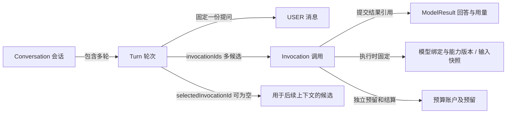

# ARTE AI 聊天界面需求及设计

> 版本：V1.18；文档更新日期：2026-10-15；整体实现基线核对日期：2026-10-12。公共空间首批 HTTP、共用空间选择器、阶段 A
> 新业务页面与浏览器恢复机制已交付，正式菜单初始化及已有库迁移脚本已提供。以下产品目标仍需按实际交付范围和验收记录判断，不表示阶段
> B／C 或动态 AI 授权已经完成。
>
> 目标：在新 AI 链路上建立可理解、可恢复的聊天与管理界面。保留左侧会话、中间聊天、右侧辅助栏的工作方式；以现有 `ainew`
> 契约为边界，先完成前端管理体验，再增量补齐确有必要的后端管理能力。

会话栏详细功能、交互、数据和验收以[ARTE AI 会话列表需求及设计](ARTE%20AI%20会话列表需求及设计.md) V1.8
为准；本文维护整体模块关系与共同约束。2026-10-15 按评审和用户性能要求统一窄屏模式、最近活动排序、编辑异常、服务端投影、独立元数据版本、100
条列表窗口与限定刷新。四项明确排除的 UI 优化保持原设计。第一阶段后端和第二阶段前端列表已编码并完成隔离验证；真实数据库迁移／联调及第三阶段布局仍待实施；不改写阶段
A 历史交付事实。

租户、通用工作空间、成员关系、模型资源归属、共享授权、凭据和预算的权威设计见[ARTE 顶层需求及设计](ARTE%20顶层需求及设计.md)
“设计 3.1～3.3、6.1、16”和公共及控制面接口。工作空间面向个人及组织，承载文章、集合、会话、助手、模型等资源；公共领域／API／规则／SPI
初期归 `arte-core`，`arte-ai` 消费公共能力并校验 AI 条件，`arte-app` 实现数据库／身份 SPI
及装配。本文负责聊天交互和接口接入，不另建租户、成员或权限体系。模型管理面向普通用户；首版只读仅为当前接口能力限制，不是长期产品定位。

## 1. 范围、约束与设计原则

### 1.1 本期范围

1. 阶段 A 已交付会话创建、分页、历史及浏览器本地置顶。增量目标为数据库置顶、命名与编辑闭环、最近活动排序、100 条列表窗口和回数据库第
   1 页、顶部手动刷新、Splitter 响应式与右侧 Tabs；完整范围及暂不实现项见会话列表专项 V1.8。
2. 纯文本发送、流式上屏、Markdown 展示、停止生成、最新轮次重新生成和候选回复浏览。
3. 模型及兼容预算选择，生成参数设置，配置应用、恢复与失效处理。
4. 右侧使用多个 Tab 展示“工作空间、会话设置、助手管理、模型管理、知识库引用”；工作空间和会话设置不使用抽屉，按真实能力及权限开放。
5. 预算摘要、待对账查看及有权限用户的人工核对，复用当前实现。
6. 加载、空数据、失败、权限不足、提交结果不确定、页面刷新和切换会话等完整流程。

### 1.2 明确约束

- AI 后端沿用 `com.arte.ainew`、`/arte/ai-new/*` 和新 AI 存储。通用空间／成员能力通过公共 API 接入，不要求位于 AI 路径；公共
  HTTP 已使用 `/arte/workspace/*`。不得为界面重构改变执行、上下文、幂等、预算及停止的既有语义。
- 新旧前端分开。旧 `/AI/ChatManagement`、旧接口和旧实体保持独立；新页面不得通过旧接口补齐新功能。全部新功能完成后再统一删除旧代码。
- 阶段 A 的界面改造不要求新增数据库表或改造执行引擎。公共空间首批基础能力已交付；后续补公共成员治理、资源授权等能力，在
  ainew 增量补模型控制面、资源资格及凭据端口，由 app
  提供持久化和身份适配；不为了管理界面重写执行链路。必要的会话元数据接口作为独立小任务实施，未完成前不展示可执行入口。会话栏专项明确允许临时入口、分组方式、分组／归档／删除菜单及搜索框只作展示，说明尚未开放且不执行业务动作；置顶／取消置顶与人工／自动命名是本批真实功能，需数据库及命令闭环。
- 知识库引用仅预留 Tab，暂不实现文章搜索、选择、检索、索引或引用功能。
- 不实现附件、视觉、生图、联网、工具调用、消息编辑重发、指定历史路径、手动切换上下文答案等当前文本入口尚未支持的功能。
- 助手与模型完整 CRUD 没有现成新接口，不能按旧实体直接复刻。本文同时给出首版可落地边界和后续面向用户的管理目标；用户自行添加模型属于明确目标能力，并非仅供配置人员使用。

### 1.3 原 TODO 转为设计准则

| 准则                 | 本设计的落实方式                                                                                         |
|----------------------|----------------------------------------------------------------------------------------------------------|
| 实体完整性及关系自洽 | Conversation、Turn、Invocation 分工不变；候选答案、配置偏好和执行事实分别管理                            |
| 行为一致性           | 模型只有一份已应用选择；展示、校验与发送采用同一配置；重试与重新生成语义不同                             |
| 流程有始有终         | 每项操作有入口、进行状态、成功反馈、失败处理及刷新后的恢复路径                                           |
| 界面友好、操作简单   | 聊天为主，管理按需展开；技术信息和高级参数折叠；未支持功能不伪装成功，会话栏约定的展示项明确提示尚未开放 |
| 合理默认值           | 从后端发现结果获得推荐额度；单一可用项自动选择；合法缓存重新校验后恢复                                   |

## 2. 实现基线与能力边界

以当前 Controller、请求 DTO、Service 实现和新前端服务类型为准。已有说明文档中的早期描述可能落后于实现，例如重新生成和多轮上下文已经实现，不能仅依据早期文档判断为缺失。下表保留阶段
A 能力边界，会话栏相关条目已于 2026-10-14 按源码核对并补充增量目标；目标不等于已交付。

| 能力                           | 当前后端情况                                                                      | 首版界面处理                                                                                          |
|--------------------------------|-----------------------------------------------------------------------------------|-------------------------------------------------------------------------------------------------------|
| 公共空间基础能力               | 已交付个人默认空间初始化、可访问目录、详情、创建／改名、偏好、基础权限及回执 HTTP | 接入公共选择器；AI 固定 scope 与公共空间不自动关联                                                    |
| 配置发现                       | 提供模型绑定、能力固定引用、窗口、额度限制、推荐值和兼容预算                      | 直接接入，不自行生成模型目录                                                                          |
| 会话创建、列表、详情、历史     | 当前列表页码／会话键升序，翻页替换记录                                            | 新模式采用最近活动排序、游标和 100 条窗口；旧调用保持兼容，限定刷新见专项                             |
| 搜索、摘要及轮数               | 当前只有本页标题筛选；无关键词契约、摘要及轮数字段                                | 搜索用 Input 加放大镜，本批仅样式，不运行本页筛选；摘要／轮数仍需真实字段，Elasticsearch 留待后续评估 |
| 会话命名                       | 无人工改名／自动标题新 HTTP 或状态                                                | 日期新建、首条问题自动标题、人工优先；独立 metadataVersion，真实超长才省略，见专项第 4.4／4.5 节      |
| 数据库置顶                     | 阶段 A 只有浏览器本地置顶，无新持久化命令                                         | 会话增 pinned 等属性，真实置顶／取消、当前主体／空间最多 7 个，服务端原子校验；不自动迁入旧本地记录   |
| 分组、归档、删除及临时会话     | 无对应新 HTTP，状态只有 ACTIVE、DELETED                                           | 仍只展示，不造业务状态或调用旧接口                                                                    |
| 会话助手及资源关联             | DTO/实体预留 chatProfile、resources；当前创建服务拒绝非空关联                     | 首版保持 chatProfile=null、resources=[]                                                               |
| 助手管理                       | AssistantManager 目前为空接口；无新 HTTP CRUD 和运行时助手接入                    | 保留 Tab，展示“通用文本聊天／助手配置暂未接入”，不提供伪保存                                          |
| 模型配置管理                   | 来源为服务器固定发布配置；发现接口只读，没有用户管理及来源权限 DTO                | 阶段 A 展示目录与选择；动态管理接口完成后开放“我的模型”和共享模型管理，不据旧接口伪造功能             |
| 发送、状态、结果、事件及 SSE   | 已有完整文本链路                                                                  | 复用，界面层调整展示                                                                                  |
| 停止、重新生成、多候选         | 已实现                                                                            | 复用原幂等和候选选择规则                                                                              |
| 预算与人工核对                 | 已有查询、待对账、确认及回执查询                                                  | 保留，管理表单按需打开                                                                                |
| 系统提示词、推理力度、Top K 等 | 当前文本 HTTP 入口不接收这些字段                                                  | 不从旧界面搬入首版可编辑表单                                                                          |
| 知识库及多模态                 | 本期不接入                                                                        | 知识库预留说明；其他功能暂不显示                                                                      |

## 3. 用户目标与核心需求

### 3.1 用户与权限

- 聊天用户：找到会话、发送问题、查看回答、选择可用模型、停止或重新生成。
- 普通用户／获授权配置管理者：在个人或其他获授权空间添加、验证、发布、编辑和停用模型配置；配置归空间，管理权不由创建者身份直接推断，默认不能修改无管理授权的共享模型。
- 租户／空间资源管理者：获得相应授权后管理组织或空间模型、发布版本及使用授权；使用和凭据维护权分别检查，不因管理角色自动读取所有用户会话。
- 助手模板维护者：后续按模板归属和授权管理；阶段 A 模型目录仍由服务器固定配置维护。
- 预算核对人员：在自己获授权的预算范围内核实费用与执行结束事实；不能处理其他主体账户。

前端沿用系统登录。scope 是租户与工作空间选择，不是授权声明。`ai:invoke`、`ai:conversation`、`ai:read` 由后端校验；费用核对还需要
`ai:budget:admin`。人工核对按钮以待对账响应的 `canReconcile` 为依据，提交仍由后端再次授权。

公共空间首批接口已交付：个人租户／默认空间通过显式幂等请求初始化，可查询本人可访问空间目录和详情、创建／改名空间、读取／更新启动及收藏偏好、检查基础权限及查询命令回执。页面使用公共空间选择器，不在前端生成默认空间或成员资格。接口及启用条件见[公共空间 HTTP](backend/arte-app/docs/PLATFORM_WORKSPACE_HTTP.md)。

前端已在全局顶部及新版聊天页面接入同一份标签内空间状态，统一当前 scope／详情、分页目录、偏好和请求协调。首次读取偏好明确返回
`PLATFORM_NOT_FOUND` 时，以保存的独立幂等键初始化个人默认空间；网络、未认证、权限或服务不可用错误不触发初始化，已存在未确认操作也不自动重发。
启动优先恢复合法标签内选择，再采用启动／最近访问／默认空间；不可访问时重新验证本人默认空间并提示回退。主动选择空间保存最近访问偏好，其他标签不强制跟随。

当前 AI 仍为 FIXED 授权路径，公共空间创建或选择不自动获得模型、预算或既有 AI 历史。阶段 A 保留“连接已有 AI 工作空间”入口供使用真实合法固定
scope，明确展示当前使用范围；公共空间没有可用配置时给出配置尚未接入／不可用说明，不静默回退其他 scope。不得写死
example-tenant 等联调值，不将公共权限检查作为 AI 执行许可。

目标交互中，每个用户自动获得由后端建立／读取的个人默认空间，可另建多个空间，也可接受他人或组织邀请加入协作空间。顶部使用与文章等模块一致的工作空间选择器，展示“我的／已加入”和归属者或组织，用户无需手填租户和
workspaceId。基础初始化与空间目录可直接接入；邀请／成员治理、组织治理、资源 ACL、政策管理、归档及关闭尚未交付，对应入口继续等待后端能力。不在前端生成虚假成员资格。

工作空间切换同时切换可用模型、会话、助手及草稿范围，取消旧前端观察并重新校验授权；切换不等于停止原执行，也不自动分享私有模型配置或历史。平台资源归属遵循顶层规则，聊天页面不另行制定跨租户继承。

空间内文章、集合、助手和模型配置统一归工作空间，租户级公共配置归租户；不按空间托管者、创建者或管理员身份改变归属。“我的资源”表示个人空间资源或本人可访问／管理的视图，不是
USER 所有权。私有表示访问范围，处置由有权者按空间策略执行。

空间负责人／管理员／成员／访客是治理角色，模型调用、资源编辑、分享、凭据维护与费用核对分别授权。管理员身份不自动开放私有会话或文章，createdBy
不自动产生永久权限。页面展示后端返回的归属及允许动作，提交仍再次校验；凭据责任、用户偏好及现有执行／账本身份独立保留，不将菜单权限或前端角色判断当作资源授权。

### 3.1.1 聊天模块中的工作空间入口

- 阶段 A 当前空间名称在页面顶部可见；增量将聊天内快捷下拉放在左栏顶部，目录和设置放在右侧工作空间 Tab，不打开
  Drawer，继续与全局入口共用状态及切换保护。空间目录展示真实角色、状态及默认标记，支持收藏和启动偏好；当前空间目录筛选仍只已加载页。会话搜索本批仅样式，不能声称全量搜索。现有
  View 没有托管者／组织来源字段，当前按返回的 tenantId 展示所属租户，不猜测组织名称或托管者标签；待后端补充可信来源后展示。
- 基础面板提供新建、名称／描述修改、收藏、设置／清除启动空间。创建及修改入口采用后端动作检查，不按负责人角色自动放行；打开表单后固定租户／空间目标。
  未确认写操作锁定原请求与键，已知 operationId 时只查询原回执；版本冲突刷新权威信息并保留用户输入，由用户检查后再次提交。
- 全局入口和聊天内入口均经过聊天配置草稿／未确认操作保护。空间切换提交前再检查保护，防止读取目标空间期间新编辑的草稿被丢弃；旧目录和空间详情迟到响应不覆盖主动选择。
- “新建工作空间／查看邀请／管理成员／空间设置”属于全产品共用入口，聊天页面只跳转或打开公共面板，不另建模型专用空间管理。
- 在有创建权的个人／组织归属下，只需名称和描述即可创建空间；无需先选择模型、预算或创建会话。之后可进入聊天，也可进入文章或集合模块。
- 接受他人个人空间邀请时，后端建立目标成员及必要的受限访客资格；不要求先手工加入组织，不显示邀请者其他私有空间。
- 个人协作空间显示“个人托管”及托管者，组织／团队空间显示相应归属；更换负责人不显示为所有权转移，跨租户转换待独立能力完成后开放。
- 加入空间不会自动看到他人私有会话；会话列表仍按后端执行归属和资源授权读取。共享聊天历史需另行接口，当前不开放。
- 切换空间前保护当前草稿、配置草稿及未确认写操作；新空间恢复自己的会话和偏好，未完成原调用通过返回原空间观察。
- 启动按合法用户偏好或最近访问恢复；对应空间不可访问时回退本人默认空间，并解释失效原因。默认空间与“此会话默认模型”是不同设置。
- 空间归档时历史按授权可读，禁止新发送／创建／业务编辑；CLOSING
  显示“关闭处理中”，从日常列表移至关闭记录，停止新业务但不标为已删除。关闭进度及处理入口按后端允许动作提供，后台核对不要求用户继续停留在原空间。
- 退出或被移除后停止新内容读取与前端观察，清理该空间缓存并回退可访问空间；原账本和必要后台收尾保留，不继续向失去权限的用户展示结果。状态处理依赖公共生命周期接口，不给当前
  Conversation DTO 添加伪空间状态。
- 文章集合等资源通过公共空间范围及其领域模块管理；本期知识库 Tab 仍只预留，完善通用空间概念不表示已经接入文章检索或引用。

### 3.2 首版必须完成的用户任务

| 编号 | 用户任务             | 完成标准                                                                                          |
|------|----------------------|---------------------------------------------------------------------------------------------------|
| R01  | 第一次开始聊天       | 设置空间后发现可用项；单项自动选择，额度采用推荐值；创建会话后可以发送                            |
| R02  | 找回已有会话         | 阶段 A 分页恢复历史；增量提供真实数据库置顶与滚动列表、元信息及恢复；搜索本批仅样式，专项分别验收 |
| R03  | 确认当前配置         | 输入框模型、右侧配置摘要及新消息请求完全一致；清楚区分已应用值与编辑草稿                          |
| R04  | 修改后续消息配置     | 修改、校验、应用或取消；说明仅影响之后的新消息，不更改已受理调用                                  |
| R05  | 停止并继续提问       | 提交耐久停止请求；保留部分回复；经权威状态确认用户停止后允许新问题                                |
| R06  | 对最新问题重新生成   | 复用原问题及原配置，创建新调用并独立计费；原回复保留，不新增用户问题                              |
| R07  | 网络异常后恢复       | 未确认受理时保留原请求与幂等键；刷新后恢复或查询原操作，不自动重发新操作                          |
| R08  | 查看余额与待核对费用 | 金额真实、精确；未知费用不补零；有权限用户可按既有流程核对                                        |
| R09  | 切换会话             | 草稿、配置偏好和页面状态按会话隔离；旧请求不能覆盖新会话                                          |

后续模型管理的增量任务：

| 编号 | 用户任务             | 完成标准                                                                                               |
|------|----------------------|--------------------------------------------------------------------------------------------------------|
| M01  | 在获授权空间添加模型 | 配置归该空间，保存草稿、验证、发布和兼容预算准备完成后进入可执行目录；本人通过初始授权管理，失败可修复 |
| M02  | 使用组织模型         | 来源清楚、可选择；没有编辑权时只能使用，不能维护共享凭据                                               |
| M03  | 管理共享模型         | 具有权限的租户／空间管理者可修改、发布、停用并配置使用范围，所有权不混同于创建者                       |
| M04  | 分享私有模型配置     | 展示目标成员／空间和实际授予动作；配置仍归源空间，不开放密钥维护权、不自动共享预算                     |
| M05  | 空间切换与默认选择   | 采用顶层默认优先级及当前可用性校验，资源／费用／缓存不串空间                                           |

## 4. 实体、配置归属与数据设计

### 4.1 服务端实体关系



- Conversation 管理会话标识、标题、归属和版本，不保存第二份执行状态或答案正文。
- Turn 固定本轮用户消息；首次生成和重新生成的 Invocation 都属于这一轮。
- Invocation 是执行状态、错误、结果引用及本次预算状态的权威来源。
- `selectedInvocationId` 为 null 时按当前后端规则采用最后一个候选解释历史；不得由前端持久化另一份服务器答案选择。
- 新候选完整成功后由后端更新选择；浏览旧候选只改变展示，不改变后续上下文。
- `Conversation.version`、`Turn.version`、`Invocation.version` 各自独立；不根据轮次数或本地操作推算会话版本。

### 4.2 首版配置不是服务端会话属性

现有 Conversation 不保存模型、预算、温度等字段，提交请求每次明确携带这些选择。右侧“会话设置”首版管理的是
**当前浏览器为这段会话保存的发送偏好**，不是已经写入服务器的会话配置。

配置展示区固定提示：“应用后用于此会话之后的新消息；保存在当前浏览器。已发送消息保留原配置。”不使用“已同步到服务器”文案，不保证跨设备恢复。

首版优先级：当前会话已应用的本地偏好 → 当前主体与空间最近一次合法偏好 → 当前发现选项的推荐值。无合法缓存且有多个模型／预算时要求选择，不把排序第一项包装成服务端默认模型。

后续接入助手后才增加“助手模板 → 会话覆盖”的运行时继承关系。届时由后端解析固定版本并记录快照；前端不能通过在用户问题前拼接提示词模拟助手。

模型资源和服务端默认偏好接入后，选择优先级遵循顶层“会话显式选择 → 用户空间偏好 → 空间默认 → 租户默认”；已失效或无权限的默认不能直接激活。阶段
A 尚无后两层发现接口，仍按上述本地偏好和推荐值初始化，不臆造组织默认。

### 4.3 前端状态与本地存储

| 数据                     | 归属与生命周期                          | 首版处理                                                                                       |
|--------------------------|-----------------------------------------|------------------------------------------------------------------------------------------------|
| 已应用发送偏好           | 用户 + scope + conversationId           | localStorage，带 schemaVersion；恢复前重新发现、校验                                           |
| 最近合法发送偏好         | 用户 + scope                            | 用于新会话初始化，不覆盖已有会话偏好                                                           |
| 未应用配置               | 当前会话编辑草稿                        | 内存中保存；切换时提示应用或放弃，不默默写入其他会话                                           |
| 消息草稿                 | 用户 + scope + conversationId           | sessionStorage；同一标签页刷新可恢复，明确不保证跨设备                                         |
| 未确认写操作             | 用户 + scope + 操作类型 + 目标          | sessionStorage 保存完整请求和原幂等键；恢复时锁定原操作，不能改参数后重试                      |
| 置顶属性及命名来源／状态 | 当前会话及后端授权范围                  | 增量数据库持久化，最多 7 个置顶；人工命名标志及自动任务资格不能只存浏览器                      |
| 面板宽度与开合           | 当前页面布局                            | 阶段 A 使用 localStorage；增量进入时使用默认宽度展开，当前页面内记拖动宽度，旧偏好不覆盖初始值 |
| 会话列表窗口             | 用户 + scope + 查询批次                 | 置顶＋普通合计最多 100，回收前部及旧分页缓存；返回顶部重读第 1 页，详情／原操作快照独立保留    |
| 历史、状态与结果缓存     | 用户 + scope + 会话／调用 ID + 权威版本 | 内存有界缓存，按需失效；不依赖 localStorage 证明执行完成                                       |
| 当前空间与页面导航       | 当前浏览器标签／路由                    | 同一标签跨模块继承；不同标签独立，不将 localStorage 最近访问变化广播为强制切换                 |

会话栏的置顶、命名、列表窗口及刷新由专项维护。旧本地置顶不自动迁入数据库，临时展示项不写真实选择。名称／置顶采用独立
metadataVersion，不因列表属性变更推进执行版本；原请求与人工优先保护继续保留。

存储键使用 `arte.ainew.*.v1` 命名空间。现有新测试页的 `arte.ai-new.chat.config.v1` 若迁移，只作为未验证候选值，不直接激活。不得读取旧
AI 的配置缓存、旧助手 ID 或旧模型 ID。

启动偏好及最近访问只是导航提示；已打开会话、管理面板及每项操作固定自己的 scope 与目标。标签 B 切换空间不能改写标签 A
的保存或发送请求；版本、幂等键与原请求快照不因全局偏好变化替换，迟到响应仍校验来源。

用户身份以现有登录提供的稳定标识划分本地数据；它只用于本地隔离，不作为后端 owner。退出登录或切换账户清理内存与该账户
sessionStorage，取消观察请求；不向下一账户展示前一账户数据。不保存 Token、供应商凭据或连接地址。

配置存储失败不会阻止已经校验通过的当前会话使用，但提示“已应用，本地保存失败，刷新后可能需要重设”。未确认写操作快照若无法保存，应明确提示保留页面；不得因刷新丢失快照后自动生成新键重发。

## 5. 设计

### 5.1 界面结构

新业务页面已建立于 `/AI/ChatNew`，页面名称“AI 聊天（新版）”，通过 Umi 约定式路由注册。初始化菜单提供独立 `ChatNew` 入口，默认分配给
admin 角色；其他角色可通过菜单管理分配。已有数据库使用 `deploy/mysql/sql/migrations/20261011-ai-chat-new-menu.sql`
增量建立入口，登录后刷新账号菜单。菜单展示资格不替代 AI scope 授权。现有新测试页 `/AI/Chat` 保留为联调入口，旧
`/AI/ChatManagement` 保持独立。

```text
┌───────────────┬──────────────────────────────────┬────────────────────┐
│ Logo/空间/工具│ 会话标题                设置开关 │ 会话 助手 模型 知识│
│ 搜索会话      │ 当前助手：通用聊天               │                    │
│ 临时／真实置顶│                                  │ 当前 Tab 内容      │
│ 普通会话列表  │ 用户问题                         │ 常用设置           │
│               │ 模型回答 / 来源候选切换          │ 高级设置（折叠）   │
│ 滚动加载／状态│                                  │                    │
│               ├──────────────────────────────────┤                    │
│               │ 状态与简要费用提示               │                    │
│               │ 消息输入框                       │                    │
│               │ 模型 ▾         发送 / 停止       │                    │
└───────────────┴──────────────────────────────────┴────────────────────┘
```

- 水平 Splitter 的三 Panel 保留，宽度基准为实际可用容器。侧栏默认／最小 300px，并排最多 50%，聊天最低
  480px；空间足够三栏默认展开，不足先收起右侧，再改单区域模式，见专项第 3.1 节。
- 单区域模式只显示列表、聊天或设置之一，侧栏独占可用宽度、仍最小 300px，不受并排 50% 上限；最小支持容器 300px。只隐藏不卸载，不把
  375px 聊天压成 75px，不用 Drawer。
- 右栏使用现有多个 Tab，空间／设置入口切入对应区域，Tab 溢出使用组件滚动能力，草稿保留；不增完整尺寸规范。页面顶部工具区增加刷新会话列表按钮，不强行塞入左侧已有四图标。
- 消息区与输入区独立布局，聊天区域可见时发送区始终可见；单区域模式进入列表／设置时暂时隐藏聊天而不卸载。普通正文建议限制在约
  800～960px 内，宽表格和代码横向滚动。
- 会话栏顶部展示 ARTE logo、当前工作空间入口及四个工具图标；聊天区域顶部保留标题与助手状态，左栏收起后仍可展开并访问空间入口。空间入口与文章模块共享，不维护第二份
  scope；模型唯一常用选择入口放在输入框，不能把模型选择器当作空间切换器。右侧会话摘要只读展示，模型
  Tab 管理同一选择源。
- 功能图标统一 DynamicIcon，图标／标题／日期大小按用途和可读性选择；Logo 为白色加粗文字 ARTE、#81D3F8 底、5px
  圆角。折叠、菜单及动作可聚焦，键盘可选择、发送、停止和切换 Tab。

### 5.2 左侧栏——会话管理

完整规范集中在[会话列表专项](ARTE%20AI%20会话列表需求及设计.md)第 3／4／6 节，本文只维护共同连接：

- 空间使用共享状态／授权与保护，管理在右栏 Tab；暂不实现项不扩业务范围。
- 新建日期会话、首条问题自动标题和人工编辑优先；独立元数据版本不干扰发送／历史。标题点击只编辑，不增加提示；失败不丢稿或误切换，见专项第
  4.4 节。
- 两区相同行表现，仍不增加分区视觉边界、固定尺寸规范、日期轮数解释。服务端维护轻量列表投影，同一最近消息时间倒序，无消息回退创建时间，再按
  ID 排序，见专项第 4.3／6.2 节。
- 数据库置顶最多 7 个；列表合计最多 100，普通窗口回收前部但聊天详情保留。返回顶部重读数据库第 1 页，末页状态只指本轮遍历结束，见专项第
  4.7 节。
- 新建、置顶／取消、进入列表上下文刷新；其他消息变化默认手动读目录。名称回执仅就地反馈名称，不查整份列表；聊天／SSE／预算观察不受该限制，见专项第
  4.8 节。
- 置顶刷新保留窗口锚点，新建／手动刷新／返回顶部回第 1 页；旧批次丢弃迟到响应，查询与缓存见专项第 6.6 节。

阶段 A 本地置顶不自动迁移。新方案需真实持久化、授权、幂等及性能验收，不能通过静态截图认定交付。

### 5.2.1 右侧辅助栏——工作空间

左侧工作空间下拉负责快捷选择；管理入口展开右栏并激活“工作空间”Tab。目录、详情、创建、名称／描述修改、收藏／启动偏好、空间 AI
配置及未确认操作反馈在该 Tab 或相应右栏分区呈现，不再用工作空间 Drawer。

复用公共共享 hook、目录及动作检查，拆分现有 WorkspacePicker 的呈现层，不把包含 Drawer 的组件直接塞入 Tab。Tab
切换保留表单目标、草稿和原操作键；页面中其他空间入口仍共用状态和切换保护，不复制权限／配置选择源。

### 5.3 右侧辅助栏——会话设置

分成“当前配置”“生成偏好”“高级参数”“会话信息”。

| 项目                 | 编辑与生效规则                                             | 来源／请求映射                                      |
|----------------------|------------------------------------------------------------|-----------------------------------------------------|
| 模型                 | 摘要只读；点击“选择模型”进入同一模型选择器                 | discoverChatOptions 的 binding、capability 精确引用 |
| 预算账户             | 单个自动选中；多个选择；切换模型后重新验证兼容性           | budgetRefs → budgetRef；余额来自 getBudget          |
| 最大回复 Token       | 数字输入，采用推荐值；不使用无依据的“短／中／长”映射       | generationOptions.maxOutputTokens                   |
| Temperature、Top P   | 默认“使用发布配置默认值”，允许高级用户显式覆盖或恢复默认   | null 或合法数值；发现响应未给出默认数值时不编造     |
| 最大输入 Token       | 高级项，说明包含历史和本轮问题，并影响预算预留             | maxInputTokens                                      |
| 超时                 | 高级项，单位秒；不等同于 SSE 连接期限                      | timeoutSeconds                                      |
| 历史使用方式         | 首版只读说明：检查最近最多 10 轮，采用完整成功的纯文本答案 | 由后端 ChatHistoryLoader 决定，不提供可编辑轮数滑块 |
| 会话标识、版本、时间 | 只读，折叠详情，ID 可复制                                  | getConversation                                     |

表单有“应用到此会话”“取消修改”“使用模型推荐额度”。推荐额度仅重设输入、输出和超时，不偷偷改变已明确覆盖的采样参数。模型／预算变化后不能无提示沿用不兼容配置。

未应用修改显示“有未应用更改”，原已应用值仍可查看；为防用户按新值理解旧请求，此时暂不允许新发送／重新生成，用户应用或取消后恢复。已受理调用、原幂等重试和停止不受编辑草稿改写。

应用仅更新当前浏览器的发送偏好，没有服务器配置写接口；不调用 createConversation
或发送模型请求来“保存设置”。应用成功后摘要与模型选择同步更新，并说明从下一次新发送生效。

常用模型快捷选择也采用同一流程：合法且无需额外选择时可以直接应用并反馈；需要换预算或调整额度时先展开配置确认，不建立第二份独立
activeModel 状态。

### 5.4 右侧辅助栏——助手管理

**首版。** 保留 Tab，显示“当前：通用文本聊天。助手模板尚未接入新 AI 链路”。允许查看功能说明，不显示旧助手列表，不提供新增、编辑、删除、默认助手或系统提示词输入框。

**后续目标。** 接入后将“选择使用”与“编辑模板”分开：Tab 展示名称、用途、版本、默认模型及“用于此会话”；“管理助手”打开宽抽屉或独立页面，完成新建、复制、编辑、停用和依赖检查。

- 编辑采用草稿与明确保存，发布后形成固定版本，修改不覆盖已有执行快照。
- 展示“来自助手模板／此会话覆盖／恢复模板默认”；会话覆盖不修改模板。
- 系统提示词必须明确替换／追加规则，并由后端解析，不能作为 USER 内容拼接。
- 在可查询、可关联、可解析并参与执行之前，不只做前端 CRUD。本任务不为此扩充执行接口或定义助手数据库实体。
- chatProfile 是 `type=chat-profile` 的固定引用，不能直接填旧 assistantId，也不能假定它与未来助手定义是一对一关系。

### 5.5 右侧辅助栏——模型管理

**产品定位。** 模型管理面向普通用户，支持使用租户／空间提供的模型，也支持在获授权空间自行添加及管理配置。配置归空间或租户，“我的模型”是本人可管理视图，不表示
USER owner。规则引用顶层第 3.1、6.1 节；页面只呈现后端确认的归属和允许动作，不根据名称、createdBy 或密钥提供者推断归属及管理权。

**阶段 A：当前可用目录与选择。** 数据唯一来源为 discoverChatOptions；模型卡显示
displayName、binding.id@version、窗口、输出上限及兼容预算数量。名称相同时显示绑定版本以便区分。

- “用于此会话”调用统一配置应用流程；当前项标记“已应用”。
- 只声明当前接口确认的“文本／流式”能力，不依据供应商名称推断视觉、联网、深思或生图能力。
- “刷新可用模型”重新发现；空结果、权限失败、网络失败分别提示。
- 页面提示“模型连接和发布配置当前由服务器维护”。不展示 API Key、endpoint、连接编辑、探测、删除或设为全局默认按钮。
- 当前发现响应没有来源、ownerType、管理权限及连接管理数据，因此不能据它开放“我的模型／共享管理”编辑。只读限制来自当前接口，不能解释为普通用户永远无权添加模型。

**阶段 C：用户模型与共享资源管理。** 新控制面接口及权限闭环完成后提供以下入口：

| 入口                 | 展示与操作                                                                                                        |
|----------------------|-------------------------------------------------------------------------------------------------------------------|
| 可用模型             | 当前空间可执行资源，标记“当前空间／租户提供／其他空间授权”；私有／共享、凭据来源另行展示，调用统一选择与应用流程  |
| 我的模型（我可管理） | 当前范围内本人获授权管理的配置，可显示草稿、验证失败、停用及缺少兼容预算等状态；不按 createdBy 或 USER owner 过滤 |
| 共享模型管理         | 仅有相应权限时出现；管理当前租户／空间资源和使用范围，不混入无管理权的共享项                                      |

普通聊天选择器只显示可执行项；管理列表中的不可执行资源显示原因及修复入口。相同远端模型可以存在多份资源，必须以资源及绑定固定版本区分，不用名称去重。

**添加与编辑流程。** “添加模型”打开宽抽屉，固定打开时的空间，配置归该空间；租户级创建仅在后端返回相应资格时另行开放，不提供
USER 归属选项。展示保存空间与可见范围，填写名称、供应商／协议、连接、凭据和远端模型；个人提供凭据需策略允许，明确凭据责任及维护资格，不能据此将配置标为个人所有。创建草稿不自动公开，本人通过初始授权获得相应管理动作。

1. 保存服务器草稿，显示真实保存状态；失败保留输入并可重试。配置页允许输入密钥，但不放入 localStorage、会话偏好或操作日志，提交后只显示脱敏凭据状态。
2. 验证连接与能力，展示结果；验证不是聊天发送，不创建虚假聊天轮次。若可能消耗供应商额度，在验证前说明。
3. 发布固定版本并检查预算兼容性；没有可用预算时提示等待配置／额度准备，不自动创建无约束账户。
4. 刷新可用模型；用户主动“用于此会话”后更新会话偏好，不自动改写当前模型或原未确认请求。

编辑与凭据替换按字段权限控制；不回填共享密钥。管理操作有版本冲突及幂等恢复，保存草稿与发布为可用分别反馈。新发布不覆盖已发送消息采用的版本；停用说明影响范围，被引用资源按后端退役规则处理，不提供前端硬删除历史。

**分享与默认。**
私有配置向本空间成员或同租户其他空间开放时，确认目标、允许动作和空间政策；默认只授予使用，配置仍归源空间，不转交密钥维护权，不共享历史和预算。组织空间内从私有改为共享只是访问范围变化，不展示“个人所有权转为组织所有权”。从个人空间迁移到组织空间是后续受控跨租户流程，不以共享开关代替。各层默认设置按权限显示，选择默认不授予执行权。

本人个人租户内多空间复用是目标能力，接入后通过源空间授权使用同一配置／连接引用，不要求重复输入密钥；首阶段可限定创建空间，界面说明当前范围。个人租户资源进入组织租户的引用／迁移另行设计，不显示已可跨租户分享。

**凭据与费用来源。**
配置来源、凭据提供者和费用说明分别表达。所有配置首阶段使用调用用户在执行空间中的兼容应用内预算，供应商费用依实际凭据账户及已确认政策显示，不因配置归空间或由某用户创建而推算付款者。个人凭据撤销可使配置不可执行，获授权管理者看到修复提示；不改变配置、历史或账本归属。共享预算池另行接入，不能选同一个
budgetRef 绕过归属。

上述管理依赖公共空间／授权 API 和 AI 动态目录、凭据与发布接口，不读写服务器配置文件或旧模型表。公共资格与 AI
发布／能力／预算条件同时满足才可执行；发现与执行解析一致接入，不能只替换身份解析器。公共契约与 AI 改接清单见顶层文档“详细设计”第
2～5 节；模型管理 DTO、凭据存储及验证／发布 HTTP Schema 仍需在对应功能批次细化。本文第 7 节仍只列当前实际执行与查询接口。

### 5.6 右侧辅助栏——知识库引用

仅保留 Tab 和说明：“知识库引用将在后续版本开放，当前回答不会从文章知识库检索。”本期不挂载旧 RagSider、不查询文章、不提交
articleIds、不写 resources，也不显示“已选资料”或引用来源数量。

后续接入时再定义关联集合、指定文章和指定段落的区别；执行结果 sources 与资源版本用于追溯。当前不把“实体存在资源字段”解释为运行时已经支持资料。

### 5.7 消息列表管理

**组成。** 一轮显示一条用户问题和一个当前候选回答，候选使用“回复 1 / 2”切换。轮次按 sequence 排列；历史默认最新页、每页 10
轮，向上加载较早页。读取各页必须使用一致的会话版本，409 后刷新详情并重建分页结果，不能拼接不同版本的历史。

**展示答案。** 默认优先展示服务器选中候选；没有显式选择时遵循后端的最后候选规则。新候选生成时展示其过程，同时保留“查看原回复”；完整成功后按刷新后的服务器选择展示。浏览其他候选不会触发选择接口，也不会改变模型历史。

**Markdown。** 支持段落、标题、列表、表格、引用和代码块；禁用原始 HTML
执行，过滤危险链接协议。代码块可复制，宽内容横向滚动。复制回答采用原始正文，不夹带状态或费用文案。流式阶段按帧合并渲染，避免每个字符重建整页；不人为增加逐字播放延时。

**流式与权威结果。** text-delta 是非耐久预览，按 attemptId 与 UTF-16 offset 合并；耐久 OUTPUT 按 sequence
去重，重叠正文不能重复追加。预览不推进事件游标；最终 ModelResult 覆盖预览。刷新后未保存片段可能无法恢复，不能承诺所有已看见文字均已入库。

**阅读。** 用户位于底部时自动跟随；向上阅读后暂停跟随，显示“有新内容／回到最新”。加载较早历史保持滚动锚点。活动生成的状态放在当前回答附近，旧历史阅读不能使正在生成的调用失去状态观察。

**消息操作。** 首版提供复制、最新轮次重新生成、候选浏览、查看执行详情。编辑、引用、删除单条消息、手动选为上下文和点赞暂不展示，避免空回调或与后端历史不一致。

**元信息。** 默认只展示模型、状态及完整／部分结果标记；Token、finishReason、invocationId、错误码、失败阶段和 correlationId
放入详情。Token 未知显示“未知”，不显示 0。当前状态 DTO 不提供本次最终金额，不能用账户 charged 或前后余额差推算单次费用。

### 5.8 消息发送

- 纯文本输入，Enter 发送、Shift+Enter 换行；中文输入法组合输入期间 Enter 不触发发送。
- 可持续编辑独立的新问题草稿；活动调用、未应用配置和受理结果不确定时禁止普通发送，并显示具体原因。停止、原请求重试等恢复操作仍可用。
- 客户端预检非空文本、DTO 字符限制和当前模型返回的 UTF-8 字节限制；包含历史的输入容量最终由后端校验。字数、字节数与 Token
  不混用。
- scope、会话详情、配置、历史与预算完成校验后允许发送。首版余额为零／负数、未知或查询失败时阻止新发送并给出刷新入口；正余额仍不保证
  Worker 预留成功。
- 点击后固定文本、版本、模型、预算、生成参数及超时，立即建立该操作快照并防重复点击。202 后才清除已提交草稿，追加／恢复服务器轮次；不是
  202 就展示成功答案。
- 网络、408、5xx 等受理不确定时显示“重试确认原提交”，复用完全相同请求与键。不能自动创建新键、换模型重发或重新创建用户问题。
- 明确 4xx 拒绝后保留文本供修正；409 根据业务码区分版本冲突、会话忙和幂等冲突。刷新状态不自动提交新消息；幂等内容冲突提示恢复原操作，不能通过换键绕过。

### 5.9 停止生成与重新生成

停止只针对确定 invocationId 的活动调用。按钮变为“正在请求停止”，同一目标重复点击防重，网络不确定重试沿用原键。收到回执不立即把执行标成
CANCELLED；保持原状态观察，停止与完成竞争时以服务器事实为准。

| 权威状态                                    | 展示                                           | 能否继续发送新问题                               |
|---------------------------------------------|------------------------------------------------|--------------------------------------------------|
| ACCEPTED／QUEUED／RUNNING                   | 已受理／排队中／生成中，显示停止入口           | 否                                               |
| SUCCEEDED                                   | 已完成；若结果读取失败则给出恢复入口           | 完成必要历史、版本及预算刷新后可以               |
| CANCELLED                                   | 已停止，显示已有部分回复                       | 完成刷新后可以                                   |
| GENERATION + UNKNOWN + INVOCATION_CANCELLED | 已停止接收；远端结果及费用待核对，保留部分回复 | 当前后端耐久停止语义允许继续，仍需有效配置及预算 |
| 普通 UNKNOWN                                | 执行结果待确认，展示刷新和待核对入口           | 否，等待后端核对后恢复                           |
| FAILED／TIMED_OUT／INTERRUPTED              | 对应失败、超时、中断说明，可显示部分结果       | 以刷新后的会话门闩、历史和预算校验为准           |

不能仅因本地点击停止、断开 fetch 或 SSE
关闭就解锁会话。停止调用的部分回复保留展示，不作为下一轮模型上下文；当该轮没有仍被采用的完整成功候选时，这轮原问题也不进入后续上下文。如果停止的是一次重新生成，而服务器仍采用此前的完整成功答案，则原问题与该完整答案仍按后端规则参与历史。待对账预留不因此释放或清零。

重新生成仅对最新 Turn 的允许来源调用开放：已知终态，或后端认可的用户主动停止 UNKNOWN；普通 UNKNOWN
先核对。使用原问题、原上下文快照、原模型／能力版本、原生成参数和原预算；当前表单的新模型不参与此次重新生成。按钮旁说明“沿用原配置，会产生新的调用和费用”。

重新生成不新增用户问题，新增 Invocation 候选；失败或停止保留原完整答案。新操作用新键，网络不确定重试保留原来源、expectedConversationVersion、timeoutSeconds
及键。预算不能用当前所选新账户的余额判断原账户是否足额；后端对来源预算继续授权并预留。

### 5.10 预算与费用核对

聊天区域展示账户可用余额及“查看费用”；额度、预留、已扣及待核对列表放在抽屉，不让账本表单长期占据聊天空间。金额使用后端十进制字符串，需要计算时使用十进制库，不转为浮点数推算实费。

待对账按需查询，普通用户可查看；`canReconcile=true` 时显示核对表单，复用已有 ReconciliationPanel
的流程。实际金额、币种、证据、说明及执行结束确认均按契约校验，未知费用不自动填 0。

核对网络不确定时锁定原表单和键；重试或调用现有回执查询确认。409 重新读取记录并核对当前版本。成功显示权威回执并刷新预算、调用状态及相关历史；普通
UNKNOWN 在核对收敛后才恢复发送。聊天页面不实现充值、自动查供应商账单或调整账户限额。

## 6. 请求、观察与恢复流程

### 6.1 页面进入与刷新

1. 读取当前登录与空间候选，本地缓存按身份隔离；无 scope 时先配置空间。
2. 在明确的 scope 下可加载会话；同时重新发现配置，验证精确引用和参数，查询所选预算。
3. 合法偏好自动恢复，不要求每次刷新点击应用；无配置、多项未选或失效时显示对应选择入口。
4. 恢复最近会话 ID 时调用 getConversation，404 则清除失效选择并回到列表；不因为失败自动创建新会话。
5. 读取最新详情和历史，按需恢复相关调用。发现同主体的未确认操作快照时优先提供原键确认路径，不靠文本相同推断已受理。
6. 恢复可编辑草稿；在配置、状态、历史和预算未确认前禁止新发送，但不阻止阅读。

### 6.2 状态观察策略

- 复用 useChatSession 和 invocationStream 的现有语义，正常 SSE 连接下不为每条历史回答建立状态轮询。
- 同用户、scope、invocationId 的并发读取合并；候选回复按需读取，缓存有界。
- 已知终态且预算 SETTLED／RELEASED／NOT_RESERVED、所需结果已读取后可复用缓存；UNKNOWN 和仍 RESERVED 的状态不能当作最终确定事实缓存。
- 收到 STARTED、TERMINAL、BUDGET_CHANGED 等通知后查询权威状态；resultAvailable=true 才读取结果。没有结果的已知失败不无限查询结果。
- SSE 不可用时沿用约 10 秒的低频恢复查询；401／403 停止自动请求，410 读取权威状态／结果并说明事件缺口，避免重复重连过期游标。
- 执行终态与预算结算分开判断；终态到达但 RESERVED 时继续必要观察，待对账不做无限高频轮询。
- 会话、scope 切换及卸载取消前端观察并忽略迟到响应，不取消后端执行。重新进入时按服务器历史恢复。
- 本地已知的阻塞状态与最新页共同参与发送校验；后端会话门闩仍是最终保护，不能因浏览旧页而绕过活跃调用。

### 6.3 错误与反馈

| 场景                   | 提示与可执行下一步                                                     |
|------------------------|------------------------------------------------------------------------|
| 配置发现无可用项       | 无可用文本模型／兼容预算；刷新配置或联系配置人员，不展示空白下拉       |
| 列表／历史加载失败     | 显示失败和重试，不误显示“暂无会话／消息”                               |
| 401                    | 登录失效，停止自动请求，进入现有登录流程；登录后同账户才恢复对应操作   |
| 403／配置撤销          | 保留草稿，停用该配置，显式重新加载和应用；旧不确定提交不能改配置重试   |
| 409 版本冲突／会话忙   | 刷新详情、最新历史与状态，说明原因；由用户决定下一次发送               |
| 结果尚不可用           | 保持观察；结果字节损坏等 500 显示读取失败，不能当作仍在生成            |
| 预算未初始化／配置冲突 | 提示需配置人员处理，不在页面初始化或重置账户                           |
| 余额非正／预留不足     | 显示账户事实或调用失败；刷新预算、选择兼容预算，不能承诺发送必定成功   |
| 输入容量超限           | 保留文本，建议减少本轮文本、调整合法输入额度或新建会话；不静默删除历史 |
| 普通 UNKNOWN           | 解释执行待确认，提供状态刷新及待对账入口；无核对权限时只读             |
| 本地保存失败           | 明确当前应用与持久保存的区别；不清空已编辑内容                         |

主要反馈在操作附近展示，Toast 仅用于辅助提示。不得同时叠加多个表达相同原因的黄色／蓝色大提示框。

## 7. 接口映射与字段规则

AI HTTP 调用使用 `src/services/arte-ai`；公共空间使用 `src/services/platform/workspace.ts`。两者沿用现有 Token
和语言拦截器。以下为当前实际接口，公共前缀 `/arte/ai-new`；均为
POST，SSE 使用 fetch 流读取。

| 页面操作           | 接口后缀                                            | 关键契约                                                                                |
|--------------------|-----------------------------------------------------|-----------------------------------------------------------------------------------------|
| 可用模型与预算发现 | configuration/discoverChatOptions                   | scope；ResultContext.data.options                                                       |
| 创建会话           | conversation/createConversation                     | scope、title，Idempotency-Key；profile 为空、resources 为空                             |
| 会话列表           | conversation/listConversations                      | scope、page；records/current/size/total 在顶层                                          |
| 会话详情           | conversation/getConversation                        | scope、conversationId；取得真实 version                                                 |
| 历史轮次           | conversation/queryTurnsOfConversation               | scope、conversationId、expectedVersion、page                                            |
| 新问题             | chat/turnsForChat                                   | 本轮 text、固定引用、额度与预算、expectedVersion；202 返回 invocationId                 |
| 重新生成           | chat/regenerate                                     | originalInvocationId、expectedConversationVersion、timeoutSeconds；202 返回 executionId |
| 停止               | invocation/cancelInvocation                         | scope、invocationId，Idempotency-Key；返回 ControlReceipt                               |
| 执行状态／结果     | invocation/getInvocationStatus、getInvocationResult | scope、invocationId；分别管理事实与结果                                                 |
| 耐久事件／流式     | invocation/invocationEvent、watchInvocation         | 排他游标 afterSequence；事件查询另带 limit                                              |
| 预算               | budget/getBudget                                    | scope、budgetRef；金额为十进制字符串                                                    |
| 待对账             | budget/pendingReconciliations                       | scope、budgetRef、current、size；data 内含 page、canReconcile                           |
| 核对及回执         | budget/confirmReconciliation、reconciliationReceipt | 确认带两种版本及 Idempotency-Key；回执查询带原 key                                      |

上表保留既有聊天路径。会话栏已接入 `createDefaultConversation`、`queryConversationWindow`、`listConversationsCursor`、
`getConversationMetadata`、`renameConversation`、`setConversationPinned` 和 `getMetadataCommandReceipt`；
数据库置顶、摘要／轮数、人工命名及首问自动标题已完成后端和前端代码，契约详见[会话接口说明](backend/arte-ai/CONVERSATION_HTTP_API.md)。
真实数据库迁移及服务联调仍待实施。搜索本批仅 Input 样式，不新增检索请求；分组／归档／删除仍为不可执行的展示项。

**已交付公共空间接口（POST；部署 context-path=/arte 时）：**

| 页面操作             | 公共路径                                                                   | 边界                                                                                     |
|----------------------|----------------------------------------------------------------------------|------------------------------------------------------------------------------------------|
| 本人默认空间初始化   | `/arte/workspace/initializePersonalWorkspace`                              | 无主体请求字段；Idempotency-Key；服务端建立／读取真实个人租户与默认空间                  |
| 可访问空间分页／详情 | `/arte/workspace/listAccessibleWorkspaces`、`getWorkspace`                 | 列表 current／size；详情 scope；只返回当前可访问范围                                     |
| 创建／改名空间       | `/arte/workspace/createWorkspace`、`renameWorkspace`                       | 创建归指定租户；改名带空间预期版本；均独立幂等命令                                       |
| 本人空间偏好         | `/arte/workspace/getWorkspacePreference`、`updateWorkspacePreference`      | 更新带偏好预期版本，完整提交 startupScope／lastScope／favorites；不修改系统 defaultScope |
| 基础权限检查         | `/arte/workspace/access/checkWorkspaceAccess`、`batchCheckWorkspaceAccess` | 展示判断，不替代命令或 AI 授权；不支持已有业务资源 ACL                                   |
| 原命令回执           | `/arte/workspace/getWorkspaceCommandReceipt`                               | 按 operationId 查询，原操作者且当前结果仍可读；未知 operationId 时按原键原请求重试       |

公共枚举使用数字编码：空间 state=0／1／2／3 对应 ACTIVE／ARCHIVED／CLOSING／DELETED，currentRole=0／1／2／3 对应
OWNER／ADMIN／MEMBER／GUEST。完整 Schema、错误及能力边界以[公共空间 HTTP](backend/arte-app/docs/PLATFORM_WORKSPACE_HTTP.md)
为准。当前首批尚不开放邀请、成员／组织治理、资源分享及空间生命周期；安装公共服务不切换 AI 的 FIXED 授权模式。

创建、发送、停止、重新生成和人工核对均按操作管理幂等键；查询不生成写操作键。regenerate 的 executionId
可在前端服务适配层统一为调用标识，但不更改后端响应或伪造 turnId。

**提交字段规则：**

- binding 与 capability 的 type、id、version 原样采用发现结果，禁止 latest、旧 modelId、凭据或客户端声明的 owner。
- maxInputTokens、generationOptions.maxOutputTokens、timeoutSeconds 为合法正整数，受 DTO 和发现 limits 双重限制；输入加输出不得超过
  contextWindowTokens。文本字符上限取当前 ChatRequests／ContractChecks 契约，不照搬旧输入框的固定 4000 字限制。
- temperature 为 null 或 0～2；topP 为 null 或大于 0 且不超过 1；首版 stopSequences
  固定为空数组。发现接口当前没有返回每项采样参数的支持标记，合法数值仍可能被适配器拒绝；页面应保留设置并显示该参数不支持，不能静默删除参数后重发。
- 当前请求不接收
  systemPrompt、assistantId、knowledgeBaseId、contextWindow、reasoningEffort、topK、penalty、globalMemory、queryRewrite、attachments、enableSearch
  等旧字段。
- 页面仅提交当前问题；完整历史、角色、上下文快照由后端构建。窗口说明不能承诺任意长历史都可装入。
- 配置发现不证明连接已探测成功、Worker 在线或预算足额；提交和执行仍重新检查。

## 8. 前端工程与新旧隔离

建议目录：

```text
frontend/src/pages/AI/ChatNew/             # 新业务页面入口与布局
frontend/src/features/ainew/              # 新组件、状态、校验及视图模型
  conversation/  configuration/  chat/  budget/
frontend/src/services/arte-ai/             # 现有新接口封装，继续复用
frontend/src/pages/AI/Chat/                # 已有新链路联调入口
frontend/src/pages/AI/ChatManagement/      # 旧业务页面，本期不替换
```

- 从当前新测试页提取可复用 hooks／校验到 features/ainew，测试页和业务页都使用同一实现，避免复制两套发送、停止及幂等逻辑。保持现有测试可运行。
- 可复用通用 Splitter、表单和 Markdown 展示工具；不得直接复用会发旧请求的
  ChatContext、ConversationSider、AssistantSider、ModelSider、RagSider。
- 一份 ConfigurationStore 管理发现选项、已应用值与草稿；一份会话会话态管理调用和草稿，派生
  canSend／canRegenerate／canStop，不由多个按钮自行判断。
- 模型绑定＋版本作为选项标识；不能只按 displayName 或供应商 modelId 去重。
- 状态摘要、当前候选和错误文案由新 DTO 映射为 ViewModel，原 DTO 不混入旧 Message／Conversation 类型。
- 会话阅读初始化依赖 scope，不依赖完整模型配置已应用；发送状态再组合模型、预算与历史条件。
- 多标签页配置变化只提示重新校验，不静默改写当前未确认操作。刷新、返回路由和窗口尺寸变化均保持恢复规则。
- 本文不删除旧代码、不修改旧数据库、不迁移历史会话，不更改当前 ainew 调用控制的后端行为。
- 动态模型管理独立新增服务 DTO、表单和 ViewModel；平台来源／权限由服务端返回，阶段 A 的只读 ChatModelOption
  不被前端擅自扩充为可写管理实体。个人密钥仅用于管理提交，绝不进入 SubmitChatRequest。

## 9. 后续管理能力与最小后端扩展

以下新增 AI 管理能力及公共治理扩展仍为 **待实现设计，不是当前可调用接口**；公共空间基础服务及首批 HTTP
已交付。会话栏专项已将日期创建、人工／首轮自动命名、数据库置顶（最多 7 个）及摘要／轮数列为本批目标，方案与待决项在专项维护；搜索仅样式，检索和
Elasticsearch 留到后续，其他管理动作不随本批开放。阶段 A UI 不依赖未交付能力；本批真实功能需等待相应契约完成，不用展示项代替业务验收。AI
专有能力继续在 ainew 扩展，通用空间与授权归
core，app 实现数据库／身份适配和装配，各自补齐契约验收。

| 需求                         | 建议扩展方式                                                                                        | 边界与影响                                                                                              |
|------------------------------|-----------------------------------------------------------------------------------------------------|---------------------------------------------------------------------------------------------------------|
| 会话命名                     | 日期初始名、人工命令、首条问题确定性标题与 metadataVersion                                          | 实际超长才加省略；人工优先，不影响执行版本，不引起目录自动查询，见专项                                  |
| 会话软删除                   | 复用已有 DELETED 状态及版本，补充接口和列表可见性规则                                               | 有活跃／普通 UNKNOWN 调用先拒绝；不清除账本、结果、审计及待对账证据；无恢复接口时必须明确不能在 UI 撤销 |
| 列表投影                     | 消息持久化／耐久事件维护摘要、用户消息数及消息生成时间，索引批量读取                                | 不逐行查历史或每次扫描消息全文；旧数据有界回填，未知不补造，见专项第 6.2 节                             |
| 名称／消息正文搜索           | 本批 Input 加 DynamicIcon 放大镜，仅样式；后续评估 Elasticsearch                                    | 不运行本页筛选冒充搜索，不在本批迁移消息或索引                                                          |
| 两区排序／窗口／刷新         | 新协议活动时间＋ID 倒序、游标续页、合计 100 条及锚点重读                                            | 旧协议保留，返回顶部重读库；目录默认手动更新，不承诺动态全量快照，见专项第 4.7／4.8／6.6 节             |
| 数据库置顶                   | 本批扩展会话属性、命令及完整置顶读取；普通分页排除置顶                                              | 当前主体／空间最多 7 个，服务端原子校验，重试幂等；旧本地不自动迁移                                     |
| 归档／分组等后续能力         | 本批仍只展示，真实动作单独交付                                                                      | 当前没有 ARCHIVED 状态，不能前端改枚举或当成删除                                                        |
| 服务端保存发送偏好           | 单独定义偏好查询／更新契约，保存固定选择与版本                                                      | 不把本地配置标为服务器属性；历史调用仍固定原配置，偏好不是授权                                          |
| 助手模板与运行时继承         | 实现 AssistantManager／chat-profile 解析、固定版本查询及会话关联                                    | 涉及控制面与上下文接入，超出单纯前端任务；不能只增 CRUD 就声称聊天采用了助手                            |
| 用户模型及租户／空间共享管理 | 依据顶层第 3.1、6.1 节及接口 2.4，增量补动态资源、连接／绑定、发布、授权及凭据端口                  | 面向普通用户，不仅是管理员功能；发现与执行使用一致目录，保留原调用身份和用户预算，不能直写旧模型表      |
| 通用工作空间与成员目录       | 基础服务及首批 HTTP 已交付，前端接入；后续补成员／邀请／组织治理及生命周期；AI 公共资格改接独立实施 | 面向多类资源，空间治理与资源动作分开；不在 AI 模块另建成员体系，不在前端制造 scope                      |
| 租户／空间共享预算池         | 顶层另行定义支付、额度分配、预留和核对权限                                                          | 当前预算仍严格按调用用户归属，分享模型不自动分享账本                                                    |

会话栏专项先完成组件／三栏／Tab 呈现，再交付会话元数据、数据库置顶、列表信息及两类命名。真实搜索、软删除、归档／分组及临时聊天不在本批业务范围，具体顺序与依赖见专项。助手、模型完整管理是后续单独需求，不能为了管理
Tab 齐全而同时改造控制面、上下文和数据库。

模型管理自身按“个人管理闭环 → 租户共享 → 空间治理深化 → 按需共享预算池”实施，顺序及平台验收以顶层第 16
节为准。允许控制面增量变化不等于必须更改既有聊天请求、停止或重新生成语义。

## 10. 实施顺序与验收

### 10.1 分步实施

| 阶段            | 交付内容                                                                                                                          | 后端影响                                                                                                      |
|-----------------|-----------------------------------------------------------------------------------------------------------------------------------|---------------------------------------------------------------------------------------------------------------|
| A：新业务界面   | 新路由、三栏布局、会话阅读、统一模型／预算配置、Markdown、草稿、本地置顶与恢复、停止及重新生成、费用抽屉；助手／知识库说明页      | 复用现有接口，必要时补前端回执封装，不增加后端业务能力                                                        |
| B：会话管理补齐 | 组件／响应式区域、真实置顶、命名／编辑闭环、100 条窗口和顶部刷新；其余范围见专项 V1.8                                             | 投影／索引、独立元数据版本、游标／锚点及性能验证；不接搜索／ES，不改执行语义                                  |
| C：完整配置管理 | 默认及多工作空间基础选择器已在 A 接入；后续接通 AI 公共资格、邀请成员、用户模型、租户／空间共享、助手及服务端偏好；知识库另立需求 | core 公共体系独立建设，app 提供 SPI 适配，AI 消费公共权限并检查自身条件；共享预算池另立需求，每项验收后才开放 |

阶段 A 可以独立验收，但不称为助手／模型完整 CRUD 已完成。新旧清理由用户在全部目标能力完成后安排。

阶段 B 本批以专项 V1.8 为准。后端基础与前端列表编辑／窗口／刷新已完成代码和隔离验证；第三阶段布局、真实数据库部署及联调仍待实施。

通用工作空间按顶层第 3.2、16 节独立实施，可以先服务文章／集合，再接入聊天；阶段 C 只是本聊天界面接入这些能力的安排，不将用户创建空间绑定到模型管理完成。

公共基础 API／SPI、身份与持久化已按顶层规则交付。本批阶段 A 复用其首批 HTTP，固定 AI scope 可独立验收；动态 AI
资格、模型／助手管理、协作和生命周期继续按独立批次实施及验收。

### 10.2 验收清单

| 场景                         | 必须达到的结果                                                                                       |
|------------------------------|------------------------------------------------------------------------------------------------------|
| 首次进入，单模型单预算       | 推荐值自动填充；完成必要空间与会话选择后可发送，不需要逐项配置技术字段                               |
| 多模型或多预算               | 不偷偷选择排序第一项；模型与预算兼容，摘要和请求一致                                                 |
| 刷新与偏好恢复               | 重新发现后恢复合法配置；失效引用显式修正，不自动替换固定版本                                         |
| 未应用配置                   | 原值与草稿可区分；应用／取消后才新发送，原重试不受草稿改写                                           |
| 阶段 A 会话分页与本地置顶    | 保留真实 total、分页顺序及历史验收事实；既有浏览器置顶记录不在本批样式改造中自动清除                 |
| 会话栏增量                   | 按专项验收置顶／版本／编辑、服务端投影、100 条回收／数据库首屏、限定刷新和性能记录；暂不实现项只展示 |
| 会话、scope、账户切换        | 草稿与配置隔离；迟到响应不覆盖；不复用其他用户的缓存或操作                                           |
| 连续点击发送／停止／重新生成 | 同一动作只创建一项操作；不重复问题或重复计费                                                         |
| 网络、408、5xx 后刷新        | 恢复同账户操作快照，原请求原键确认；不能按消息文本猜测受理结果                                       |
| 停止并刷新                   | 用户停止状态保留部分回复并允许新问题；普通 UNKNOWN 仍阻塞，预留仍真实                                |
| 停止与成功竞争               | 后端先提交成功则展示成功；本地按钮不能覆盖终态                                                       |
| 重新生成                     | 同一 Turn 新增调用候选，沿用原参数与预算；旧答案保留；完整成功后由后端采用新答案                     |
| 浏览旧候选                   | 只改变显示，不改变服务器选择或后续上下文                                                             |
| SSE 重连、重复增量与游标过期 | 文字不重复；最终结果校准；事件缺口明确，状态查询不会无限增长                                         |
| 历史分页期间版本改变         | 重新读取一致版本，不拼接冲突历史；浏览旧页不能绕过发送门闩                                           |
| Markdown 与长回答            | 表格、列表、代码可读可复制；危险 HTML／链接不执行；向上阅读不被强制滚动                              |
| 预算不足或未知               | 不伪造零费用、足额或已结算；正余额仍允许后端明确拒绝预留                                             |
| 待对账与权限                 | 只读用户无核对按钮；有权限用户按版本和幂等提交；成功回执可确认                                       |
| 未实现管理项                 | 无假保存或旧接口调用；助手与知识库边界说明清楚；会话栏约定的展示入口说明尚未开放，不修改真实记录     |
| 1920、1366、1024、手机宽度   | 实际容器三栏／双栏／单区域可用，375px 不挤压聊天，切换不卸载、无 Drawer；最小支持宽度 300px          |
| 键盘和中文输入               | 关键操作可达；输入法确认不发送／保存标题；菜单／侧栏关闭后焦点可恢复                                 |

自动测试重点覆盖配置来源、状态判定、请求快照与幂等、切换隔离、候选选择展示和金额精度。布局、长
Markdown、流式滚动与键盘操作做实际浏览器验收；不以静态截图或通过编译代替交互验收。

### 10.3 模型管理接入后的增量验收

- 每个用户有真实个人默认空间，可另建多个空间及加入他人／组织空间；空间切换不需要日常手填标识，未配置模型也能创建并使用其他资源模块。
- 个人空间配置归该空间，本人按初始及后续授权管理；私有配置对其他成员默认不可发现／调用，共享可用但无管理权时无编辑、凭据维护或分享入口。
- 同空间中托管者、管理员与受邀者创建的配置均归该空间，createdBy 单独记录；租户级配置归租户，同名资源保持独立。
- 保存草稿、验证、发布、兼容预算准备及应用到会话各有真实反馈；失败不会显示为可用，已发布目录与执行解析一致。
- 密钥不回显、不落入本地偏好或聊天请求；分享使用不开放凭据或预算，不转移所有权。
- 空间策略禁止个人提供凭据或某目的地时，有管理权限的列表保留说明，但禁止选择执行；配置健康不替代成员及资源授权。
- 新版本、停用、撤权、默认失效和不确定重试不改写旧调用引用；个人空间配置不覆盖组织配置，凭据撤销不删除历史或转交密钥资格。
- 组织提供模型时仍采用当前用户预算；不得把同一个账户或管理员身份当作已实现的共享资金池。

### 10.4 通用空间接入后的聊天验收

- 同一标签从文章进入聊天继承当前空间，草稿分别恢复；另一个标签切换不改变原标签 scope 或未确认操作，加入他人空间不暴露其私有会话。
- “学习”“写作”等多个个人空间可分别拥有文章集合及会话；空间创建不要求 AI 配置完成，聊天发送再检查模型和预算。
- 接受个人协作空间邀请后保留本人默认空间，只开放目标授权范围；组织邀请同样不授予所有组织资源。
- 切换及退出过程中，旧流、预算和未确认操作不转到新空间；失效启动偏好回退本人默认空间。
- 在通用空间服务完成生命周期接口后，归档阻止新聊天、保留获授权历史；CLOSING 与已删除分别展示，默认空间受保护，未知费用不因空间退出或关闭清零。
- 空间负责人无法凭角色读取他人会话，组织私有配置不按可见性误标为个人所有；个人托管与组织归属在邀请及设置中可区分。
- 成员移除时旧客户端停止接收内容，后台仍完成必要核对／结算；可处理动作取自后端，不让无权限用户用原操作快照继续读取或执行。

### 10.5 本批实现记录（2026-10-10）

- 正式入口 `/AI/ChatNew`，原新链路联调页保留并提供跳转。配置、会话、执行观察和费用逻辑提取到 `frontend/src/features/ainew`
  ，不通过旧业务接口补功能。
- 已交付三栏／抽屉响应式页面、真实会话分页、本地置顶、统一配置应用、GFM Markdown／复制、候选浏览、停止／重新生成及费用抽屉。助手与知识库只显示当前能力说明。
- 公共空间选择器位于 `frontend/src/features/workspace`
  ，支持显式默认初始化、可访问目录、详情校验、创建、收藏和启动偏好，创建资格取自后端检查。共享当前空间机制可供其他资源模块复用，本批未改造文章页面。
- 按账号／scope／目标隔离配置、草稿及未确认操作；提交前保存原请求和幂等键，刷新只恢复观察或提供原操作确认入口。包含公共命令与核对回执恢复，存储失败和损坏记录显式提示并保护竞争写操作。
- 相关自动回归 12 个文件、232 项通过，生产构建通过。全项目类型检查仍有与改动前相同的 106
  项既有错误，新增页面、共享功能及测试没有类型错误。使用隔离模拟接口完成 1920／1366／1024／375 宽度和刷新／切换交互检查，未调用真实模型或产生费用。
- AI FIXED 模式保持原边界。真实账号和原合法 scope 的联调依赖实际后端身份、发布引用、预算与凭据；公共空间不自动绑定 AI。阶段
  B／C、成员治理、生命周期与动态模型管理仍未交付。

操作和验证说明见[新版聊天 README](frontend/src/pages/AI/ChatNew/README.md)。

2026-10-11 正式入口复核：补齐独立菜单 `ChatNew` 的初始化、已有库增量脚本和多语言名称；相关 12 个文件、232 项回归再次通过，生产构建生成
`AI/ChatNew/index.html`。菜单脚本已提供但尚未在真实数据库执行，本次未调用真实模型。

2026-10-11 公共空间接入复核：补齐公共类型与改名／回执契约、全局顶部及聊天共用状态、真实默认初始化、分页与当前页筛选、基础管理与偏好、原键恢复和切换保护。相关
15 个测试文件、268 项回归通过，生产构建通过；全项目仍有 106
项既有类型错误，本次未新增类型错误。隔离浏览器验收覆盖改名、刷新恢复、跨模块导航、多标签独立切换与空配置提示；真实后端／模型联调尚未执行。公共选择不切换
AI 授权模式，也不新增后端切换接口。

2026-10-12 第 5 点验收：统一空间状态与聊天的页面集成验收补至 13 项，验证所有聊天请求的 scope、FIXED
授权边界、刷新／跨模块／多标签隔离、失效偏好回退、迟到响应及旧调用观察取消／恢复。修复目标空间 403 导致整个目录误锁的问题。相关
15 个文件、279 项回归全部通过，生产构建成功；106
项既有类型错误未增加。真实后端／供应商联调尚未执行，复验条件和步骤见[公共空间接入聊天验收](frontend/src/pages/AI/ChatNew/WORKSPACE_ACCEPTANCE.md)。

### 10.6 会话栏首轮文档调整记录（2026-10-14，V1.10）

- 根据 Axure HTML 附件、截图及用户确认，新建会话列表专项需求设计，本文同步整体布局、能力边界与阶段 B 范围，并建立双向引用。
- 首轮约定为全部会话菜单展示、置顶示例、临时入口和样式；名称单击编辑、其他非操作区域打开。置顶与搜索等范围已由下节最新九点修订，不再作为当前实施要求。
- 默认自动命名、列表统计与时间口径、排序及分页一致性等未确认方案在专项待决表维护，不把建议写成已确认需求。
- 本次只更新文档及原型参考图，没有代码、API、SQL 或真实业务数据变更，没有运行新的功能验收。

### 10.7 会话栏最新九点调整记录（2026-10-14，V1.11）

- 专项升级 V1.1：图标使用 DynamicIcon、尺寸按合适值；Logo 为白色加粗 ARTE、#81D3F8 底、5px 圆角，搜索 Input 加放大镜但暂不接逻辑。
- 新建立即日期命名，首轮问题和模型响应自动生成短标题；用户修改后禁止自动覆盖，需数据库人工标志与命名竞态保护。
- 置顶由示例改为数据库属性和真实命令，最多 7 个；分组／归档／删除与临时聊天仍未开放。
- 三栏使用 Splitter，默认宽度展开、可调整／收起／展开；工作空间和会话设置迁入右侧多个 Tab，取消本批抽屉呈现。
- 补齐置顶原子名额、普通分页分区、自动命名来源／状态及相关验收；检索与 Elasticsearch 延后。仅文档改动，未执行代码、DDL、数据迁移或新功能测试。

### 10.8 自动标题截取规则调整（2026-10-14，V1.12）

- 专项升级 V1.2：首次用户问题受理持久化后，不足 20 字直接设置为问题原文；达到或超过 20 字取前 20 字加“……”，恰好 20 字也追加。
- 不再依赖模型响应或额外模型标题任务；自动标题算法已确定，移除 D11 待决方案。模型失败／停止不影响已经受理问题的标题。
- 保留日期初始名、人工修改后不自动覆盖、权威持久化及重复请求／竞争保护；同步字段、流程和验收。仅更新文档，未改代码或数据库。

### 10.9 会话列表六项规则确认（2026-10-14，V1.13）

- 专项 V1.3 将 D03／D04／D05／D06／D08／D09 移入已确认规则：30 字问题摘要、用户消息数、最后消息生成日期 yy-MM、左右最小
  300px／最大视口 50%、失焦提交且标题点击不切换，以及两区表现一致。
- 同步正文、字段与验收，取消置顶特殊颜色和独立排序建议。极窄屏小于 600px 的上下限冲突单列 D12，未改变已确认约束。
- 此次只调整文档，未修改代码、API、SQL 或真实数据。

### 10.10 极窄屏宽度规则确认（2026-10-14，V1.14）

- 专项升级 V1.4，D12 移入已确认规则：视口小于 600px 时侧栏展开以 300px 为准，优先于 50% 上限；有效上限 max (300px,
  视口宽度 × 50%)。
- 同步布局、D06 和窄屏边界验收，继续使用 Splitter 与收起／展开，不退回 Drawer。仅调整文档，未修改代码或数据库。

### 10.11 保存与异常规则说明（2026-10-14，V1.15）

- 专项 V1.5 将 D10 改为直白的已确认行为：改名和置顶由后台校验权限、持久化，重复请求不重复执行，网络异常后可确认原结果，并发不覆盖新设置、不影响正在聊天。
- 接口、回执、版本和并发保护的具体技术方案由开发确定并验证，不再作为用户待确认需求。仅调整文档，未修改代码或数据库。

### 10.12 评审与性能方案优化（2026-10-15，V1.16）

- 专项 V1.6 采纳布局、排序、编辑失败、版本隔离和实际截断省略优化；标题编辑提示、分区边界、完整固定视觉规范、日期／轮数解释四项保持原设计。
- 服务端维护列表投影，前端置顶＋普通合计最多 100，回收前部并保锚点，回顶部重读数据库第 1 页；刷新按用户指定触发，名称回执仅反馈目标，聊天仍实时。
- 规则集中在专项第 4／6 节，决策表为索引，补性能证据及旧协议兼容验收。仅文档变化，无代码、DDL、数据或功能测试变更。

## 11. 资源与参考

- 会话栏专项：[ARTE AI 会话列表需求及设计](ARTE%20AI%20会话列表需求及设计.md)，统一维护该模块的功能、交互、视觉、字段、待决项及验收。
- 平台规则：[ARTE 顶层需求及设计](ARTE%20顶层需求及设计.md)，重点参见“设计 3.1～3.3、6.1、16”、“详细设计”第 2～5
  节及公共／控制面接口；权限矩阵、公共 API／SPI、事务与存储、撤权／后台收尾及 AI 动态接入在此统一维护，不在聊天页面另定义一套规则。
- 旧业务页面：[frontend/src/pages/AI/ChatManagement/index.tsx](frontend/src/pages/AI/ChatManagement/index.tsx)
  。仅供交互结构参考，不作为新接口或实体来源。
- 新链路联调页：[frontend/src/pages/AI/Chat/README.md](frontend/src/pages/AI/Chat/README.md)。
- 新业务页面及恢复说明：[frontend/src/pages/AI/ChatNew/README.md](frontend/src/pages/AI/ChatNew/README.md)。
- 已交付公共 HTTP：[backend/arte-app/docs/PLATFORM_WORKSPACE_HTTP.md](backend/arte-app/docs/PLATFORM_WORKSPACE_HTTP.md)。
- 新前端契约：[frontend/src/services/arte-ai/types.ts](frontend/src/services/arte-ai/types.ts)。
- 配置发现：[backend/arte-ai/CONFIGURATION_HTTP_API.md](backend/arte-ai/CONFIGURATION_HTTP_API.md)。
- 会话接口：[backend/arte-ai/CONVERSATION_HTTP_API.md](backend/arte-ai/CONVERSATION_HTTP_API.md)
  。早期“上下文／重新生成待实现”等描述以当前实现和聊天接口文档为准。
- 提交及重新生成：[backend/arte-ai/CHAT_HTTP_API.md](backend/arte-ai/CHAT_HTTP_API.md)。
- 状态、停止、结果及流式：[backend/arte-ai/INVOCATION_HTTP_API.md](backend/arte-ai/INVOCATION_HTTP_API.md)。
- 预算及核对：[backend/arte-ai/BUDGET_HTTP_API.md](backend/arte-ai/BUDGET_HTTP_API.md)。
-
控制器与请求：[backend/arte-ai/src/main/java/com/arte/ainew/web/controller](backend/arte-ai/src/main/java/com/arte/ainew/web/controller)、[web/request](backend/arte-ai/src/main/java/com/arte/ainew/web/request)。
-
当前会话服务：[DefaultConversationService.java](backend/arte-ai/src/main/java/com/arte/ainew/application/conversation/DefaultConversationService.java)
；上下文规则：[ChatHistoryLoader.java](backend/arte-ai/src/main/java/com/arte/ainew/application/context/ChatHistoryLoader.java)。

## 附录 A：首版发送契约示意

以下占位引用必须替换为 discoverChatOptions 的真实返回值；示例额度也必须同时满足当前 limits、窗口和预算校验。

```json
{
  "scope": { "tenantId": "<授权租户>", "workspaceId": "<授权空间>" },
  "conversationId": "<服务器会话 ID>",
  "expectedVersion": 3,
  "text": "<本轮纯文本问题>",
  "capability": { "type": "capability", "id": "<发现的能力>", "version": "<固定版本>" },
  "binding": { "type": "binding", "id": "<发现的绑定>", "version": "<固定版本>" },
  "budgetRef": "<与绑定兼容的预算>",
  "maxInputTokens": 32768,
  "generationOptions": {
    "maxOutputTokens": 512,
    "temperature": null,
    "topP": null,
    "stopSequences": []
  },
  "timeoutSeconds": 60
}
```

同一次操作重试固定上述整个对象和 `Idempotency-Key`。创建、停止、重新生成、核对各自使用独立操作快照；不要共享一个通用“重试发送”按钮而丢失操作类型。

### 10.13 会话列表第一阶段后端基础（2026-10-15，V1.17）

- 持久化置顶（同主体／空间最多 7 个）、独立 metadataVersion、幂等元数据命令及原回执，支持跨进程并发保护；旧执行版本和页码协议保持兼容。
- 默认日期名、首问字素簇命名和人工保护；用户问题摘要／消息数／生成时间同事务投影，新增最近活动游标和一致窗口／锚点读取。
- 提供增量 DDL 和显式有界回填开关；本次未在实际数据库运行迁移、回填或真实模型。前端 100 条窗口、刷新和编辑交互、Splitter／Tabs
  尚未实现。
- 专项 93 项通过；新 AI 回归 335 项通过、4 项条件跳过，另有既有 PLATFORM 授权解析器缺失影响的 2 项配置测试，未改动相关平台配置。
- 契约、迁移顺序和性能基线见[会话 HTTP 文档](backend/arte-ai/CONVERSATION_HTTP_API.md#会话目录与元数据接口2026-10-15)。

### 10.14 会话列表第二阶段前端（2026-10-15，V1.18）

- 新页使用独立目录状态和游标接口，置顶＋普通总计最多 100 行，续页回收前部并恢复滚动锚点；当前聊天与草稿独立保留。
- 名称单击编辑、失焦／Enter 单次保存、IME／Esc 保护、失败不切换、原回执恢复；人工／自动名称只更新名称，不随聊天事件刷新目录。
- 进入、新建、置顶与显式刷新重读；顶部刷新及返回顶部读取数据库第 1 页。搜索只展示，旧联调页分页兼容。三栏与 Tabs 布局仍待第三阶段。
- 20 文件 331 项回归及 Umi 生产构建通过，新增组件定向 lint 通过；tsc 仍有 106 项已有错误，改动范围无新增。浏览器隔离验证已保存截图。
-
具体范围、复现命令、截图和真实联调限制见[前端列表验收记录](frontend/src/pages/AI/ChatNew/CONVERSATION_DIRECTORY_ACCEPTANCE.md)
。本次没有部署或执行真实数据库迁移。
