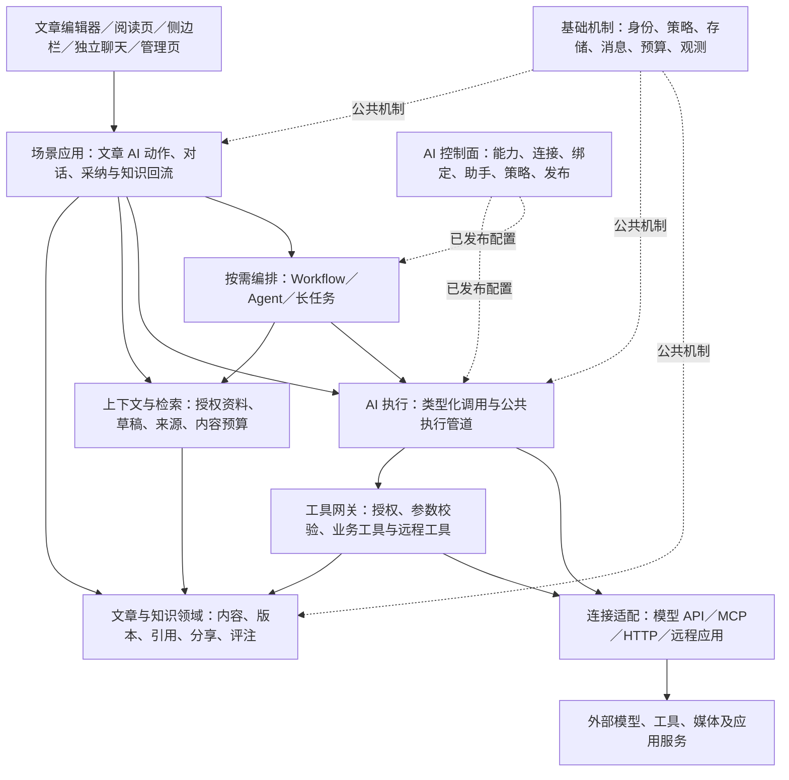
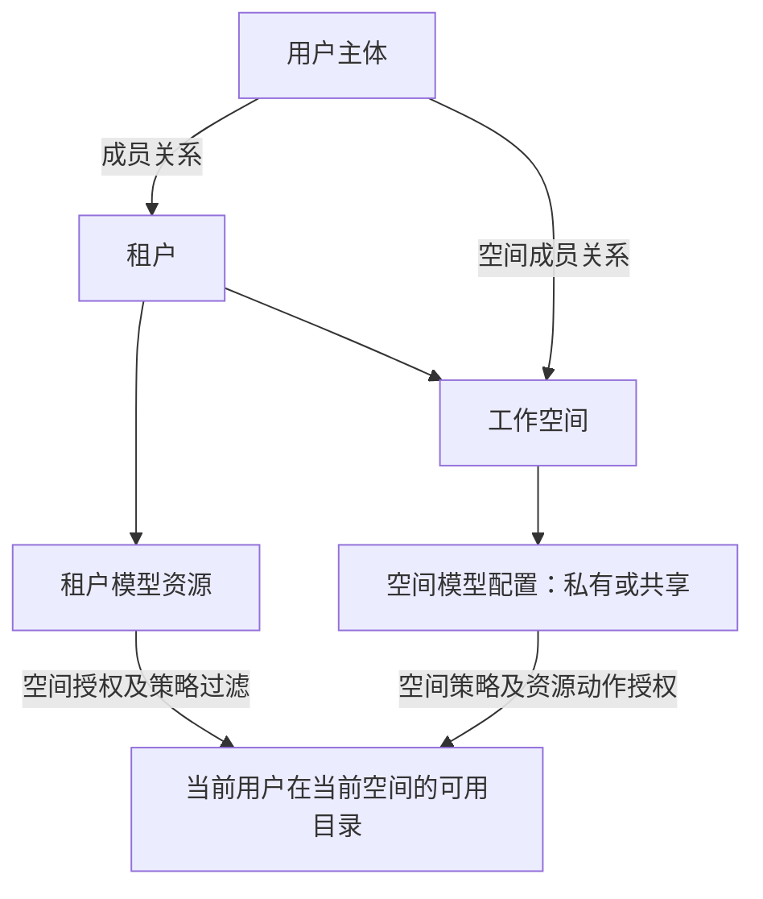
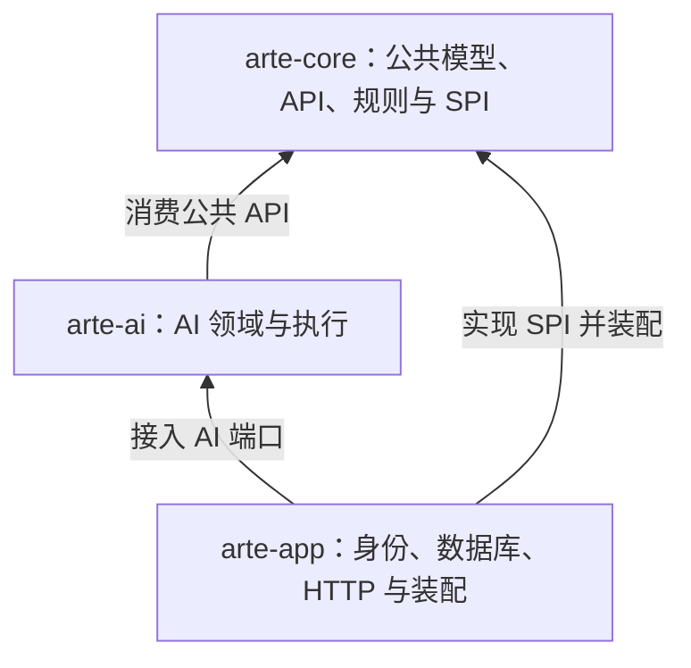
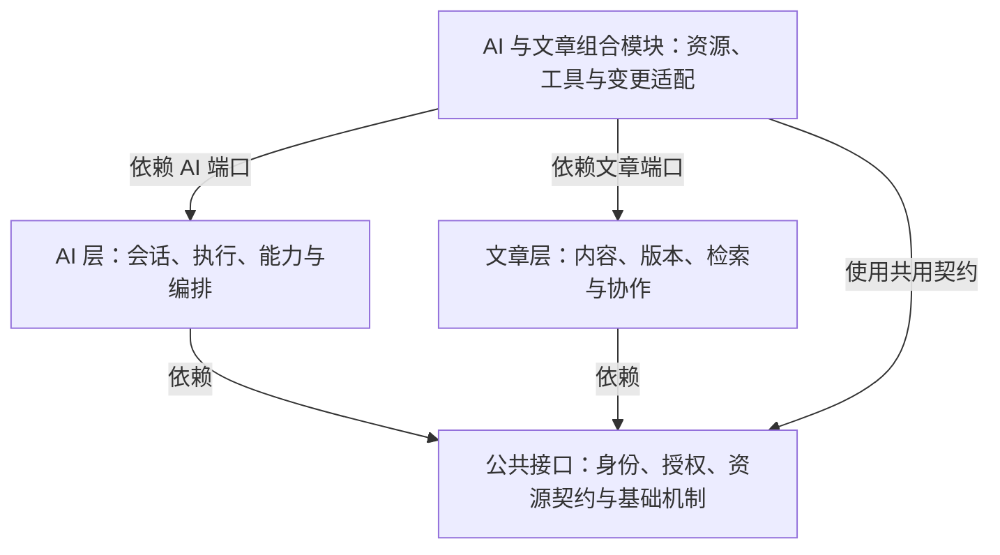
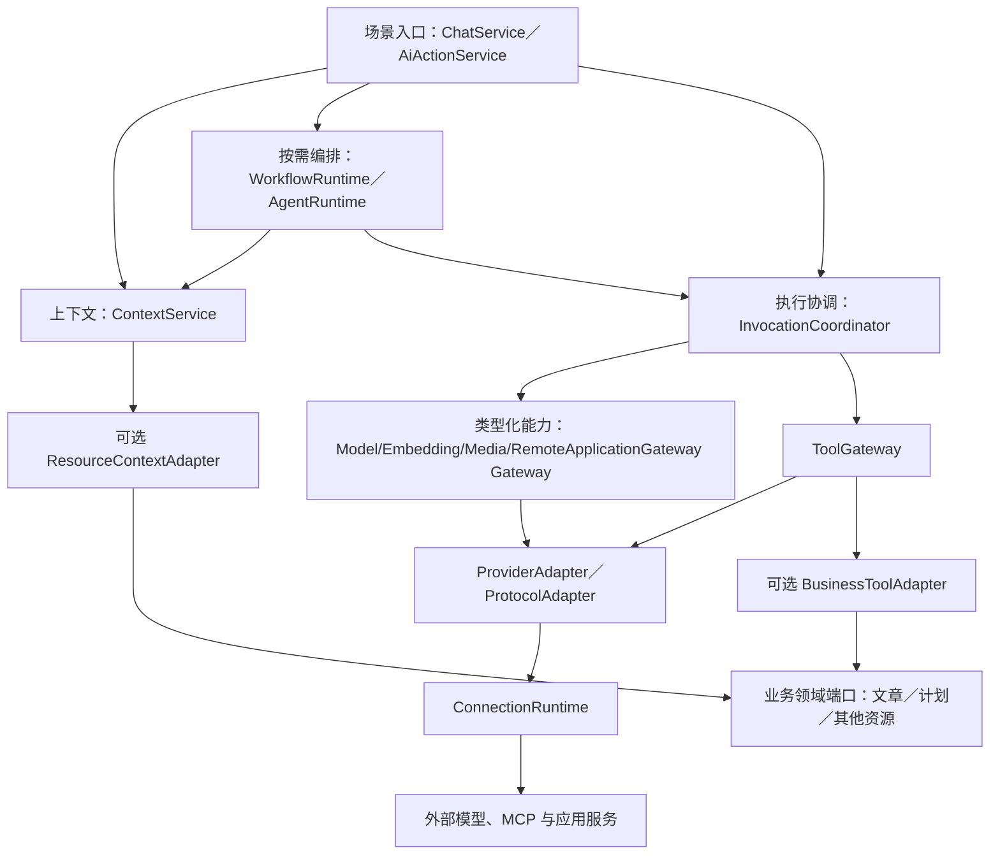
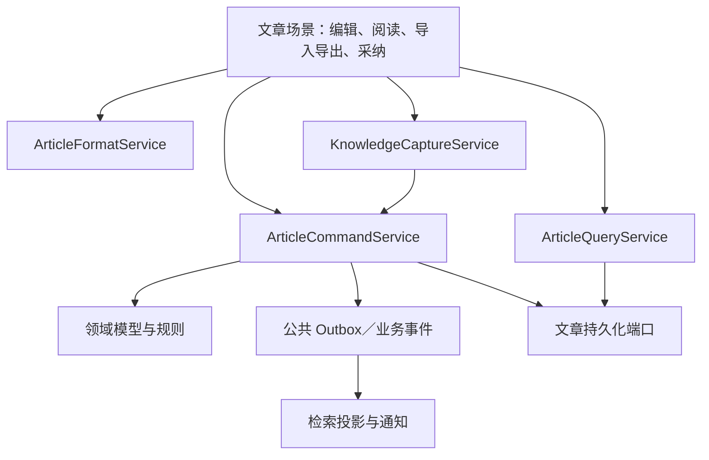
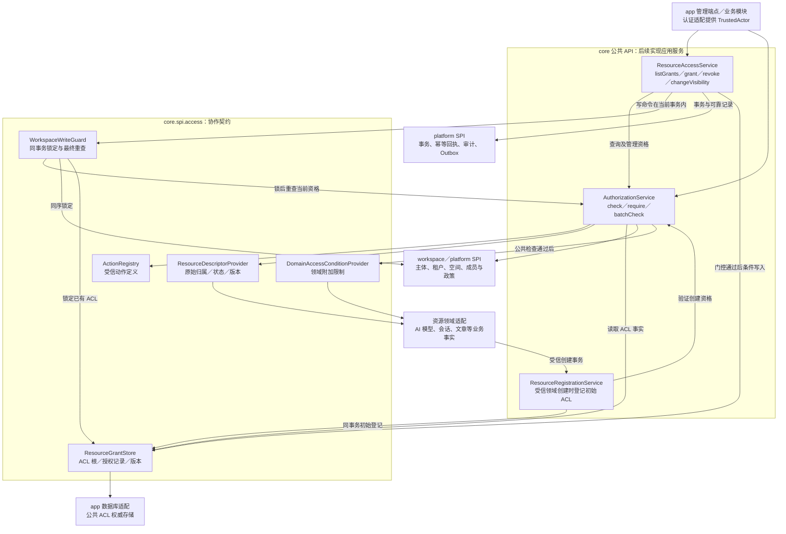
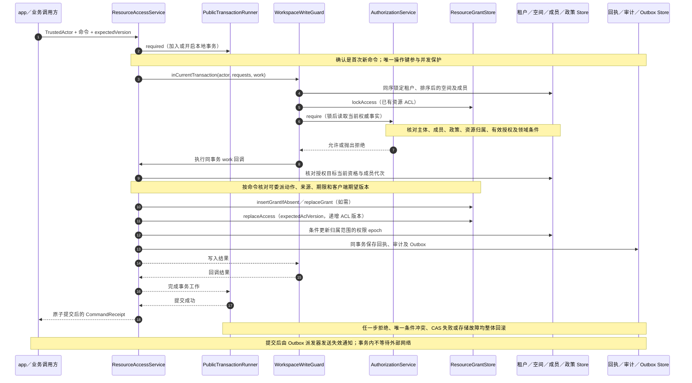

AI 平台与业务资源系统顶层架构草案

版本：v0.14

日期：2026-10-10

状态：讨论稿。用于确认需求、模块边界、核心对象及顶层契约，不限定现有代码结构，不包含具体实现。

空间内资源统一归属工作空间，资源访问与处置由空间策略、成员资格及具体动作授权决定；创建者、凭据责任主体和执行身份独立记录，不再把
USER 作为通用空间资源 owner。保留租户级资源归属及 `arte-core` 公共领域／API／规则／SPI、`arte-ai` 消费、`arte-app`
持久化适配的职责。本版在“详细设计”第 2～5 节补充权限、API／SPI、事务及存储、撤权与收尾、AI
动态接入的首版方案。本文定义跨页面共用规则；[AI 聊天界面需求及设计](ARTE%20AI%20聊天界面需求及设计.md)
定义聊天交互，不另行定义平台实体。公共基础契约和个人空间／基础授权默认逻辑已按实施第 1～2 步添加，实际包位置和阶段边界见设计第
3.3 节；第 3 步第 1 批已增加 app
身份映射适配与现有账号／会话核验，部署及阶段边界见 [公共身份适配说明](backend/arte-app/docs/PLATFORM_IDENTITY.md)。第 2
批已增加空间数据库、同库事务、回执、审计、Outbox、Redis
游标与投递协调，以及有界响应式执行边界，见 [公共持久化说明](backend/arte-app/docs/PLATFORM_PERSISTENCE.md)。第 3
批已增加独立应用服务装配、
默认政策配置和响应式会话适配，见 [公共应用服务说明](backend/arte-app/docs/PLATFORM_WORKSPACE.md)。第 4 批已开放首批 10 个
HTTP
接口，包含空间／偏好、权限检查及成功命令回执查询、参数／分页／错误适配，见 [公共空间 HTTP 说明](backend/arte-app/docs/PLATFORM_WORKSPACE_HTTP.md)
。资源 ACL、成员治理及 AI 接入仍分步实施。涉及当前 `ainew` 的描述仅为实施基线，不表示目标功能均已实现。

## TODO

- [ ] 评审新版设计、顶层接口与分阶段验收，确认与目标及 P0／P1／P2 需求对应。
- [ ] 确认结构化文档、Markdown 兼容、草稿与版本、范围锚点及撤销语义。
- [ ] 评审“设计”第 3.1～3.3 节及“详细设计”第 2～5 节的归属、权限、公共 API／SPI、事务与存储、撤权及 AI 迁移方案，确定首批范围后进入编码。
- [ ] 细化 Conversation、Turn、动作、Invocation／Attempt、Job、Run 与远端任务契约。
- [ ] 细化类型化能力、连接、绑定、助手、Skill、策略和发布的 Schema 与版本。
- [ ] 确认采纳、正式保存、来源记录、幂等、冲突和跨领域事务边界。
- [ ] 明确 P0 快速执行、Worker 领取、租约、事件重放与未知结果的实现方案。
- [ ] 验证数据库、Redis、消息／Outbox、对象存储、中文检索与向量的职责及选型。
- [ ] 确认首期供应商及框架／协议版本，验证统一工具网关与适配契约。
- [ ] 通过原型与压测确认编辑、上下文、流式、容量、成本与可用性目标。
- [ ] 细化凭据管理、审计保留、插件隔离、备份恢复、发布回滚与运维方案。
- [ ] 完成 P0 契约、安全、故障与场景验证后，再进入相应实现与上线评审。

## 资源/参考

以下资料分别用于理解架构模式、协议契约和工程约束。论文模式作为可评估的策略来源，不要求全部实现；协议与库的实际接入版本应在实现阶段明确记录。

1. [Anthropic：Building effective agents](https://www.anthropic.com/engineering/building-effective-agents)：Workflow、Agent
   及常见编排模式。
2. [Anthropic：Effective context engineering for AI agents](https://www.anthropic.com/engineering/effective-context-engineering-for-ai-agents)
   ：上下文、工具集、按需加载及长任务记忆。
3. [MCP：Understanding MCP servers](https://modelcontextprotocol.io/docs/learn/server-concepts)：Tools、Resources、Prompts
   及交互边界。
4. [Agent Skills 规范](https://agentskills.io/specification)：Skill 的指令、参考资料、脚本、资源和渐进加载。
5. [ReAct 论文](https://arxiv.org/abs/2210.03629)：推理与行动交替的研究模式。
6. [Plan-and-Solve Prompting 论文](https://arxiv.org/abs/2305.04091)：规划后求解的提示方法；与运行时 Plan-and-Execute
   分别讨论。
7. [Temporal：Durable AI](https://docs.temporal.io/ai)：可恢复任务、长时间等待和人工审批的实现参考。
8. [Redis Pub/Sub](https://redis.io/docs/latest/develop/pubsub/)
   与 [Redis Streams](https://redis.io/docs/latest/develop/data-types/streams/)：通知和流消费的投递语义。
9. [OWASP：Authorization](https://cheatsheetseries.owasp.org/cheatsheets/Authorization_Cheat_Sheet.html)：最小权限、默认拒绝和逐次授权。
10. [OWASP：LLM Prompt Injection Prevention](https://cheatsheetseries.owasp.org/cheatsheets/LLM_Prompt_Injection_Prevention_Cheat_Sheet.html)
    ：文档、工具输出等不可信内容的处理。
11. [RFC 9110：If-Match](https://www.rfc-editor.org/rfc/rfc9110.html#name-if-match)：条件更新与并发修改控制。
12. [Envoy：Connection pooling](https://www.envoyproxy.io/docs/envoy/latest/intro/arch_overview/upstream/connection_pooling.html)
    ：连接复用与并发限制的工程参考。

13. [Spring AI：Tool Calling](https://docs.spring.io/spring-ai/reference/api/tools.html)：模型请求与应用执行工具的边界。
14. [Spring Framework：WebFlux](https://docs.spring.io/spring-framework/reference/web/webflux/new-framework.html)：异步
    I/O、并发与背压。
15. [MCP：Transports](https://modelcontextprotocol.io/specification/latest/basic/transports) 与
    [Authorization](https://modelcontextprotocol.io/specification/latest/basic/authorization)：按协议版本适配传输与认证。
16. [Debezium：Outbox Event Router](https://debezium.io/documentation/reference/stable/transformations/outbox-event-router.html)
    ：事务与消息衔接参考。
17. [Temporal：Workflow Execution](https://docs.temporal.io/workflow-execution)：持久化运行历史与恢复模型。

## 目标

>
人类的知识行为，大致可看作“创造”与“模仿”的双螺旋：塔尔德视“发明”为社会现象的起源，“模仿”为个体联结与社会形成的基本机制；文化进化论则以模仿为文化复制之“遗传”。若借用演化论，创造是变异，模仿是遗传，二者相辅相成。健康的知识生态既需保护创造、宽容失败，也需建立学习与传播的机制。人类文明，正是在“创造—模仿—再创造”的循环中不断前行。

ARTE 是面向个人和团队、以文章为主要载体的 AI 内容创作与知识管理工作空间。ARTE 不是纯写作软件，而是“以写作为界面”的知识操作系统。

ARTE 将内容创作、知识使用与 AI
协作融入同一工作过程，通过丰富的内容表达形式，帮助用户将资料、想法和经验转化为可理解、可查找、可复用的内容。用户能够借助已有积累持续创作和完成工作，让知识在学习、积累、应用和再创造中不断产生价值。

ARTE 主要服务于个人创作与团队知识积累，其适用于：个人写作、企业内部知识库、计划/信息管理等。

1. **高效创作与组织内容**
   1. 提供流畅、易用的编辑体验，兼顾 Markdown 使用习惯与直观的格式呈现。支持文章、附件和内容片段的组织，让用户便捷地记录想法、积累经验并完成长篇写作。
2. **高效阅读、查找与复用知识**
   1. 支持内容检索、阅读定位、个人标注、评注和来源引用，帮助用户快速找到相关信息、理解已有内容，并将知识用于后续写作与工作。支持内容导出，明确格式兼容范围，保障内容的可迁移性。
3. **丰富且一致的内容表达**
   1. 支持文本、代码、数学公式、图片、音频、视频及可编辑图表等内容形式，提供清晰、一致的编辑和阅读体验。媒体内容的插入、生成、管理与展示作为基础能力，专业媒体编辑范围另行明确。
4. **融入工作过程的 AI 协作**
   1. 提供独立 AI 对话入口，以及结合当前文章或业务资源的侧边栏交互。支持检索问答、解释、总结、翻译、续写、补全、改写和媒体生成，并允许用户创建可复用的助手与操作流程。
   2. AI 可以针对整篇文章或指定内容片段进行解读、插入或替换。操作范围和结果清晰可见，内容修改遵循用户授权，并支持预览、版本保护和撤销。
5. **安全共享与自主控制**
   1. 支持按资源分配管理、编辑、评注和阅读权限，使个人与团队能够安全地共享和协作。用户能够了解 AI
      使用了哪些内容、执行了哪些操作，并控制访问范围、外部服务使用和内容修改。
6. **持续扩展到其他知识与工作场景**
   1. 在文章与 AI 核心能力的基础上，通过模块扩展支持项目计划、客户信息、内部知识库，以及论文、小说等专业写作场景。扩展模块复用内容、检索和
      AI 能力，同时保留各自的业务规则。

## 需求

本章依据目标规划用户任务与阶段范围，不以现有代码、功能或技术选型为前提，分为核心需求点与细节需求点。首期面向需要持续写作、整理资料和积累知识的个人创作者；P1
扩展到共同维护文章与知识资料的小团队，涉及作者、编辑者、评注者、阅读者及共享管理者。先验证个人知识积累与再创作，再深化团队协作和复杂任务。

**阶段划分**：P0 为原始可用功能集，所有 P0 共同组成 MVP；P1 在 P0 基础上深化知识利用、个性化与团队协作；P2
为进一步扩展的需求池，结合实际使用反馈逐项取舍。首期聚焦桌面
Web，不以覆盖全部格式、平台、终端和业务场景为目标。验收标准与性能、安全等非功能性要求后续在设计中阐述；本章保留用户需要感知和控制的资料使用、内容修改与共享边界。

**阶段取舍依据**：P0 验证用户能否将资料与想法写成文章、借助已有文章和 AI 完成修订、保存有价值的成果并在下一次创作中再次使用；P1
验证文章集合的检索问答及团队评审修订；P2 在高频任务明确后扩展自主执行、多模态与专属业务。独立聊天属于完整产品范围，在 P1
引入，使首期优先验证文章与知识复用的价值。

**用语约定**：文章是可独立保存、编辑和检索的内容单元；选区是一次操作中临时指定的内容范围；引用是复用内容时保留可查看的来源；知识资产是用户整理、采纳并保存、可再次使用的内容，P0
以普通文章承载。P1 的可复用片段是用户从文章中保存的摘录，不预设底层块结构；附件指与文章关联的文件，P0
仅覆盖图片插入与展示，其他附件管理和解析范围在 P1 明确。

**一、核心需求点**

1. **文章创作与表达**
   - **P0**：创建、编辑、保存和恢复文章，以 Markdown 为基础提供易用的编辑与阅读体验，支持常用文本格式和图片。【已实现】
   - **P1**：通过模板、数学公式、图表和更丰富的编辑操作，提高专业写作与内容表达效率。【已实现】
   - **P2**：扩展音视频、脑图及可编辑的复杂图表，支持更丰富的内容创作。【部分已实现，可编辑的复杂图表未实现】
2. **知识组织、检索与阅读**
   - **P0**：通过文章列表、最近访问和标题／正文关键词检索找回已有内容，手动选择文章或摘录用于新的写作和 AI 提问；支持
     Markdown 导入、导出。【已实现】
   - **P1**：深化分类、标签、阅读标记、来源关联与语义检索，支持基于指定文章集合的知识问答。【已实现】
3. **文章中的 AI 协作**
   - **P0**：围绕当前文章或选区提问、追问，可主动加入已有文章或摘录作为参考；直接发起总结、翻译、改写和续写，并衔接追问，通过解读、插入、替换三种方式使用结果。【已实现】
   - **P1**：提供独立聊天页面、可复用助手和模型选择，支持围绕文章集合进行检索问答，以及根据文章生成图片和基础图表。【部分已实现，根据文章生成图片或图表未实现】
   - **P2**：扩展多模态生成、自定义流程和受用户控制的自主任务执行。
4. **知识反哺与持续复用**
   - **P0**：用户核对并采纳 AI 回答、总结或生成内容后，可保存到当前文章、其他已有文章或新文章，查看其来源；保存结果可再次检索、编辑和用于
     AI 处理。
   - **P1**：保留结果与来源的关联，将已采纳成果整理为可复用的知识条目、写作素材或模板，支持后续校正和更新。
5. **分享与协作编辑**
   - **P1**：共享文章、邀请成员、按角色查看／评注／编辑，通过异步协作完成内容评审与修订。【已实现】
   - **P2**：支持多人实时编辑、在线状态、光标／选区提示及协同修改体验。
6. **用户控制与后续扩展**
   - **P0**：明确本次 AI 使用的资料、服务和结果用途，允许调整或拒绝资料发送；支持停止生成、预览、采纳、放弃和撤销，原文变化时提示用户重新处理。
   - **P1**：保存助手与上下文偏好，管理可用模型，查看任务结果和用量信息。
   - **P2**：按实际任务接入工具、Skill、外部应用等能力，将成熟的文章与 AI 协作体验扩展到计划、客户资料等后续模块。

**二、细节需求点**

### P0-01 个人文章创作与基础编辑

- **场景**：用户记录想法、整理资料或撰写文章，能够从草稿持续修改到可阅读、可复用的内容。
- 支持文章创建、重命名、编辑、保存、删除及误删恢复；展示保存状态，重新打开后能够继续编辑已保存内容。保存暂时失败时保留当前草稿，允许继续编辑、复制备份并重试，明确区分未保存内容与已保存版本。
- 默认支持 Markdown，提供基础所见即所得的编辑与阅读体验，涵盖标题、段落、列表、引用、表格、代码、链接、常用文字格式及图片插入与展示；提供常用快捷键和选区操作入口。
- 支持编辑撤销／重做，以及恢复此前保存的文章版本；支持基础 Markdown 文件导入、导出，让用户能够带入和带走自己的文本内容。
- **边界**：首期以单篇文章为编辑单位，服务个人写作，不承诺兼容所有 Markdown 扩展、第三方富文本格式或复杂媒体；完整版本比较、模板和专业表达能力在
  P1 深化。首期保护已打开文章的草稿，不要求完整离线工作空间或跨端离线同步。

### P0-02 文章找回、阅读与再次使用

- **场景**：用户将文章保存后，能够在下一次写作或提问时找到它、读懂它并继续使用。
- 提供文章列表、最近访问记录，以及覆盖标题和正文的关键词检索；从检索结果直接打开文章并查看匹配内容。
- 支持阅读位置记忆，在切换文章或重新打开时继续阅读；已有内容可复制或引用到新的文章，引用时保留可查看的来源文章。
- 检索到资料后，用户可手动选择文章或摘录作为当前写作、提问和 AI 动作的参考，查看并移除本次选入的资料；摘录带有来源，不要求先建立独立片段库。
- **边界**：首期检索用户自己的已保存文章，不包含附件内容解析、语义检索、知识图谱或全库自动问答。检索本身即可独立使用，无需开启
  AI。

### P0-03 当前文章的 AI 提问与追问

- **场景**：用户阅读或编辑当前文章时，通过侧边栏询问含义、梳理要点或讨论改进方向，并继续追问。
- 用户可选择以当前文章或选区为背景，并手动加入已有文章或摘录；明确看到本次带入的文章、内容范围及草稿／已保存状态，可查看和移除参考资料，不要求先另建聊天会话。
- 所选内容无法全部用于本次处理时，告知实际使用范围，允许缩小选区、调整参考资料或改为分段处理；不将部分内容处理呈现为已完整阅读全文。
- 发送前能够了解本次使用的 AI 服务及资料范围，并选择是否发送；不使用 AI 时仍可完成文章编辑与检索。
- 支持连续对话、历史查看、重新生成和停止生成；切换文章时明确显示会话关联的文章，避免无提示地混用不同文章的背景。
- 回答引用文章内容时提供可定位的来源片段，便于核对；没有内容依据时说明依据不足，不把模型补充内容呈现为文章原有事实。
- 提供可直接使用的默认助手和首期模型；用户无需先配置工具、记忆或流程才能提问。
- **边界**：首期以当前文章为工作中心，只使用用户主动选入的资料，不自动搜索全库、浏览外部资料或执行其他业务操作。跨文章参考采用手动选择，不包含语义检索和全库自动检索问答；对话历史不自动成为知识库内容。

### P0-04 文章 AI 动作与结果应用

- **场景**：用户在编辑器中选择内容或定位光标，发起总结、翻译、改写、续写，查看结果后完成文章修订。
- 提供少量可直接使用的预设动作，用户能够补充要求；动作可针对整篇文章、选区或光标位置，发起前明确处理范围与结果用途。
- **解读**：只展示解释或生成结果，不改变原文； **插入**：采纳后将结果放入指定位置； **替换**：采纳后以结果修改指定内容。
- 支持预览、必要的前后比较、继续调整、采纳、放弃及撤销；一次动作无需先创建独立聊天会话。
- 用户可从动作结果继续追问或转到文章侧边栏，保留该次指令、参考资料、生成结果及采纳状态，免于重复描述；只延续用户选择的这次操作，不无提示地带入其他动作历史。
- 支持查看该次操作的处理范围、参考来源、结果及是否已应用；失败或停止时明确说明状态，不自动应用未完成结果。重新生成与重新应用分别呈现，重试不重复插入同一结果。
- 生成期间目标内容发生变化时，提示用户核对新的内容并重新选择应用方式，避免将旧结果直接覆盖新修改。
- **边界**：首期由用户发起单次动作、核对后应用；不要求实时逐字 AI 补全、自定义多步骤流程或 AI 自主修改整库文章。

### P0-05 已采纳 AI 成果回流为知识资产

- **场景**：用户获得有价值的回答、摘要或生成内容，经核对与修改后保存下来，在后续写作和提问中再次使用。
- 可将结果保存到当前文章、用户选定的其他已有文章，或连同必要的问题背景保存为新文章；保存前可编辑结果、指定位置、拟定标题，避免将每次回答都默认创建为新文章。
- 已保存成果可查看其 AI 辅助生成说明、参考文章与摘录、采纳时间，以及采纳时的内容；来源记录说明生成依据，不将“已采纳”标记为事实已被验证。
- 保存后的内容遵循普通文章的使用方式：可继续编辑、搜索、引用、导出，打开后可再次用于文章提问或 AI 动作。
- 用户能够清楚区分“仅存在于对话中的结果”和“已保存的文章内容”；再次采纳时提示已有保存结果，便于选择更新或另存。
- **闭环**：查找已有资料 → 写作／提问／生成 → 核对与修订 → 保存到合适的文章 → 检索找回 → 作为参考再次创作或提问。
- **边界**：知识反哺以用户采纳为前提，不自动收录全部对话、自动发布内容或自动训练模型。采纳保存不意味着同意将内容用于训练或其他二次用途。P0
  以文章承载成果，不另建独立知识资产管理系统，也不强制用户建立标签或文件夹后才能保存。

### P1-01 丰富写作表达与可复用模板

- **场景**：用户撰写技术文档、研究笔记或结构化文章，能够使用专业格式和模板提高表达效率。
- 增加数学公式、Mermaid 等图表、悬浮编辑操作、快捷输入及可复用文章模板；支持文章版本查看、比较与恢复。
- 可根据文章或描述生成图片、基础图表，先查看或调整，再插入文章；适用的图表结果能够继续编辑。
- 支持模板、附件及扩展内容的管理与复用，明确导入、导出后能够保留的内容和格式。
- **边界**：本阶段优先满足常见写作和图片／基础图表需求，不以完整替代专业绘图工具、音视频编辑器为目标。

### P1-02 文章集合的知识检索与问答

- **场景**：用户为新文章查找旧资料，或围绕一个主题从多篇文章中提取、比较和归纳知识。
- 支持分类、标签、文章关联与来源引用，深化关键词检索并增加语义检索；支持将摘录保存为可管理、可复用的片段，并保留来源。支持私有阅读标记、重点标注和笔记，明确其与修改原文的区别。
- 用户选择文章集合或检索范围后发起问答，能够查看、调整使用的资料，并从回答定位到来源文章和相关片段。
- 回答中的资料归纳与 AI 推断应便于区分；来源不足时提示用户补充资料。结果可按知识反哺方式保存，并保留与来源的关联。
- 已采纳成果可整理成主题文章、摘录素材或模板；“知识条目”表示这些已保存内容的用途，不要求另建一套内容体系。来源更新时，用户能够识别和校正受影响的成果。
- **边界**：先服务用户可访问的文章集合，附件管理与内容解析分别明确支持范围，不默认将所有附件纳入问答；双向链接、关系图谱及互联网资料接入按实际需求取舍。

### P1-03 独立聊天、助手与模型管理

- **场景**：用户进行不依赖某篇文章的交流，或复用特定的写作、研究助手，并按任务选择模型和资料。
- 提供独立聊天页面，支持会话创建、命名、检索、继续交流与删除；可明确选择文章资料作为对话背景。
- 支持创建和复用助手，保存角色、提示和偏好；支持管理可用模型及其连接，选择适合本次任务的模型并确认可用状态。
- 模型资源管理面向普通用户：用户可在个人或其他获授权空间添加、验证、发布和维护模型；配置归空间，租户级配置归租户。可使用与可管理分别授权，不要求所有用户都是配置管理者；“我的模型”是本人可管理的列表，不表示
  USER 所有权。
- 在当前空间中统一展示获授权的当前空间模型、租户提供模型及其他空间授权模型，来源空间、可见范围、凭据来源及费用承担分别表达；同名资源保持独立，不因个人添加而覆盖组织配置。
- 个人用户默认获得个人租户和默认工作空间，日常界面显示“个人空间”；加入团队后再提供组织和空间切换。空间策略可限制个人提供凭据、自定义连接及分享，限制原因对用户可见。
- 用户能够查看和调整对话关联的资料与保留信息，按需保存、修改或删除记忆；记忆与作为事实依据的文章资料分别呈现。
- 支持查看调用状态、结果及用量／费用信息；从独立聊天得到的成果同样可采纳并保存为文章。
- **边界**：先提供日常可用的默认设置和必要的个性化，不要求普通用户理解模型协议、工具绑定或复杂编排；全面外部能力管理在 P2
  扩展。

### P1-04 文章分享与异步协作编辑

- **场景**：小团队将文章交给成员阅读、评注和修订，完成“共享 → 评审 → 修改 → 确认”的协作闭环。
- 支持共享文章、邀请成员和撤销共享；按资源分配完全控制、编辑、评注、只读权限，使成员清楚自己可执行的操作。
- 支持围绕具体内容的共享评论、回复和处理状态；个人阅读标记、共享评注和原文修改分别呈现。相关成员能够收到评注、回复和文章更新通知，并回到对应内容继续处理。
- 支持成员异步或轮流编辑，查看修改者、修改时间及历史版本；多人修改同一内容时提供冲突提示和处理入口。
- 共享管理者可决定共享内容是否允许 AI 处理，以及可使用的外部服务范围；阅读、导出、复制另存、AI 处理和修改原文分别遵循共享约定，成员能够查看可执行的操作。
- 允许使用 AI 的阅读者可查看结果，评注者可将建议作为评注提交，编辑者可采纳修改；使用 AI 不提升成员原有权限。生成结果进入共同文章前仍遵循协作与修改规则。
- **边界**：此阶段不承诺多人同时编辑时的实时同步体验；实时共同编辑、在线光标及同步选区归入 P2。

### P1-05 多工作空间与资源组织

- **场景**：个人按主题建立学习、写作等空间，邀请他人共同整理内容；组织按项目建立空间，成员也可以加入别人创建或组织提供的空间。
- 每个用户自动获得一个个人默认工作空间，未使用多空间功能也可直接工作；在自己的个人租户内可另建多个空间，在组织内按权限创建空间。创建无需先配置模型或知识库。
- 提供“我的工作空间”统一入口，查看本人创建、受邀加入及组织分配的空间；通过邀请接受或组织授权加入，不要求用户先理解和手填租户信息。
- 工作空间统一承载文章、文章集合、会话、助手、模型及其他资源的导航、成员、共享策略和默认设置，各类资源保留自身管理规则。新增资源类型不要求新建另一种工作空间。
- 可以围绕一个主题建立多个文章集合，一篇文章可归入多个集合；集合管理、文章内容读写及 AI 外发权限分别判断，加入集合不自动开放原文。
- 支持空间创建、命名、描述、成员邀请与角色管理、退出、归档及受控删除；明确操作对资源、访问和未完成任务的影响，组织资源不因创建者退出而转为个人资源。
- **边界**：P0 的默认个人空间可隐式提供；P1 开放多空间及成员协作。空间不替代文章集合、资源领域服务或执行主体；跨空间移动、跨租户迁移和公开社区空间另行设计，不随成员加入默认开放。

### P2-01 多人实时协作编辑

- **场景**：多名成员同时撰写、讨论和修订一篇文章，在共同编辑过程中及时理解彼此的操作。
- 提供在线成员、光标和选区提示，实时呈现协同修改；评论、评注和历史记录与编辑内容保持关联。
- 支持并发修改后的结果查看与修订，成员恢复连接后能够理解当前内容及自己的修改状态。
- AI 生成与采纳融入实时协作，成员能够识别 AI 辅助修改及其采纳者，处理生成期间其他成员对目标内容的变更。
- **边界**：在异步协作验证团队需求后引入；不将实时协作等同于全功能离线共同编辑，也不默认允许 AI 无限制改写共享内容。

### P2-02 自定义流程、外部能力与自主任务

- **场景**：用户将重复的内容操作保存为流程，或将明确目标交给 AI，借助已配置能力完成多个步骤。
- 支持能力的声明、配置、验证、启用／停用和绑定／解绑，按需接入本地／远程工具、Skill、外部应用及 Agent 服务；用户可了解用途和使用范围。
- 支持创建、编辑、试运行和复用流程，例如 `总结摘要 → 翻译为英文 → 核对与文章的契合度 → 用户采纳后插入文章顶部`。
- 支持 AI 在用户指定的资料、可用能力和使用限制内选择步骤与工具；发起时可约定工具、用量和执行时限，达到限制后由用户决定是否继续。
- 默认展示待采纳结果；用户可明确授权约定范围内的自动应用，并可收回授权、补充信息或人工接管。涉及超出约定范围的修改、分享或发布时，须由用户决定。
- 展示任务进度、结果和失败原因，按任务特性提供暂停、继续、取消或重新执行；完成或停止后明确哪些结果已保存、哪些修改已应用，对适用的内容修改提供撤销或恢复入口。不能撤销的外部操作提前说明，不将取消任务等同于撤回已执行操作。
- **边界**：从高频、可核对的文章任务扩展，不以接入所有知名平台为完成标准；使用能力的权限不等同于修改、分享或发布内容的权限。

### P2-03 更丰富的媒体创作与编辑

- **场景**：用户将文章扩展为包含图片、音频、视频或复杂图表的内容，或由文章素材生成媒体成果。
- 支持适用的音频、视频、脑图、draw.io 等内容的插入、查看、播放或编辑，提供媒体与文章的关联管理。
- 按实际场景扩展语音、视频等 AI 生成能力；用户可查看任务进度、预览成果、调整或放弃，再决定是否保存和用于文章。
- **边界**：各媒体类型分批引入，明确支持的创作、编辑和导出范围，不承诺所有媒体形式同时上线或达到专业制作工具的完整能力。

### P2-04 后续业务场景扩展

- **场景**：在文章创作与知识积累闭环成熟后，将资料提问、生成、评估和优化能力用于其他具体工作任务。
- 论文、小说、研究记录等优先通过文章模板、助手和素材复用满足；确有专属任务需求时再增加对应功能。
- 项目计划、客户资料等模块分别明确用户、任务和完成结果，例如“查看计划 → AI 评估与提出建议 → 用户采纳调整 → 保存并继续执行”。
- 不同场景保留一致的提问、预览、采纳和知识回流体验，同时满足各自的业务操作要求。
- **边界**：不把通用项目管理、CRM、论文研究平台或企业全域知识管理作为当前 MVP 的组成部分；新模块按独立场景闭环确认后再纳入。

## 设计

本版从产品目标和 P0／P1／P2 需求推导架构，不沿用现有代码的模块、实现或平台限制。
前版保留于[设计历史草案](docs/arte-top-level-design-v0.1.md)
。以下为顶层方案：确定职责、数据权威、关键契约、功能流程和生产运行约束；公共空间与访问体系的接口语义、逻辑表结构及 AI
接入方案见“详细设计”第 2～5 节，其他领域签名、物理 DDL、框架版本和部署参数按各批次落实。

### 1. 设计目标与基本原则

系统围绕“资料积累 → 写作与 AI 协作 → 核对采纳 → 保存知识 → 再次使用”组织能力。生产级要求从 P0 生效，用户功能按阶段开放；P0
的基础可靠性、安全与可观测性不因高级功能后置而省略。

1. **领域独立、按场景组合**：文章与知识领域管理内容及业务规则，AI 平台管理生成与执行，场景应用将两者组合。支持独立使用文章、独立使用
   AI，以及未来 AI＋其他业务组合。
2. **统一治理、类型化执行**：共享身份、授权、预算、追踪及调用生命周期；文本生成、向量、媒体、工具和远程应用保留各自语义，不统一成无类型的
   `execute(Object)`。
3. **轻量路径优先**：普通提问和单次动作不经过通用工作流引擎；仅对需要多步状态、长时间等待或可靠恢复的任务引入持久化编排。
4. **内容修改有唯一入口**：人工编辑、AI 采纳、工具修改和协作修改最终都进入领域命令，执行权限、版本和业务校验。
5. **分布式不等于全面微服务**：先建立可独立测试和部署的模块边界，通过多实例、异步 Worker 和共享持久化支持分布式；再依据负载、故障隔离和团队规模拆分服务。
6. **扩展通过组合完成**：提供商、协议、能力、策略、业务资源分别扩展；配置解决已有契约的接入，新语义通过适配器或插件实现。
7. **明确保证的边界**：区分受理、执行、生成、保存和应用；区分事件重放与模型续传、取消请求与取消完成，不承诺外部副作用天然恰好执行一次。

### 2. 逻辑架构与模块依赖



| 模块               | 主要职责                                           | 依赖边界                                                                                 |
|--------------------|----------------------------------------------------|------------------------------------------------------------------------------------------|
| 产品前端与应用 API | 编辑、阅读、提问、生成、配置、预览、采纳和状态反馈 | 配置页可提交用户输入的凭据，但不持久保存或回读明文；页面不直接调用付费模型和远程工具     |
| 场景应用           | 组合文章、上下文、会话、动作和成果保存流程         | 不直接访问其他领域的表，不复制领域校验                                                   |
| 文章与知识领域     | 文章内容、版本、引用、附件关系、标注、评论、分享   | 不依赖具体模型、MCP、Agent 框架或 AI 供应商 SDK                                          |
| 会话与 AI 动作     | 会话、轮次、动作历史及明确的任务输入输出           | 共用执行入口，动作不强制隶属聊天                                                         |
| 上下文与检索       | 资料选择、权限过滤、内容裁剪、检索、来源映射       | 通过资源适配端口读取业务内容，不直接修改业务资源                                         |
| AI 控制面          | 能力契约、连接、绑定、助手、Skill、策略和发布      | 管理配置，不承接每个请求的网络调用                                                       |
| AI 执行与编排      | 调用治理、单次执行、工作流、Agent 和任务控制       | 编排决定步骤，执行层完成类型化操作                                                       |
| 工具网关与连接适配 | 执行受限业务工具，适配外部协议及平台特性           | 业务工具调用领域服务；适配器不授予用户权限                                               |
| 公共空间与访问领域 | 租户、工作空间、成员、邀请、归属及通用授权规则     | 初期位于 `arte-core` 独立包；提供领域模型、API、规则实现与 SPI，不依赖 AI 或文章专有类型 |
| 公共基础机制       | 存储、可靠消息、审计、观测及通用准入机制           | 通过 SPI 适配；AI 预算账本归 AI，不形成承担所有业务的“公共服务”                          |
| 应用装配与适配     | 登录身份、数据库、事务、HTTP、缓存和跨领域适配     | 当前由 `arte-app` 实现 SPI 并装配公共与业务服务；不能重复定义公共领域规则                |

业务端口归属于提供能力的模块。文章核心不依赖 AI：`BusinessToolAdapter` 和 `ResourceContextAdapter` 位于组合边界，分别将领域操作与资源读取适配到
AI 平台。AI 也可在未启用文章模块时运行。

### 3. 概念、核心对象与状态权威

MCP 是协议；HTTP、SSE、stdio 是传输或输出方式；Skill 是指令与资源包；Workflow 和 Agent 是决定下一步的编排方式。它们不作为同一类原子能力建立继承树。Workflow
的控制路径由预定义规则决定，Agent
由模型与运行反馈决定下一步；两者可组合。[模式依据](https://www.anthropic.com/engineering/building-effective-agents)

| 对象族     | 关键对象                                                                                                      | 权威归属及关系                                                                                                                                                |
|------------|---------------------------------------------------------------------------------------------------------------|---------------------------------------------------------------------------------------------------------------------------------------------------------------|
| 身份与空间 | Tenant、Workspace、Principal、Membership、ResourceGrant                                                       | Tenant 是组织、隔离与费用治理边界，Workspace 是租户内的工作与共享范围；P0 提供个人空间，P1 增加团队空间；具体预算账户归属另行明确                             |
| 内容       | Article、ArticleCollection、CollectionMembership、ArticleRevision、DraftSnapshot、RangeAnchor                 | 文章服务管理正文与版本，集合以关联组织文章而不复制正文；草稿快照不冒充正式版本；集合可见不自动授予原文权限                                                    |
| 知识关系   | SourceRef、Citation、AdoptionRecord、SavedExcerpt                                                             | 引用关联来源与版本；采纳记录关联结果、目标版本及采纳者；P1 再提供独立可管理的摘录                                                                             |
| 媒体       | Artifact、AttachmentRef                                                                                       | 对象存储保存文件，领域服务保存归属与引用；产物存在不等于已经插入文章                                                                                          |
| 对话与动作 | Conversation、Turn、AiActionExecution、ContextSnapshot                                                        | 会话组织交流，动作可独立执行；二者记录实际输入范围、执行与结果，不拥有文章事实                                                                                |
| 连接与使用 | ModelResource、CapabilityDefinition、ConnectionDefinition、BindingDefinition、SecretRef                       | 模型／连接配置归空间或租户，使用资格与凭据责任独立；ModelResource 是管理视图，不合并为含密钥的聊天对象                                                        |
| 可复用配置 | AssistantDefinition、ChatProfile、AiActionDefinition、SkillDefinition、StrategyDefinition、WorkflowDefinition | 定义与使用实例分离；助手可用于多个会话，实际执行记录解析后的版本                                                                                              |
| 发布       | ReleaseManifest                                                                                               | 固定配置依赖与校验结果，不承诺供应商模型行为永久不变                                                                                                          |
| 执行       | Invocation、Attempt、Job、Run、RemoteTaskRef                                                                  | Invocation 是一次逻辑能力操作，Attempt 是一次实际尝试；主动重新生成与自动重试使用不同身份规则；Job 是可恢复工作项，Run 是多步任务；远端任务另有身份与生命周期 |
| 修改       | ChangeSet、ApplicationRecord                                                                                  | 提案与应用分离；具体补丁由目标领域定义，应用记录关联业务新版本                                                                                                |

每类状态只设一个权威来源：业务数据库管理文章、配置、授权、应用记录和单次调用记录；对象存储管理产物字节；检索索引和任务查询视图是可重建投影。引入持久化编排引擎时，Run
的推进历史以引擎为权威，本地 Run 表只作查询投影，不同时驱动任务。

#### 3.1 租户、工作空间、用户与资源归属

本节是平台共用规则，适用于模型、助手及其他可共享资源；文章共享仍补充其编辑、评注等领域权限。资源归属不直接替代执行身份，也不自动授予内容读取权。

| 对象／关系      | 定义与约束                                                                                                                     |
|-----------------|--------------------------------------------------------------------------------------------------------------------------------|
| Principal／用户 | 稳定登录主体，可加入多个租户及工作空间；成员变化不改变其身份                                                                   |
| Tenant          | 个人或组织的隔离与治理边界；组织租户管理成员、资源政策及费用分配，不等于单个用户                                               |
| Workspace       | 必须属于一个租户，是个人或组织围绕主题／项目组织多类资源及成员的工作单元；定位及生命周期见第 3.2 节                            |
| Membership      | 用户与租户／空间的成员关系；空间成员需有效的所属租户成员或受限访客资格，邀请接受时可由后端建立；加入租户不自动获得全部空间权限 |
| ResourceGrant   | 针对资源和动作的授权，可面向空间、成员或角色；撤销、有效期和版本由授权服务管理                                                 |
| 资源归属／owner | 空间内资源统一为 WORKSPACE，租户级公共资源为 TENANT；不由创建者身份决定，USER 不作为通用空间资源 owner；归属不自动授予操作权   |



个人模式为“个人租户 → 默认及自建工作空间 →
我的模型、助手、会话和文章”。用户也可以受邀加入其他个人租户内的协作空间或组织空间；进入这些空间不改变用户身份或个人默认空间。产品无需让用户手填租户与空间标识，创建、邀请接受及空间读取由可信身份／空间服务完成，前端不能凭空构造授权
scope。

首阶段个人空间模型限定在创建时的租户和工作空间，归该空间，默认通过初始授权仅本人可使用和管理；这是当前增量实施限制，不是
USER
所有权或长期单空间限制。目标支持同一个人租户内其他空间经显式授权复用同一模型／连接，无需重复录入密钥，源资源归属不改变。组织空间内创建个人凭据模型须获组织策略允许，其配置仍归组织空间，凭据责任及维护资格独立；跨租户引用、迁移或复制另行设计，不自动继承或以修改
tenantId 代替。

租户统一模型可以授权给若干空间或租户内全部允许的空间，工作空间模型通过明确的共享规则授权给成员；有效使用权按下述统一判断顺序计算。创建组织资源需要相应权限；组织资源不因创建者离职就自动转为个人资源。成员移除后失去目标空间的使用资格，直接资源授权不能绕过撤权；历史执行与账本按原归属保留，不转交给其他成员。

个人空间、协作空间及租户级模型配置即使供应商、远端模型名称相同，也保持独立资源与绑定标识；显示名称不作为唯一键。默认模型优先级为“会话显式选择 →
用户在该空间的偏好 → 空间默认 → 租户默认”，各层均需重新验证可用性；默认配置不能授予权限。没有合法默认且有多个可用资源时，由用户明确选择。

**归属维度及创建默认**

| 维度                       | 语义与约束                                                                                                                                 |
|----------------------------|--------------------------------------------------------------------------------------------------------------------------------------------|
| 治理租户 tenantId          | 资源遵循的个人账户／组织政策和隔离边界；与主空间所属租户一致，普通分享不能改变                                                             |
| 主归属空间 homeWorkspaceId | 空间资源的归属、保存与组织位置；必须属于治理租户，不等于全部可使用空间；租户级资源可无主空间                                               |
| ownerType／ownerId         | WORKSPACE 指向主空间，TENANT 指向治理租户；两者是归属范围而非具体操作人，USER 不适用于通用空间资源；如保留这些字段，由服务端派生并保证一致 |
| 可见性与 ResourceGrant     | 私有、指定对象或空间共享等访问规则；私有表示访问受限，资源仍归空间；共享不改变归属                                                         |
| createdBy／作者            | 创建审计／内容署名；修改、离职或负责人交接不重写创建事实                                                                                   |
| 凭据责任主体               | 记录谁提供、获准维护／撤销凭据及供应商账户关系；独立于模型配置归属，空间管理权不自动转交密钥维护权                                         |
| 执行主体                   | 谁在何租户、空间发起调用；继续使用现有 ExecutionOwner，不用资源 owner 替代                                                                 |

空间内文章、集合、助手、模型配置等统一归空间，治理仍属于其租户；不因创建者是托管者、负责人、管理员、普通成员或访客而改变。TENANT
owner 仅用于租户级公共资源。用户的操作资格来自成员关系、空间策略与具体授权，资源处置由有权者按策略执行，创建事实不自动产生永久处置权。空间关闭时资源按关闭与保留策略处理，不自动归最后一位负责人。下表是目标创建默认，UI
显示保存空间与可见范围，服务端确定归属；共享或导出不能默默改变 owner。

| 创建场景                                         | 默认归属                                           | 默认可见性与退出语义                                                                     |
|--------------------------------------------------|----------------------------------------------------|------------------------------------------------------------------------------------------|
| 本人个人空间中新建文章、集合、助手或模型配置     | WORKSPACE，归创建时的空间                          | 默认仅本人，经初始授权获得相应动作；分享后仍归源空间                                     |
| 个人托管协作空间中新建文章、集合、助手或模型配置 | WORKSPACE，不区分托管者或受邀创建者                | 内容／配置草稿默认仅创建者按初始授权访问，主动共享后才向授权成员开放；退出不带走空间资源 |
| 组织／团队空间中新建文章、集合、助手或模型配置   | WORKSPACE                                          | 同样归当前空间，创建者获得初始动作授权；离职后资源归属及私有范围保留                     |
| 在策略允许的空间使用个人提供的模型凭据           | 配置为 WORKSPACE；凭据责任主体独立                 | 配置默认仅创建者按初始授权访问；共享使用不转交密钥维护／撤销资格                         |
| 经授权创建租户级公共模型配置                     | TENANT                                             | 向获授权空间提供使用资格；管理及凭据资格分别判断                                         |
| 任意空间中新建会话及调用                         | 会话的工作范围为固定空间，执行与账本保留原用户归属 | 按当前后端只允许原主体访问；通用资源归属规则不替换现有 ExecutionOwner 或共享历史         |

“个人资源／我的资源”是产品视图：表示个人空间中的资源，或本人获授权访问／管理的资源，不是第三种通用所有权。私有草稿同样归空间；普通管理员不自动读取其正文，保留、冻结或清理等治理动作须有独立权限及审计，正文查阅若未来开放须单独定义并明确告知。成员离开后资源仍留原空间，撤销该成员访问，不自动转交管理员；导出、复制、迁移及保留期限按空间策略和领域规则执行，退出后不以创建者、作者或凭据提供者身份绕过失效成员资格。

用户偏好保留主体关系，凭据保留责任与维护关系，会话／调用／预算保留执行主体；这些关系均独立于通用资源归属。个人提供者撤销凭据可使模型配置不可执行，配置及历史仍归原空间，修复须由获授权者替换有效凭据；不能因为配置归空间就阻止个人撤销自己的凭据或自动取得明文。

**通用权限判断顺序**

以下顺序适用于空间资源操作；凭据撤销和必要后台收尾使用各自受限领域授权，不能将这些资格用于读取或处置无权访问的空间资源。

1. 验证可信主体、目标租户／空间匹配和当前有效成员资格；受限访客资格必须覆盖目标空间。直接授权、资源 owner 或曾经参与编辑均不能绕过这些条件。
2. 检查租户／空间政策、空间生命周期及资源显式禁止条件。禁止优先于普通允许；读取、管理、外发及后台收尾分别适用相应规则。
3. 计算当前动作的允许来源：受策略约束的治理动作授权、有效直接授权，以及当前可见范围允许继承的角色／共享授权。资源归空间／租户不把所有成员或治理管理员映射为正文读者；创建者通过明确的初始授权访问，不靠
   createdBy 自动获得永久权限。空间角色只提供动作上限和预设资格，不默认把私有资源开放给成员或管理员。
4. 由资源领域补充版本、状态和依赖校验；AI 另检查发布、能力、凭据、预算，文章外发另检查资料与目的地。公共允许不能跳过领域禁止。
5. 查询、正文读取、写入、执行受理和外发等关键边界再次检查当前授权；旧快照或目录显示不能证明当前资格。返回适度的原因码和可执行动作，不能泄露未授权资源的存在、标题或内部策略。

撤销空间成员关系立即使目标空间的新访问失效；多空间访客资格按各目标范围独立维护，移除一个空间不应误删其他有效空间资格。邀请接受同时建立必要的租户／访客资格与空间成员关系，须保证幂等与原子性；重复邀请不能无提示降级或提升已有角色，角色调整使用独立授权命令。

#### 3.2 工作空间的定位、功能与边界

**统一定义**

工作空间是由个人或组织建立、围绕主题、项目或协作目标组织资源与成员的工作单元。它提供统一入口、资源范围、协作授权、默认设置和运行上下文，可同时用于内容创作、资料积累及
AI 工作。它面向个人和组织，模型只是其中一种资源。

| 概念                 | 职责与区别                                                                 |
|----------------------|----------------------------------------------------------------------------|
| 租户                 | 提供组织／个人账户的隔离、成员与政策治理；一个租户可有多个工作空间         |
| 工作空间             | 提供实际开展工作的资源与协作范围；必须归属一个租户，同一用户可进入多个空间 |
| 文章集合／目录／标签 | 在空间内组织某类资源；不拥有独立租户身份，也不必建立另一套空间成员关系     |
| 资源                 | 文章、集合、助手、会话、模型等有独立标识、版本、权限和生命周期的对象       |
| 当前工作空间         | 用户此次浏览或操作选中的工作范围；不是用户身份、资源所有者或资金账户       |

工作空间可以只有文章、没有模型或会话。它不存储所有资源的统一正文，不直接实现文章编辑、模型调用、凭据解析或预算结算；各领域服务按工作空间范围提供能力。

**创建、默认空间与加入关系**

1. 每个用户在其个人租户中有一个系统创建的个人默认工作空间，初始化幂等；默认私有，可重命名。个人默认空间不能直接删除、转交为他人所有或因加入组织而被替换。默认私有状态不意味着用户的其他空间不能协作。
2. 用户可在个人租户内建立多个空间，例如“学习”“小说写作”“与朋友共读”；组织成员可在组织政策与创建权限允许时创建组织空间。名称、描述即可完成基础创建，模型和集合之后再添加。
3. 用户可接受他人创建的协作空间邀请，也可接受组织空间邀请或组织管理员分配；成员关系为用户与空间的多对多关系。同一账号始终保留自身个人空间，不为每次加入重复创建用户。
4. 接受邀请前显示空间名称、归属者／组织、角色和共享边界。邀请由有权管理成员的主体发起，限定目标和有效期；重复接受幂等，撤销／过期邀请不能继续生效。
5. 加入他人个人租户内的空间时，后端可同时建立仅适用于目标空间的受限访客资格；不必先手动加入“组织”，也不因此看到邀请者的默认私有空间、其他空间或全部模型。加入组织空间同样不自动开放组织全部资源。
6. “系统个人默认空间”“用户启动偏好”“上次访问空间”分别记录。用户可以偏好进入某个自建或已加入空间；该空间不可用时回退到自己的默认空间，不随机跳到其他组织。

**空间归属、创建者与管理角色**

个人租户空间由对应个人账户治理，组织空间由组织治理；空间负责人是承担管理责任的成员，createdBy 记录创建者，不改变 tenantId
或资源 owner。组织空间的负责人离职可由授权流程交接，不能让组织空间随其退出而变成私人空间。

空间治理角色收敛为负责人、管理员、成员和访客；文章编辑者、评注者、阅读者属于资源动作授权或权限预设，不成为所有资源共同的空间角色。访客可以获得指定文章编辑权，但不能因此成为租户正式成员。界面可提供“文章编辑成员”等预设，由公共与领域权限组合，不形成第二套成员关系。

| 动作                                   | 负责人                   | 管理员                             | 成员／访客                                 |
|----------------------------------------|--------------------------|------------------------------------|--------------------------------------------|
| 查看本人可进入的空间及获授权资源       | 按资源权限               | 按资源权限                         | 按资源权限                                 |
| 修改空间信息、管理普通成员与邀请       | 允许，受租户政策约束     | 获委派时允许；不能自行提升治理权限 | 默认不允许                                 |
| 交接负责人、关闭／恢复空间             | 按租户政策及独立治理权限 | 仅有明确委派时允许                 | 默认不允许                                 |
| 创建资源                               | 按资源类型创建权         | 按资源类型创建权                   | 按资源类型创建权；访客默认关闭，可明确授予 |
| 阅读／评注／编辑私有文章，读取私有会话 | 不能因治理角色获得       | 不能因治理角色获得                 | 按资源动作授权；现有会话仍仅原主体         |
| 调用模型、分享资源、维护凭据、费用核对 | 各自独立授权             | 各自独立授权                       | 各自独立授权                               |

**个人协作托管与交接**

个人租户内的协作空间属于“个人托管”，页面和邀请明确显示托管者；负责人交接只转交管理责任，不改变个人租户的治理账户。默认个人空间继续受保护；非默认协作空间也不能仅靠负责人交接转为另一个人的个人资产。

组织／独立团队空间属于相应组织／团队租户，负责人更换不影响治理主体；长期多人协作可采用此形态。个人托管空间转为团队空间、跨租户交接属于后续受控迁移，不在首版改
tenantId 实现。独立团队复用组织型租户，不新增另一套空间实体。

账户注销流程应先列出其托管的协作空间及未完成事项，提示成员影响，并按权限提供通知、允许的导出及关闭处理；不得绕过空间关闭检查直接级联删除。个人托管者注销后不承诺空间继续运营，不能让已经更换负责人掩盖这一边界。通知通过受控系统事件处理；待空间治理与账户注销接入完成后开放相应流程。

加入空间不代表所有成员可以看到其中所有资源。每项空间资源可设为仅指定用户可见或空间共享，并明确访问策略；空间管理员能治理空间，也不因管理身份自动读取个人会话、私有文章或密钥。创建资源时显示所属空间和可见范围，不因归空间就无提示地共享内容。

**资源承载与文章集合**

空间提供按资源类型组织的导航与查询，可包括“文章与集合、聊天、助手、模型、附件”等模块；模块未启用时不给空操作。各领域保存资源自身内容与版本，空间只管理基本元数据、成员、策略及必要的关联索引。

| 资源           | 与工作空间的关系                                                                     |
|----------------|--------------------------------------------------------------------------------------|
| 文章           | 统一归其主空间，作者、创建者、共享权限和正式版本独立；同空间成员不自动拥有原文权限   |
| 文章集合       | 集合本身归属一个空间，通过成员关联组织文章；一篇文章可属于多个集合，不复制正文       |
| 会话与执行     | 会话在固定空间和用户范围内创建，读取仍校验原执行归属；加入空间不自动共享他人聊天历史 |
| 助手与模板     | 在空间内创建或按授权使用，维护定义版本；采用它不扩大资料权限                         |
| 模型           | 空间配置可私有或共享，也可引用租户／其他空间授权配置；目录可用不改变源归属或凭据责任 |
| 附件及其他资源 | 通过对应领域端口纳入；归属、引用、解析与可见性规则单独校验                           |

空间资源的 owner 是其主空间，如同时保存 ownerId 与
homeWorkspaceId，须一致或由服务端派生，不能各自独立修改；创建者／作者、可使用空间和凭据责任是独立维度。租户级模型无需复制到每个空间，其他空间中的资源按明确授权引用；不能为统一列表而给所有领域强行套用模型实体或同一
CRUD。

文章集合首阶段组织同一空间内的文章；删除集合只解除集合关系，不删除原文。共享集合不自动共享其私有文章；成员无原文权限时不展示标题、摘要、数量明细或检索片段。分享者仅对其有权查看的内容预览权限影响，选择“只共享集合，沿用文章权限”或“同时为选定文章授予阅读权”；后一项逐篇检查分享资格，不能分享的项明确提示且不假装成功。接收者无可读内容时显示中性的空状态，不泄露隐藏文章。

批量授权记录来源与操作标识；取消集合共享只能撤销此次共享产生的授权，不撤销其他集合或直接分享授予的独立资格。首期不实现隐式嵌套
ACL 继承，批量共享使用显式文章授权；失败或部分成功有逐项回执和原操作恢复。用集合发起 AI
处理时仍逐篇校验读取、外发及实际版本，集合可见不等于所有文章可发送给模型。跨空间集合引用是后续扩展，需要来源和目标两侧授权。

**隔离、分享、移动与复制**

- 默认查询当前空间；跨空间搜索是显式的范围选择，结果标明来源空间并逐资源授权，不因“用户加入了多个空间”就合并全部聊天和上下文。
- 分享授予使用／读取等动作，不改变主归属、owner、版本或账本；进入空间也不自动复制被分享资源。
- 移动同时改变主空间及空间归属，复制在目标空间产生新资源；两者不能用“分享”代替。跨空间移动需源处置权、目标创建权及领域迁移契约，处理权限、索引、引用、凭据授权和依赖；当前不开放通用移动接口。
- 已有 Conversation／Invocation／预算的执行 owner 和快照不得直接修改 workspaceId 来实现迁移。需要带入旧聊天内容时按授权另建资源，不迁移旧执行账本。
- 组织资料转入个人空间、跨租户复制或导出遵循组织策略，不能因为用户曾参与编辑就默认允许带走。

**退出、归档、删除与任务**

退出解除本人对应成员关系，不删除空间或组织资源；最后一位负责人须完成交接或进入受控关闭后退出，关闭期间仍保留可承担收尾责任的治理主体。最后负责人检查与成员更新须通过条件更新／事务保证，防止并发退出留下无人治理空间。个人托管者的治理关系不能通过普通退出转给受邀成员，须按上述托管关闭或迁移规则处理。

移除成员和退出均撤销相关新访问权，停止向失去权限的客户端返回新内容，清理本地缓存和订阅；客户端不能代替后端撤权。此前已产生的执行、费用和审计按原归属保留。后台必要的取消、远端核对及结算由受限系统身份执行，绑定原任务和审计，不依赖已失效的成员资格，不因此把结果继续开放给原用户；不能利用收尾资格发起新的模型生成或业务外发。

目标生命周期为 ACTIVE、ARCHIVED、CLOSING、DELETED，分别表达正常使用、只读归档、关闭处理中及软删除：

| 状态     | 用户业务行为                                                             | 治理及收尾行为                                                                   |
|----------|--------------------------------------------------------------------------|----------------------------------------------------------------------------------|
| ACTIVE   | 按权限读取、创建、编辑与执行                                             | 按权限邀请、管理及申请归档／关闭                                                 |
| ARCHIVED | 按权限读取历史；禁止新建、业务编辑、共享授权扩展及新执行                 | 可按独立权限恢复、撤权、关闭；已有任务按原规则观察、必要取消、核对及结算         |
| CLOSING  | 停止新增业务，默认从日常空间列表移入关闭记录；授权历史读取按保留策略处理 | 展示资源依赖、任务与费用阻塞项；受限治理／后台身份继续处理，未完成不能宣称已删除 |
| DELETED  | 不允许正常资源访问或执行                                                 | 恢复窗口内按独立权限恢复；审计、账本和必要证据按各自期限保留，物理清理另有记录   |

允许 ACTIVE 与 ARCHIVED 相互转换、两者进入 CLOSING；关闭检查完成后才能进入 DELETED。首版关闭边界见“详细设计”第 4.4
节：不开放取消关闭、DELETED 恢复或自动物理清理。后续可设计取消关闭回到此前状态及软删除恢复进入
ARCHIVED，均需独立权限、版本校验和领域依赖检查；恢复窗口、清理期限及可取消阶段确认并实现前不开相应按钮。

归档不自动取消已受理任务，需停止时单独提交耐久停止。申请关闭前列出资源、依赖、活跃任务及未核对费用；结果未知可使空间长期停留
CLOSING，但不要求用户继续把它作为日常工作入口。超时只触发告警／人工处理，不将未知费用记为零或直接关闭账本。删除不级联抹除账本、审计或已发送的外部数据；默认个人空间在普通空间管理中不能归档、关闭或删除，账户注销走独立治理流程。

以上是待实现的工作空间生命周期，不是当前 ainew Conversation.State
的新增枚举。用户停止使用、空间软删除和物理清理分别反馈，页面不能只移除列表项就宣称删除成功。身份、邀请、资源变化和空间关闭采用各自领域命令；关闭按可恢复步骤协调，不以一次跨模块大事务修改所有资源。

**用户入口与实施边界**

产品提供跨模块一致的“工作空间”切换入口，列表区分“我的／已加入”，并标注个人托管或组织／团队归属；可搜索、收藏、查看邀请并进入空间设置。空间设置包含名称与描述、成员与权限、共享及
AI 使用策略、默认偏好和生命周期操作，具体入口按授权展示。普通用户主要理解空间、资源与分享，不需理解后台 tenantId 或手填技术授权。

同一页面／浏览器标签内的模块跳转继承当前空间，各模块分别维护草稿和历史；不同标签拥有独立空间上下文，不通过 localStorage
事件或服务器“当前空间”字段强制同步。路由／页面上下文明确空间，已打开资源以其真实归属定位，每项保存、上传、发送及重试固定发起时的
scope 和目标资源。最近访问与启动偏好只作下次导航提示，不能作为已有操作的执行范围；标签 B 切换空间不能把标签 A 的保存请求改到另一空间。

截至本次基线，ainew 已把 tenantId／workspaceId 用于授权与执行隔离，但没有完整的 Workspace 实体、默认空间初始化、成员邀请或资源目录管理
API。需要在公共身份／空间层增量实现这些能力，各领域通过已有 scope 和资源端口接入；不能把任意用户输入 workspaceId
当作已经创建或加入空间，也不要求本次立即迁移旧文章和旧 AI 数据。

#### 3.3 公共空间与访问体系的代码职责

本节确定目标模块边界。实施第 1 步已添加领域值对象、枚举、命令／View、公共 API 与 SPI；第 2
步已实现个人初始化、基础空间管理、本人偏好、范围及基础授权。包位置见下表及 [公共基础契约说明](backend/arte-core/PLATFORM_CONTRACTS.md)
；第 3 步第 1～4 批已在 app 增加身份、公共持久化、默认服务装配与首批 HTTP 适配。资源 ACL、成员治理、生命周期及 AI
接入仍按后续步骤实施。租户、工作空间、成员、邀请、通用归属及访问规则属于平台公共领域，初期在
`arte-core` 的独立包形成“领域模型 + 公共 API + 规则实现 + SPI”。SPI 表达外部依赖与扩展点，仅一组接口不能代替完整领域体系；AI
和文章使用公共 API，`arte-app` 实现存储及环境 SPI 并装配服务。

| 层次               | 初期位置与职责                                                                                                                         | 边界                                                                               |
|--------------------|----------------------------------------------------------------------------------------------------------------------------------------|------------------------------------------------------------------------------------|
| 公共领域模型       | `com.arte.core.pojo.platform`、`pojo.workspace`、`pojo.access`；枚举在 `com.arte.core.enums` 的对应子包                                | 不依赖 AI 类型、Controller DTO、MyBatis 实体或供应商 SDK；枚举沿用 StatusEnum 风格 |
| 公共 API           | `com.arte.core.api.platform`、`api.workspace`、`api.access`：空间／成员应用服务、可信范围解析、通用授权判断                            | 给 AI、文章、HTTP 适配调用；请求来自可信主体上下文，不接受客户端自报授权           |
| 公共规则与应用实现 | `com.arte.core.application.platform`、`application.workspace`、`application.access`；基础默认服务已实现，成员／ACL／生命周期按批次补齐 | 规则统一实现，调用 SPI；领域状态转换和原子操作要求不得下放为各适配器自选规则       |
| 公共 SPI           | `com.arte.core.spi.platform`、`spi.workspace`、`spi.access`：存储、身份映射、事务边界、可靠事件、审计及领域关闭参与者                  | 给环境和领域适配实现；明确原子性、版本、错误及同步语义，不暴露 SQL／Mapper         |
| AI 领域            | `arte-ai` 的 `com.arte.ainew`：模型／连接／绑定／发布、凭据使用、会话、执行和预算                                                      | 消费公共空间与权限；AI 状态、能力、预算与历史仍由 AI 校验和保存                    |
| 应用与持久化适配   | `arte-app`：数据库实体／Mapper／Store 实现、登录适配、事务、HTTP、缓存及组合配置                                                       | 依赖公共和 AI 模块，实现 SPI；不复制权限算法或在 Controller 中补一套成员规则       |

公共枚举、领域对象、API 与 SPI 的上述包位置已按现有结构落实；后续默认实现继续遵循该边界，公共接口语义及存储职责见“详细设计”第
3 节。当前 `arte-core`
已包含基础设施依赖，新领域包仍保持上述边界；本次不要求先清理整个 core。以后可整体提取为 `arte-workspace`／`arte-platform`
，保持业务消费契约稳定，不把“core”发展为承载全部业务的包。



`core` 不反向依赖 `app` 或 `arte-ai`。文章目前位于 `app`，其领域服务消费同一公共
API；未来拆出文章模块也遵循此方向。模型连接、绑定、发布、凭据和预算的持久化契约归 AI，部署中的数据库适配可以由 `app` 实现；既有已工作的
AI JDBC 存储不要求为此次分层立即搬迁。

**公共 API 与 SPI 的区分**

| 公共 API（业务消费者调用）                                           | 所需 SPI（适配者实现）                                       | 必须统一的规则                                                          |
|----------------------------------------------------------------------|--------------------------------------------------------------|-------------------------------------------------------------------------|
| Tenant／Workspace 服务：个人初始化、创建、列表、读取、改名及状态命令 | TenantStore、WorkspaceStore、事务端口                        | 每用户一个个人租户／默认空间，租户与空间匹配，版本校验和生命周期约束    |
| Membership／Invitation 服务：邀请、接受、撤销、角色调整、退出        | MembershipStore、InvitationStore、可信主体查询、事务端口     | 目标身份验证、邀请有效期与幂等、访客范围、角色变更及最后负责人保护      |
| ResourceAccess 服务：授予／撤销、可见模式及授权管理列表              | ResourceGrantStore、AuthorizationService                     | 分享不转交，私有范围不隐式继承；所有动作判定统一经 AuthorizationService |
| WorkspacePreference 服务：启动偏好、收藏与导航提示                   | PreferenceStore                                              | 偏好不授权、不覆盖标签内上下文；默认关联唯一且受保护                    |
| Workspace 关闭应用服务：预检、申请关闭、进度、重试与恢复             | DomainClosureParticipant、关闭工作项存储、可靠事件／审计端口 | 固定空间及关闭操作标识，可恢复协调；领域阻塞项未收敛不标记已删除        |

公共授权收到的归属、可见性和资源状态必须由资源领域或受信存储提供，不能采信客户端自报 owner。ResourceOwnership 只描述
WORKSPACE／TENANT 归属范围，不引入通用 USER owner；主体授权用 ResourceGrant 表达，凭据责任及执行主体由各自领域表达。资源描述可含
ResourceRef、ResourceOwnership、ResourceGrant
和版本；正文、模型配置、业务索引和领域版本不搬入公共体系，也不建立万能资源正文表。若保存公共目录投影，需明确权威来源、版本和失效，不能用目录绕过领域授权。

**事务、撤权与关闭扩展**

- 公共应用服务声明事务边界，`app` 数据库适配保证落库原子性和约束：个人初始化唯一、邀请接受与资格建立、授权记录及事件、最后负责人变更、状态条件更新。读后写或
  Java 内存锁不能代替数据库并发约束。主体自身的个人初始化由可信引导流程执行，创建空间检查租户创建资格，不要求先成为尚未创建空间的成员。
- 资源创建须同时形成正确的初始归属、私有范围及创建者允许动作。首版按“详细设计”第 3
  节固定为同库同线程本地事务；跨库部署是后续独立设计，不能直接沿用首版原子提交承诺，也不能让初始授权未完成的资源对外可用。
- 公共 API／存储 SPI 首版采用同步语义；阻塞数据库调用由适配层隔离到受控执行资源，不能阻塞 AI
  响应式执行线程。事务不得跨未受控的异步线程隐式延续，具体事务协作见“详细设计”第 3.3 节。
- 成员、策略和授权变更生成可追踪版本及可靠失效通知，关键边界读取当前权威状态或验证有效版本；缓存不可永久放行旧授权。租户标识不能只靠通用
  SQL 拦截器补入，读取、写入及唯一约束均落实范围隔离。
- 关闭参与者由文章、AI 等领域实现公共 SPI，由 `app` 装配；预检返回通用阻塞项和可处理动作，领域执行自己的取消、核对、保留或清理。公共服务不读取
  AI 表、不引用 Invocation 状态、不直接级联删除文章。
- 关闭检查失败或参与者暂时不可用时保留 CLOSING 并反馈重试条件。最终状态转换需与已生效的空间写入禁令协调，防止预检后又受理新任务；可靠事件通知不能代替命令受理时的状态校验。

**与现有 ainew 的增量衔接**

保留 `ExecutionAuthorizationResolver` 作为 AI 侧适配端口，`app` 的实现调用公共主体、范围和授权 API，转换为现有 AI 执行授权；保留
ExecutionOwner 的 tenantId／workspaceId／subjectId，不以资源 owner 代替。操作、绑定及预算权限仍需 AI 领域校验，公共成员资格不能直接生成无限制
AI 授权。

当前 `AdmissionAuthorization.grant()`、固定目录和配置发现仍依赖 NewAiProperties 中的授权与资源配置。动态成员／资源接入时须同步抽出受信
AI 资源资格来源，让发现、发布解析和执行准入一致使用；只替换身份解析器不构成接入完成。固定配置与动态资源可按明确来源并存，不混用标识或产生两套矛盾授权；迁移按用户及原
scope 核对，旧 `ai` 功能继续独立。

本阶段先定公共规则与契约，不更改已有提交 DTO、SSE、停止、重新生成或预算账本语义；需要增加的管理 DTO、端口和数据库结构在评审通过后逐项实现。

### 4. 功能设计：文章编辑、阅读与知识反哺

**内容与编辑模型**

- 建议以版本化结构化文档（AST／Document JSON）作为正式内容的权威表示，Markdown 作为一等导入、导出和快捷编辑格式；不维护两套互不一致的权威正文。
- 内容节点包含稳定标识，格式能力由受控节点类型注册；前端编辑、阅读、AI 补丁和导出遵循同一内容契约。P0
  只启用需求规定的文本与图片类型，公式、图表和其他媒体逐阶段注册。
- 基础 Markdown 格式定义往返兼容规则；不支持的扩展可保留原始信息或提示降级。导出必须说明媒体文件与扩展内容的保留范围，不将图表编辑信息无声丢弃。
- 编辑器以适配层接入，领域模型不依赖编辑器库的内部类；P2 实时协作增加操作同步模型，并沿用文档与版本契约，不将 CRDT
  状态直接作为所有模块的业务接口。

**草稿、版本与修改**

- 前端保存当前草稿及未完成编辑，区分本地草稿、保存中的内容和已确认版本。保存失败仍可编辑、复制备份与重试；本地恢复数据按用户／空间隔离，并设退出清理及保留策略。
- 每次正式保存携带 `expectedVersion`。保存、版本记录、采纳来源及 Outbox 事件在同一业务事务内提交；成功响应表示服务器已完成指定耐久级别的提交。
- 草稿保存合并频繁输入，正式历史采用受控保存频率、增量与周期快照，避免每次按键都建立完整历史副本；保留策略不破坏来源版本和可恢复检查点。
- AI 的范围锚点包含资源版本、节点／选区、文本摘要等信息。位置随编辑失效时进行重新定位或提示重新选择，不能仅按旧字符偏移直接替换。
- 针对当前草稿的采纳先成为编辑器中的待保存修改；前端核对草稿标识与内容状态，保存时一并提交采纳信息。针对其他已保存文章的应用走服务端领域补丁与版本校验。两种路径都以正式保存记录认定知识已回流。
- 前端收到保存响应时不覆盖响应期间产生的新输入。撤销已保存的 AI 修改形成新版本，不能回退并覆盖其他人后续修改。

**知识保存与来源**

- `KnowledgeCaptureService` 将成果保存到当前文章、其他有编辑权限的文章或新文章；复用正常领域保存，不绕过版本与共享规则。
- `AdoptionRecord` 记录结果引用、实际采纳内容、目标版本、采纳者、时间及参考来源。生成说明与来源证明分离：有来源可追溯不表示内容已经核实。
- 引用保留来源文章、版本、摘录／锚点及必要说明；来源被删除、更新或变为不可访问时，分别提示失效、可能过期或无权查看。来源展示重新校验权限，不借历史快照泄露内容。
- 保存后通过业务事件更新检索投影；正文数据库可立即读取，新保存内容在索引未就绪时可从最近文章或限定数据库查询找回。P0
  不新建独立“知识资产库”。

### 5. 功能设计：聊天、动作、上下文与检索

**统一交互、明确任务**

- 独立聊天、文章侧边栏和未来业务侧边栏共用 Conversation／Turn 及输出契约，通过 `ChatProfile` 设定默认资料、动作和允许能力；独立聊天按
  P1 开放。
- 同一会话的普通轮次按会话版本串行推进，冲突请求明确等待或拒绝。相同幂等请求返回原 Invocation；系统自动重试在原 Invocation 下增加 Attempt；用户主动重新生成创建新 Invocation 并关联原 Turn 与调用，编辑重发创建新 Turn 并保留原轮次／分支。已成功的调用不重新进入执行态，不默认重放此前的写操作。
- `AiActionDefinition` 定义总结、翻译、改写、续写等动作的输入范围、输出类型和应用方式；一次动作无需先创建会话。
- 从动作继续追问时，显式关联该次动作、选入资料、结果与采纳状态；不将所有放弃结果和其他动作历史自动加入上下文。
- 三种应用方式分别落到展示结果、形成插入提案、形成替换提案。生成成功、提案产生、用户采纳和文章保存是分别可查询的状态。

**上下文解析**

1. 服务端验证用户、空间、目标资源和资料使用授权。
2. `ResourceContextAdapter` 读取已保存版本或验证带入的草稿，区分用户选区、手选参考、检索结果、会话历史、记忆和任务指令。
3. 按模型能力和预算分配输入空间，预留输出与工具结果容量；按选区、结构和相关性裁剪，而不是每轮全量拼接所有文章。
4. 生成不可变 `ContextSnapshot`，包含来源、版本、实际片段、截取说明和内容摘要；为模型分配可核对的引用标识，前端展示实际使用范围。
5. 发送前执行目的地与外发策略检查；来源无法全部带入时提示覆盖范围。摘要属于派生资料，仍关联原文，不能静默替代为已经阅读全文。

草稿快照与敏感上下文按最小保留原则存储，可加密并设置较短期限；审计可以保留标识和摘要，无需永久复制全文。删除原文不保证撤回已经发送给第三方的内容，产品须准确说明这一边界。

**检索演进**

- P0 提供关键词检索及手动选择参考，检索后在读取资料时再次授权。中文分词、索引或 n-gram 方案需要实测；不能将大规模正文扫描作为长期检索方案。
- P1 增加版本化片段、关键词与向量混合检索、去重和按需重排。向量模型与分片方案的变更采用新索引版本构建、验证及切换，不混用不同维度和语义空间。
- 索引消费文章保存、删除和授权变更事件，携带资源版本；防止乱序事件恢复旧内容。ACL 预过滤只减少候选集，最终内容读取与进入模型前仍重新授权。
- 结果记录索引水位及来源版本；缺失或滞后时可降级到关键词检索或用户手选资料，不把索引结果当作最新业务事实。问题依据不足时返回可理解的说明。
- 记忆是用户可管理的派生偏好／摘要，文章是业务资料，运行状态是任务事实；三者分别存储和加载。

### 6. 功能设计：模型、工具、媒体与远程服务

#### 6.1 面向用户的模型资源管理

**管理对象与来源**

模型资源是用户管理连接与模型选择的入口，不改变执行层的类型化契约。其内部关联
ConnectionDefinition、SecretRef、BindingDefinition 和能力固定引用；一个连接可承载多个模型绑定，不因每添加一个模型就复制凭据。

| 归属范围／使用方式             | 可管理者                                             | 默认可使用者                               | 范围                                                     |
|--------------------------------|------------------------------------------------------|--------------------------------------------|----------------------------------------------------------|
| 租户模型                       | 获授权的租户资源管理者                               | 被授权空间中的成员                         | 租户内，由空间授权和策略限定                             |
| 工作空间模型配置（私有或共享） | 获具体配置管理授权的成员；不由空间创建者身份直接决定 | 私有配置按初始授权，共享配置按明确使用授权 | 源空间；其他空间使用需显式授权                           |
| 个人空间模型配置               | 同属 WORKSPACE，用户按初始及后续授权管理             | 默认本人，不因空间归属自动开放             | 首阶段限定创建空间；目标支持同一个人租户内显式跨空间复用 |

“个人空间模型”是工作空间模型的一种使用场景；“个人凭据模型”表示凭据由个人提供，不是第三种归属类型。在组织空间添加个人凭据模型，配置仍归该组织空间，使用／编辑／分享与凭据维护分别授权。

资源管理元数据至少表达 tenantId、归属范围、适用的主空间、createdBy、可见规则、资源标识、发布版本和状态；使用及管理授权分别引用授权记录。如保留
ownerType／ownerId，TENANT 指向治理租户，WORKSPACE 指向同租户的主空间，两者由服务端构建／校验，不提供 USER
选项。主空间与允许使用空间分别表达；具体字段及冗余归属字段是否派生在详细设计中确定，不更改现有执行
scope。凭据提供者、维护授权及供应商账户关系另存，不由配置 owner 推断。

这些是待详细设计的控制面概念，不要求直接给当前 ResolvedBinding 增加所有字段，更不能把新资源 owner 写入现有 ExecutionOwner
代替调用用户。具体 DTO、表结构和索引由模型管理详细契约定义。

**权限、分享与空间策略**

- 区分发现／使用、编辑配置、发布／停用、维护凭据、分享等操作；可使用不等于可编辑或可读取密钥。
- 空间可以限制是否允许个人提供凭据、允许的供应商／自定义连接及模型分享。有权管理的配置可保留在管理列表，不满足策略时不得进入可执行目录，页面解释原因。
- 将私有模型配置授权给本空间成员或同租户其他空间使用是明确分享操作，默认不授予编辑、维护凭据或再次分享资格；配置仍归源空间，不因分享转交。
- 私有配置在组织空间内开放共享不发生 USER 到组织的转交；从个人空间转入组织空间属于跨租户迁移，需要目标接收并处理凭据、授权与依赖，后续独立设计，不以共享开关代替。
- 模型可调用不自动授予文章外发权；对组织资料使用个人提供凭据的模型仍需满足资料及目的地政策。

**操作闭环与版本**

用户以“添加模型”进入供应商、连接、凭据及远端模型设置，保存草稿，验证受支持的连接和能力，发布固定版本，最后出现在获授权空间的可用目录。验证不经过用户聊天轮次；若供应商验证请求可能计费，明确告知并沿用受控执行和审计，不能将验证标记为免费保证。

修改发布配置形成新版本；正在执行及已有历史保持原固定引用。凭据轮换按独立策略进行，旧调用不能绕过当前撤销／停用规则。停用阻止新调用，并明确活跃任务后续如何受影响；被引用资源以保留历史可追溯的方式退役，不级联删除调用、费用和审计。

服务端加密保存用户提交的密钥，业务记录使用 SecretRef，配置响应只给脱敏状态。用户可替换或撤销自己有权维护的凭据，不能从共享模型读取明文。只有经授权的执行解析才能按引用获取凭据，聊天请求不携带
endpoint 或 API Key。

配置归空间不自动转交个人凭据责任或维护资格。个人凭据撤销通过独立凭据服务按责任及维护授权处理，不因此授予退出空间后读取配置或其他资源的权限；凭据失效时相关配置不可执行并按授权提示修复，配置、历史及费用记录仍保留原归属。供应商账户的实际费用承担与平台预算另行表达，不能由创建者或配置归属猜测。

**可用目录与默认选择**

当前空间的候选来源为租户提供资源、当前空间配置和其他空间显式授权配置，经成员关系、动作授权、空间政策、发布状态、适配能力及兼容预算过滤后形成可执行目录；私有配置需对当前主体有效的动作授权。“我的模型／我可管理”是管理视图，可以展示获授权管理的草稿、失败、停用或缺少预算项，不以
createdBy 或 USER owner 过滤，不把这些状态伪装为可执行。

发现返回展示名称、来源与必要的资源标识、固定绑定／能力引用、限制和兼容预算，不返回凭据或内部授权详情。选择默认模型只是保存偏好，不新增使用资格；执行受理、外发和读取阶段继续按既有规则重新授权。

**模型共享与预算归属**

供应商凭据所属账户、应用内使用额度和调用记录主体分别处理。租户统一提供凭据，可以给各成员分配独立应用内预算；这表示组织分配使用额度，不表示成员必须承担个人付款义务。个人凭据的供应商费用由其对应供应商账户承担，应用仍可为该用户设置独立预算约束。

为避免用户添加模型后还必须逐项配置技术预算，后续资源发布可由受信策略为该用户选择、分配或初始化兼容账户；账户归属、费率和额度来自平台／租户规则，不能由普通用户自报金额直接创建无约束预算。此自动准备能力尚未实现，详细设计需复用现有初始化权限和耐久账本规则，不重置已有账户、预留或已扣金额。

| 阶段     | 模型资源                                         | 预算处理                                                                       |
|----------|--------------------------------------------------|--------------------------------------------------------------------------------|
| 初始增量 | 个人空间模型配置，以及获授权的租户／协作空间配置 | 沿用当前 tenantId + workspaceId + subjectId 的用户预算；当前绑定与费率仍须匹配 |
| 后续扩展 | 同上，可进一步按组织策略分配                     | 租户／空间共享预算池独立定义所有者、支付授权、额度分配、预留和核对权限         |

截至 2026-10-09，`ainew` 的发现、预算查询及固定目录均要求预算 owner 与调用主体的 ExecutionOwner
一致，尚不支持所有成员直接共用同一预算账户。不得通过统一使用管理员 subjectId、共享同一个 budgetRef 或放宽 owner
校验实现资金池；共享模型也不自动赋予共享预算资格。租户是费用治理边界，不意味着当前账本已经按租户汇总扣款。

**当前实现与增量边界**

当前模型目录、授权和凭据登记来自固定配置，凭据解析采用登记的环境变量；ConnectionManager
等已有端口并不表示动态管理已经完成。用户自行添加需要动态资源／连接／绑定存储、成员和资源授权、加密凭据存储及解析、验证与发布能力；配置发现和执行解析必须读取同一权威来源。

空间、成员及通用授权使用 `arte-core` 的公共 API；模型连接、绑定、发布、凭据与预算条件仍由 AI 控制面校验。`arte-app` 通过公共及
AI SPI 提供数据库／身份适配和装配，遵循第 3.3 节，不把模型资源管理下沉为公共空间服务的专有逻辑。

扩展优先发生在控制面与身份授权端口，保留 binding／capability 固定引用及聊天提交形状，尽量复用
Invocation、SSE、停止、重新生成、预算与幂等机制。固定配置与动态目录过渡时统一校验来源、版本和标识，不让发现读新目录、执行仍只读旧
properties。不能将动态用户添加描述为仅新增 CRUD 页面或只替换一个授权解析器。

以下继续说明这些资源进入公共执行管道后的能力与适配规则。

**类型化能力与统一执行管道**

公共管道依次处理身份及绑定解析、授权、能力匹配、参数校验、预算预留、执行准入、连接调用、结果校验、记录结算和事件输出。调用前、执行中、结束与清理分别提供有序中间件；观测事件默认只通知，不改变业务决策。

| 能力类型             | 专有契约                                       | 必须声明的特性                                       |
|----------------------|------------------------------------------------|------------------------------------------------------|
| 文本／多模态对话生成 | 消息、内容部件、工具请求、结构化输出、生成结果 | 输入模态、流式、工具调用、输出格式、上下文及用量能力 |
| 向量生成             | 批量文本／适用内容、向量及模型版本             | 维度、批量限制、模型版本；不复用聊天输出类型         |
| 媒体生成             | 生成请求、任务引用、状态、产物                 | 同步或异步任务、查询、取消、产物格式与有效期         |
| 工具操作             | 工具描述、输入 Schema、结构化结果或产物        | 只读／写入／外部副作用、幂等、超时和人工控制要求     |
| 远程应用／Agent 服务 | 应用输入、远端会话、任务、结果和回调           | 会话归属、远端状态、恢复和取消能力                   |

认证方式、可用性与权限分别建模；“连接健康”不表示用户有权限，“支持流式”也不表示支持暂停、续传和跨进程恢复。缺失必需特性时拒绝或明确降级，不默默丢弃参数。

**模型提出调用，程序执行调用**

模型只收到本次允许使用的工具描述，并提出调用请求；后端工具网关重新校验工具绑定、参数、资源权限、外发范围和任务预算，然后调用本地领域服务或远端适配器。结果经过校验和内容预算处理后返回模型。框架自动工具调用必须通过该网关，避免另有一条绕过治理的执行路径。[Spring AI 工具调用依据](https://docs.spring.io/spring-ai/reference/api/tools.html)

工具集按任务筛选，必要时按需发现；发现结果仍须授权，不开放全局工具名解析回退。只读调用可按独立输入并发执行，写操作按资源冲突与副作用约束排序；模型提出并发不等于执行器无条件并发。

远端工具的描述和只读／风险注解是适配输入，不是本地授权依据；平台通过接入审核与运行策略确定其副作用等级，未知等级按受限操作处理。

**供应商与协议适配**

- 模型 API、MCP、业务 HTTP API、远程应用分别适配；阿里云、OpenAI、OpenRouter、Anthropic 等按实际提供的操作与协议接入，平台名称不进入业务接口。
- 魔搭等 MCP 服务由后端 MCP 客户端连接；远程优先考虑规范支持的 HTTP 传输，stdio 限于受管进程。不同 MCP
  版本的请求、会话、能力发现和取消行为由适配器处理，不假定所有服务使用同一会话模型。[MCP 传输规范](https://modelcontextprotocol.io/specification/latest/basic/transports)
- Dify 或其他远程 Agent／应用保留远端会话及任务语义；不能因返回文本就将它们当作普通模型。LangChain
  是构建运行时的框架，其部署出的服务可通过远程应用／HTTP 适配，不要求把框架本身登记为供应商。
- 供应商托管工具或远程应用内部的步骤不一定经过本地工具网关；必须声明可观测、可授权、可取消与数据使用范围，只有符合任务策略时才允许委托。不能将不可逐步拦截的远端流程宣称为本地可完全控制的
  Agent。
- Skill 按版本加载指令、参考资料与资源；脚本必须转换为受控工具或隔离任务，不直接在应用进程执行任意命令。
- 已支持的协议、认证和契约允许配置接入；新协议、新生命周期或复杂结果映射需要适配器开发。所谓“免改代码”只适用于已有契约内的变化。

媒体产物先进入隔离存储并完成适用校验，再登记归属；文件上传、回调与文章插入分别处理。回调验证签名、任务归属和重复事件；没有回调的服务使用有界轮询。任务停止不等于已经撤销供应商生成或费用。

### 7. 功能设计：Workflow、Agent 与可插拔策略

- Workflow 定义步骤、依赖、条件、输入输出和人工决定点；发布前校验引用、类型、循环上限与副作用，执行时固定定义版本。
- Agent 使用目标、上下文、允许工具和反馈迭代；每轮执行前检查授权、剩余预算、步骤数、时间和停止条件。记录可公开的计划、工具选择和结果摘要，不依赖获取模型完整内部思维过程。
- 模型路由、上下文选择、重试、结果组合、Agent 决策分别设置策略端口。ReAct、Plan-and-Execute、多模型比较或投票是可评估策略，默认不启用昂贵的多模型链路；Plan-and-Solve
  提示方法与运行时持久化编排分别讨论。
- 普通调用由 Invocation 管理；媒体／导入等后台工作由 Job 管理；多步骤、长等待和人工接管由 Run 管理。Job 与 Run 均不能代替领域事务。
- P2 的复杂持久化编排建议接入成熟引擎，如 Temporal；模型、工具和业务写入作为外部
  Activity／工作项，确定性流程只推进控制状态。恢复重用已经记录的结果，不重新执行已完成的外部调用。[Temporal 恢复模型](https://docs.temporal.io/workflow-execution)
- 运行中任务使用固定发布配置；新发布通常只影响新任务。权限撤销、连接停用及紧急安全策略覆盖旧配置；策略在线迁移和引擎替换需显式迁移方案，不能只换一个存储客户端。

### 8. 功能设计：共享、评注与协作

P1 提供空间成员、资源共享、评论回复、处理状态、通知和异步版本修订；P2 再引入实时操作同步、在线状态和光标／选区。评论锚定版本与范围，无法重定位时提示锚点失效，不静默指向无关内容。

| 操作                    | 默认角色边界                                   | 补充约束                                 |
|-------------------------|------------------------------------------------|------------------------------------------|
| 阅读、个人标注          | 有阅读权限的成员                               | 私有标注不修改公共文章                   |
| 评论、提交建议          | 评注者及更高权限成员                           | AI 建议只能以其可执行的形式提交          |
| 编辑、采纳修改          | 编辑者及管理者                                 | 提交时检查资源版本及当前编辑权限         |
| 管理共享与撤销          | 有共享管理权限者                               | 平台管理员不因运维身份自动获得内容读取权 |
| 导出、复制另存          | 按资源策略单独判断                             | 不默认随阅读权限开放                     |
| AI 处理、向外部服务发送 | 用户权限、共享策略、目的地策略及任务授权的交集 | 不默认随阅读或编辑权限开放               |

P2 实时协作的同步层只接收已授权的编辑操作；持久化文章服务仍保存版本与检查点。单文章会话可以按文章路由到持有租约的协作节点，实时在线状态为可失效的临时数据；操作恢复记录与在线广播分离。AI
补丁应用到当前协作状态，目标变化时重新核对，不能导出旧全文覆盖实时内容。

### 9. 非功能设计：分布式部署与存储分工

**建议部署形态**

P0 使用 Spring Boot 模块化应用的多副本部署，应用模块边界与领域数据所有权从第一天建立；按需要以同一代码库的不同启动角色运行
API、AI 执行 Worker 和后台 Worker。API／执行可初期合并部署，文章交互、长连接、外部调用和重型后台任务必须有独立资源配额。P1／P2
按负载再拆分执行服务、检索服务和实时协作服务。

推荐基线为关系数据库（优先评估 PostgreSQL）、Redis 与 S3 兼容对象存储；可靠消息初期可由数据库
Outbox＋任务领取实现，规模扩大后接入独立消息系统。搜索／向量存储在 P1 按中文检索与规模评测决定。选择均是本版建议，生产版本与部署规格需记录兼容矩阵。

| 机制               | 保存什么                                                        | 可替换边界                                                      |
|--------------------|-----------------------------------------------------------------|-----------------------------------------------------------------|
| 关系数据库         | 内容、版本、配置、授权、采纳、Invocation、Job、预算账本、Outbox | Repository 与事务端口；事务、唯一约束、并发更新语义必须满足契约 |
| Redis              | 热点缓存、短期会话辅助、限流状态、租约辅助、在线通知            | 缓存／准入／通知端口分别替换，不暴露 Redis 数据类型到业务层     |
| 可靠消息／任务队列 | 待处理工作、业务事件、重试与死信                                | 必须声明耐久、确认、重投、可见性、分区顺序及保留能力            |
| 对象存储           | 图片、媒体、附件、较大生成结果及归档                            | ArtifactStore；元数据权限与文件字节归属一致                     |
| 检索索引           | 全文与向量投影、版本水位                                        | SearchIndex；可重建，不作为授权与业务真相                       |
| 编排引擎           | 多步骤执行历史、等待与恢复状态                                  | Workflow／Run 端口；不承诺任意引擎之间无成本迁移                |
| 执行事件存储       | 可重放输出批次、关键状态与游标                                  | ExecutionEventStore；关键记录耐久，保留期限与归档明确           |

Redis Pub/Sub 只用来唤醒在线订阅者；客户端错过通知后从耐久事件存储读取。不能单独用它交付必须恢复的任务。Redis Streams
可作为经过评估的队列实现，但其持久化、故障转移和保留策略必须满足所需耐久级别；消费者仍需要幂等与重复处理控制。[Pub/Sub 语义](https://redis.io/docs/latest/develop/pubsub/)、[Streams 机制](https://redis.io/docs/latest/develop/data-types/streams/)

服务实例可替换：会话、任务、取消信号、事件游标和执行归属不以实例内存为唯一事实。外部连接池与特定协议会话可以归属于实例，但其失效与重建必须由适配层处理。

### 10. 非功能设计：一致性、消息与故障恢复

**事务与消息**

- 文章保存、正式版本、采纳记录、应用去重及 Outbox 在一个领域事务中提交。跨模块通过领域接口／事件组合，跨服务不以持有数据库事务等待模型或
  HTTP 返回。
- Outbox 发布器重试投递，消费者以事件 ID
  和资源版本去重；消息采用至少一次处理模式。按资源顺序处理或拒绝旧版本，死信提供查询、告警及经授权的重放。[Outbox 参考](https://debezium.io/documentation/reference/stable/transformations/outbox-event-router.html)
- 跨领域任务明确部分成功、补偿与人工处理；数据库提交与外部服务调用不构成一个原子事务。不可逆外部操作不声明自动回滚。

**幂等、并发与执行归属**

- 应用请求使用按租户／主体／操作限定的幂等键，并校验请求内容摘要；相同键、相同输入返回原受理或结果，不同输入拒绝。去重记录保留期覆盖允许的重试和结果恢复窗口。
- 业务应用使用唯一 `applicationKey` 与 `expectedVersion`，在同一事务中防重和提交。修改正文采用乐观并发控制；HTTP 层可用
  ETag／If-Match 表达条件更新。[条件更新规范](https://www.rfc-editor.org/rfc/rfc9110.html#name-if-match)
- Worker 领取任务需要有期限的租约、心跳和 fencing token；状态与写入提交检查持有者版本，防止过期 Worker
  继续提交。分布式锁只能辅助协调，不能替代事务、唯一约束和领域版本。
- 外部副作用即使有租约也可能重复。远端支持幂等时复用稳定操作键；否则记录“已发出但结果未知”，先查询或人工核对，不盲目再次执行。

**快速路径与持久化路径**

普通提问先持久化受理记录，然后可在本实例立即异步执行，避免每次经过重型编排。后台任务通过耐久工作项领取。两条路径均记录
Attempt、执行归属和最终结果；节点故障后，确认未开始的工作可以重新领取，已可能发出外部请求的工作先标记中断／结果未知。

P0 保证已保存文章和已持久化结果可恢复查询，不保证任意模型调用在故障后接着原 Token 继续。Run
的恢复依赖引擎历史；单次调用重新生成是新尝试，可能再次收费，须明确呈现。

重试统一由执行协调层负责，适配器仅进行被允许的协议级恢复，避免 SDK、网关和任务层重复叠加。退避加入抖动，受尝试次数、总期限和预算约束；参数错误、授权拒绝和业务冲突不自动重试。

### 11. 非功能设计：异步、流式与背压

- 模型、远程工具、媒体和应用调用使用异步 I/O 端口；Spring WebFlux／Reactor 适合高并发 I/O
  与流式入口。文章领域可以使用事务型阻塞持久化，但必须在专用有界执行资源上运行，不放入 I/O
  事件循环。异步方法返回值不代表底层已经非阻塞。[Spring WebFlux 的并发与背压模型](https://docs.spring.io/spring-framework/reference/web/webflux/new-framework.html)
- 浏览器使用 SSE 接收生成与状态事件，普通 HTTP 完成命令、查询和取消；实时协作在 P2 使用
  WebSocket。事件创建与订阅分离，用户刷新或换实例后仍能按游标订阅。
- 每个执行流具有 `executionId + attemptId + sequence`、事件类型、时间和负载；sequence 在同一 executionId 内跨 Attempt 单调递增，游标为 executionId + afterSequence 的排他位置，不承诺所有任务全局有序。前端去重并识别间隙，终态不与未完成片段混淆。
- 输出按时间／字节阈值批量持久化，持久化后发布可重放批次；终态与最终结果引用在状态权威库同一次提交。事件存储独立部署时通过
  Outbox 同步终态，订阅端可查询最终状态补齐，不能假定两个库原子写入。避免逐 Token 写业务数据库。保存前的缓冲片段在进程故障时允许丢失，不能对客户端声明已耐久。
- 浏览器断线默认只结束观看，不默认取消已受理任务；用户“停止”通过显式取消命令传播到执行器及适配器。任务有独立期限，不因没有订阅者无限运行。
- 慢消费者使用有界缓冲，超过界限断开并允许重放，不能挤占生成或文章保存资源。上游无法背压时采用批量持久化／有界缓存并按策略停止，不无限堆积内存。
- 游标已过保留期时返回明确的游标过期状态，提供最终结果或检查点重新同步；浏览器恢复观看不表示上游供应商能够续传生成。
- SSE 心跳、负载均衡空闲超时、代理缓冲和滚动发布排空统一配置。浏览器鉴权采用同源安全 Cookie 或支持授权头的流式客户端，不将访问凭据写入查询参数。

### 12. 非功能设计：安全、隐私与执行护栏

**身份和授权**

Spring Security 负责入口身份与方法级授权；领域策略负责资源和动作授权。用户、租户、空间和服务身份由服务端验证，Worker
使用受限服务身份加原发起者上下文，不能信任模型或请求体自报的身份。

有效权限为用户权限、资源共享策略、应用策略、绑定权限与任务授权的交集；读取、导出、外发、编辑、分享分别判断。检索、缓存、历史、流订阅、来源查看和产物下载均执行授权，不能只检查页面入口。关键写入与外发前检查当前策略版本。

对象默认私有；敏感下载经过鉴权代理，普通下载可使用短期签名地址。已签发地址的失效窗口必须明确，不能将数据库撤销权限描述为能够立即撤销所有已发出的下载地址；需要立即撤销的资源不用长期可复用直链。

撤销后新请求立即使用新策略；活跃流和长任务在输出批次／后续操作边界重新核对，建议权限租约上限 5
秒，并通过通知加速失效。不能收回已经下载、展示或发送给第三方的数据；在不确定授权时停止新的敏感读取和写入。

**凭据与远端连接**

- 凭据通过 Secret 引用解析，存储加密、按需注入并支持轮换；不进入模型上下文、浏览器响应、普通日志或用户可编辑的业务参数。
- HTTP／MCP 连接限制协议、目标域名、端口、重定向和网络出口；验证 DNS 解析及私网／元数据地址，防止 SSRF 与 DNS
  重绑定。受批准的内网服务通过独立网络策略接入。
- HTTP MCP
  按所接入协议的授权规范与目标服务要求实现，验证令牌目标和作用域；不将平台内部令牌无差别转发给第三方。[MCP 授权规范](https://modelcontextprotocol.io/specification/latest/basic/authorization)
- 外部回调校验签名、时间、任务归属及重复事件；外部应用的会话标识按租户和用户隔离，不能跨主体共享。

**不可信内容与输出**

文章、附件、网页、Skill
及工具结果均作为待处理数据；区分指令和资料，但不依赖提示词分隔作为唯一防线。模型提出调用仍受实际工具范围、参数校验、运行时授权和领域规则约束，不能修改权限或发布配置。[提示注入防护依据](https://cheatsheetseries.owasp.org/cheatsheets/LLM_Prompt_Injection_Prevention_Cheat_Sheet.html)

HTML、Markdown、SVG、Mermaid、draw.io 和媒体预览采用适用的清洗、编码、CSP 与隔离渲染；附件检查类型、大小与适用的恶意内容。插件与
Skill 脚本在隔离运行环境执行，限制文件、网络、CPU、内存和执行期限，不继承应用主进程全部凭据。

**隐私、保留与外发**

资料可发送目的地、保留期限和用途由策略与用户设置共同约束。采纳不等于同意训练或其他二次用途；第三方的数据处理条件需记录并向用户准确呈现，不能替供应商作未经确认的承诺。支持内容删除向附件关系、索引、缓存、快照和备份生命周期传播；法定或合同保留事项在选定部署场景后另行确认。

### 13. 非功能设计：性能、容量与可用性目标

以下为 **待基准测试确认的初始工程目标**，不是已达成的指标或供应商承诺。所有指标注明测量边界、分位数、负载和失败分类；以测量结果调整规格与目标。

| 指标                   | 建议初始目标                         | 测量边界                                                       |
|------------------------|--------------------------------------|----------------------------------------------------------------|
| 文章读取与保存         | 服务端 p95 ≤ 300 ms                  | 常规正文 ≤ 50 KiB；保存包含事务与版本记录，不含大附件上传      |
| 列表与最近文章         | 服务端 p95 ≤ 200 ms                  | 游标分页，权限过滤；不含浏览器与公网时间                       |
| 关键词检索             | 服务端 p95 ≤ 500 ms                  | 基准数据 10 万篇，确认中文检索质量与高权限过滤开销             |
| AI 受理与平台处理      | p95 ≤ 300 ms                         | 受理、授权、常规上下文解析及准入；队列等待与供应商时间单独报告 |
| 已接收输出到浏览器推送 | p95 ≤ 300 ms                         | 包含批量持久化，在无慢消费者及正常网络下测量                   |
| 取消命令受理           | 服务端 p95 ≤ 300 ms                  | 只表示平台收到命令；实际远端停止时间另计                       |
| 核心平台月可用性       | 目标 99.9%                           | 文章与平台控制链路；完整 AI 成功率另报，保留供应商失败分类     |
| 已确认内容耐久性       | 同区域单节点故障 RPO = 0             | 要求相应同步复制与存储配置；不能只依赖异步副本                 |
| 灾难恢复               | 初始目标 RPO ≤ 5 分钟、RTO ≤ 60 分钟 | 覆盖数据库、对象、凭据和配置，必须通过演练验证                 |

建议初始基准环境：2 个应用实例、每实例 4 vCPU／8 GiB；按部署角色增加 2 个同规格 AI／后台 Worker；关系数据库 8 vCPU／32 GiB 与
SSD，Redis 2 vCPU／4 GiB，对象存储独立。普通 API 100 请求／秒、500 个在线流订阅、其中 100 个活跃模拟生成任务作为第一轮压力组合；文档数据同时覆盖
50 KiB 常规与 500 KiB 大文档。容量不是平台支持上限，生产 HA 副本和网络条件另行计入。

压测先用可控延迟和输出速度的供应商替身测平台容量，再使用真实供应商验证配额、长尾与费用。AI
首次输出拆分为排队、上下文、连接、供应商首个输出和前端呈现；不对不同模型统一承诺“首字小于某固定值”。

**性能机制**

- 按租户、任务类型、供应商和连接设置有界准入；交互生成优先于批量索引、媒体与离线评估。队列有等待期限，过载返回可理解的限流／繁忙状态，不无限排队。
- HTTP 连接池复用但隔离凭据与会话，限制连接数及每目标并发；超时分为连接、首个输出、空闲、单次操作和整个任务。阻塞 SDK
  使用专用有界资源，禁止在事件循环阻塞。
- 缓存优先用于不可变版本内容、发布配置和授权后元数据；缓存键含租户、资源版本和适用策略版本，读取仍重新授权。P0 默认不做跨用户生成答案缓存。
- 查询使用游标分页、必要索引与批量读取；限制请求内容、输出、附件、并行步骤和上下文容量。长文分段和前端增量呈现通过可理解的范围说明实现。
- 自动扩容综合 CPU、内存、队列年龄、活跃调用和连接数；供应商配额不足时扩实例不能提升吞吐，应先限流、调度或选择已获允许的替代连接。
- 熔断按连接／操作隔离，半开探测有界。模型降级只使用用户允许的服务与模态；生成已经输出后切换模型必须创建新尝试并说明，不拼接成同一次结果。

### 14. 非功能设计：观测、成本、质量与运营

Trace 关联用户操作、会话轮次、动作、Run、Invocation／Attempt、远端任务和内容应用；分别记录运行事件、指标、审计、费用与质量。Micrometer／OpenTelemetry
可作为实现基线，高基数身份与执行标识放在日志和追踪，不作为无限增长的指标标签。

| 数据           | 主要用途                                       | 约束                                                     |
|----------------|------------------------------------------------|----------------------------------------------------------|
| 执行记录与事件 | 状态查询、重放、故障核对                       | 不依赖追踪采样；终态和结果可靠持久化                     |
| 指标与追踪     | 延迟、吞吐、排队、错误和供应商定位             | 允许采样，但不能替代审计与账本                           |
| 审计           | 授权、外发、修改、共享、配置发布和人工接管     | 受限访问、完整性保护、保留策略；默认不保存全文提示与结果 |
| 用量与费用账本 | 预留、结算、对账及超预算处理                   | 区分估算、供应商报告和实际结算，记录费率版本             |
| 质量评估       | 检索相关性、引用有效性、回答质量、采纳与再利用 | 以经过授权的数据集及场景评估，不以“用户采纳”代替正确性   |

调用前按输入与最大输出预留预算，完成后结算；并发预算由权威账本和原子预留保证，Redis
仅作快速准入辅助。供应商超时、取消后仍收费或用量缺失时保留待对账状态，不把未知费用记为零。多模型比较与评估计入同一任务预算。

费率可能变化，预留值并非最终账单；供应商不提供硬限额时，平台预算只能约束本地准入和后续步骤，不能保证已发出的远端任务绝不产生额外费用。

结构化输出先做契约与领域校验；媒体做格式和适用内容检查；昂贵的质量评估可异步执行，影响放行的检查必须进入明确执行步骤。运营观察创作完成、成果采纳、再次引用／使用与协作闭环，但不以纯生成次数驱动功能扩张。

### 15. 非功能设计：发布、维护与可扩展性

- 定义、连接、助手、Skill、策略和流程都有 Schema 版本及发布状态，发布前验证依赖、授权范围、能力兼容和示例任务；配置发布与代码发布分别管理。
- 供应商扩展字段使用有命名空间的受校验扩展，不让任意参数绕过平台限制；适配器通过协议、错误、用量、流式、取消及副作用契约测试。
- 代码采用滚动／灰度发布、版本兼容与任务排空；数据库迁移采用扩展—迁移—收缩，运行中任务使用支持其定义版本的
  Worker。回滚计划分别处理代码、配置和数据。
- 备份、时间点恢复和跨故障域副本覆盖正文、对象引用、凭据与配置；定期演练恢复后的版本、权限、索引重建和任务核对。对象生命周期不得提前删除仍被正式文章引用的文件。
- 健康探针区分存活、就绪和依赖降级；外部模型失效不让整个文章服务退出。监控失败、索引积压、租约过期、未知结果、预算异常和产物孤儿。
- Redis 故障可回源读取与降低并发，文章保存不依赖缓存成功；可靠队列故障保留 Outbox，AI 无法安全受理时明确拒绝；业务数据库不可用时不返回“已保存”，提供草稿保护。
  预算或全局准入无法确认时，新的付费调用暂停或经权威存储限量受理，不能退化成各实例无约束放行。
- 新业务模块通过自己的 Query／Command、`ResourceContextAdapter`、`BusinessToolAdapter` 和页面场景定义接入，保留自身业务规则；无需修改文章核心或为每个业务复制
  AI 调用链路。

### 16. 分阶段落地与关键决策

| 阶段 | 必须形成的功能闭环                                         | 对应架构交付                                                                                                                     |
|------|------------------------------------------------------------|----------------------------------------------------------------------------------------------------------------------------------|
| P0   | 写作、关键词找回、手动参考、文章提问／动作、采纳与再次使用 | 文章／版本／引用／采纳模型，场景应用，上下文快照，默认模型连接，单次执行与输出事件，幂等保存、授权、预算、观测、多实例与基本恢复 |
| P1   | 专业表达、集合问答、独立聊天／助手、多空间与异步团队协作   | 模板与格式扩展，搜索／向量投影，图片任务，助手管理，通用工作空间／成员／资源关联，共享／评注／通知，按负载拆分 Worker 与检索     |
| P2   | 实时共同编辑、自定义流程与 Agent、多媒体及新业务           | 协作同步服务，持久化编排与策略扩展，隔离插件执行，媒体适配及新领域资源端口                                                       |

本版建议优先确认：结构化文档作为正式内容权威、领域命令作为唯一修改入口、类型化能力与公共管道、多实例模块化应用及按需
Worker、数据库事务与 Outbox、Redis 非权威缓存／通知、可恢复编排按需接入。具体搜索引擎、消息系统、持久化编排引擎及框架版本经契约与负载验证后选择，不以“组件更多”作为生产级的判断标准。

**本轮需求／设计评审及编码前置条件**

当前已完成公共基础契约阶段，默认规则及环境适配尚待后续步骤实现。“详细设计”第 2～5 节已列出公共 API／SPI、权限预设、事务／唯一约束、撤权与收尾及
AI 迁移的首版方案；与第
3.1～3.3 节的创建归属、个人托管、生命周期、标签上下文和模块职责一起评审，再按独立批次编码。待评审的参数、迁移和 HTTP Schema
不按“已完成能力”开放页面。

评审交付包括资源归属默认表、空间／资源动作权限表、API 与 SPI 职责表、状态转换与收尾流程及以下场景验收；数据库表与缓存键从这些规则派生，不先套用旧模型表或旧菜单
RBAC 推断资源权限。无需等所有远期能力详细设计完毕，已定规则的独立阶段可在评审后实施。

**模型资源管理的独立实施顺序**

下列顺序用于现有新 AI 链路的增量实施，不重新定义上述产品 P0／P1／P2 范围，也不要求同步改造旧 AI 代码。

1. **个人管理闭环**
   ：可信身份建立／读取个人租户及默认空间，用户添加、验证、发布归该空间的模型配置；动态目录、凭据、授权与原用户预算一致接入。旧个人配置迁移核对目标个人空间、原管理资格及凭据责任，不把所有旧模型归入公共租户，不创建新的通用
   USER owner。
2. **租户共享闭环**：租户及成员管理、统一模型、指定空间授权和策略；为各调用用户分配兼容预算。普通用户使用共享模型但不能编辑组织配置或读取凭据。
3. **工作空间与治理深化**：空间配置管理、私有模型明确分享、空间默认及跨空间授权；受控空间／租户迁移与用户偏好持久化按需求补齐。
4. **共享预算池**：有明确需求时单独设计支付主体、预留并发、成员限额和核对；不通过改写现有执行归属绕过。

每步验收覆盖：私有资源默认不可见于其他成员；同空间内资源不按创建者身份改变归属；空间／租户切换不泄露配置；使用、管理和凭据权限分开；停用与撤权阻止新调用；新配置和原快照不混用；模型分享不自动共享账本。聊天交互与接口接入见配套文档。

**通用工作空间的实施与验收**

工作空间独立于模型管理建设，各资源模块按能力逐项接入：先在 core 定义公共领域／API／规则／SPI，由 app
实现最小存储与可信身份适配，形成真实个人默认空间和可进入空间目录；再开放多空间创建与文章／集合组织，随后补齐邀请、资源授权及组织协作，最后完善归档、可恢复关闭和受控迁移。每阶段只开放已完成的命令，不能因生命周期先定义完整就假装各状态操作均可用。空间创建不依赖模型发布，模型资源实施步骤不能成为文章空间使用的前置条件。

| 验收任务                                   | 结果                                                                                               |
|--------------------------------------------|----------------------------------------------------------------------------------------------------|
| 新用户首次进入                             | 幂等获得一个真实默认空间，可直接使用已接入的文章等能力；不手填租户／空间标识                       |
| 同一用户另建两个空间                       | 名称与描述即可创建；文章、集合、会话及偏好按空间隔离，未配置模型也可组织内容                       |
| 接受另一用户邀请                           | 以原账号加入目标空间，个人默认空间仍存在，邀请者其他私有空间不可见                                 |
| 接受组织邀请                               | 获得目标组织空间的成员权，不能因此读取组织所有空间或个人私有资源                                   |
| 一个空间同时使用多类资源                   | 资源入口属于同一空间，文章、模型等仍各自授权和管理，未启用模块不显示假功能                         |
| 一篇文章加入多个集合                       | 只有关联增加，正文与版本唯一；删除集合不删除文章，共享集合不泄露私有内容                           |
| 在文章与聊天模块之间切换                   | 同一标签继承当前空间，各模块草稿独立；另一标签切换不改变原保存／发送范围；失效偏好回退本人默认空间 |
| 成员退出或被移除                           | 目标访问权撤销，组织资源和费用记录不转给该用户或被删除，负责人退出需交接                           |
| 归档或关闭空间                             | 归档只读，未知任务可保持 CLOSING 并移出日常列表；收尾未完成不确认删除，默认空间受保护              |
| 组织成员创建私有草稿后退出                 | 草稿仍为组织／空间归属，原成员失去访问；私有范围不自动解除，普通管理员不能读取正文                 |
| 托管者、管理员与受邀者在同空间创建同类资源 | 均归该空间，createdBy 分别记录，具体动作与私有范围按策略和初始授权确定                             |
| 空间模型使用个人凭据后提供者退出或撤销凭据 | 配置仍归空间，撤权不自动转交凭据；失效时禁止新执行，有权者可修复，历史及账本保留                   |
| 私有资源遇到空间管理员或直接授权           | 治理角色不自动读内容，策略禁止及失效成员资格不能被直接允许覆盖                                     |
| 个人托管空间更换负责人                     | 托管账户及 tenantId 保持原值；提示负责人交接并非治理权转移，注销不能绕过受控关闭                   |
| 本人两个空间使用同一模型                   | 跨空间能力接入后显式授权复用资源及凭据，绑定与预算仍按目标执行检查；跨租户不自动开放               |
| 集合共享并撤销                             | 仅分享有资格处理的文章，部分失败可恢复；撤销来源授权不影响其他独立授权                             |
| 成员移除时仍有活跃调用                     | 原用户不能继续接收内容；后台按受限身份完成必要取消／核对／结算，不新发业务请求                     |
| 并发初始化、邀请接受、负责人退出           | 初始化唯一，接受幂等且角色不意外变化，不留无人治理的活跃空间                                       |
| 关闭预检与新提交竞争                       | CLOSING 生效后禁止新业务受理，迟到预检及重复事件不能覆盖新版本或确认不满足条件的删除               |
| 动态授权与固定 AI 配置并存                 | 同一资源的发现和执行解析一致，撤权在关键边界生效，不仅替换身份解析器                               |

## 顶层接口

本章按接口归属分为公共及共用接口、AI 层接口、文章接口三部分。层级表达调用与职责关系，不要求一个接口族对应一个 Java
类、微服务或数据表；各功能接口以组合、依赖和委托连接。

公共空间与访问 API 的同步签名、请求字段及 HTTP 语义见“详细设计”第 3 节；其他领域的具体签名与 HTTP Schema 按批次细化。异步单值与流分别用
`Async<T>`、`Stream<E>` 表示语义，在 Spring 中可映射为
Mono／Flux；领域对象与补丁不依赖模型 SDK。接口实现依赖顺序与产品功能开放分期分别管理，先实现独立 AI 链路不改变需求中的
P0／P1／P2 划分。

### 1. 公共及共用接口

公共部分提供两层可依赖的基础契约与机制，不导入 AI 或文章模块的专有类型。公共契约可以携带执行、来源和变更的通用标识；模型参数、会话状态、文章节点、版本规则等由各自模块定义。

其中空间与访问能力形成独立公共领域，代码归属及 API／SPI 区分以设计第 3.3 节为准；“公共”不表示仅有工具类，也不表示所有接口均由
app 重写业务实现。

#### 1.1 模块依赖与组合边界



AI 核心不依赖 Article、ArticleRevision、ArticlePatch 或文章 Repository；文章核心不依赖模型 SDK、Conversation 或
AgentRuntime。组合模块依赖双方的公开端口，提供适配实现。公共基础设施实现按端口接入，数据库、Redis 与消息客户端不成为业务接口类型。

当前 Maven 落地为 `arte-ai → arte-core`、`arte-app → arte-core + arte-ai`；公共规则位于 core 的独立领域包，app 实现 SPI
并装配。文章目前在 app，其领域代码仍只依赖公共契约；不因 app 同时包含文章和装配就允许 AI 反向导入 app
类型。共用执行信封的后续提取与此次空间领域建设分别安排，不要求先整体迁移 ainew.common。

#### 1.2 公共数据契约

| 契约                                  | 最小内容                                                                                                | 约束                                                                                               |
|---------------------------------------|---------------------------------------------------------------------------------------------------------|----------------------------------------------------------------------------------------------------|
| Tenant／Workspace                     | 租户标识与类型；空间标识、tenantId、名称、描述、负责人关系、托管归属、状态、version 及审计时间          | 生命周期为 ACTIVE／ARCHIVED／CLOSING／DELETED 的目标设计；个人托管负责人交接不改变治理账户         |
| Membership／WorkspaceInvitation       | 主体与租户／空间关系、角色、有效状态；邀请目标、邀请者、目标角色、期限及接受状态                        | 由真实身份验证，邀请接受幂等；访客仅获目标范围，不开放整个租户                                     |
| WorkspacePreference                   | 用户的系统个人默认空间关联、启动偏好、最近访问及收藏                                                    | 默认关联每用户唯一，空间偏好不授予访问权；默认空间失效需明确恢复处理                               |
| ResourceOwnership／ResourceGrant      | 治理租户、归属范围 WORKSPACE／TENANT 及适用主空间、可见范围；授权目标、动作、有效期、来源操作及版本     | 不设通用 USER owner，空间 owner 与主空间一致；主体动作、凭据责任及执行归属独立，描述由领域可信提供 |
| AccessDecision／ClosureBlocker        | 动作判断、适度原因码及授权版本；领域关闭阻塞项、类别、状态及允许的处理动作                              | 不泄露未授权资源；公共关闭流程不引用 AI／文章专有状态                                              |
| ExecutionContext                      | 执行身份、经验证的主体／租户／空间、traceId、父执行、deadline、授权范围、预算引用、发布引用、适用幂等键 | 服务端构建、可持久化；进程内取消信号单独放在运行上下文；预算与发布使用通用引用，不引入 AI 专有实体 |
| ResourceRef／SourceRef                | 资源类型、ID、版本标识、草稿标识、范围引用与内容摘要                                                    | 范围结构由资源领域解释；查看及重用时重新授权                                                       |
| AcceptedExecution                     | executionId、执行种类、受理时间；HTTP 层生成状态与事件查询地址                                          | 只在受理记录与可恢复派发依据提交后返回，不表示生成、业务保存或应用完成                             |
| ExecutionEvent                        | 执行／尝试标识、执行内跨 Attempt 单调序号、事件类型、时间、负载类型与 Schema 版本                       | 平台事件在保存后发布；供应商增量与耐久事件分开；事件类型与负载由所属模块扩展，重放不重新执行业务   |
| ExecutionError                        | 稳定错误码、失败阶段、可重试性、副作用情况、结果确定性、关联 ID                                         | 不泄露凭据／全文；具体错误扩展由各模块定义                                                         |
| ChangeSet                             | 目标领域、资源、基准版本／草稿摘要、领域补丁、来源、应用约束                                            | 共用变更信封；具体补丁 Schema 与应用规则由领域提供，不能携带任意数据库语句                         |
| ApplyRequest／ChangeApplicationResult | applicationKey、expectedVersion、补丁／采纳引用、新版本或冲突信息                                       | 应用标识与生成标识分别管理，应用去重与保存由目标领域事务保证                                       |

共用信封不意味着共用所有输入输出。AI 使用 GenerationRequest／ModelResult，文章使用自身内容与补丁类型；双方通过资源引用、Schema
和适配器交换所需数据。

#### 1.3 公共机制与变更路由

| 接口族                                  | 主要操作                                                                             | 边界                                                                                      |
|-----------------------------------------|--------------------------------------------------------------------------------------|-------------------------------------------------------------------------------------------|
| Tenant／Workspace／Membership 应用 API  | 初始化个人默认空间，创建／查询／命名空间，邀请／接受／退出／管理成员，归档及受控关闭 | core 统一实现公共规则，app 实现其存储等 SPI；空间接口不包含文章正文或模型凭据             |
| ResourceAccess／WorkspacePreference API | 授予／撤销、可见模式及授权管理列表、启动偏好和收藏                                   | 动作判定统一经 AuthorizationService，领域再检查业务条件；偏好不是执行范围                 |
| AuthorizationService／EgressPolicy      | 验证主体、资源动作、资料外发及目的地                                                 | 关键边界重新授权；领域规则与任务授权仍由所属模块补充                                      |
| AdmissionController                     | 并发、速率、队列优先级与准入                                                         | 提供通用准入机制，AI 预算结算另归 BudgetService                                           |
| LeaseCoordinator                        | 任务领取、续租、失效与 fencing token                                                 | 协调执行归属；不能替代领域事务和唯一约束                                                  |
| ReliableMessageBus／OutboxStore         | 发布、确认、重投、死信与重放                                                         | 耐久、顺序、保留和去重语义必须经过验证                                                    |
| CacheStore／NotificationBus             | 热点缓存、在线通知与唤醒                                                             | 可丢失、可重建，不承载唯一业务事实                                                        |
| ArtifactStore                           | 文件产物、上传／读取、完整性与生命周期                                               | 保存文件字节及通用归属；文章附件关系由文章模块管理                                        |
| AuditSink／Telemetry                    | 审计、指标与追踪                                                                     | 审计耐久与追踪采样分别管理，默认不记录敏感全文                                            |
| JobScheduler                            | 提交、查询、领取、续租、取消请求、重试调度、完成与死信                               | 管理通用 Job 的权威调度状态；可用于 AI 后台工作或文章导入／索引，领域处理器由所属模块注册 |
| ChangeSetService                        | 登记提案、分派预览／草稿补丁准备／正式资源应用、查询状态                             | 只管理信封与路由，具体预览和应用委托给注册的领域处理器                                    |

ChangeSetService 不内置文章处理器；没有对应领域提供者时，明确返回“目标领域不支持”，不能模拟保存成功。AI
可独立生成文本、结构化结果和产物；成果应用到业务资源由组合模块接入后开放。

#### 1.4 共用协议约定

- 所有入口验证主体与租户／空间；命令的幂等键限定主体及操作，并核对请求摘要。
- 202 表示已可靠受理；正式业务保存以对应领域返回的新版本为准。
- 事件创建与订阅分离，游标用于重放，不承载访问凭据；订阅和结果查询均重新授权。
- 取消请求、取消完成、结果未知分别表达；失败响应同时说明是否可能已发生副作用。
- 错误码覆盖参数／能力不匹配、未授权、范围失效、版本冲突、限流／繁忙、预算不足、供应商错误、部分输出、中断、结果未知及游标过期。具体
  HTTP 状态在 API 设计阶段固定。

#### 1.5 公共 SPI 的实现契约

公共 API、规则实现与 SPI 的划分见设计第 3.3 节。存储 SPI 须表达带租户范围的读写、expectedVersion
条件更新、幂等请求摘要及耐久提交结果，不能只提供任意字段
CRUD。事务适配确保默认关联唯一、成员资格与邀请接受一致、负责人交接原子以及授权与可靠事件一致；约束失败返回可识别冲突，不假装保存成功。

可信身份 SPI 对接 app 现有登录系统，映射稳定主体，不把菜单 RBAC 角色直接当作资源访问授权。关闭参与者 SPI
由各领域实现，身份／数据库／消息等环境 SPI 由 app 实现；因此“app 是 SPI 实现者”不意味着所有领域扩展也都应放到
app。各实现的阻塞／异步边界、失效传播及后台收尾身份须在详细契约中明确并验收。

### 2. AI 层接口

AI 层提供会话、动作、上下文、配置、单次能力执行、任务控制及按需编排。它依赖公共接口，以用户消息、会话历史和显式资料即可运行；文章、计划、客户等领域能力通过可选提供者注册。

#### 2.1 接口层级与调用关系



上下文为入口与编排提供资料，不负责派发调用；普通调用直接进入 InvocationCoordinator，复杂任务才经过 Workflow／Agent。Gateway
通过公共执行管道工作，业务不能直接绕过治理调用底层 SDK。控制面和策略为上述链路提供已发布配置。

#### 2.2 AI 专有数据契约

| 契约 | 最小内容 | 约束 |
|---|---|---|
| ContextRequest／ContextSnapshot | 显式选入资料、历史／记忆、目标范围、实际片段、来源、内容预算及裁剪说明 | 使用公共 ResourceRef／SourceRef；不要求资料必须来自文章 |
| CapabilityDescriptor | 操作类型、输入输出 Schema、能力特性、副作用、版本 | 能力发现与实际使用授权分离 |
| InvocationRequest | 能力／绑定引用、类型化输入、执行选项、ExecutionContext | 不携带凭据或任意远端地址，不统一为无类型调用参数 |
| GenerationRequest／ModelResult | 消息、内容部件、模型选项、工具请求、生成输出及用量 | 保留文本／多模态与结构化输出语义，工具请求由运行时决定执行 |
| EmbeddingRequest／向量结果 | 输入内容、向量、维度及模型版本 | 与聊天契约分开，不混用不同模型向量空间 |
| 媒体请求／任务／产物结果 | 生成输入、远端任务、状态、产物引用及用量 | 同步结果、异步任务与取消能力分别声明 |
| ToolInvocation／ToolResult | 工具、Schema 约束的输入、结构化结果、来源或产物 | 参数验证、授权与副作用检查后执行 |
| 远程应用请求／RemoteApplicationResult | 应用输入、远端会话／任务、结果及控制能力 | 保留远端生命周期，不伪装为普通模型响应 |

#### 2.2.1 最小 AI 数据契约与身份规则

首批可实现的数据契约、字段与校验见 [最小 AI 数据契约 v1](backend/arte-ai/DATA_CONTRACTS.md)。源码位于 `com.arte.ainew`，复用现有不可变执行身份与授权数据；公共引用和执行信封暂留 `ainew.common`，未来整体迁移到公共契约模块，不修改旧 `ai` 或文章实现。

- Conversation 组织交流，Turn 固定一次用户输入与回答候选，Invocation 保存一次逻辑调用，Attempt 保存实际尝试与执行归属；会话不复制执行终态作为第二权威。
- 主动重新生成建立新 Invocation 并关联原调用／Turn；自动重试只增加原 Invocation 的 Attempt。编辑重发建立新 Turn，原输入与历史分支保持可追溯。相同作用域幂等键、相同规范化请求摘要返回原受理，不以新分配 ID 覆盖原身份。
- ContextRequest 描述选择要求，ContextSnapshot 固定实际输入、来源、容量与裁剪事实；规范化消息已包含资料片段，来源映射不能重复拼接。资源引用与快照均不授予当前读取／外发权限。
- GenerationEvent 表达供应商适配后的增量；ExecutionEvent 包装已持久化的有界批次、状态与终态。游标只恢复观看，不恢复模型调用；ModelResult 是结果快照，模型工具请求不等于已经执行业务。
- 缺失用量保持未知，估算与供应商报告分别表达；未知费用保留待对账，超时或取消不自动释放预留。状态 UNKNOWN 禁止重新排队／执行，仅允许经有证据的远端核对收敛为确定终态。
- 字段不可变及结构校验已经落实；存储／预算端口已补充原子方法和独立 MyBatis 事务实现，详见 [分布式存储与预算契约](backend/arte-ai/DISTRIBUTED_PERSISTENCE.md)。版本／fencing、受理／终态与 Outbox 原子提交、事件序号防重和账本事务由存储落实；Schema、引用归属、摘要计算、当前授权、证据和结果字节验证仍由应用边界负责，不能由构造对象冒充已提交。

#### 2.3 场景入口、会话与上下文接口

| 接口族              | 主要操作                                       | 边界                                             |
|---------------------|------------------------------------------------|--------------------------------------------------|
| ConversationService | 创建／查询／命名／删除会话，关联资料，管理历史 | 资料关联使用通用引用，不自动授予资源访问权       |
| ChatService         | 提交轮次、追问、重新生成、关联动作继续交流     | 选择上下文与执行方式，不默认重复已完成的写操作   |
| AiActionService     | 执行已发布动作、查询结果、转为追问             | 无需创建会话；文章操作是注册场景，非核心必需依赖 |
| ContextService      | 组织消息、选入资料、历史、记忆和实际范围       | 通过资源提供者解析领域资料，返回快照与范围说明   |
| MemoryService       | 保存／查询／修改／删除允许保留的信息           | 与业务事实、会话原始历史区分，按用途和授权加载   |

#### 2.4 AI 控制面接口

| 接口族             | 主要操作                                 | 边界                                     |
|--------------------|------------------------------------------|------------------------------------------|
| CapabilityCatalog  | 声明、发现、校验、查询能力与操作         | 管理可版本化契约，不默认开放全部发现结果 |
| ConnectionManager  | 配置、验证、健康状态、凭据引用轮换、停用 | 使用 SecretRef，连接验证经过网络出口策略 |
| BindingManager     | 绑定／解绑、范围配置、解析可用操作       | 表达使用配置，不替代资源授权             |
| AssistantManager   | 管理助手、ChatProfile、默认动作与偏好    | 保存复用定义，执行记录实际解析版本       |
| SkillRegistry      | 登记、校验、解析和加载受信版本           | 脚本进入隔离工具机制，不由注册表直接执行 |
| DefinitionRegistry | 管理动作、策略和工作流定义               | 分类型校验，不作为无约束 JSON 存储       |
| ReleaseManager     | 依赖检查、试运行、发布、灰度、停用和回滚 | 固定发布配置；紧急授权与安全策略独立生效 |

**模型资源管理的控制面组合**

上述接口是目标职责，不能据此认定当前空接口／只读实现已支持完整管理。面向用户的模型资源应用服务组合下列端口，提供添加、编辑、验证、发布、停用、分享及默认偏好闭环；不直接承接聊天流式执行。

| 职责             | 契约要求                                                                                                                       |
|------------------|--------------------------------------------------------------------------------------------------------------------------------|
| 身份／空间与授权 | 查询真实主体可进入的租户及空间、初始化个人空间、校验 Membership 与 ResourceGrant；客户端 scope 只是选择                        |
| 连接与凭据       | ConnectionManager 管理受权连接；凭据存储和现有 ConnectionCredentialResolver 的增量实现负责加密保存、引用解析及轮换，不返回明文 |
| 模型资源与绑定   | 保存管理元数据，组合连接、能力、绑定及费率依赖；使用范围授权独立校验，不把 ownerType 当作授权结果                              |
| 发布与发现       | ReleaseManager 固定版本依赖；发现返回当前可执行白名单，管理列表另含草稿、停用等状态                                            |
| 默认偏好         | 保存用户／空间／租户默认选择，附版本与归属；不替代模型或预算的使用授权                                                         |

管理命令核对真实身份、资源归属、动作权限、expectedVersion 和幂等语义；空间／租户迁移、使用分享与凭据维护分别表达，不提供普通配置
USER 归属选项。新增资源返回管理标识，发布后返回现有执行可用的固定引用；旧引用不能因显示名称相同自动替换。

截至本次基线，`discoverChatOptions` 仅支持只读配置发现，未返回资源来源、ownerType、管理权限或租户／空间目录。新增管理 DTO
与接口另行详细设计，当前发现 DTO 可按白名单增量增加展示字段；不把这些规划字段当作已经可读写的现有 HTTP 契约。

#### 2.5 执行协调与类型化能力接口

| 接口族                | 主要操作                                    | 边界                                               |
|-----------------------|---------------------------------------------|----------------------------------------------------|
| InvocationCoordinator | 受理、准入、派发、尝试记录、重试协调、结算  | 统一治理与生命周期，能力专有执行委托给对应 Gateway |
| ModelGateway          | generate、生成事件与最终 ModelResult        | 接收类型化生成请求，不直接执行业务工具             |
| EmbeddingGateway      | embed、向量与版本结果                       | 向量专有契约，与聊天输出分开                       |
| MediaGateway          | 生成、查询任务、获取产物、请求取消          | 同步／异步分别返回，共享供应商连接适配             |
| ToolGateway           | invoke、返回 ToolResult                     | 重新检查绑定、参数、资源权限及副作用               |
| RemoteApplicationGateway | 调用远程应用／Agent，继续远端会话，查询任务 | 保留远端身份、生命周期与结果，隔离不同主体的会话   |

五类 Gateway 并列，共享管道与连接适配。模型提出工具调用，由运行时经 InvocationCoordinator 和 ToolGateway 执行；供应商托管工具按远端委托能力管理，不能宣称本地可以逐步拦截。

#### 2.6 编排、任务控制与 AI 运行支撑

| 接口族                               | 主要操作                                                 | 边界                                                                                  |
|--------------------------------------|----------------------------------------------------------|---------------------------------------------------------------------------------------|
| WorkflowRuntime                      | 校验、启动、推进预定义流程                               | 按固定规则调用能力，Run 状态由选定运行时／引擎推进                                    |
| AgentRuntime                         | 启动目标任务、决策、反馈、人工接管                       | 受授权、预算、期限和停止条件约束                                                      |
| ExecutionControl                     | 查询状态、请求取消，支持时暂停／继续                     | 分派到 Invocation／Job／Run 的权威，不另建状态推进者                                  |
| ExecutionEventService                | 游标订阅／重放、检查点及结果读取                         | 鉴权、背压与保留期明确，不重新执行任务                                                |
| ExecutionStore                       | Invocation／Attempt 记录、条件更新、关联工作项与结果查询 | AI 定义状态契约，基础设施实现；Job 调度状态由公共 JobScheduler 管理，Run 历史另有权威 |
| ExecutionEventStore                  | 保存输出批次、检查点、游标与终态事件                     | AI 定义重放契约，存储实现可替换，不作为文章正文存储                                   |
| BudgetService                        | AI 预算预留、结算、限额、用量与费用对账                  | 原子账本与快速准入分开，未知费用保留待对账状态                                        |
| EvaluationService                    | 模型／检索／任务结果的场景质量评估                       | 经授权的数据集与标准，不以采纳等同正确                                                |
| 模型路由／上下文／决策／结果组合策略 | 选择模型与资料、决定下一步、比较结果                     | 各自独立插拔、版本化，遵循预算和能力契约                                              |

JobScheduler、LeaseCoordinator、可靠消息、审计和产物存储使用公共端口；AI 的记录实体、预算账本和执行状态归 AI
模块。没有长任务或复杂编排时，无需先实现 WorkflowRuntime、AgentRuntime 或持久化编排引擎。

#### 2.7 供应商、协议与可选业务扩展端口

| 接口族 | 主要操作 | 边界 |
|---|---|---|
| ProviderAdapter／ProtocolAdapter | 能力探测、参数映射、请求与结果／错误转换 | 声明协议／SDK／能力矩阵，不默默忽略不支持特性 |
| ConnectionRuntime | 网络连接／受管进程、凭据解析、会话与资源清理 | 按协议复用与隔离，支持停用及故障失效 |
| ResourceContextAdapter | 按授权资源／范围输出内容及来源 | AI 定义资源提供端口，组合模块提供文章或其他领域实现 |
| BusinessToolAdapter | 将领域查询／命令暴露为受限工具 | AI 定义工具接入契约，组合模块调用实际领域端口，不直接改库 |

MCP 工具和外部应用不依赖文章模块即可接入。文章资料读取、文章工具和成果应用只有在相应提供者注册后可用；未注册时能力不出现在可用目录，显式请求返回不支持，不通过空实现冒充已接入。

#### 2.8 AI 对外 API 与独立实现顺序

| 用户任务 | 建议 API 形态 | 契约要点 |
|---|---|---|
| 会话管理 | 会话创建、查询、命名、删除与关联资料 | 会话归属、历史和资料权限分开 |
| 提问／动作 | 提交 Turn 或执行动作，返回 AcceptedExecution | 202 只表示受理；资料可来自消息或已注册提供者 |
| 观看输出 | GET /ai/executions/{id}/events，游标／Last-Event-ID | SSE 重放已保存批次，终态与结果另可查询 |
| 控制任务 | 对 execution 提交 cancel 等命令 | 能力不支持的控制明确拒绝，取消请求不等于完成 |
| 管理配置 | 能力／连接／绑定／助手／定义／发布接口 | 管理权限独立，Schema 校验，不返回明文凭据 |

独立实现建议按依赖推进，公共机制采用满足当前场景的实现，不必一次做完全部扩展：

1. **公共基础**：主体与授权、审计、存储、准入、异步与事件契约；生产实现落实适用的耐久与多实例约束。
2. **最小 AI 闭环**：默认能力／连接／绑定、ModelGateway、适配与连接运行时、InvocationCoordinator、执行记录、预算及输出控制，再组合
   ConversationService／ChatService／ContextService 完成聊天。此时只使用用户消息与会话历史，不依赖文章。
3. **深化 AI 能力**：增加助手、通用动作、记忆、工具／MCP、媒体、向量、远程应用、管理和评估，再按需求引入 Workflow／Agent 与持久化任务。
4. **接入业务场景**：组合模块注册资源、业务工具和领域变更处理器，接入文章侧边栏、文章动作与知识回流；之后可按同一方式增加其他领域。

测试 AI 核心可使用授权后的内置资料和可控外部服务替身；不需要创建文章表或启动文章服务。真实外部协议与运行保证仍须通过契约、故障和负载验证。

### 3. 文章接口

文章层负责正文、版本、来源、附件关系、检索与协作，可不启用 AI 而独立运行。文章专有契约保留在文章模块；AI 组合适配器引用文章公开端口。

#### 3.1 接口层级与调用关系



ArticleCommandService 组织规则校验与领域事务，领域对象不依赖 Repository
实现。查询可使用专用读取模型；格式、检索和协作并列支撑不同场景，不要求每次操作依次经过全部接口。持久化端口的具体命名后续细化。

#### 3.2 文章专有数据契约

| 契约 | 最小内容 | 约束 |
|---|---|---|
| Article／ArticleRevision | 归属、标题、结构化内容、版本及元数据 | 正式内容只有一个权威，历史与当前版本关联 |
| DraftSnapshot／RangeAnchor | 草稿标识、基准版本、实际内容摘要、节点／选区锚点 | 不冒充正式版本；锚点失效时重新定位或提示 |
| 文章保存请求／ArticlePatch | expectedVersion、正文或文章补丁、幂等／应用标识、采纳引用 | 具体操作由文章定义，不以通用 JSON 更新绕过规则 |
| AdoptionRecord／文章引用记录 | 实际采纳内容、结果通用引用、目标版本、来源、采纳者与时间 | 不要求导入 AI 的 ModelResult／Conversation 实体；记录来源不表示事实已核实 |
| AttachmentRef／SavedExcerpt | 产物归属与关联、摘录内容、来源及版本 | 文件字节用公共 ArtifactStore；独立片段管理按 P1 引入 |

#### 3.3 核心读写、格式、检索与协作接口

| 接口族 | 主要操作 | 边界 |
|---|---|---|
| ArticleQueryService | 文章／版本读取、列表、最近记录、内容范围查询 | 授权后读取领域事实，不返回未授权历史或附件 |
| ArticleCommandService | 创建、保存、应用文章补丁、删除／恢复、版本恢复 | 人工、AI、协作的正式正文修改统一进入；检查当前权限、版本与幂等 |
| ArticleFormatService | Markdown 导入／导出、节点验证、渲染／格式转换 | 使用同一内容契约，转换后由 Command 保存，导出声明降级范围 |
| SearchService | 文章关键词／语义检索、匹配定位、资料集合选择 | 关键词可独立运行，语义能力依赖已注册向量提供者；索引非权威，读取及外发重新授权 |
| CitationService | 来源登记、解析、定位、失效／过期状态查询 | 引用不授予来源权限；通用 SourceRef 的文章解析由此服务提供 |
| KnowledgeCaptureService | 选择目标、准备采纳内容、保存或更新文章、查询保存结果 | 属于文章应用流程，可接收通用成果与来源；保存由领域事务提交，不调用具体模型 |
| CollaborationService | 成员、资源分享、评论、回复、处理状态和通知 | 使用公共身份／授权；正文修订走 Command，评论等使用各自领域操作 |
| RealtimeCollaborationService | 加入文档、同步操作、在线状态、检查点恢复 | P2 接入领域文档，不旁路保存与授权 |
| 文章持久化与索引端口 | 正文、版本、引用／采纳／评论读取保存，索引更新 | 具体 Repository 后续细化，事务与版本契约属于文章模块 |

保存正文、正式版本、采纳来源、应用防重与 Outbox 在一个文章事务中提交。索引和通知随后更新，不将索引就绪作为正文保存成功的前提。针对当前草稿的采纳先成为待保存编辑，正式保存后形成持久化知识资产。

#### 3.4 AI 与文章组合接口

以下实现归组合模块；相关端口的契约所有者仍是公共模块或 AI 模块，文章核心不反向依赖 AI。

| 组合适配 | 依赖与调用关系 | 启用后的功能 |
|---|---|---|
| ResourceContextAdapter 的文章实现 | ContextService → 文章资源适配 → ArticleQueryService／CitationService；需要检索时由适配实现组合 SearchService | 当前文章、草稿、选区、手选参考及集合资料进入 AI 上下文 |
| BusinessToolAdapter 的文章实现 | ToolGateway → 文章工具适配 → ArticleQueryService／ArticleCommandService | 文章查询与受控修改作为 AI 工具 |
| ChangeSet 的文章处理器 | 共用 ChangeSetService → 文章处理器 → ArticleFormatService／ArticleCommandService | 文章补丁预览、草稿补丁准备与正式内容应用 |
| 成果采纳入口 | AI 结果通用引用 → 组合应用 → KnowledgeCaptureService → ArticleCommandService | 保存到当前／已有／新文章，保留来源并再次使用 |
| 文章向量提供实现 | 文章索引任务 → 组合模块的向量提供实现 → EmbeddingGateway | 为语义索引提供向量；文章核心只依赖自身的向量供给端口，不导入 AI Gateway 类型 |

AI 不直接访问文章数据库；文章不直接调用模型 Gateway。文章侧边栏及文章 AI 动作由组合应用调用 AI 层，实际资料读取与修改通过上述适配回到文章端口。

#### 3.5 文章对外 API 与独立能力

| 用户任务 | 建议 API 形态 | 契约要点 |
|---|---|---|
| 读写文章 | 资源查询、创建、带 If-Match 的保存／领域操作 | 返回正式版本，幂等、冲突与未保存状态清晰 |
| 导入／导出 | 格式转换与受控读取／写入 | 格式兼容、附件范围与降级说明明确 |
| 检索与阅读 | 范围／游标检索、结果定位、阅读记录 | 候选与实际内容授权分别执行 |
| 引用与附件 | 来源状态／定位、附件关联与授权读取 | 使用公共引用及 ArtifactStore，不因持有 ID 获得权限 |
| 分享与协作 | 分享撤销、评论回复、修订与通知；P2 实时同步 | 明确角色权限、版本与并发修改处理 |
| 采纳成果 | Capture／Application，或随文章保存提交采纳引用 | 来源为可验证通用引用；AI 未启用时普通内容保存仍可用 |

文章层只依赖公共契约和机制即可完成编辑、保存、关键词检索、引用与协作；语义检索等扩展在所需提供者就绪后启用。组合适配接入后复用同一领域规则完成
AI 知识回流，不建立另一套 AI 专用文章写入路径。

## 详细设计

本章对应独立评审的第 2～5 点，确定公共空间与访问体系的首版详细设计；归属以前文设计第 3.1 节为准：空间资源归 WORKSPACE，租户级配置归
TENANT，创建者、凭据责任及 ExecutionOwner 分别记录。下列内容描述整体目标契约；第 1～2 步已添加基础契约、个人空间及基础授权默认实现，资源
ACL、成员治理、生命周期及 AI 接入仍分步实施；app 已完成身份、数据库、服务装配及首批 10 个 HTTP 接口，不表示后续管理端点均已可调用。

首版使用现有登录系统及关系数据库，同一 DataSource 内以本地事务提交公共数据；core 的公共 API／存储 SPI 采用同步语义，app
将阻塞调用适配到 MVC 或受控数据库线程。AI 继续使用 Mono／Flux，由 app 的适配器连接公共 API，不把 Reactor
类型带入公共领域模型。首版不建设跨库事务、通用策略脚本、跨租户分享或共享预算池。

### 2. 权限模型、动作矩阵与统一授权计算

#### 2.1 主体、成员资格及角色

- 可信主体为 `Principal(subjectId, kind, status)`；subjectId 为不可变标识，kind 为 USER 或
  SERVICE。用户名仅作认证入口和显示，不作为成员、授权或账本关联键。
- 租户成员角色为 OWNER、ADMIN、MEMBER、GUEST，空间角色也采用这四个名称，但使用不同类型，互不隐式继承。租户 OWNER 是治理责任主体，空间
  OWNER 是负责人；租户管理员不会自动成为所有空间的负责人或正文读者。
- 个人租户初始化时，本人是租户 OWNER 及默认空间 OWNER。组织租户创建采用有资格用户发起的独立命令，创建者成为首位租户
  OWNER；首版只允许一位租户 OWNER，转交为独立原子命令，不通过普通改角色实现。
- 新建空间时创建者成为首位空间 OWNER；首版同一空间一位 OWNER。个人托管账户仍是租户 OWNER，空间 OWNER 的交接不改变托管账户。OWNER
  不能直接被移除或降级，需先交接；关闭例外由独立关闭流程承担。
- GUEST 仅能进入被明确加入的空间；其租户资格由有效目标空间成员关系支撑，不获得租户目录、创建空间或跨空间发现资格。移除一个空间不解除其他有效空间成员关系。
- MEMBER／ADMIN 等租户资格被撤销时，其全部空间资格失效；不能因旧空间授权仍存在而继续访问。首版不让被组织移除的人自动退化为访客，需重新邀请并审核。

#### 2.2 动作命名与默认治理矩阵

动作采用服务器登记的 `域:动作` 字符串；未知动作拒绝，不解释通配符。角色预设使用 `rolePresetVersion=1`
，修改预设是政策变更并增加授权版本，不能升级程序时无提示扩大权限。下表“允许”均仍受主体状态、成员资格、空间状态及租户政策约束。

| 动作                                      | 租户 OWNER                 | 租户 ADMIN                          | 租户 MEMBER／GUEST                                    |
|-------------------------------------------|----------------------------|-------------------------------------|-------------------------------------------------------|
| tenant:read                               | 治理信息                   | 获授权治理信息                      | MEMBER 仅基本归属信息；GUEST 仅已加入空间所需归属标签 |
| tenant:workspace:create                   | 允许                       | 允许                                | MEMBER 首版默认禁止，可由租户政策开启；GUEST 禁止     |
| tenant:policy:write／tenant:member:manage | 允许                       | 允许，但不可修改 OWNER 或授予 OWNER | 默认禁止                                              |
| tenant:owner:transfer                     | 允许，目标须为有效正式成员 | 禁止                                | 禁止                                                  |
| tenant:model:create／manage               | 需专门的租户模型管理授权   | 同左                                | 同左，GUEST 禁止                                      |

| 动作                                   | 空间 OWNER                                           | 空间 ADMIN                                                   | 空间 MEMBER          | 空间 GUEST                               |
|----------------------------------------|------------------------------------------------------|--------------------------------------------------------------|----------------------|------------------------------------------|
| workspace:read／resource:discover      | 允许                                                 | 允许                                                         | 允许                 | 仅目标空间；资源结果逐项过滤             |
| workspace:update                       | 允许                                                 | 允许                                                         | 禁止                 | 禁止                                     |
| workspace:invite／member:manage        | 允许                                                 | 可邀请 MEMBER／GUEST 和移除非治理成员；不可授予 ADMIN／OWNER | 禁止                 | 禁止                                     |
| workspace:admin:assign／owner:transfer | 允许，受租户上限约束                                 | 禁止                                                         | 禁止                 | 禁止                                     |
| workspace:policy:write                 | 允许收紧；不得放宽租户禁止                           | 禁止，首版不开放委派                                         | 禁止                 | 禁止                                     |
| workspace:archive／close／restore      | 允许，默认空间另受保护                               | 默认禁止                                                     | 禁止                 | 禁止                                     |
| workspace:resource:govern              | 可查看治理清单及按政策冻结／清理，不授予私有正文读取 | 默认禁止                                                     | 禁止                 | 禁止                                     |
| article:create／collection:create      | 允许                                                 | 允许                                                         | 允许                 | 默认禁止，可明确委派目标类型创建权       |
| model:create／assistant:create         | 允许                                                 | 允许                                                         | 默认禁止，可明确委派 | 默认禁止，可明确委派                     |
| workspace:ai:use                       | 允许                                                 | 允许                                                         | 允许                 | 默认禁止，可明确委派；模型及资料另行授权 |

额外治理动作只由 OWNER 在自身治理权限及租户上限内委派，记录目标、动作和有效期；委派不包括 OWNER 转交资格。租户模型管理资格由受信
provisioning policy 在租户初始化或专项治理命令中明确授予指定主体，普通 OWNER 角色不自动包含该资格，后续委派仍受其已获动作上限约束。组织租户
OWNER 可通过显式治理命令恢复失联空间的负责人，记录原因和审计，不因此读取私有正文；个人托管者具有同类受限治理资格。此类覆盖处理不可借普通资源分享命令发起。

#### 2.3 资源动作与初始授权

归属本身不是允许来源。新资源创建成功时，公共授权服务按资源类型和空间政策产生 `CREATION` 来源授权，并保存创建时适用的成员代次；不能只保存
createdBy 后在读取时推算权限。下表同一资源行中省略前缀的动作沿用该行前缀，例如 edit 指 article:edit 或 model:
edit，不登记无前缀动作。

| 资源类型   | 已登记动作                                                 | 创建者初始动作（仍受政策禁止）                                                                        |
|------------|------------------------------------------------------------|-------------------------------------------------------------------------------------------------------|
| 文章       | article:read、edit、comment、share、delete、export、egress | read、edit、comment、share、delete；export／egress 仅政策明确允许的范围                               |
| 集合       | collection:read、edit、share、delete、ai:use               | read、edit、share、delete；ai:use 还需空间 AI 资格及逐篇资料权限                                      |
| 模型配置   | model:read、edit、validate、publish、disable、share、use   | read、edit、validate、publish、disable、share、use；草稿不能执行，validate 可能计费并另受预算约束     |
| 助手配置   | assistant:read、edit、publish、disable、share、use         | 相应动作；首版 AI 助手未接入时不开放实际管理入口                                                      |
| 会话／调用 | ai:conversation、ai:read、ai:invoke                        | 映射现有入口权限，固定原 ExecutionOwner；不通过通用 ResourceGrant 共享历史                            |
| 授权管理   | resource:access:manage                                     | 资源创建事务可明确授予创建者；用于管理该资源 ACL，不由当前 createdBy 动态推算，也不默认授予空间 ADMIN |
| 凭据／预算 | credential:maintain、credential:revoke；ai:budget:admin    | 由 AI 凭据／预算领域独立授予，不从模型创建、分享或空间角色生成                                        |

资源访问模式采用 `EXPLICIT` 或 `SPACE_SHARED`。EXPLICIT 仅应用具体授权，SPACE_SHARED
应用显式登记的目标空间／角色动作授权；修改模式不自动生成“全部成员完全控制”。普通新资源默认
EXPLICIT，公共或共同资源也需主动共享。读取授权不隐含编辑、分享、导出或外发；model:read 不包含密钥明文。

资源授权记录首版只表达 ALLOW。禁止来自主体失效、成员撤销、租户／空间政策及领域状态，统一优先；首版不开放任意资源 DENY
脚本或多级继承。Policy 的最小字段为：允许创建的资源类型、额外创建角色、是否允许访客
AI、个人凭据、受支持协议／供应商及连接目的地白名单、导出／外发范围、分享目标范围。个人空间允许受支持目的地上的本人凭据及本人资料操作；组织默认关闭个人凭据和资料外发，治理者明确设置后开放。既有配置迁移按实际授权及目的地白名单建立政策，不用新默认值意外扩大旧权限。

#### 2.4 授权管理与统一判断入口

`AuthorizationService` 是唯一通用判定 API，提供 `check`、`require` 和有界 `batchCheck`；`ResourceAccessService`
仅负责授予、撤销、模式更新和可管理授权列表，内部调用同一个判定器。EgressPolicy 是其中资料外发条件的提供者，不维护第二套角色允许算法。

`AccessRequest` 包含当前使用 scope、服务器确认的资源引用、单个 action 和用途，可信 actor 由 API 的独立参数传入，避免请求内重复主体字段。
授权范围以 `AccessScope` 表达，租户必填，空间可选；租户根治理只校验主体、租户成员、租户状态及政策，不以空间成员资格为前提，
即使请求附带空间也不受该空间状态影响。空间动作继续校验有效租户资格和目标空间成员，两级角色互不继承。 业务执行使用的 `Scope`
仍要求完整租户与空间；仅租户授权的版本快照不包含空间 epoch 或空间成员版本，不能作为空间执行许可。
`AccessDecision` 返回允许／拒绝、适度原因码、相关权限版本及 `checkedAt`。公开响应不返回内部授权链。Decision
是判断结果而非永久凭据，重要写入与受理还需第 4 节的提交保护。

判定顺序固定为：主体有效 → 租户资格及适用时的目标空间资格 → 生命周期及政策禁止 → 可信资源归属／访问模式 →
对当前动作有效的允许记录或治理预设 → 领域状态、发布、资料外发等条件。任一必要条件不满足即拒绝，默认拒绝。

首版资源引用限定当前空间或同租户已授权的租户级资源；同租户跨空间使用在该功能批次开放后才允许，需同时验证目标空间资格、源资源授权及两侧政策，不能要求接收者必须读取源空间所有内容。源空间归档／关闭后不允许据其模型配置产生新调用，已受理任务由收尾流程处理；源资料按读取授权可只读。跨租户首版返回不支持，不根据共同用户身份合并范围。

分享者须有该资源的 share 动作，授予集合不得超出其可委派动作及政策上限；首版 share 可委派
read／comment／edit／use，不能通过它授予治理、凭据、预算或再次分享资格。完全控制／新增分享资格须有该资源的 resource:access:
manage 并且授予者自身拥有待授动作，界面预设不得绕过此限制；授权不能通过资源 share 转授租户／空间治理资格。撤销自己创建的分享还需当前
share 资格；治理者可撤销异常授权，但不能给自己补私有正文读取或 ACL 管理资格，首版不开放这种正文查阅覆盖流程。

治理动作的额外委派复用 ResourceGrant，以受信 TenantRef／WorkspaceRef 为目标资源，由专门治理命令检查 OWNER
权限和可委派动作；普通资源分享不能登记这类动作。创建者初始授权及资源治理模板由公共服务内部执行，不暴露可对任意 resourceId
自报 createdBy 的初始化 HTTP。

`ResourceDescriptorProvider`
由资源领域实现，按引用返回原始可信归属、状态及版本，不调用对外“读取资源”API，避免授权服务与领域读取互相递归。领域正式查询／命令先调用统一判定，再执行业务校验；搜索、批量列表先筛选再统计可见
total，不暴露未授权标题、数量明细或片段。

##### access 接口覆盖与管理关系

按本文首版范围，`com.arte.core.spi.access` 的五个接口已覆盖动作定义、资源事实、领域附加条件、ACL
存储和最终写入门控，暂不需要补充接口方法。这里的“覆盖”指契约职责齐备，不代表权限计算、事务、数据库和管理端点已经实现；以下图示为后续实现应遵循的调用关系。

| 接口                            | 现有方法                                                                                                                      | 管理职责                                                                |
|---------------------------------|-------------------------------------------------------------------------------------------------------------------------------|-------------------------------------------------------------------------|
| `ActionRegistry`                | `find`                                                                                                                        | 查受信动作定义；未知动作拒绝，存在定义不等于获得权限                    |
| `ResourceDescriptorProvider`    | `supports`、`find`                                                                                                            | 由领域返回可信归属、状态和版本；正文及业务数据仍由领域管理              |
| `DomainAccessConditionProvider` | `supports`、`evaluate`                                                                                                        | 收紧领域状态、发布、资料外发等条件；不能覆盖公共拒绝                    |
| `ResourceGrantStore`            | `findAccess`、`lockAccess`、`insertAccess`、`replaceAccess`、`findGrants`、`findGrant`、`insertGrantIfAbsent`、`replaceGrant` | 存储 ACL 根、独立来源的授权及撤销历史；提供锁和版本条件写入，不计算权限 |
| `WorkspaceWriteGuard`           | `inCurrentTransaction`                                                                                                        | 在调用方真实事务内，同序锁定并重查资格，通过统一判定后执行写入回调      |

主体、成员、政策、epoch 和事务／回执／审计／Outbox 分别由 `spi.workspace`、`spi.platform` 的端口协作提供，不在 `spi.access`
重复定义。授权列表分页、授予、撤销、模式更新由 `ResourceAccessService` 对外提供；统一判断由 `AuthorizationService`
提供，业务模块不直接以 Store 查询结果代替授权。



图中的领域适配直接读取原始业务事实，不反向调用已经受保护的公开资源查询。必要提供者缺失、资源类型匹配冲突或权威查询失败时拒绝；附加条件必须按受信动作定义和领域规则装配，不能因没有匹配实现而跳过必要检查。提供者装配与失败行为在下一步应用服务实现中验证。

初始登记与资源正文同事务：领域服务先针对既有租户／空间治理对象检查创建资格并经过提交门控，保存业务资源后，调用
`registerCreated` 核对真实描述并登记初始 ACL。不能要求新资源先具备尚未创建的 ACL，也不能允许客户端声明创建者来领取初始权限。

##### 授权变更的事务时序

下图描述首次新命令的授予、撤销或模式更新。幂等重放分支按第 3 节处理：相同操作键及相同内容在当前结果读取资格允许时返回原回执，不重复修改授权；不能用重放恢复已失效权限。



门控后的判断不能复用事务开始前的 `VerifiedAccess`、旧事务快照或允许缓存。授权变更必须使 ACL 与对应权限 epoch
一起提交：空间归属资源增加该空间的 `workspaceEpoch`，租户级资源增加 `tenantEpoch`；不依据操作者当前页面所选空间更新错误的
epoch。撤销通过记录状态及版本变更保留历史，首版不提供任意硬删除授权的方法。

展示型批量授权须通过有界集合事实读取避免逐项数据库查询；授权写入仍逐项验证并使用同事务 CAS，不为便捷写操作提前扩张接口。跨租户、任意
DENY 规则、多级
ACL 继承及物理清理均不在当前接口完备性结论的范围内。

#### 2.5 首版权限验收

- 同空间内 OWNER、ADMIN、MEMBER 创建同类资源，其空间归属相同；只有初始动作授权和创建审计不同。
- ADMIN 无法凭治理角色读取 EXPLICIT 私有正文，模型 use 不获得 edit／share／credential:maintain。
- 分享者不能授予自己没有的动作，访客授权不扩展到其他空间；成员撤销后旧直接授权无效。
- 组织资料外发被禁止时，即使文章 read 与 model:use 均允许仍拒绝外发；选择默认不新增任何权限。
- 同一输入经单项与 batchCheck 得到同一结论，ResourceAccessService 与领域命令使用同一规则版本。

### 3. 公共 API、SPI、数据结构与事务契约

#### 3.1 首版范围与稳定身份映射

首批公共闭环包括个人初始化、空间目录／创建／改名、可信范围解析及基础访问判断；后续独立批次补邀请、组织治理、资源分享和生命周期。以下先定义一致契约，不要求一个批次同时实现全部端点；未交付的命令不注册或返回能力未开放，不能写空实现。

app 的 `IdentityProvider` 从已认证登录名查现有用户，再以 `arte_rbac_user.id` 映射公共 subjectId。新用户首次映射生成不可变
opaque subjectId，保存唯一 `(identityProvider, externalUserId)` 关联；不通过用户名拼接、hash 或序号推算。已存在 ainew
数据的用户，迁移时优先核对并绑定其原稳定 subjectId，不能生成新标识使旧会话／预算变成他人数据。冲突或一主体对应多个不明旧标识时停止该用户迁移，提供治理核对记录。

租户、空间、邀请、授权和公共操作 ID 均为服务端生成的不透明标识；时间使用 UTC Instant，版本从 0
开始且只增加。主体状态以登录系统停用／注销状态为准，关键操作读取当前状态。用户名修改不改 subjectId；AI 保存的旧 subjectName
只作历史认证标签，当前重新授权以已核对稳定主体为依据，名称变化不能映射到同名新账户。

已注销主体的身份映射保留且不可重绑；重新注册使用新的用户主键及新主体，即使用户名相同也不继承旧身份。外部用户主键被复用或与旧映射冲突时拒绝自动绑定并要求治理核对，不靠当前用户名消除冲突。

**第 3 步第 1 批实施基线（2026-10-10）**

app 已添加 RbacAccountReader、JdbcPrincipalIdentityStore 与 RbacIdentityProvider，复用既有账户；公共身份映射以显式开关启用，应用不自动执行
DDL。切换前记录既有账户主键上限，旧账户通过受信部署 bindings 核对关联；未经核对不生成新主体，以保护已存在的 AI 历史。映射额外保存
external_created_at 账户创建记录指纹，账户主键及创建记录不可复用或改写来冒充原账户。

账号查询统一复用既有 UserMapper，登录由 UserServiceImpl 直接调用 XML
中的专用查询，一次读取当前账号和密码并核对权限缓存主键；登录暂停外层路由事务，避免使用其他库的已绑定连接。在线会话及公共身份通过
RbacAccountReader 保留身份核验与事务检查。身份专用 Mapper 固定绑定物理 appDataSource，与身份映射写入共用事务连接，禁止查询缓存并支持
FOR UPDATE；原用户管理 Mapper、路由事务和业务拦截器继续按既有配置运行。身份 Mapper 不参与线程路由切换，不建立第二套账户数据或查询定义。

账号主键统一使用 Long／long 与数据库 BIGINT；用户请求参数单独使用 Long，其他资源主键保持原类型。账号 HTTP JSON id 与新 JWT
accountId 使用十进制字符串，公共 subjectId 与身份映射的 external_user_id 保持既有字符串值。旧 JSON 缓存数字 ID 已通过实际
Redis Codec 兼容测试，数据库迁移脚本不自动执行。

现有登录和在线会话按账户主键读取当前状态，同时核验名称与 accountCreatedAt；升级前缺少该字段的在线记录需重新登录，不能按当前用户名回填身份。新
Token 包含账户主键、账户创建时间及随机会话标识，避免同名账户／重复登录复用旧会话键。旧 RBAC 菜单权限继续使用原服务，不转为空间授权。

公共身份启用时默认 FIXED AI 兼容适配仅增加当前账户及稳定主体核验，原 tenantId／workspaceId／subjectId、grant
和预算引用不改变；不表示公共成员、动态资源授权或撤权／收尾已完成。存储当前读要求同一物理 appDataSource 的原事务，拒绝路由
DataSource 外层事务与物理库独立提交混用。实现和部署说明见 [公共身份适配说明](backend/arte-app/docs/PLATFORM_IDENTITY.md)。

#### 3.2 公共输入、输出与 API 签名

core 的 `TrustedActor` 由可信身份适配创建，HTTP 不接受其字段。`Scope(tenantId, workspaceId)` 是选择，服务端解析成
`VerifiedScope`；初始化和创建空间使用已验证主体／租户资格，不要求加入尚不存在的空间。

| 契约                    | 字段及固定语义                                                                                                                                                    |
|-------------------------|-------------------------------------------------------------------------------------------------------------------------------------------------------------------|
| CommandMeta             | operationKey、traceId；服务端补 actorSubjectId、commandType 与范围；所有写命令必填操作键                                                                          |
| CommandReceipt<T>       | operationId、status、applied／replayed、value、resultVersion、acceptedAt／completedAt；关闭受理可为 PENDING，普通本地命令为 APPLIED                               |
| PageQuery／Page<T>      | current≥1，size 为 1～100，默认 20；total 仅当前主体可见数据；空间目录按 createdAt 降序、tenantId／workspaceId 升序，其余目录按领域约定排序；过滤条件服务端白名单 |
| AccessRequest／Decision | 前节定义；资源描述由领域提供，版本包括 tenantEpoch、workspaceEpoch、membershipGeneration／version、aclVersion 和适用资源版本                                      |
| CommandError            | code、traceId、可否按原键查询／重试、适度说明；不携带明文凭据、完整策略或隐藏资源信息                                                                             |

以下为同步 Java 语义签名的设计简写，相关 Command／View 按后续字段表及公共基础契约实现；存在基础类型不表示相应功能已完成。数据
DTO 与领域对象分别定义，公开
View 不包含完整策略或内部 token。

空间候选多批扫描使用不可变的 `WorkspaceCandidateKey(createdAt, scope)`，后续游标按创建时间和完整范围严格向后查询， 不使用
offset、updatedAt 或其他可变排序字段。scope 和 createdAt 创建后不得修改，游标保存边界键而不依赖边界行仍存在。 内部扫描每批最多
100 条，最终结果按当前资格过滤后分页计数；扫描期间改名、更新或此前记录删除不应导致持续存在的候选漏项。
这不是成员目录的固定快照：新增且位于游标之前的候选可在下次查询出现，撤权按每批读取的事实逐项校验生效。

展示型 `batchCheck` 对本批范围去重后，通过 `WorkspaceAccessFactsStore` 真正批量读取租户、空间、成员与政策， 以
`WorkspaceAccessFacts` 返回原始事实，公共层仍使用单项共用规则决定是否允许，最多 100 项并保持输入顺序。
身份每批重检一次，事实和验证快照只在本批复用；下一批及下一次请求重新读取，最终写入仍使用治理门控下的当前事实。
关闭／归档／负责人转交所需的默认空间偏好按个人租户关联主体批量取得，普通目录读取不逐项查询偏好。

`listAccessible` 每批授权后直接使用同一验证快照构造摘要，不再先逐项授权、再逐项重读整套事实。
适配器必须使用绑定参数的集合／连接查询，往返数受固定表数约束，不得循环调用单项 find 充当批量；
成员、政策按完整范围关联，缺失成员不可见，缺失／未知政策及基础设施故障拒绝，不能把故障变成空目录。 现有精确可见 total
仍需完整候选扫描，不以候选计数替代可见计数。目录改造第二批新增独立公开游标和精确计数接口，旧页码接口保留兼容。 空间选择器使用有预算的
records、nextCursor、exhausted 浏览，不为首屏计算 total。内部只传强类型不可变边界，
候选只读成员范围／创建键，授权后复用同批事实展示。预算耗尽允许空页续扫，边界不能越过未返回的可见记录；
游标绑定主体、规范化搜索、页大小、格式版本和有效期，过期返回明确错误。默认处理上限与时间检查语义见
`backend/arte-app/docs/WORKSPACE_DIRECTORY_REDESIGN.md`。计数投影及固定快照导出仍为后续独立设计。

租户生命周期与主体身份错误须区分：租户 SUSPENDED／CLOSING 返回 `TENANT_INACTIVE`， 授权拒绝原因编码为 10，公共错误码为
115；单项、批量及事务内最终授权采用同一分类。 主体停用／注销仍为 `SUBJECT_INACTIVE`，租户不可用不能解释成用户需要重新登录或空间只读。
租户成员缺失／失效时先按不可见处理，不能泄露该租户状态；空间列表过滤不可用租户，其他有效租户仍可访问。

第 1 步已按这些语义添加基础接口。代码中的命令／View 分别以 `WorkspaceCommands`、`TenantCommands`、`ResourceAccessCommands` 及
`WorkspaceViews`、`ResourceAccessViews` 的嵌套 record 组织；下列伪代码保留简写，实际包名、输入与返回差异见公共基础契约说明。API
尚无默认实现或可调用 HTTP 端点，值对象结构校验不代表已经完成授权判定。

```java
interface PersonalWorkspaceService {
    CommandReceipt<PersonalWorkspaceView> initialize(TrustedActor actor, CommandMeta meta);
}

interface WorkspaceService {
    Page<WorkspaceSummary> listAccessible(TrustedActor actor, PageQuery query);

    WorkspaceView get(TrustedActor actor, Scope scope);

    CommandReceipt<WorkspaceView> create(TrustedActor actor, CreateWorkspace command);

    CommandReceipt<WorkspaceView> rename(TrustedActor actor, RenameWorkspace command);
}

interface MembershipService {
    CommandReceipt<InvitationView> invite(TrustedActor actor, InviteMember command);

    CommandReceipt<JoinResult> accept(TrustedActor actor, AcceptInvitation command);

    CommandReceipt<MemberView> changeRole(TrustedActor actor, ChangeMemberRole command);

    CommandReceipt<Void> remove(TrustedActor actor, RemoveMember command);

    CommandReceipt<Void> leave(TrustedActor actor, LeaveWorkspace command);

    CommandReceipt<WorkspaceView> transferOwner(TrustedActor actor, TransferOwner command);
}

interface AuthorizationService {
    AccessDecision check(TrustedActor actor, AccessRequest request);

    VerifiedAccess require(TrustedActor actor, AccessRequest request);

    List<AccessDecision> batchCheck(TrustedActor actor, List<AccessRequest> requests);
}

interface ResourceAccessService {
    Page<GrantView> listGrants(TrustedActor actor, Scope scope, ResourceRef resource, PageQuery query);

    CommandReceipt<GrantResult> grant(TrustedActor actor, GrantResource command);

    CommandReceipt<Void> revoke(TrustedActor actor, RevokeGrant command);

    CommandReceipt<AccessView> changeVisibility(TrustedActor actor, ChangeVisibility command);
}

interface WorkspaceLifecycleService {
    ClosurePreview preview(TrustedActor actor, Scope scope);

    CommandReceipt<WorkspaceView> archive(TrustedActor actor, ChangeWorkspaceState command);

    CommandReceipt<WorkspaceView> unarchive(TrustedActor actor, ChangeWorkspaceState command);

    CommandReceipt<ClosureView> close(TrustedActor actor, CloseWorkspace command);

    ClosureView progress(TrustedActor actor, Scope scope, String operationId);
}

interface CommandReceiptQueryService {
    CommandReceiptView get(TrustedActor actor, String operationId);
}
```

| 命令                      | 请求字段（均附 CommandMeta）                                                                            | 成功结果／约束                                                                                                   |
|---------------------------|---------------------------------------------------------------------------------------------------------|------------------------------------------------------------------------------------------------------------------|
| initialize                | 无客户端 tenantId、owner 或默认空间 ID                                                                  | 本人的租户／默认空间与版本；重复初始化复用同一关联                                                               |
| create                    | tenantId、name、description                                                                             | 当前租户新空间；name 去除首尾空白后 1～100 字符，description≤1000；同租户可重名，以 ID 区分                      |
| rename                    | scope、expectedVersion、name、description                                                               | 新版本；名称修改不改变归属、负责人或模型默认                                                                     |
| invite                    | scope、expectedWorkspaceVersion、目标 subjectId、目标 MEMBER／GUEST 角色、expiresAt                     | 邀请 ID、状态、版本；默认 7 天有效，最长 30 天，首版仅邀请已有有效账户                                           |
| accept                    | invitationId、expectedInvitationVersion                                                                 | JOINED 或 ALREADY_MEMBER、真实 scope、当前角色；不信任自报目标账户／角色                                         |
| changeRole／remove／leave | scope、目标 memberId（leave 为本人）、expectedMemberVersion、expectedWorkspaceVersion、变更角色（如需） | 新成员／空间版本；OWNER 降级或移除拒绝，普通改角色不能提升为 OWNER                                               |
| transferOwner             | scope、目标 memberId、双方 expectedMemberVersion、expectedWorkspaceVersion                              | 单事务将旧 OWNER 降为 ADMIN、新成员升 OWNER；目标须为有效空间 MEMBER／ADMIN 且政策允许其担任负责人，不改租户归属 |
| grant                     | scope、resourceRef、expectedAclVersion、目标主体／空间角色／空间、actions、expiresAt（可空）            | 每项授权的 ID 与 ACL 新版本；来源操作由服务器记录，动作白名单及目标资格由服务器校验                              |
| revoke／changeVisibility  | scope、grantId 或 resourceRef、expectedAclVersion、expectedGrantVersion（如需）、目标模式（如需）       | 新 ACL 版本；切换共享仍须附明确允许动作，不自动产生全权限                                                        |
| archive／unarchive／close | scope、expectedWorkspaceVersion、原因（≤1000）                                                          | ACTIVE 与 ARCHIVED 间转换为 APPLIED；close 同事务进入 CLOSING 并登记关闭操作，返回 PENDING，不承诺资源已清理     |

租户创建／成员治理／OWNER 转交与空间政策更新使用同类 CommandMeta、expectedVersion 及范围校验；组织创建另受平台 provisioning
policy 授权，首批默认关闭，组织治理批次才开放，组织初始化返回租户及首位 OWNER，不产生可读全部正文的全局管理员。组织默认仅正式租户成员可担任空间
OWNER；个人托管协作空间可向具有目标空间受限租户资格的 MEMBER／ADMIN 交接负责人，该资格仍不覆盖其他空间。默认偏好更新以本人
subjectId、expectedPreferenceVersion 和可访问目标为键，不能更新他人当前导航上下文。

#### 3.3 存储 SPI 与执行边界

| SPI                                        | 必须提供的语义                                                                                       |
|--------------------------------------------|------------------------------------------------------------------------------------------------------|
| IdentityProvider                           | 已认证名称解析稳定主体、按主体查当前状态；不读取请求体 owner 或线程切换后的旧 ThreadLocal            |
| TenantStore／WorkspaceStore                | 按范围读取、插入、版本条件更新、治理门控行锁；跨租户 ID 视为不可见                                   |
| WorkspaceAccessFactsStore                  | 每批最多 100 个租户及完整空间范围的展示授权原始事实；固定表数的集合查询，不逐项 find，不替代最终授权 |
| MembershipStore／InvitationStore           | 按主体及范围查询、锁定、条件变更；唯一成员关联、邀请接受资格与状态原子保存                           |
| ResourceGrantStore                         | 按 ResourceKey 查询 ACL 根及有效授权，追加／撤销来源授权，ACL 版本 CAS；批量查询有上限               |
| ResourceDescriptorProvider                 | 同事务可信读取资源归属／状态／版本；由领域实现，不使用用户输入替代事实                               |
| PublicTransactionRunner                    | 同线程、同 DataSource 执行同步 work，公共命令嵌套加入现有事务；异常整体回滚，不在事务内等外部网络    |
| CommandReceiptStore／PublicOutboxStore     | 同事务保存请求摘要、结果及可靠事件；唯一操作范围，提交后再发送通知                                   |
| WorkspaceWriteGuard                        | 在领域受理事务内锁定授权门控、读取当前资格并执行最终判定；不能在另一个事务返回永久 permit            |
| ClosureWorkStore／DomainClosureParticipant | 登记关闭操作与领域进度，预检／处理固定操作，版本与租约条件更新；参与者不可用时保留阻塞               |

领域创建资源与初始授权在一个本地事务提交，app 装配相同 DataSource 和事务管理器；公共命令发现已有事务时加入，不另开事务或切换线程。AI
的现有 MybatisExecutionPersistence 自建事务并使用调度线程，不能通过在 Controller 外包一个事务让它自动加入；需要在其受理／派发事务回调内部调用同步
WorkspaceWriteGuard，或提供同线程事务内协作端口。不得把两个已提交事务描述成原子受理。

#### 3.4 首版表结构与唯一约束

本节新增公共管理表统一采用 `arte_platform_` 前缀，表达租户、工作空间、成员关系与跨业务资源授权的平台公共模块归属。前缀按逻辑模块划分，不按
Java 包或部署位置划分：公共领域／API／规则／SPI 位于 arte-core，数据实体／Mapper 及数据库适配位于 arte-app，公共领域只见
SPI。以下为逻辑字段及约束，DDL 在编码交付中按此生成。所有范围关联须校验同租户；数据库可表达的关系使用联合唯一键／外键约束，其余在持锁事务内检查。

现有 `arte_rbac_` 表继续承载账户、登录及原菜单／功能权限；`arte_platform_principal_identity` 只提供对现有用户的稳定主体映射，复用
`arte_rbac_user`，不建立第二套登录账户。AI、文章等领域数据保留各自模块前缀，例如现有 `arte_ai_`、`arte_rt_`，以
tenantId、workspaceId、subjectId 引用公共范围与主体；本次不重命名既有表，也不将模型、会话、正文或账本搬入公共表。公共命令及
Outbox 表分别命名为 `arte_platform_command`、`arte_platform_outbox`，不重复增加 public 前缀。

| 表                                                         | 关键字段                                                                                                                                                                               | 必须约束及索引                                                                                                        |
|------------------------------------------------------------|----------------------------------------------------------------------------------------------------------------------------------------------------------------------------------------|-----------------------------------------------------------------------------------------------------------------------|
| arte_platform_principal_identity                           | subject_id、provider、external_user_id、external_created_at、created_at                                                                                                                | PK(subject_id)，UNIQUE(provider, external_user_id)；subject_id 不因改名变化                                           |
| arte_platform_tenant                                       | id、type PERSONAL／ORGANIZATION、personal_subject_id、state ACTIVE／SUSPENDED／CLOSING、version、auth_epoch                                                                            | PERSONAL 主体关联唯一，组织 personal_subject_id 为空；默认个人关系不按名字查询                                        |
| arte_platform_tenant_member                                | id、tenant_id、subject_id、role、state ACTIVE／REVOKED、generation、version                                                                                                            | UNIQUE(tenant_id, subject_id)；原记录保留，重新加入 generation 增加                                                   |
| arte_platform_workspace                                    | id、tenant_id、name、description、state、created_by、version、auth_epoch、created_at、updated_at                                                                                       | UNIQUE(tenant_id,id)；按租户／状态／更新时间索引；负责人取成员 OWNER，不重复维护另一个可漂移字段                      |
| arte_platform_workspace_member                             | id、tenant_id、workspace_id、subject_id、role、state、generation、version                                                                                                              | UNIQUE(workspace_id, subject_id)；每个活跃空间仅一位 OWNER，通过空间门控行锁保证，创建／交接事务校验                  |
| arte_platform_workspace_invitation                         | id、tenant_id、workspace_id、target_subject_id、role、state PENDING／ACCEPTED／REVOKED／EXPIRED、expires_at、issued_by、version、accepted_member_id                                    | 接受身份等于目标主体；同一邀请只接受一次，历史保留；按目标／状态查询索引                                              |
| arte_platform_tenant_policy                                | tenant_id、policy_schema_version、role_preset_version、固定政策字段、version                                                                                                           | tenant_id 唯一；更新政策与 tenant.auth_epoch 同事务提交，空间政策只能在该上限内收紧                                   |
| arte_platform_workspace_policy                             | tenant_id、workspace_id、policy_schema_version、role_preset_version、固定政策字段、version                                                                                             | workspace_id 唯一；租户策略另有租户政策记录，不把任意 JSON 脚本当作许可                                               |
| arte_platform_resource_access                              | tenant_id、resource_type、resource_id、home_workspace_id（租户级可空）、visibility、acl_version                                                                                        | PK(tenant_id,resource_type,resource_id)；主空间与领域权威归属一致，首版不支持通用 USER owner                          |
| arte_platform_resource_grant                               | id、ResourceKey、target_kind SUBJECT／SPACE_ROLE／WORKSPACE、target_id、目标成员 generation（适用时）、action、state、expires_at、source_type、source_operation_id、issued_by、version | 同来源／目标／动作唯一防重；不同来源允许并存；按资源及目标索引，过期／撤销不删除历史                                  |
| arte_platform_workspace_preference                         | subject_id、default_workspace_id、startup_workspace_id、last_workspace_id、version                                                                                                     | subject_id 唯一，default_workspace_id 唯一；更新启动偏好不能重写系统默认关联                                          |
| arte_platform_command                                      | operation_id、actor_id、tenant_id、scope_key、command_type、operation_key、request_digest、status、result、version、时间                                                               | UNIQUE(actor_id,tenant_id,scope_key,command_type,operation_key)；无空间命令使用明确常量范围，不能靠 NULL 绕过唯一约束 |
| arte_platform_outbox／arte_platform_workspace_closure_work | 事件 ID／操作 ID、范围、载荷 Schema、版本、投递／处理状态、重试时间、租约                                                                                                              | 事件 ID 唯一；关闭工作项 UNIQUE(operation_id,domain,work_key)，重复回调不重复清理                                     |
| arte_platform_cleanup_authorization                        | id、actor_subject_id、tenant_id、workspace_id、governance_operation_id、domain、actions、work_key、target_refs、expires_at、state、version                                             | 关联受信关闭／撤权操作及固定工作项；按范围／工作项查询；续发新版本或新 ID，禁止 Worker 自报扩展目标                   |

arte_platform_resource_access 是公共 ACL 权威，正文及 homeWorkspaceId 的资源事实以领域记录为权威；创建时同事务登记，归属不一致即拒绝并告警，不能以旧
ACL 镜像覆盖领域事实。暂未迁移的旧资源走明确 legacy 路径，不因缺少 ACL 默认公开。

上述唯一键是逻辑身份，物理联合索引优先使用租户／空间／主体内部行键，避免多个最长公开字符串直接组成超长索引。公共操作范围使用固定长度
operationIdentityDigest 建立唯一键，同时保存原始范围和操作键供碰撞核对；相同摘要但原始身份不同须拒绝并告警，摘要不参与授权。资源
ID 与操作键最长 256 字符，动作／资源类型最长 96，枚举和政策字段限定服务器白名单；公开 ID 的比较采用区分大小写的确定规则，密钥明文不进入这些字段。

直接 SUBJECT 授权绑定当次目标空间成员 generation，租户级授权绑定租户成员 generation；移除后重新加入不复活旧授权。SPACE_ROLE／WORKSPACE
分享面向当前有效成员，是主动共享语义，新增成员可按明确共享动作访问。成员代次变化、来源撤销及 TTL 判定均在当前授权计算中执行，不能只依赖前端缓存。

##### 3.4.1 第 3 步第 2 批的物理落地

首批 DDL 为 `backend/arte-app/scripts/arte-platform-workspace-ddl-mysql.sql`，采用 MySQL
8+／InnoDB，新建租户、空间、两级成员、两级政策、偏好、命令、Outbox 和 `arte_platform_audit` 表。主体复用前一批稳定身份表；本批不提前创建邀请、ACL
或关闭表，不迁移旧业务归属。

公共持久化业务时间的目标契约为 UTC／微秒精度，进入领域模型前统一规范化，保证落库、比较、回执和游标中的同一值一致；
稳定目录顺序由不可变创建时间和完整范围共同决定，不依赖时间戳唯一性或原始纳秒位。 改造第一批仍以秒／纳秒保存现有
Instant，微秒物理迁移在后续协调完成，不能只在数据库隐式舍入。 租户／空间更新持锁后取观测时间与原更新时间的较大值；命令完成时间不早于受理时间。审计／事件保留实际观测时间，
版本、授权代次和事件 ID 承担并发／去重职责。完整契约和分批边界见
`backend/arte-app/docs/WORKSPACE_DIRECTORY_REDESIGN.md`。 政策固定结构、偏好收藏、白名单公开 View
回执及事件元数据采用版本化 JSON，不存任意类型标记或正文／凭据。成员目录复制不可变空间创建键并用联合外键保证一致；主体摘要仅缩短扫描索引，查询仍核对原主体，不作为身份或授权依据。

Redis 优先承担短期游标和跨实例 Outbox 发布协调，Streams 作为传输；治理门控、唯一约束、CAS 和命令／事件／审计原子提交仍由数据库负责。不能用可到期的
Redis 租约替代原数据库事务授权门控。事务当前读不使用跨请求缓存，集合授权事实读取最多 7 次数据库查询；响应式适配将完整 JDBC
事务提交到有界工作线程，在事务内部不切线程。

Outbox 分批使用 SKIP LOCKED 领取可恢复租约，发布成功后以 leaseToken 确认；投递为至少一次，消费者按 eventId 去重。Redis
不可用不丢弃已提交事件。发布确认不代表消费完成，生产 Redis 的持久化、消费者检查点及灾难恢复重放另按消费接入方案验收。公共
API 的精确可见 total 仍须完整候选扫描，不把单页索引优化描述成总数查询常数成本。

本批功能默认关闭、DDL 由部署迁移执行，详细配置及真实 MySQL／Redis
集成验证见 [公共持久化说明](backend/arte-app/docs/PLATFORM_PERSISTENCE.md)。下一批装配 core 默认应用服务，再开放首批 HTTP。

#### 3.5 幂等、接受邀请与错误语义

同键请求对规范化业务字段及预期版本计算摘要；排除
traceId、Token、服务端生成时间及密钥明文。涉及凭据的管理命令摘要由凭据服务使用受控不可逆指纹，凭据不写公共操作回执。相同键不同摘要返回
IDEMPOTENCY_CONFLICT；相同键相同摘要先验证当前主体仍有结果读取资格，再返回原回执，不重复写入，不以重放恢复已撤销资格。

邀请接受先读取邀请定位范围，再按租户、空间、邀请／成员的固定顺序持锁，在同事务重读并验证目标身份、期限、空间
ACTIVE、邀请者当前邀请资格和目标角色上限；必要时建立受限租户资格及空间成员，更新邀请 ACCEPTED，保存回执和事件。已是有效成员时返回
ALREADY_MEMBER 和原角色，不按邀请降级或升级；角色调整另行命令。已撤销成员可按新有效邀请重新加入，generation
增加；已消费旧邀请不能重新激活成员。重复请求仍重新校验读取资格。

初始化以主体唯一关联兜底，并发失败方读取胜出记录；初始化、租户 OWNER、默认空间 OWNER 及默认关联在同事务完成。改名、改角色、授权和状态变更使用
expectedVersion；错误不得静默覆盖。授权与私有模式变更同事务更新 ACL 版本及门控 epoch。

公共 HTTP 前缀为 `/arte/workspace`。首批共 10 个接口：`WorkspaceController` 提供
initializePersonalWorkspace、listAccessibleWorkspaces、getWorkspace、createWorkspace、renameWorkspace、getWorkspacePreference、updateWorkspacePreference、getWorkspaceCommandReceipt；同包的
`WorkspaceAccessController` 提供 checkWorkspaceAccess、batchCheckWorkspaceAccess。全部采用 POST 和明确主体／操作命名，偏好及权限检查无额外路径段。
权限检查首批只接受 tenant／workspace 根目标；resourceId 与 purpose 由服务端构建。普通拒绝返回 200 和 allowed=false，权威故障为
503；批量最多 100 项且保留输入顺序，结果不含内部授权版本或执行凭据。展示判断不能替代命令最终授权，动作允许也不代表对应管理功能已交付。
getWorkspaceCommandReceipt 复用 core 默认查询服务，仅按 operationId 查询已实现的初始化、创建、改名、偏好更新成功回执，不接收
Idempotency-Key，不重新执行命令；若尚未知 operationId，按原键与原业务字段重试原命令。查询在事务门控后核验当前主体及全部历史结果范围的读取资格，偏好中任一旧引用已不可见时整份结果为
404；保留原结果、版本和时间，delivery 为 REPLAYED。未知 Schema、损坏结果及非成功状态拒绝为 503，后续异步命令随功能扩展结果契约。
后续批次补邀请、成员、资源授权、归档、关闭及租户治理，URL 仍采用明确主体／操作命名。保持项目现有
POST 及结果封装习惯，具体 URL 为新增契约，不挂在 `/arte/ai-new` 或借旧模型 Controller 实现。同步成功返回 200，可靠关闭受理返回
202。回执查询仅允许原操作主体且仍须验证结果当前可见资格；找不到或不可见统一 404，不借 operationId 读取他人结果。授权管理列表需
resource:access:manage；batchCheck 首版一次最多 100 项。

| 错误                                                            | HTTP 语义 | 恢复                                               |
|-----------------------------------------------------------------|-----------|----------------------------------------------------|
| INVALID_ARGUMENT／UNKNOWN_ACTION                                | 400       | 保留输入，修正后使用新操作键                       |
| UNAUTHENTICATED                                                 | 401       | 重新登录，不能重用另一账户操作                     |
| ACCESS_DENIED／POLICY_DENIED                                    | 403       | 有权可见的操作资格不足；不可见资源与不存在统一 404 |
| NOT_FOUND                                                       | 404       | 不泄露其他租户／空间资源存在性                     |
| VERSION_CONFLICT／MEMBER_ROLE_CONFLICT／OWNER_TRANSFER_REQUIRED | 409       | 读取当前版本，用户确认新意图后新键提交             |
| IDEMPOTENCY_CONFLICT                                            | 409       | 查询原操作，不能用新键盲目重发不确定请求           |
| TENANT_INACTIVE                                                 | 409       | 切换有效租户／联系租户治理人员；不要求重新登录     |
| SPACE_READ_ONLY／SPACE_CLOSING                                  | 409       | 原草稿可备份；不在失效空间发起新业务               |
| CAPABILITY_NOT_ENABLED                                          | 409       | 相应批次未开放，隐藏管理入口                       |
| AUTHORITY_UNAVAILABLE                                           | 503       | 权威状态无法确认则拒绝新操作；原键查询／有限重试   |

#### 3.6 本地事务验收

并发初始化只产生一套个人关联；邀请接受不会产生半个成员关系；最后负责人无法并发退出留下活跃空空间；资源与初始 ACL
任一失败均不对外可用；相同键失去响应后可查询原结果且不重复授权；成员重新加入不恢复旧直接授权；领域调用与公共 SPI
在同线程同事务内协作，有故障注入验证而非仅检查注解。

### 4. 撤权一致性、关闭协调与后台收尾

#### 4.1 “立即撤权”的准确边界

撤权的线性化点是成员／政策／ACL 变更及 auth_epoch
在数据库同事务提交。其后开始或尚未完成最终授权受理的新命令必须按新状态拒绝；在该点之前已完成受理或外发许可的任务属于已受理任务，后续按取消与收尾规则处理。不能承诺撤回供应商已收到的输入、已进入网络缓冲的字节或用户已下载的数据。

关键写入、AI 受理及派发许可使用同库授权门控，不依靠“先查权限，再在另一个事务保存”。WorkspaceWriteGuard
在实际提交事务内按固定顺序锁定租户门控、涉及空间门控（按 ID
排序）、成员／ACL，再读取当前资格执行领域提交；撤权使用同一门控顺序。首版采用数据库门控行锁，允许短事务串行化相同治理范围的写入；不使用
Redis 锁代替，不持锁等待模型或 SSE，吞吐优化须保持同样一致性语义并另做验证。

取锁顺序覆盖实际外层事务，不能只在单个服务调用中排序。`PublicTransactionRunner.resource` 将治理锁记录绑定到原事务，
嵌套调用及不同服务实例共享，完成后清理，挂起／恢复时跟随事务。新主体门控必须先于全部租户父锁并按主体 ID 递增取得； 新租户父锁按租户
ID 递增取得，已经持有的锁可以重入。租户父锁采用排他锁，其下的空间、成员、政策和 ACL 操作均先持父锁，
因此同一租户的多个空间命令可以组合执行；跨租户业务顺序任意时，应先通过 WorkspaceWriteGuard 取得完整目标集合的门控，
再执行各命令。多主体流程同样须在第一个租户锁前按序锁定全部主体，不能在持租户锁后新增另一个主体门控。 顺序冲突在申请新存储锁前拒绝，并通过
`markRollbackOnly` 强制原事务回滚；捕获异常不能提交此前写入，授权判断不能吞掉此调用错误。 app
适配必须提供真实事务资源生命周期及回滚标记，不能用每次调用的新状态或未随事务清理的 ThreadLocal 代替。

#### 4.2 受理、派发及流式输出

| 边界                   | 处理方式                                                                                                                                     |
|------------------------|----------------------------------------------------------------------------------------------------------------------------------------------|
| 文章保存／资源授权变更 | 最终校验、版本条件更新、正文／ACL／事件在受门控事务内提交；撤权先提交则原操作拒绝                                                            |
| AI 受理                | 以原 owner、scope、固定引用检查当前资格，在原受理事务内保存授权版本依据、Invocation、关联及可恢复派发记录                                    |
| Worker 领取／预算预留  | 保留既有 fencing 规则，预留前再确认当前资格；无资格且尚未外发则按已知未派发路径终结，预留处理依原账本规则                                    |
| 远端派发               | 紧邻网络调用前，在本地短事务保存原任务的派发授权依据并重查许可；撤权先于此提交则禁止外发，许可先提交则为已授权在途操作，后续撤权发起必要取消 |
| SSE／结果与事件读取    | 打开连接、重放及结果读取重新授权；活跃流在每个对客户端的输出批次检查当前权威资格，拒绝则关闭订阅，不继续回放                                 |

授权版本依据为受理／派发审计事实，不是跳过后续资格检查的 bearer token。进程崩溃发生在派发授权记录与网络调用之间时，沿用既有“不确定是否派发”的耐久记录与
UNKNOWN 收敛规则；新增门控记录不能把外发变成 exactly-once，也不能据它无证据释放预留。

流式首版输出批次最多 4 KiB 或 500 ms，先达到者触发；每批在发送前读取当前资格，不缓存正向允许。无数据时每 1
秒检查一次活跃授权以关闭失效订阅；拒绝或权威查询失败时不输出新内容，回执控制信息不能包含答案片段。此参数是实现上限而非网络到达时间保证，必须验证慢消费者、跨实例撤权及输出检查竞争；已入发送缓冲内容无法追回。前端清理缓存是体验措施，不是后端撤权证明。

#### 4.3 授权版本、缓存与失效通知

租户政策／成员、租户级资源 ACL 及租户状态变化增加 tenantEpoch；空间成员、政策、空间归属资源 ACL 和空间状态变化增加
workspaceEpoch，ACL 另增加
aclVersion。初版每次最终写入与输出读取主库权威值，避免读副本延迟放行。关键路径不使用带 TTL
的“允许缓存”；可缓存不可变发布定义及非敏感展示，返回前仍验证权限。

同事务 Outbox 事件携带租户／空间、变化类别、新 epoch
与最小目标标识，提交后通知各实例失效缓存、取消观察及唤醒收尾。事件迟到、重复或丢失不能恢复旧授权；本地版本只增加。后台可靠扫描查询权威状态与未完成工作项，即使通知失败也能推进关闭和核对。

#### 4.4 关闭协调及收尾工作项

申请关闭在门控事务内将空间从 ACTIVE／ARCHIVED 改为 CLOSING，固定 closureOperationId 并保存可靠工作项，随后各领域执行预检与处理。公共服务只接收
ClosureBlocker，不访问领域表。参与者处理幂等，状态为 PENDING／RUNNING／WAITING_EVIDENCE／DONE／FAILED，失败保留原因及重试条件；未知执行或费用进入
WAITING_EVIDENCE，超时只告警，不自动视为成功。

空间保留唯一治理责任：组织租户 OWNER 或个人托管账户负责关闭，即使空间负责人按许可退出，也不能删除治理关联。首版 CLOSING
不支持取消，DELETED 不开放恢复入口；后续批次新增取消／恢复须重新设计资源清理的可逆边界。普通空间管理仍保护默认空间，账户注销作为独立流程协调默认空间、其他托管空间及未完成费用。

所有必需参与者 DONE、依赖已处理且不存在未收敛任务／费用时，公共服务重新持门控检查当前版本再进入
DELETED。软删除后资源普通访问停止；首版物理清理默认关闭，保留数据和审计，不引入自动到期硬删除。恢复窗口、保留期限和清理任务在后续治理批次确认前不提供用户承诺。

#### 4.5 操作者与原数据归属分离

后台使用可信 SERVICE 身份，公共治理服务／可靠任务发行 `CleanupAuthorization`
：authorizationId、actorSubjectId、tenantId、workspaceId、closure／revocationOperationId、允许的
domain／action、workKey、目标任务标识、expiresAt、version、状态。授权在受信存储登记，Worker 只持 ID，按工作项领取并校验，不接受
HTTP 自报系统 actor、originalOwner 或权限集合。

AI 内部应用层从已登记工作项读取原 Invocation／预算／预留关联，确定 originalOwner；调用者身份用于核对收尾资格与审计，原 owner
用于数据过滤、版本及账本校验。后台不能伪造原用户登录，不能把 owner 改成系统身份，也不能绕过当前任务 fencing
和金额证据要求。授权只允许必要取消、状态核对、费用结算和耐久收尾，不包含新生成、重试 UNKNOWN 模型调用或新的资料外发。

| AI 内部目标端口                             | 输入／处理与限制                                                                                                                   |
|---------------------------------------------|------------------------------------------------------------------------------------------------------------------------------------|
| ExecutionCleanupService.requestCancellation | 可信 cleanup authorization ID、workKey、operationKey；按登记目标提交耐久停止，原 Invocation owner 保留                             |
| RemoteOutcomeVerifier.verify                | 登记的原任务及远端请求引用；只读核对或必要取消已有远端任务，不能重新发起生成                                                       |
| InternalReconciliationService.confirm       | 授权 ID、登记目标、expectedInvocationVersion／reservationVersion、实际 Money、证据引用、结束事实、operationKey；后台证据不足不结算 |
| CleanupReceiptQuery                         | 按工作项资格读取处理回执／摘要，不向已移除成员开放原回复全文                                                                       |

上述端口定义在 AI 内部 API／SPI，app 装配系统身份与工作项适配，不开放普通聊天 HTTP 入口。SERVICE
授权短期有效、只覆盖固定目标；过期可按当前工作项续发，不能由 Worker 自行延长。首版默认 5
分钟，权限状态、工作项绑定及续期均在实际操作时验证。收尾也不能绕过供应商凭据撤销；无法查询或取消时保留
WAITING_EVIDENCE，通过其他可信账单证据或治理核对收敛。

#### 4.6 现有对账契约的增量调整

现有 `Reconciliation.Confirm` 构造器要求 `owner.subjectId == reviewer.subjectId`，ManualReconciliationService 又从当前上下文生成
owner。它继续用于原用户授权的前台核对，保持同主体限制；不删此校验来支持后台服务或管理员代处理。

新增内部 `CleanupReconciliationCommand`，分开保存 verifiedCleanupAuthorization、originalOwner、actor、原任务／预留／预算及
expectedVersion、实际费用、证据与结束事实。AI
应用层先核实受限资格及证据，内部持久化端口在同事务验证授权／目标／有效期及原数据关联，然后复用相同账本状态转换内核；费用记账、预留处理、执行收敛、回执和事件仍原子提交，已有金额不可重复结算。

公共 CleanupAuthorization 原始表留在 core／app，AI 通过受限可信授权校验 SPI 参与同事务校验，不反向读取 core 表。内部回执补充原
owner、实际 actor、授权 ID、治理原因和证据；现有前台回执格式及 owner 限制保持兼容。表／记录 Schema 仅增量扩展，不改历史账本
owner；关键失败按原键查询确认，成员失效不阻止系统完成证据充分的既有义务。

#### 4.7 撤权及收尾验收

撤权与保存／受理竞争有确定先后结果；已受理任务的外发许可竞争被正确记录；跨实例事件失效不作为唯一防线；流式批次读取失效资格后不再输出内容；系统处理原
owner 账本但实际 actor 为 SERVICE；错误工作项、过期授权、错误预算／币种、缺失证据、重复操作及旧 fencing
均不能结算；未知结果保持等待证据；关闭不能通过删除列表项掩盖未完成费用。

### 5. AI 动态授权、目录与预算资格的接入设计

#### 5.1 公共资格与 AI 专有资格

公共体系负责稳定主体、当前范围、成员、政策和模型资源动作。AI 负责固定发布引用、绑定／连接／能力、凭据、费率、预算和历史执行归属。
`ExecutionAuthorizationResolver` 在 app 中适配公共 API，保留既有方法形状；它返回经验证的原 AI
ExecutionAuthorization，grantRef 指向可重检的授权版本依据，不能只复制 Authentication 的菜单角色。

现有粗粒度 scopes 的映射为：有效空间成员可在政策允许下获得 ai:conversation／ai:read，用于本人会话及执行；workspace:ai:use 对应
ai:invoke 的入口资格，真正调用还须 model:use 和领域条件；ai:budget:admin 仅来自对应用户预算的显式预算管理资格。粗 scope
不代表能调用所有绑定、读取所有会话或管理整个空间账本。

AI 重检以稳定 subjectId、租户、空间、kind 和原权限上限为基准，拒绝扩大权限。现有对 subjectName 的全对象相等校验须调整为可信身份重新解析及稳定
ID 检查，显示名称变化不影响旧归属；旧名称不得成为另一个账户的授权依据。HTTP 每次仍验证当前登录状态；为 Worker 增加内部
reauthorize (originalContext) 端口，按保存的稳定主体查询当前身份及资格，保留对外登录名解析入口。该内部端口不接受 HTTP
自报主体，不能仅按原 subjectName 重新查同名账户；撤权后只允许有限系统收尾路径，不将保存的用户名当成登录凭据。

#### 5.2 AI 新增资格及目录端口

| AI 端口                                             | 契约及所有者                                                                                                                                     |
|-----------------------------------------------------|--------------------------------------------------------------------------------------------------------------------------------------------------|
| AiResourceEntitlementService                        | 按当前 ExecutionContext、固定 binding／capability 引用和动作，取得管理资源映射及公共访问结论；提供有界 discover 与 resolve，同一实现读取相同来源 |
| PublishedAiCatalog                                  | 精确查询发布版本的 binding、connection、capability、rate 与 release 依赖；不提供 latest，定义不可变，撤权／停用状态另查                          |
| BudgetDefinitionProvider                            | 按原 ExecutionOwner、budgetRef 读取兼容定义及当前查询／使用资格；金额、币种及固定费率独立于空间资源 owner                                        |
| AiExecutionPolicyProvider                           | 提供现有平台限制与经验证的租户／空间收紧限制；有效 limits 取交集，不接受客户端提高上限                                                           |
| CredentialUsagePolicy／ConnectionCredentialResolver | 校验当前连接用途和凭据责任授权后解析 SecretRef；不因 model:read 或空间治理角色返回明文                                                           |
| AiAdmissionAuthorizationGuard                       | 将公共门控和 AI 发布／预算资格校验嵌入实际受理／派发事务；对接第 4 节的提交保护，不改执行身份                                                    |

这些端口归 `arte-ai`，公共 core 不引用 BindingDefinition、Money 或 Invocation。app 组合公共 API 和 AI 存储 SPI
提供环境适配；固定配置适配器和动态存储适配器共同遵守同一个 AI 端口，而不是各 Controller 自建过滤规则。

`AiEntitlement` 至少返回经验证的 owner／scope、固定定义引用、管理资源 ID 与源归属、允许动作及授权版本；预算候选通过
BudgetDefinitionProvider 取得，不再将所有绑定与预算简单塞进一个通用公共 Grant。校验发布依赖、实际能力、费率、目的地、预算归属与状态之后才标为
executable。无兼容预算的配置仍可按管理资格展示，但不进入聊天可执行选项。

#### 5.3 必须同步改接的现有入口

| 当前类／入口                                                    | 增量接入                                                                                                                      | 保留的约束                                                                                     |
|-----------------------------------------------------------------|-------------------------------------------------------------------------------------------------------------------------------|------------------------------------------------------------------------------------------------|
| FixedExecutionAuthorizationResolver／ExecutionContextFactory    | app 提供公共身份／成员适配；重检稳定主体及原 scope 上限                                                                       | 不接受自报 subjectId，原 executionId／deadline／owner 不漂移                                   |
| AdmissionAuthorization.require／grant                           | require 接入当前公共资格；以 AiResourceEntitlementService／BudgetDefinitionProvider 代替返回 NewAiProperties.Grant 的业务依赖 | scope 与当前动作均重新确认，不能只改 resolver                                                  |
| FixedControlCatalog.resolve／discover／validate                 | 提取 PublishedAiCatalog、Entitlement、Policy 等端口，固定实现成为适配器，动态实现按精确版本读取                               | 固定引用、发布依赖、能力、限额和预算费率仍验证                                                 |
| ChatConfigurationQueryService                                   | 用同一可执行资格源发现 binding 与 budget，返回合法白名单及可选来源标签                                                        | 不将草稿、无预算或无权限配置显示为可执行                                                       |
| BudgetAccountQueryService／BudgetAccountInitializer             | 读取 BudgetDefinitionProvider 的原 owner 定义与当前资格                                                                       | 账户 owner、币种、费率及额度匹配；初始化复用已有账户，禁止重置                                 |
| GenerationDispatcher／HttpConnectionRuntime                     | 派发前门控、当前模型与连接资格、SecretRef 用途及目的地重检；费率从 PublishedAiCatalog 精确解析                                | 保留 Attempt／fencing／UNKNOWN、限时、停止与预留规则                                           |
| DefaultConversationService／TextContextService／状态与结果／SSE | 当前成员与操作资格、固定用户归属、资料读取／外发、每批流式校验                                                                | 加入空间不读他人历史，不扩大原上下文资料范围                                                   |
| NewAiHttpContext 等入口上下文构建                               | 由受信目录按请求固定引用及 scope 解析合法 release，不只读取全局 properties.releaseRef                                         | 新受理解析发布依赖，原操作重试与 Worker 保留已固定 release 和 deadline                         |
| ManualReconciliationService                                     | 前台资格源改接，后台使用独立 InternalReconciliationService                                                                    | 原用户前台核对限制保留，后台 actor 与 owner 分离且不放宽账本关联                               |
| NewAiProperties 校验及各 NewAi*Configuration 装配               | 以接口类型注入目录、资格、预算及门控，显式选择运行模式；静态 grants 完备校验只用于 FIXED 及未迁移范围，动态模式验证所需提供者 | enabled 不再无条件要求全部静态列表非空；缺失依赖或来源冲突失败，不能发现读新目录、执行读旧配置 |

GenerationDispatcher 当前也直接读取 NewAiProperties 的连接／费率等定义，不能仅替换 FixedControlCatalog。PublishedAiCatalog
要覆盖这些精确引用读取路径；limits／线程／基础开关等环境参数仍可保留配置，不要求所有 properties 一次迁移到数据库。

#### 5.4 固定配置与动态数据的过渡

启动模式明确为 FIXED、HYBRID 或 DYNAMIC，默认为现有 FIXED，不因安装公共空间服务自动改变当前聊天权限。

- FIXED 保留现有静态 grants、发布定义和预算定义，继续走已有规则；可独立验收公共默认空间，不宣称它已接入原固定 scope。现有测试示例
  scope 不自动归任何新用户。
- HYBRID 中，已迁移范围使用公共成员／政策及公共资源
  ACL，未迁移范围仅走固定路径。范围映射在受信迁移表登记，单次请求不能从两种授权来源取并集绕过禁止。固定发布定义可继续作为目录来源，公共拒绝不能被旧
  grants 覆盖。
- DYNAMIC 中，身份及资源资格来自公共／动态来源，定义与预算通过上述端口解析；仍可保留登记的固定发布定义作为只读 catalog
  来源，但不再从静态 grants 扩大资源访问。

建立定义来源登记 `(definitionType,id,version) → FIXED／DYNAMIC`，同一个精确引用只能有一个内容权威；内容摘要冲突则启动／发布失败，不能按来源顺序覆盖。固定引用保持原
id／version，动态新标识避免与已登记固定引用冲突。定义不等于资源归属：既有固定 binding 可通过经核对的 `(tenantId,bindingRef)`
管理资源映射用于不同已授权租户，不从用户名猜 owner；同一执行范围中的 bindingRef 必须唯一映射到可执行管理资源，歧义拒绝。

停用、成员撤销及凭据撤销是当前资格；历史发布内容不可变，两者分别记录。已有 Invocation／预算／幂等回执不改 owner、scope
或引用。某用户已有旧 scope 时，先明确沿用或显式迁移入口；创建默认空间不意味着旧会话自动迁入。无法确认旧归属的资源／预算留在原
FIXED 范围等待核对，不直接归新默认空间。

#### 5.5 首版预算与凭据接入

BudgetDefinitionProvider 首批可继续用已核对固定预算定义；动态模型发布若无兼容预算只形成“已发布但暂不可执行”的管理状态。后续自动准备预算由受信额度分配策略执行，产生原
`(tenantId,workspaceId,subjectId)` 账户，普通模型创建请求不能自报额度或重置预留。已扣、预留及待核对沿用原耐久账本。

模型来源、凭据提供者与资金账户分开。共享配置不授予同一个 budgetRef，空间 OWNER／ADMIN
也不能借公共治理资格读取其他用户账本或对账。个人凭据在组织空间中仍归独立责任主体维护，model:edit
不包含密钥回读；撤销后禁止新使用，原派发任务按证据核对，未知费用不补零。

后台收尾读取原预算定义及历史费率用于已有义务，不要求原用户仍有调用资格；当前目录停用不能让原账本失去核对依据。此读取仅对固定工作项授权，不将后台预算能力开放给普通模型选择器或公共授权服务。

#### 5.6 接入顺序、回退与验收

1. 先实现 core 公共模型、身份映射、默认空间、范围与授权 API，app 同库适配；AI 保持 FIXED，独立验证公共闭环。
2. 抽出 AI 资格、发布目录、预算定义与政策端口，以固定适配器完成现有流式／停止／重新生成／核对回归，确认行为兼容。
3. 完成受理事务门控、输出检查和内部收尾端口，再迁移首个明确用户／scope 到 HYBRID；未完成收尾时不开放成员移除后后台核对承诺或空间关闭功能。
4. 接入动态模型发布／凭据存储，发现、解析和派发同时使用新来源；按用户／scope 逐项迁移，再开放协作及相应管理 UI。

回退保留所有已生成数据、授权版本和目录来源登记；不把动态调用改成静态 owner 或复用未知幂等请求。程序无法支持已有动态来源时拒绝新受理并保持历史只读／后台收尾能力，不能切回
FIXED 后依旧 grants 放行已撤销成员。

验收必须覆盖：同一个精确引用发现与执行一致；无权限、无预算、无凭据及被禁止目的地分别拒绝；新旧来源冲突不覆盖；用户改名不改变稳定身份及历史归属；成员移除不依旧
grants 放行；已知成功／停止／UNKNOWN 与既有规则一致；后台核对保留 owner 且记录实际
actor；切换空间不改原请求和账本；同键故障重试不重复调用／授权／扣费；启动装配缺少动态依赖时明确失败，不以空列表掩盖。

## 附录

### A. 关键端到端流程

**写作、提问、采纳与知识复用**

```text
关键词查找旧文章 → 用户选择文章／摘录 → 编辑当前草稿
  → 提问／动作 → 验证身份与资料范围 → 建立 ContextSnapshot
  → 预算与准入 → Invocation／Attempt → 模型生成与事件输出
  → 用户核对／追问 → 准备 ChangeSet 或 Capture
  → 核对草稿状态／正式基准版本 → 领域保存
  → 同事务写入版本、采纳来源与 Outbox
  → 更新检索投影 → 再次找回并用于创作
```

**Agent 的一次工具调用**

```text
运行时按任务选择允许工具 → 模型提出 tool call
  → 工具网关检查绑定、参数、资源权限、外发与预算
  → 业务工具调用领域服务，或远程工具调用协议适配器
  → 保存调用结果／未知状态 → 校验并限制结果内容
  → 反馈给模型 → 判断完成／继续／等待人工／停止
```

**配置接入与发布**

```text
选择已有协议／连接模板 → 配置 SecretRef 与网络策略 → 验证
  → 发现或声明能力 → 校验 Schema 与支持特性 → 建立绑定
  → 助手／动作／流程引用 → 试运行与评估 → 发布固定版本
```

**分布式执行与断线观看恢复**

```text
请求幂等受理并保存执行身份 → 本实例快速执行或可靠队列派发
  → 执行器领取租约 → 记录 Attempt → 调用供应商
  → 批量持久化事件 → 通知在线订阅 → 任意 API 实例输出 SSE
  → 浏览器断线后携游标重新订阅 → 从耐久记录重放
  → 终态提交 → 最终结果查询／采纳
```

### B. 生命周期与状态语义

| 对象                | 主要状态／事件                                     | 关键语义                                                         |
|---------------------|----------------------------------------------------|------------------------------------------------------------------|
| 定义与发布          | 草稿、校验、发布、弃用、停用                       | 修改已发布契约生成新版本；停用的执行影响按策略处理               |
| Workspace           | ACTIVE、ARCHIVED、CLOSING、DELETED                 | 归档只读，关闭可长期收尾；软删除与物理清理分开，不改 AI 会话状态 |
| Invocation／Attempt | 已受理、执行中、成功、失败、中断、超时、结果未知   | 调用成功不表示已修改文章；Attempt 与逻辑操作分离                 |
| 取消控制            | 请求已接收、正在取消、确认取消、无法确认／已完成   | 取消请求不作为终态；实际结果由执行器／远端反馈判定               |
| Job／Run            | 就绪、执行、等待外部／用户、暂停、完成、失败、取消 | 仅支持声明的暂停／继续；状态权威只有一处                         |
| 生成输出            | 批次、检查点、完成、部分输出失败                   | 流结束不自动等于成功；终态事件明确最终结果                       |
| ChangeSet／Capture  | 提案、待采纳、待保存、已应用、拒绝、冲突、失效     | 前端采纳草稿后，服务器正式保存才能形成持久化知识资产             |
| Artifact            | 接收／生成、隔离、校验、可用、引用、过期／删除     | 存在文件不等于有访问权或已经用于文章                             |
| 索引投影            | 等待、处理、水位推进、失败、重建                   | 最终一致，版本控制防止旧事件覆盖新投影                           |

### C. 典型故障与降级规则

| 故障                   | 平台处理                                 | 用户可见结果                               |
|------------------------|------------------------------------------|--------------------------------------------|
| 文章保存暂时失败       | 保留草稿与未保存状态，允许重试／复制备份 | 不提示保存成功，不用旧响应覆盖新输入       |
| AI 生成中原文已变      | 保留结果，拒绝按旧锚点直接应用           | 比较、重新选择范围或重新生成               |
| 浏览器断线／API 换实例 | 根据游标重放已持久化事件与最终结果       | 恢复观看，不保证模型继续原来的生成         |
| 执行节点故障           | 依据租约和尝试记录接管；核对已发出的调用 | 状态为中断、恢复或结果未知，而非永久执行中 |
| 消息重复／乱序         | 去重、条件更新、版本顺序控制             | 不重复保存、不恢复过时索引内容             |
| 外部写操作超时         | 查询远端或等待人工核对，禁止盲重试       | 明确可能已经生效及核对入口                 |
| Redis／通知故障        | 回源查询、降低准入，耐久事件继续可读     | 可能延迟，正式文章与结果仍可找回           |
| 队列／索引故障         | 保留 Outbox、重试与告警；限定范围回源    | 保存状态与索引就绪状态分离                 |
| 模型故障／限额         | 熔断、限流或选择已获允许的替代连接       | 可重试／换模型，文章编辑仍可用             |
| 权限被撤销             | 停止新读取／外发／写入，活跃任务重新校验 | 提示权限变化，不能通过历史或下载绕过       |
| 产物有效期结束         | 检查是否已转存本系统；失败则标记失效     | 不将失效远端链接当作永久附件               |

### D. 分阶段验收与架构验证

**P0：个人知识再创作闭环**

- 文章创建、Markdown 编辑与导入／导出、保存／恢复、最近与关键词检索可独立于 AI 使用；保存失败有草稿保护。
- 手选旧文章／摘录、当前草稿提问和文章动作显示实际范围，引用定位可核对；动作可接续追问，不混入无关上下文。
- 解读不改原文；插入／替换需用户采纳；本地变化、服务端版本冲突和重复应用均不会覆盖新内容或重复写入。
- 成果可保存到新／已有文章，来源与正式版本一起提交；保存后能找回并再次作为参考。
- 多实例下，授权、幂等、输出重放、取消、节点中断、结果未知、预算与调用记录符合约定；缓存或外部模型故障不破坏文章状态。
- 按第 13 节基准组合测试延迟、并发、慢消费者与资源隔离；通过备份恢复和权限隔离测试后再确认工程目标。

**P1：知识集合与团队闭环**

- 格式／模板和图片任务能够预览、保存与复用；产物权限、回调重复和失败路径正确。
- 独立聊天与文章侧边栏复用契约；语义检索、索引滞后／更新／删除和共享撤销不会泄露资料或伪造最新来源。
- 评论通知、异步修订及 AI 角色权限完成“共享 → 评审 → 修改 → 确认”；来源变化可识别并修订派生成果。

**P2：可控扩展闭环**

- 实时协作与 AI 采纳在并发编辑、断线和节点迁移下不覆盖合法修改。
- Workflow／Agent 在等待、人工接管、预算用尽、重复消息、代码升级和恢复下保留正确决策历史；外部副作用不被盲目重放。
- 新供应商、新协议、新媒体与新业务通过对应端口扩展，并通过契约、安全、故障及质量评估，不修改文章核心规则。

### E. 待详细设计确认的事项

- 正式文档 Schema、编辑器适配、节点／选区锚点及 Markdown 兼容清单。
- 评审“详细设计”第 2～5 节的动作预设、API／SPI、事务与唯一约束、身份适配、撤权及 AI 接入；编码时生成物理
  DDL、版本迁移脚本和契约测试，不重新解释已定公共规则。
- 根据首版邀请及关闭契约进一步细化个人托管账户注销、集合批量授权逐项回执、各领域关闭参与者的资源处理规则及多标签体验。
- 确认私有资源与审计保留期限、软删除恢复窗口、关闭取消条件及跨租户迁移流程；当前不默认开放跨租户引用／转交，空间负责人交接不作为替代。
- 模型连接／绑定／SecretRef 的管理 DTO、加密存储、验证／发布、分享／转交和旧用户资源迁移；用户预算到共享资金池的后续扩展另行设计。
- Invocation／Job 快速派发、状态存储、租约、事件批次与保留窗口。
- 数据库、中文检索、向量、消息系统、对象存储及 P2 编排引擎的选型、部署与兼容矩阵。
- 框架／SDK 工具调用治理的唯一执行路径，MCP 版本与认证适配，供应商能力及费用对账。
- 预算预留、用户外发选择、凭据轮换、插件隔离与删除／备份保留策略。
- 参考负载下的 SLO、实际配额、容量、HA 成本、灾难恢复演练和发布回滚方案。

上述事项在接口详细设计和原型验证后落实。生产级结论需要契约测试、容量测试、安全验证、故障演练和运维运行共同证明，不能仅由本架构文档给出。
