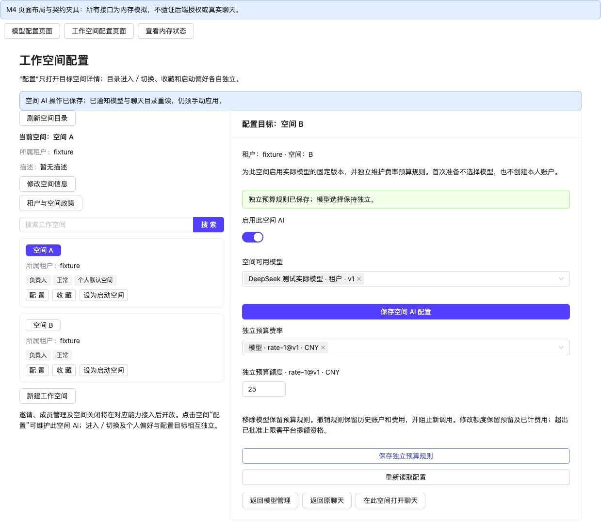

# 模型配置 M4：统一详情与工作空间 AI 入口

2026-11-03。状态：M4 编码及阶段验证完成；M5
综合验收待实施。需求基线为[模型配置专项 V1.5](../../../ARTE%20AI%20模型配置需求及设计.md)。

本批只改前端装配、交互、菜单说明和文档，不新增业务 HTTP 或业务表。沿用 M1～M3 后端与 schema；没有连接业务数据库、清库、执行
SQL、授予权限或部署。

## 已交付行为

| 入口           | 当前行为                                                                                                           |
|----------------|--------------------------------------------------------------------------------------------------------------------|
| 模型配置       | 审核连接／审核模型与费率／模型管理三个 Tab，默认模型管理；平台页签不依赖已选工作空间                               |
| 模型管理       | 同入口选择个人／租户归属，创建后立即打开详情；草稿、对应凭据、验证、固定版本及授权在一起维护                       |
| 原租户授权组件 | 去掉普通创建入口，嵌入所选资源详情；原未确认创建仍保留原键恢复，成功直接定位详情                                   |
| 审核模型与费率 | 审核方案与独立平台默认模板；模板不进入工作空间编辑器，不覆盖已有空间                                               |
| 工作空间目录   | 每行独立“配置”，局部打开目标 AI 详情；原进入／切换、名称／描述、收藏、启动偏好保留                                 |
| 工作空间 AI    | 显式首次准备、固定实际资源版本选择、独立预算规则，分别保存及反馈，沿用独立 CAS 与幂等恢复                          |
| 聊天           | 移除完整空间 AI 表单和平台模板抽屉；保留模型、参数、本人预算查看／刷新／准备及手动应用；平台菜单改为既有方案页入口 |

`ModelManager` 是统一管理器。`PersonalModelManager` 和 `WorkspaceAiSettings` 只保留兼容导出／包装，生产完整空间编辑器仅由工作空间页直接挂载，平台模板仅由模型方案
Tab 挂载。没有新增第二份业务配置状态。

2026-11-04 目录整理：`WorkspaceAiGovernanceEditor`、`WorkspaceAiPreparation` 和 `aiConfigurationEvents` 已迁入
`frontend/src/features/workspace/`；删除无生产调用的 `WorkspaceAiSettings` 兼容包装，原测试拆为两个空间组件测试及
`DefaultAiTemplateEditor.test.tsx`。恢复存储键及业务行为保持原样。

## 三种范围与导航

模型页管理范围是局部选择，不调用公共 `directory.select`。工作空间“配置 B”也不调用它，不写入当前聊天 A、最近／启动偏好或模型归属。
只有明确“在此空间打开聊天”使用原切换服务；新增内部完成回调，在受保护的切换真正提交后导航，不把 getWorkspace 成功当成已切换。

- 工作空间完整路径：`/Environment/Workspaces?tab=ai&tenantId=...&workspaceId=...`。
- 模型／工作空间往返区分目标 scope、`management-tenantId`／`management-workspaceId` 、`execution-tenantId`／
  `execution-workspaceId` 和 `chat-tenantId`／`chat-workspaceId`。生成定位携带账号标记；换账号拒绝沿用，业务范围仍重新授权。
- `resourceId`、`bindingId`、`bindingVersion` 必须成组；拒绝 latest、重复标识参数、不完整 scope、跨管理租户及任意 returnTo
  URL。returnTo 只允许 chat／models。
- 精确模型定位按目标空间服务端可读候选逐页核验；空授权过滤页继续游标，不替换最新版本。返回模型管理按资源版本分页核验所定位固定版本；管理
  M 与执行 B 分开保留，B 的使用准备和通知不误读为 M。
- 模型跳转先明确选择同租户目标，不默认第一个空间。缺 scope 显示目录选择提示，不借用当前聊天空间；失效／越权版本不挂载配置编辑器。
- `/AI/Connections`、`/AI/ModelPlans` 仍打开相应 Tab；`/AI/ModelSharing` 打开统一授权视图。两个模型主路径的旧
  `tab=workspace-ai` 定位安全转向工作空间详情。
- “返回原聊天”不执行切换；若原聊天范围已变化，提示并阻止返回错误范围。管理范围与当前聊天不同，不提供把该范围准备结果直接交给当前聊天的错误入口。

## 未保存、恢复与刷新

所有已打开模型页签保留草稿；dirty、临时密钥、pending、storageBlocked 保护局部管理范围与站内离开，浏览器关闭也有保护。
统一模型和授权编辑互锁；聊天两种模型视图在存在待处理内容时禁止切换，避免同一范围的两个预算准备面板竞争。本人账户准备不要求治理菜单。

空间模型与规则编辑互锁、独立提交，保存一项不会丢掉另一项未保存内容。未知写入只恢复原请求／键；confirmed 后重读失败只重读。
账号／完整 scope 切换卸载旧读取与临时密钥；原服务及新增定位均忽略已取消／迟到响应。治理编辑器新增读取取消协调，重读期间关闭写入入口。

空间成功保存发布同页及 storage 跨标签失效通知，只含账号、完整 scope 和随机修订标记，不含密钥、额度或许可。
模型页重读使用准备状态，聊天重读可用目录及使用条件；保留当前选择和草稿，不自动切换、升级、应用或发送。工作空间收到其他页通知只提示重读，不覆盖草稿。

## 菜单与部署边界

静态核对了既有环境及旧模型菜单脚本：环境脚本只给现有 admin 分配菜单，旧 aiModels 从 ChatNew 继承菜单关系；这不能证明其他治理角色已拥有
`EnvironmentWorkspaces`。 复用 `Environment`、`EnvironmentModels`、`EnvironmentWorkspaces`
，没有新菜单编码或业务动作。新装脚本只更新工作空间菜单说明，已安装环境无需为 M4 重跑 DML。

[只读核对 SQL](../scripts/arte-model-m4-menu-audit-mysql.sql)用于人工核对目标环境菜单、角色和直接用户绑定，本批未执行。
缺菜单与 `getConfiguration.canManage`／业务拒绝分别提示；按原职责分配现有入口、刷新受影响角色缓存，再核对
`/arte/auth/onlineInfo.menus`。 真实账号菜单、JWT、角色缓存及供应商验收由 M5／上线前核实，不能用本次源码核对代替。

## 验证结果

- 16 个管理／导航／空间／配置及环境入口测试文件：150 项通过（149 项批量回归及新增执行空间读取／通知测试 1 项）。
- ChatNew 页面及空间集成分别串行运行：18 + 17 项通过。
- 合计 **18 个文件、185 项通过**，环境入口 4 项已计入上述 150 项。
- 前端生产构建成功。全量 tsc 保留 **106 项既有诊断、无新增诊断**；按文件及错误内容比较 M3 基线，忽略变更引起的行号偏移，未宣称全量类型检查通过。
- 21 个核心变更文件 Biome lint 无错误，保留 5 项警告（既有 WorkspacePicker 非空断言及新增通知测试的一处非空断言）。
  `git diff --check`、手册模板保留及本批新增链接检查通过。检查的 240 个本地引用中，顶层文档既有历史草案链接
  `docs/arte-top-level-design-v0.1.md` 缺失；已与 HEAD 核对为原有问题，本批保留历史记录。
- 后端逻辑未修改，未重跑 M3 的 Java／供应商测试来充当 M4 验证。

测试覆盖三个 Tab 顺序和保留、局部管理／配置／聊天隔离、原创建恢复、精确定位及失效拒绝、缺
scope、旧深链接、菜单区别、本人准备、同页／跨标签通知、迟到响应与显式切换提交后导航。原模型、方案、连接、预算恢复与聊天手动应用也有回归。

复现（frontend 目录，重型聊天文件单独串行）：

```sh
npm test -- src/features/ainew/aiNavigation.test.ts src/features/workspace/aiConfigurationEvents.test.ts src/pages/AI/Models/index.test.tsx src/pages/Environment/Workspaces/index.test.tsx src/features/ainew/WorkspaceAiUsagePanel.test.tsx src/features/ainew/PersonalModelManager.test.tsx src/features/ainew/ModelSharingManager.test.tsx src/features/workspace/WorkspaceAiGovernanceEditor.test.tsx src/features/workspace/WorkspaceAiPreparation.test.tsx src/features/ainew/DefaultAiTemplateEditor.test.tsx src/features/ainew/ModelUsagePreparationPanel.test.tsx src/features/ainew/modelSharingRecovery.test.ts src/features/ainew/ModelPlanManager.test.tsx src/features/ainew/ConnectionManager.test.tsx src/features/ainew/ChatConfigurationForm.test.tsx src/features/workspace/workspace.test.tsx src/features/workspace/WorkspacePicker.test.tsx --maxWorkers=1
npm test -- src/pages/AI/ChatNew/index.test.tsx --maxWorkers=1
npm test -- src/pages/AI/ChatNew/workspaceIntegration.test.tsx --maxWorkers=1
npm test -- src/features/environment/navigation.test.tsx --maxWorkers=1
npm run build
npm run tsc
```

## 浏览器阶段证据

使用[独立 M4 页面夹具](../../../frontend/scripts/model-m4-browser/README.md)，正式模型／工作空间页面与目录／编辑组件，接口为内存模拟。
验证三个 Tab、归属选择、租户创建直接详情、B 局部配置／显式准备、模型和规则分别保存、dirty 离开阻止及宽窄屏。 390px
视口下模型页和工作空间页均测得 clientWidth = scrollWidth = 375px（扣除滚动条），没有横向溢出；下拉、额度输入和保存可操作。
保存后左侧仍为当前空间 A；B 选择 actual-1@v1、规则 rate-1@v1 的额度 25。夹具不创建真实预算账户。

[工作空间宽屏](evidence/model-m4/workspace-wide.jpg) · [工作空间 390px](evidence/model-m4/workspace-390.jpg) · [模型 390px](evidence/model-m4/models-390.jpg)



截图不验证后端授权、实际供应商或结算，不能替代 M5。浏览器标签已关闭、临时视口已恢复、本地夹具服务已停止。

## 后继工作

M5 按 AC 矩阵在新装隔离库完成角色、失败恢复、并发撤权、回环供应商、真实结算和生产认证边界核验，升级 model-a2-browser
的完整流程并汇总结果。 本批没有修改文章、成员治理或空间关闭功能，也没有自动进入 M5 或部署。
