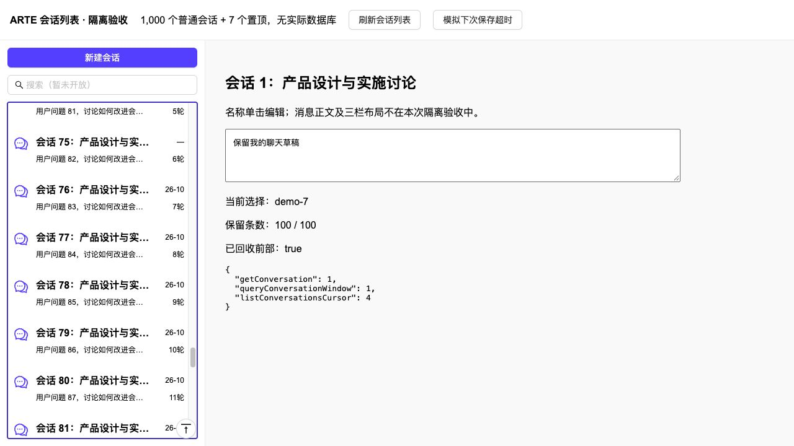
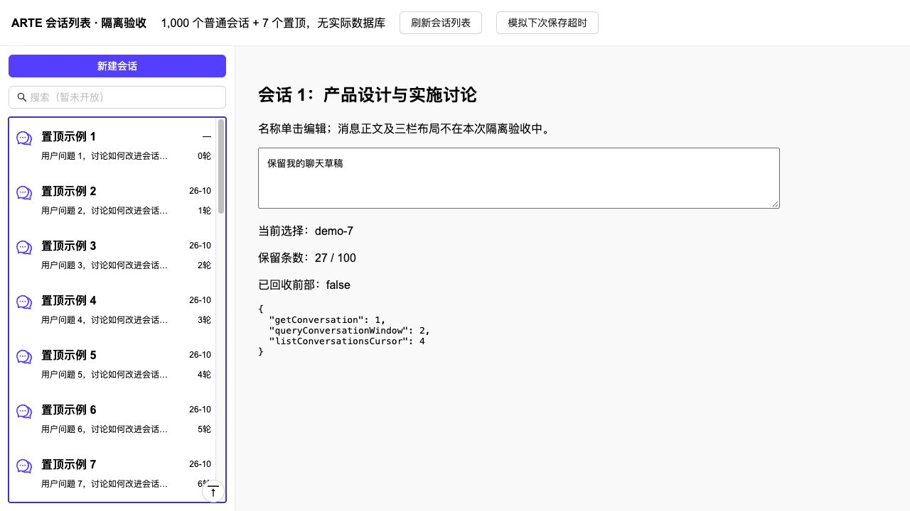

# 会话列表第二阶段：前端接入与验收

日期：2026-10-15。对象：`/AI/ChatNew`，不替换旧联调页的页码协议。

本阶段完成名称编辑闭环、真实置顶接入、100 条滚动窗口、限定刷新和返回数据库第 1 页。 三栏默认宽度／窄屏切换、去除
Drawer、工作空间与会话设置 Tabs、Logo 和顶部完整工具区属于下一阶段。 搜索输入框仅展示和输入，不作本页筛选或实际全文检索。分组／归档／删除菜单不可执行。

## 代码与状态边界

- [useConversationDirectory](../../../features/ainew/useConversationDirectory.ts)：目录窗口、编辑及原命令状态；只保留置顶＋普通最多
  100 个真实会话，独立于当前聊天详情。
- [ConversationDirectoryList](../../../features/ainew/ConversationDirectoryList.tsx)：两区共用行组件、名称输入、日期／轮数、菜单、一个滚动容器及滚动锚点。
- [接口封装](../../../services/arte-ai/conversation.ts)
  和[响应校验](../../../services/arte-ai/conversationDirectorySchema.ts)：使用第一阶段的新接口；校验过滤、目标、版本、分页信封和原命令回执。
- 旧 `useConversations` 保留默认页码行为，新页仅复用详情选择和旧创建请求的恢复；关闭它的旧列表读取，避免两份目录或 N+1
  置顶详情请求。
- 旧 localStorage 置顶 ID 不迁入服务器、不参与当前分区。列表不持久化页内容、历史 ID 去重集或已回收行；会话详情、草稿及必要原操作快照按原边界保存。

## 名称与操作闭环

单击名称只编辑；点击图标、摘要或行内非操作区域才打开会话。一次仅编辑一个固定目标。 Enter
与失焦共享保存；中文组词确认不提交，Esc／取消先关闭编辑再处理失焦。未修改的自动长 Unicode 名称可直接退出，不因人工输入的 256
UTF-16 上限意外改写。

编辑打开时只读目标最新元数据，输入后的草稿不被迟到读取覆盖。空白／超长、403／404、版本冲突及未确认结果保留原目标和草稿，阻止开启另一编辑器或切换聊天。
已知冲突只读目标，显示当前名称，用户检查后明确再保存，使用新版本／新键；不能由失焦连续自动重试。

网络／408／5xx 保留原请求、目标和键到账号／scope 隔离的 sessionStorage，不在刷新后自动发送。 “确认原操作”先查询原回执；404
不证明原请求未执行，仅原样重放同一命令。已知原拒绝保留稿供修正，不盲目换键竞争写入。 恢复目标不在第一页时，用独立草稿面板展示，不插入第
101 个会话行。

成功的人工／首问名称回执只更新该名称及其元数据版本，不查询／重排列表或刷新摘要、轮数、日期。
迟到的低版本列表响应及完整聊天快照不能覆盖已确认的新名称。聊天受理响应的可选 titleMetadata 已接入名称反馈。

新建直接请求服务器日期默认名，不弹命名表单。升级前遗留的旧创建请求先按旧参数与原键确认。 置顶／取消使用服务器目标状态与版本；7
个上限同时由界面和服务器处理，成功后重读当前有界窗口。 置顶版本或名额冲突按当前操作恢复权威窗口，不假装成功。只读空间禁止新建／命名／置顶，按原权限读取历史。

## 窗口和刷新

- 初次、进入新账号／空间、顶部刷新及返回顶部：无锚点读取数据库第一页（普通 20 条＋完整置顶），不恢复旧分页缓存。
- 新建成功：合并成一次第一页刷新；若此前尚有旧读取，取消并开始新批次，避免误用创建前的响应。
- 置顶成功：按当前可见普通行 ID＋偏移重读；迁走锚点时找下一可见普通行。无可见锚点时回第一页，不追回已回收页。
- 发送、完成、停止、重新生成、预算、切换已加载会话、Tab、栏宽、菜单与重新聚焦均不刷新目录；显式访问重查／失败重试按相应用户操作处理。
- 一次一个续页，最多 20 条；同批重复触底共用请求。失败保留旧窗口和原游标，只由用户重试。
- 置顶最多 7 条保留，普通容量为 `100－置顶数`；超限回收普通前部。选中的会话离开窗口不卸掉当前聊天或清空草稿。
- 回收前后使用可见行和像素偏移补偿，关闭原生 scroll anchoring；正在编辑／保存未确认的回收候选会暂停续页。续页已发出后才开始编辑，也在提交前再次检查。
- 用户向上滚到已回收窗口顶部（含 Home）重读数据库第一页；程序化锚点恢复不触发该读取。
- 回到第一页成功后才替换窗口并滚到顶部；失败保留旧行、选择和聊天草稿。只有服务器无续页才显示“已加载全部”，100 条上限不代表末页。

## 自动验证

```sh
cd frontend
npm test -- src/features/ainew src/pages/AI/ChatNew src/pages/AI/Chat src/features/workspace src/services/arte-ai
```

最终回归 20 个测试文件、331 项通过（2026-10-15），含恢复到窗口外的名称草稿失焦提交。 覆盖连续浏览 1,000 个会话、置顶＋普通最多
100 条、原游标重试、迟到响应、失焦／Enter／IME／Esc、 错误后不切换、目标读取不串 ID、原回执恢复、人工／自动名称合并、新建刷新、锚点补偿及公共空间／既有聊天回归。

新增目录 Hook 与行组件通过定向 Biome lint。全量 TypeScript 检查仍有 106 项已有错误；对照隔离的修改前源码副本，
归一化路径后没有新增诊断，改动文件无类型错误；文章编辑器、表单及用户类型等既有错误未在本次范围内处理。

Umi 生产构建已通过，包含 `AI/ChatNew/index.html`。沙箱内构建未继续输出，停止已核实属于本次任务的构建进程后，在允许本地进程通信的环境重试成功；未部署。

## 真实浏览器隔离验收

使用真实业务目录 Hook、组件和 CSS，加临时本地模拟接口；数据为 1,000 个普通会话与 7 个置顶。
未连接实际数据库、登录身份或模型，不将本次验证当作真实服务部署与权限验收。

- 点击图标打开会话，再点击名称编辑成功；名称保存后的 queryConversationWindow 仍只有 1 次。
- 模拟服务器已提交但前端超时，草稿和原键保留；点击另一会话被阻止。查询原回执后恢复名称，没有多发改名请求，也没有刷新目录。
- 连续触底后，实际 DOM 从 27、47、67、87 到 100 条；继续滚动仍为 100，置顶保留，原选中会话和聊天草稿保留。
- 返回顶部按钮和用户 Home 均使 queryConversationWindow 增加一次，普通首条恢复数据库第一条，scrollTop=0；仅本地滚到旧窗口首条不能冒充成功。
- 取消置顶提交一次、窗口重读一次；菜单禁用未实现动作；浏览器未记录运行时错误。





## 发布前与尚未覆盖的验证

接真实服务前先执行[第一阶段的数据库迁移及回填步骤](../../../../../backend/arte-ai/CONVERSATION_HTTP_API.md#迁移旧数据回填与回退)
。本次没有执行实际数据库迁移、回填或模型调用。 生产 MySQL 联调、真实浏览器堆快照／长时间运行，以及第三阶段 Splitter／Tabs
的页面联合验收仍需单列；不因单元测试及模拟接口通过而宣称这些已完成。

## 已有库兼容问题修复（2026-10-15）

后续实际开发库反馈“消息区已有会话，目录为空”。核实为元数据表建表后旧会话尚未回填：原会话 9 条，列表投影 0 条。 已使用现有回填逻辑补齐
9 条投影，并修复项目配置模板遗漏的回填开关；缺失投影及任务均归零。 从实际持久化适配器查询目标空间第一页返回 3
个会话，包含“新会话10142202”。页面按限定刷新规则需点击“刷新会话列表”。
原消息、会话名称和选择不因回填重写，未调用模型。具体证据见[后端修复记录](../../../../../backend/arte-ai/CONVERSATION_HTTP_API.md#已有库列表为空的修复验证2026-10-15)。
此次实际库修复不表示上节的完整服务／浏览器联合验收已完成。
