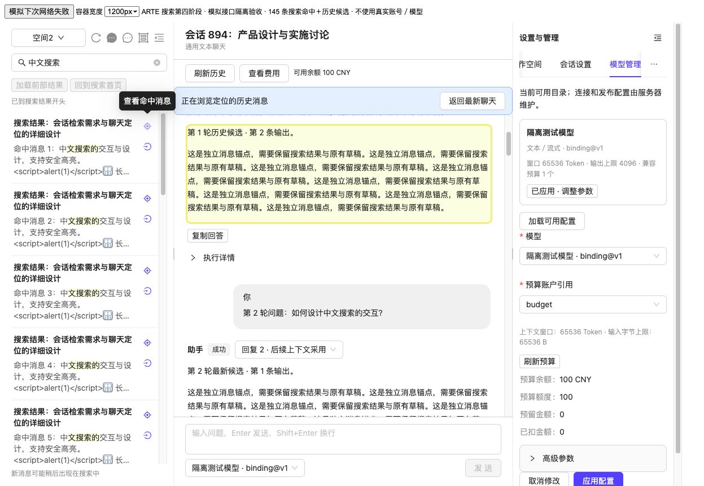
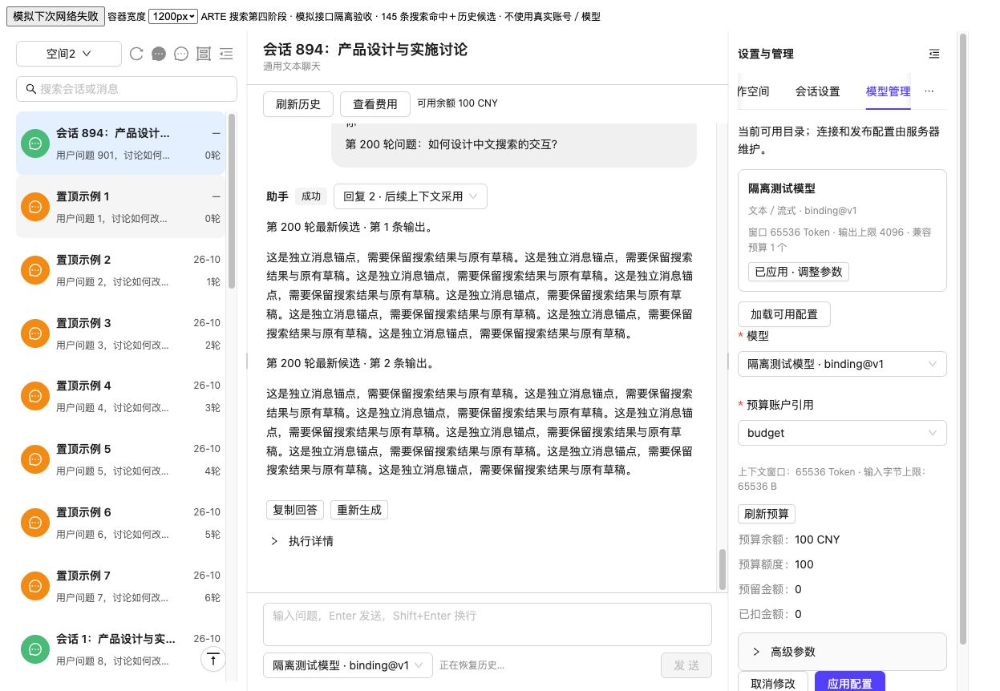
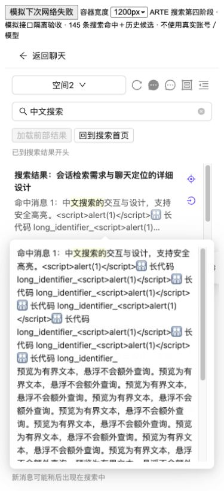

# 会话搜索第四阶段：页面与定位验收

日期：2026-10-16。对应搜索设计 V0.10、会话列表 V1.20、聊天总设计 V1.30。

S4 已完成页面接入、针对性回归及真实浏览器的隔离接口验收。后端搜索开关仍默认关闭，未部署；真实业务环境的端到端联调、标注查询质量、索引新鲜度与灰度发布属于
S5。

## 实现

| 范围       | 当前行为                                                                                                                                                                                                                            |
|------------|-------------------------------------------------------------------------------------------------------------------------------------------------------------------------------------------------------------------------------------|
| 输入       | 有效词变化后 300ms 防抖；IME 期间不查询，Enter 只确认组词；进行中同词合并，完成／失败后 Enter 创建新搜索。128 个可见字形上限，保留合法 emoji 连接符                                                                                 |
| 清理与过渡 | A 改 B 立即移除旧行／预览、取消旧读取并异步关闭旧会话，局部遮罩不阻塞输入和聊天；迟到响应不能恢复旧结果。空白／不可见输入不查询，Enter 退出；清空按钮直接退出                                                                       |
| 独立行     | ConversationSearchItem 仅显示标题、命中片段／高亮和右侧上下两图标；无 Avatar、置顶、候选标签或管理菜单。纯标题命中的上方入口禁用                                                                                                    |
| 预览       | 标题两行、片段三行；围绕高亮按字形截取约 180 字，Popover 使用服务端同一份约 800 字有界预览。纯文本／结构化高亮，不执行 HTML 或 Markdown，不增加悬浮请求                                                                             |
| Popover    | 悬浮、键盘聚焦、点击可打开，同时一个；支持进入浮层阅读／选字，外部点击或 Esc 关闭。小屏在下方展开，保留视口边距；移出窗口、换词、退出或失效时清理内容                                                                               |
| 搜索窗口   | 最多五个页段／100 行，按窗口内 entryKey 去重，无全历史 seen 集合；加载后部回收前部，反向相反；提交窗口前读取当前可见锚点并补偿滚动。普通目录缓存进入搜索时释放                                                                      |
| 分页状态   | 前部加载与同 PIT 首页；预算空页显式“继续查找”，不自动无界追扫；续页失败保留原窗口／边界。到期仍可定位现有有效结果，分页禁用并提示 Enter 重搜；顶部普通刷新禁用                                                                      |
| 上方入口   | 先运行保护、读取真实详情、目标附近轮次和命中候选，核对 turnId／invocationId／messageId；一次版本冲突最多重新读取一次。全部成功且提交前再次通过当前保护，才切换聊天，保留关键词、窗口、滚动和 PIT                                    |
| 下方入口   | 先准备真实详情、默认目录首页及目标元数据，确认当前详情和保护后再提交。清空搜索和旧定位模式；目标已在首页则直接定位，否则临时补入真实行，并与后续页去重，不修改置顶、total 或分页游标                                                |
| 历史浏览   | 每个真实用户消息／助手 output 有独立 messageId 锚点，渲染后滚动并短暂高亮；命中历史候选只改变浏览，不修改上下文采用候选。定位窗口独立于普通历史／SSE，最多显示 100 轮，支持较早／较晚读取，版本变化围绕可见锚点重建，不自动拉到最新 |
| 保护与失效 | 复用名称编辑、聊天草稿、配置及未确认操作保护，读取期间新产生的配置草稿也在提交前检查。网络失败保留搜索；权威失效按消息、会话或 scope 清理内容，保留失效占位，取消在途读取避免恢复旧片段                                             |
| 隔离       | 搜索词、片段、高亮和历史定位仅在当前内存；账号／scope 改变或卸载时清理并尝试关闭 PIT。不增加业务表或模型调用                                                                                                                        |

代码入口：

- [搜索生命周期](../../../features/ainew/useConversationSearch.ts)、[结果窗口](../../../features/ainew/ConversationSearchResults.tsx)、[独立结果行](../../../features/ainew/ConversationSearchItem.tsx)、[安全文本与字形截取](../../../features/ainew/searchText.tsx)。
- [定位准备](../../../features/ainew/searchNavigation.ts)、[独立历史窗口](../../../features/ainew/useLocatedHistory.ts)、[消息渲染与锚点](../../../features/ainew/BusinessChatPanel.tsx)。
- [目录窗口与临时行](../../../features/ainew/useConversationDirectory.ts)、[页面保护与提交](index.tsx)。

下方入口复用普通 getConversation，原详情路径缺少归档资格检查。本阶段让 DefaultConversationService.find 接入既有
ConversationArchiveReader，生产装配使用其可替换默认空读；真实读取失败不能回退为可见。该检查不依赖查询开关开启。未新增归档写入、目录归档过滤、归档管理或专门检索，未来归档专项仍需按设计补齐其余入口。

## 验证结果

- **前端 11 个测试文件，159 项全部通过**：搜索状态／字形、定位准备与历史浏览、普通目录／恢复、布局、ChatNew 页面与工作空间、既有
  API／共享读取。覆盖旧关键词迟到、同词合并、空输入、100 行回收、空页、过期、撤权、候选失效、历史输出锚点、失败不切换、临时行去重、配置保护及读取期间新增配置草稿。
- **后端 43 项全部通过**：普通详情归档资格及失败不降级、新旧会话 HTTP、搜索 HTTP、默认关闭配置及装配回归，使用 H2 隔离测试库。
- **前端生产构建、arte-app 集成编译通过**，包含 AI/ChatNew 静态路由产物。
- 全量 TypeScript 检查仍有 **106 项既有错误**；与原基线按文件及诊断内容比较无新增。未声称全仓类型检查通过，也未运行全仓全部测试。
- 本次浏览器使用真实 ChatNew／Ant Design／Markdown 组件、隔离模拟 HTTP，验证宽屏及 375px 真实视口；没有使用业务账号、真实模型或启用正式搜索索引。S3
  的真实 ES／Redis／MySQL 验证见第三阶段记录，不能把本次模拟接口浏览器验收称为真实业务联调。

## 浏览器证据

1. 上方定位到历史候选的第二个真实 output：搜索词“中文搜索”与 20 行结果保留，目标为 candidate-1-old-output-2，没有横向溢出。
2. 下方打开同会话后定位模式消失、关键词清空，目录为 1 个真实临时目标＋7 个默认置顶＋20 个默认普通条目；未改变数据库置顶。
3. 375px 真实视口：预览横向边界约 17～357px，document 无横向溢出；Esc 后预览内容节点为 0。预览原样显示字面 `<script>` 和
   emoji，没有执行 HTML。
4. 100 行窗口加载下一页后，scrollTop 从 12207 补偿到 9647，回收 2560px；同一个 hit-96 的可见偏移始终为
   -47px。原始测量见 [window-anchor.json](search-acceptance/window-anchor.json)。另验证前部回看和同快照首页恢复 hit-1、20
   行及 scrollTop=0。







截图及测量使用模拟数据，证明当前前端交互与布局，不证明搜索相关性、真实吞吐或索引新鲜度。

## 复验

前端在 frontend 目录运行：

```sh
npx vitest run \
  src/features/ainew/useConversationSearch.test.tsx \
  src/features/ainew/searchNavigation.test.tsx \
  src/features/ainew/useConversationDirectory.test.tsx \
  src/features/ainew/ConversationDirectoryList.test.tsx \
  src/features/ainew/recovery.test.tsx \
  src/features/ainew/ChatWorkspaceLayout.test.tsx \
  src/pages/AI/ChatNew/index.test.tsx \
  src/pages/AI/ChatNew/workspaceIntegration.test.tsx \
  src/services/arte-ai/conversation-search.test.ts \
  src/services/arte-ai/api.test.ts \
  src/services/arte-ai/sharedReads.test.ts
npm run build
```

后端在仓库根目录用 JDK 21 运行：

```sh
mvn -o -f backend/pom.xml -pl arte-ai -am \
  -Dtest=SearchInvocationVisibilityTest,ConversationHttpIntegrationTest,ConfigurationAssemblyTest,SearchConfigurationTest,ConversationSearchHttpTest \
  -Dsurefire.failIfNoSpecifiedTests=false test
mvn -o -f backend/pom.xml -pl arte-app -am -DskipTests compile
```

**当前环境未执行新增 MySQL DDL、业务回填、正式索引创建、服务重启或部署，搜索开关保持关闭。** 因而本阶段没有业务库迁移／备份完成的声明；其他环境启用
S2 后台仍需按第二阶段记录备份并显式执行迁移。S5 再进行真实浏览器＋后端联调、标注样例排序／定位、索引新鲜度、规模与回退验收。
