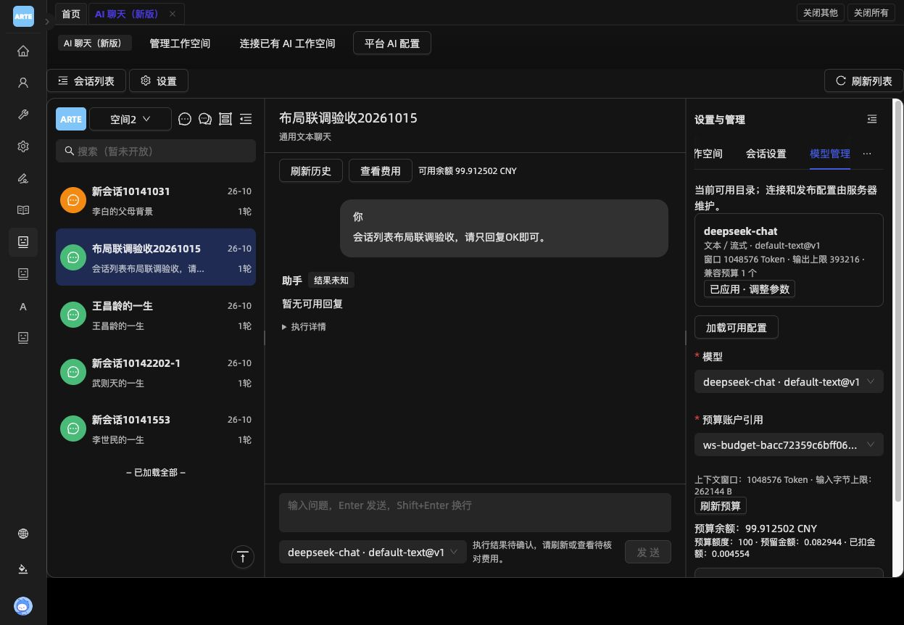
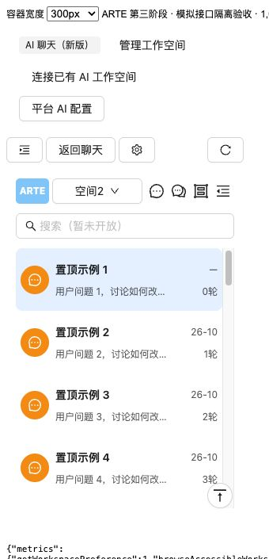
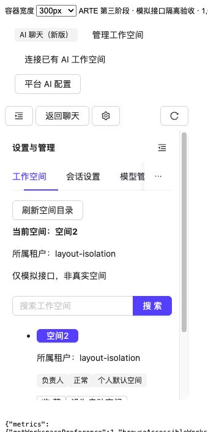
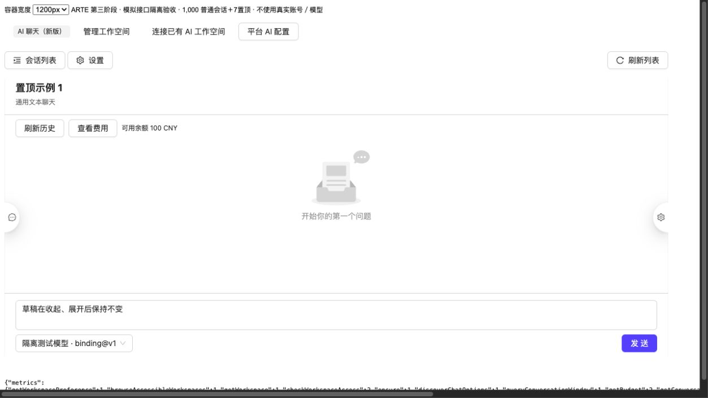
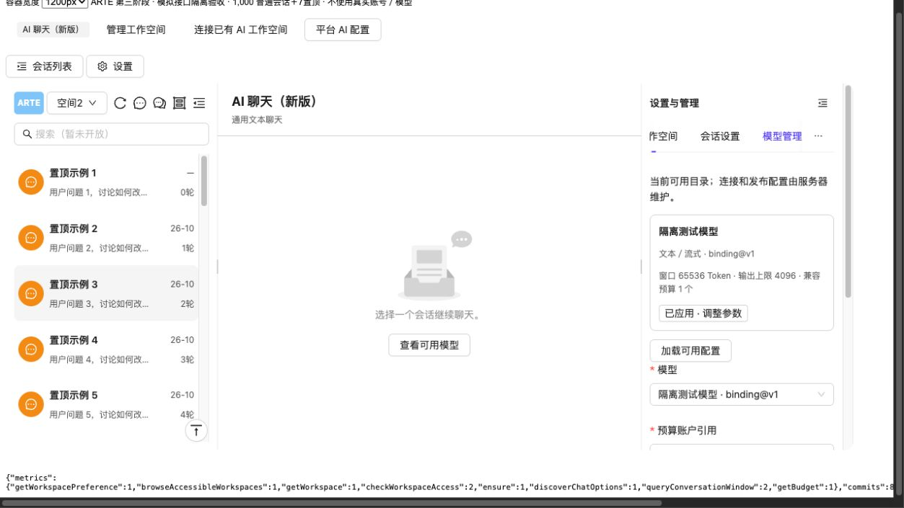
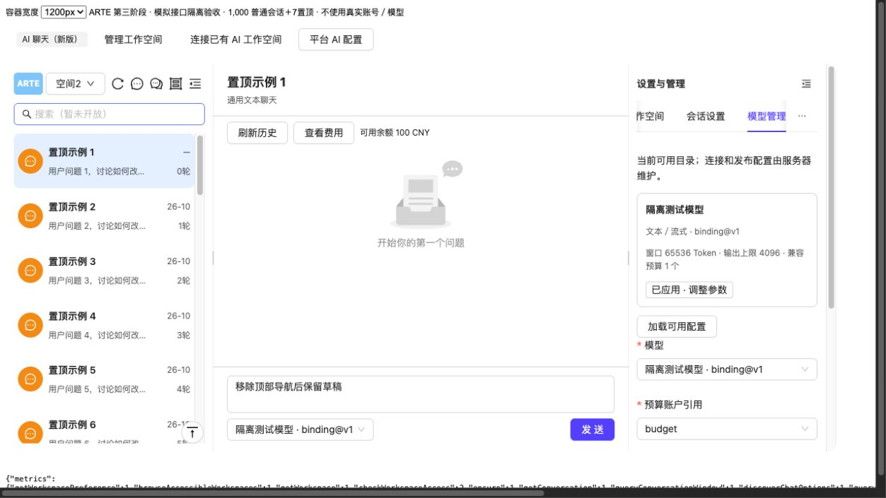
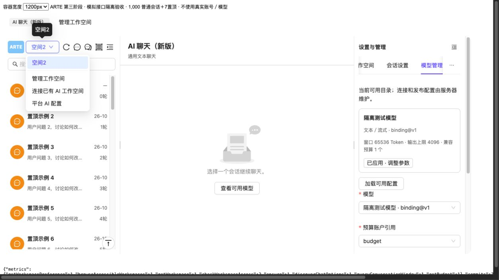
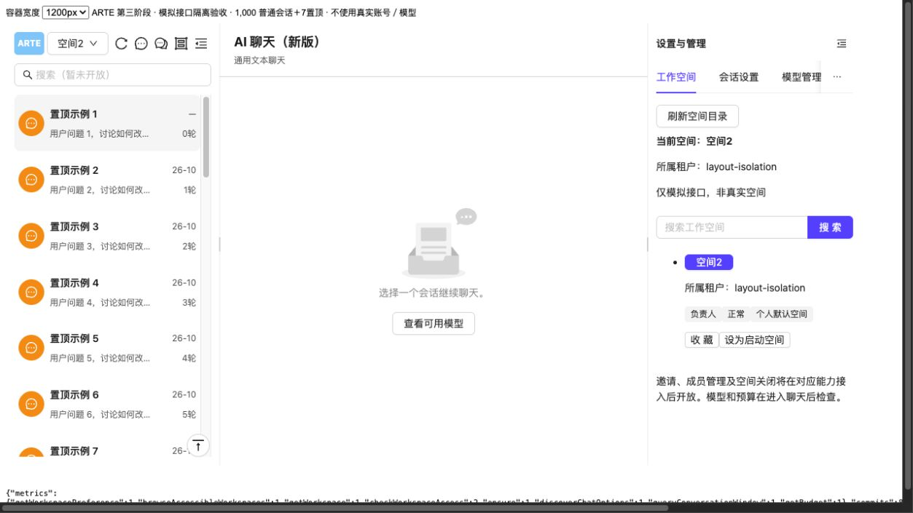
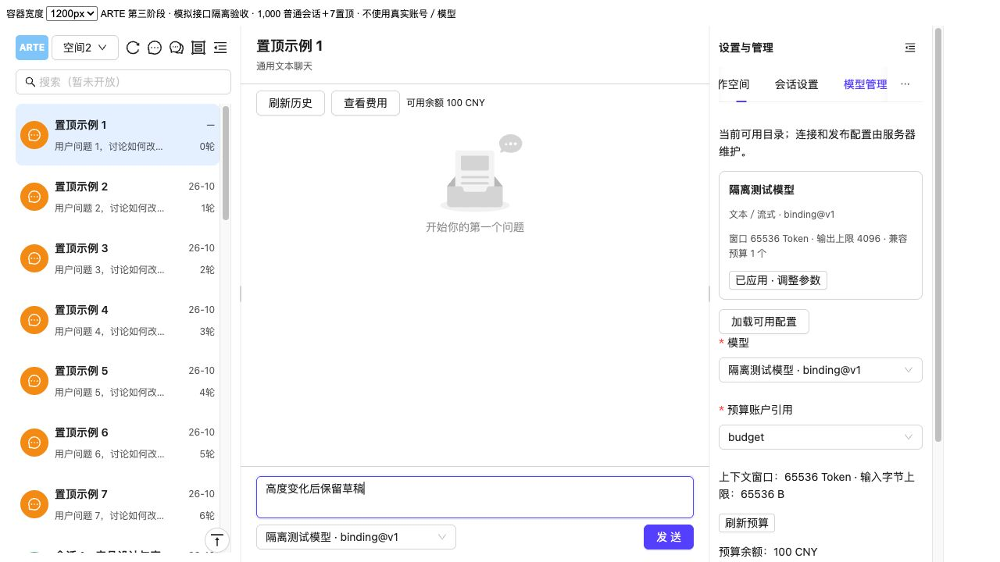

# 会话列表第三阶段：布局、联调与性能记录

日期：2026-10-15。页面：`/AI/ChatNew`。当前结论：布局代码、真实目录操作和分层性能基线已验证；供应商成功回复与生产容量认证未通过／未完成，不能把本记录视为全链路上线通过证明。

## 交付范围

- 三个区域统一使用 Ant Design Splitter。以内容容器的实际可用宽度为断点，扣除外层导航和边框，不直接使用屏幕宽度。
- 可用宽度 ≥1080px：默认左右各300px，中间至少480px；780～1079px：默认列表＋聊天，展开设置时收起列表；300～779px：默认聊天，列表／聊天／设置互斥展示。
- 并排侧栏最小300px、最大容器50%，同时保留聊天480px；单区域模式展开占满容器，以300px最小值优先。小于300px明确提示不支持，不退回
  Drawer。
- 拖宽／拖窄、按钮及 Splitter 分隔条收起／展开均使用同一份受控状态。折叠记住本次页面内的宽度，重新进入恢复默认，不读写旧布局偏好。
- 三个区域和右侧表单始终保持挂载。隐藏区域使用 hidden／inert，焦点转移到可用入口；聊天草稿、配置草稿及执行观察不因切换布局或
  Tab 重建。
- 右侧包含工作空间、会话设置、模型管理、空间 AI 配置、助手与知识库 Tabs。工作空间管理改为内嵌面板，与左上快捷下拉共享账号目录、切换保护与原操作恢复。
- ARTE 文字 Logo、空间下拉、四个图标入口和搜索 Input 已接入。图标采用 DynamicIcon；保留工作区当前 Avatar
  外观，补回原生按钮、禁用／加载及键盘语义。当前工作区的置顶橙色／普通绿色 Avatar 与需求第3.2节“两区同色”仍有视觉差异，本次保留现有外观，不改写该需求。
- 临时会话与分组菜单明确未开放；分组／归档／删除不执行业务动作，搜索不发检索请求。独立的平台配置、费用及核对面板仍保持各自既有呈现，不属于本次工作空间／会话设置
  Drawer 的替换范围。

关键实现：[布局状态](../../../features/ainew/useChatLayout.ts)、[Splitter](../../../features/ainew/ChatWorkspaceLayout.tsx)、[目录顶部](../../../features/ainew/ConversationDirectoryHeader.tsx)、[快捷空间](../../../features/workspace/WorkspaceQuickSelect.tsx)、[页面](index.tsx)。

浏览器检查修复了两处实际问题：背景包装层缺少 flex／min-height 约束会撑高列表，导致后台连读；隐藏侧栏或程序化锚点补偿产生的
scroll 不得触发续页。最终列表拥有独立且有界的滚动高度。

## 自动验证

```sh
cd frontend
npm test -- src/features/ainew src/pages/AI/ChatNew src/pages/AI/Chat src/features/workspace src/services/arte-ai
npm run tsc
npm run build
```

回归21个文件、343项通过。新增测试覆盖容器断点、宽度限制、折叠恢复、分隔条展开互斥、单区域切换保留同一DOM与草稿、隐藏区域焦点处理、共享空间目录、切换失败可见反馈、隐藏列表不续页。既有编辑／100条窗口／旧联调页／权限和恢复用例继续通过。

全量 TypeScript 保留106项既有诊断，本次改动文件无新增诊断；不能把全量检查描述为通过。Umi生产构建通过。新增布局文件定向 Biome
lint无警告；包含公共WorkspacePicker的检查保留其4项既有非空断言警告，未扩大修改范围。

## 真实服务联调

环境为用户启动的 `http://localhost:8080/AI/ChatNew` 与 IDEA
中的12636后端，账号zhangsc、空间2，使用真实MySQL及服务端授权。8000是已有Docker前端，未用作本次真实验收；临时8137服务已关闭。没有改写用户的数据库连接配置或执行迁移。

| 项目         | 观察结果                                                                                                                                    |
|--------------|---------------------------------------------------------------------------------------------------------------------------------------------|
| 真实空间选择 | 登录有效时从个人空间切换到空间2，目录、模型、预算与右侧管理使用空间2；快捷选择失败会展开管理Tab显示反馈                                     |
| 新建         | 默认名“新会话20261015”，新会话选中，目录重读数据库首页                                                                                      |
| 首问标题     | 20字问题原文作为标题，无实际截断不追加省略；与最新第4.5节一致                                                                               |
| 人工改名     | 生成期间改为“布局联调验收20261015”，不等待生成结束，不重置聊天；重入后仍保持人工标题                                                        |
| 置顶／取消   | 新测试会话进入置顶区，再取消回普通区；原有置顶会话保留；刷新／重入后状态与名称保持                                                          |
| 统计口径     | 发送后目录原统计暂时保持，置顶后的窗口重读取得1轮、最新用户问题摘要和26-10；手动首页刷新可见取消置顶后的最新会话                            |
| 布局／Tabs   | 工作空间管理内嵌右栏；切换Tab、收起展开后消息草稿仍在，未打开工作空间／会话设置Drawer                                                       |
| 公共操作恢复 | 切换空间后的偏好保存一度待确认；明确点击原操作确认后恢复“空间操作已保存”，未绕过恢复保护                                                    |
| 模型执行     | 请求真实受理并持久化用户消息，随后供应商超时；后端 `INVOCATION_TIMED_OUT`、`UNKNOWN`，输出0字节。前端保留结果未知和费用核对提示，未自动重发 |

仅新增一个会话“布局联调验收20261015”，最终未置顶；没有更名或删除原业务会话。该测试调用结果未知，仍按原预算核对流程处理，不自动退款或伪造成功。7个上限和并发竞争已有后端及模拟接口用例，本轮未在空间2批量创建会话来强行占满真实名额。

本机启用单点登录；独立测试登录会使同账号的旧浏览器令牌失效。发生登录失效后重新登录验证，不修改权限或放宽响应校验。



## 浏览器布局与长列表

使用实际新版页面、Hook、Splitter、Tabs和CSS，临时模拟1000个普通会话＋7个置顶。模拟接口与真实服务证据分开记录。

- 逐一验证内容容器300、375、600、779、780、900、1079、1080、1200px；1080px为300／480／300，780px为300／480，单区域始终有返回聊天入口。
- 实际鼠标拖动：1200px容器从300／600／300调整到400／500／300；继续拖动被约束为420／480／300。折叠后恢复420px，没有目录刷新。
- 300px模式的列表宽度300px，顶部内容宽度与scrollWidth均为276px，无工具区横向溢出；右侧工作空间Tab占300px，无Drawer。此处验证的是内容容器，不能冒称所有手机浏览器和外层应用布局均已完成兼容认证。
- 连续触底浏览到第1000条，49次续页；500／1000条处仍最多100个真实行，7条置顶保留，已回收的当前会话不清空聊天草稿。输入、菜单和切换仍可用。
- 返回顶部后queryConversationWindow由1增至2，普通首条回到数据库模拟源的第1条，scrollTop=0，当前聊天与草稿保持。切换宽度、Tab和折叠不增加目录读取。
- 开发模式Profiler单次提交最大约47.8ms；两次长任务均发生在初次加载，滚动期间未增加，加载时最大约165ms。不是生产构建的渲染SLA。
- 近似JS堆采样约82.7→174.7→157.4MiB，返回首页／空闲后约92.4→82.1MiB；未呈单调增长。数值含开发运行时、模拟后端的1007条数组及浏览器开销，不能替代生产堆快照或长期泄漏认证。

[原始浏览器观察记录](../../../../../docs/public/assets/captures/ai-chat/sidebar-layout-browser-evidence-20261015.json)。





## 性能基线与边界

原始JSON位于[2026-10-15目录测量](../../../../../backend/arte-app/docs/measurements/2026-10-15-directory/README.md)
，不含密码、令牌、消息正文或数据库地址。HTTP每项5次预热、30次串行＋30次最多8并发；含本地前端代理及HTTP。采样时空间2为1置顶＋3普通，后续新建验收会话不计入该轮基线。

| 链路                                         | 串行P50／P95     | 8并发P50／P95    | 最大响应体 | 完整请求SQL数 |
|----------------------------------------------|------------------|------------------|------------|---------------|
| 首屏窗口；手动刷新／返回顶部使用相同读取参数 | 1111.7／1562.2ms | 2149.4／3323.6ms | 2635B      | 16            |
| 真实游标续页                                 | 1136.4／1226.2ms | 2027.0／3138.5ms | 1246B      | 13            |

小数据集通过size=1预读取得真实游标，再以size=20测续页；不是伪造游标，也不是20条满页吞吐。真实置顶窗口锚点重读功能已验证，观察到17条SQL，但未单独完成30次深层锚点HTTP采样。

应用观察日志的首屏初始授权P95约840.6ms，8并发约1932.1ms；续页约772.6／1652.2ms。首屏16条与续页13条包含授权与基础读取，目录自身为4／1条SQL；不是前端逐行N+1详情请求。阶段时间可能重叠，不相加推算总耗时。授权和调度链路是下一轮性能定位重点，不能仅凭索引命中宣称HTTP性能优良，也不以缓存旧授权作为提速手段。

真实配置数据库的单条目录SQL30次只读基线：首屏P95 33.438ms、续页32.122ms，命中`idx_ai_conversation_list`
。当时元数据共9条、最大活动归属5条；该续页落点后为空，不能代表大列表。

另在专用本机MySQL上使用连接级临时表及正式迁移表结构，测量1000／10000条、0／7置顶、每会话投影用户计数0／10000共8组，每组30次。首屏4条SQL的P95为1.546～13.226ms，单次续页P95为0.375～3.219ms，各组首页查询计划均命中列表索引。临时表随连接关闭自动删除；未写业务库。这是SQL规模基线：只改变投影计数，没有创建真实消息正文，不包含授权、HTTP、模型或真实历史回填成本。

尚未完成：1000／10000条完整HTTP及真实历史体量矩阵、真实名额并发竞争、长时间生产浏览器堆快照，以及供应商成功流式回复。当前交付可验收布局和目录接入，生产容量和完整模型链路仍须复验。

## 2026-10-15 收起入口补充

参照 ChatManagement，在左右栏收起时显示对应边缘的半圆悬浮按钮，展开后隐藏。按钮使用 DynamicIcon 的
MessageOutlined／SettingOutlined，带提示与键盘焦点；展开沿用同一布局状态和宽度恢复逻辑。后续移除顶部导航后的焦点规则见本文末节。

定向回归 `npm test -- src/features/ainew/ChatWorkspaceLayout.test.tsx src/pages/AI/ChatNew`
共3个文件、35项通过，覆盖按钮显隐、420／360px栏宽恢复、草稿和DOM保留、焦点处理。组件定向lint通过，全量TypeScript仍为相同的106项既有诊断，无新增诊断。

浏览器使用前述模拟接口隔离环境：1200px容器中左右按钮均为28×56px，贴对应边缘且垂直居中；点击展开后隐藏。300px单区域模式通过右侧按钮按Enter打开设置，列表隐藏，消息草稿仍保留。整个收起／展开及容器切换期间，
`queryConversationWindow`维持1次，没有额外列表查询。此次未重新登录真实服务。



## 2026-10-15 刷新按钮位置调整

刷新入口移至左栏顶部，顺序为工作空间、刷新、新建、临时、分组、收起；原页面工具区入口移除。使用与相邻工具一致的图标按钮，保留提示和加载状态，仍调用原
`refreshFirst`。ChatNew相关2个文件、27项测试通过。模拟浏览器点击后目录窗口读取从1次增加到2次；300px容器中顶部宽度和scrollWidth均为276px，无横向溢出，页面仅有1个刷新会话列表按钮。



## 2026-10-15 移除重复导航

移除三栏上方独立的“会话列表／设置”导航行及其占位样式，继续使用侧栏内部收起按钮和两侧悬浮展开按钮。单区域模式的列表、设置内部顶部各自显示“返回聊天”；区域内容保持挂载。展开或返回后焦点进入目标区域，隐藏区域内的焦点转移到可见区域或对应边缘入口。

相关3个测试文件、35项通过，覆盖无重复导航、窄屏返回入口所属区域、焦点转移、栏宽恢复和草稿保留。组件定向lint通过。模拟浏览器验证300px列表入口及375px列表／设置往返、1200px桌面收起展开，草稿保留且目录窗口读取仍为1次；没有重新登录真实服务。



## 2026-10-15 工作空间菜单入口收纳

将页面顶部的“连接已有 AI 工作空间”“平台 AI 配置”移入左栏工作空间下拉，按“管理工作空间、连接已有 AI 工作空间、平台 AI
配置”排列。原连接Modal、平台配置Drawer及授权／未确认操作保护保持原逻辑。空间未就绪、左栏尚未挂载时，准备区域提供同一菜单，避免固定授权连接入口不可达。

ChatNew相关2个测试文件、27项通过；快捷选择及目录顶部组件定向lint通过。模拟浏览器确认菜单顺序、页面顶部按钮移除，两项分别可打开原连接弹窗和平台配置界面，未提交连接或配置写入。



## 2026-10-15 移除页面标题工具栏

移除独立的“AI
聊天（新版）／管理工作空间”栏及其桌面、窄屏占位样式。正常状态三栏直接从页面内容顶部开始；页面的无障碍名称、必要提示、空间准备流程保留。工作空间管理继续从左栏下拉进入右侧Tab；无当前空间或准备未完成时仍有准备区域的菜单及管理内容。

模拟浏览器确认页面与Splitter顶部均为33px（其上为隔离验收工具），没有遗留顶部栏占位，并从下拉“管理工作空间”成功打开右侧工作空间Tab。

ChatNew相关2个测试文件、27项通过；既有草稿保留用例改从空间快捷入口进入管理，真实下拉联调用例继续通过。



## 2026-10-15 页面高度自适应及外框移除

页面使用 `useComponentHeight`
，通过页面和父容器的ResizeObserver及窗口resize测量实际顶部位置，剩余高度填至视口底部；隐藏缓存页不采用零坐标。移除旧的100／80px固定扣减和540／460px最小高度，清除三栏外框及圆角，保留内部区域分隔和控件边框。

ChatNew相关2个测试文件、27项通过。模拟浏览器实测：720px视口时页面top=33、height=687、bottom=720；500px视口时height=467、bottom=500；375×420px窄窗口时工具区换行使页面top=50，bottom=420。以上document.scrollHeight均等于视口高度，没有整页纵向溢出；外层border和radius均为0px，消息草稿在尺寸变化后保持。临时视口设置已恢复，未登录真实服务。


