# AI TOOL 页面分批验收记录

> S6-02（2026-10-22）新增“执行记录与统计”：本人当前空间的窗口筛选、记录分页、样本统计及执行详情。
> 指标边界与部署前的查询投影 SQL 见 [执行记录与统计说明](../../../../../backend/arte-ai/TOOL_OBSERVATION.md)。
> 本批组件及服务回归 14 类、89 项通过，覆盖空间／凭据迟到响应、金额精度、截断、历史未回填和读取失败。
> 全量 TypeScript 当前 106 项诊断在 HEAD 基线中均可复现，本次无新增；本批没有新增浏览器或真实后端联调验收。

S2-07（2026-10-19）范围：`/AI/Tools` 的目录／个人配置；不包含 S2-08 的调用提交及结果跟踪，S2-09 为只读集成验收。

## 自动验证

- 前端：`node node_modules/vitest/vitest.mjs run src/features/aitool src/services/arte-ai src/features/workspace`，143
  项通过。本批 31 项覆盖精确 JSON／请求白名单、游标空页／停滞、迟到读取、重复点击／同键确认、恢复损坏／存储失败、账号／空间隔离、配置编辑与启停、有效预览及非兼容升级确认。
- 后端：沿用 `backend/arte-ai/TOOL_IMPLEMENTATION.md` §13 选定兼容命令。arte-ai 775 项，771 项通过／4 项 Redis 测试跳过；平台授权
  26 项全通过。新增 9 项 HTTP／H2 用例覆盖默认身份并发、跨用户、重放／异义冲突、事务内撤权、用户编辑／停用保留、配置纠正、精确数值及
  v2 回执、服务器过滤和审计回滚。
- 更新旧管理路由数量断言为 17；旧工具过期租约夹具改为等待真实时钟越过租约，未改变生产执行／恢复逻辑。
- 本批组件 Biome lint 与差异检查通过。全仓 `tsc --noEmit` 仍有未修改的文章编辑器、旧页面及既有搜索验收脚本等诊断；本批文件无类型诊断。完整
  Umi build 在当前环境等待期间无后续构建输出，已停止，不列为通过；生成路由已包含唯一 `AI/Tools/index`，本批页面通过隔离 Vite
  编译及浏览器走查。

## 浏览器走查

使用 `frontend/scripts/tool-s207-browser` 和显式 `ToolBrowserAcceptance#browserBridge`：固定测试主体／空间，经 HTTP 进入真实
Controller、管理用例、MyBatis 和临时 H2。没有调用工具、业务数据库或业务 Redis；宿主生产登录／菜单／RBAC 未以此替代验证。

| 场景             | 观察                                                                                 |
|------------------|--------------------------------------------------------------------------------------|
| 桌面目录→详情    | 用途、发布状态、只读风险可见，版本及 Schema 折叠                                     |
| 准备默认配置     | 显式命令创建本人默认绑定，随后读取当前修订；没有执行工具                             |
| 编辑／保存／回读 | 名称与普通字段正确回读；0.12345678901234567890123456789 和 9007199254740993 原文保留 |
| 有效限制预览     | 未修改配置也可只读预览；不产生保存或工具调用                                         |
| 停用配置         | 页面回读“已停用”，显示“启用配置”，没有自动恢复启用                                   |
| 390px 窄屏       | 筛选纵向排布、卡片与抽屉可用，操作换行、内容可滚动                                   |

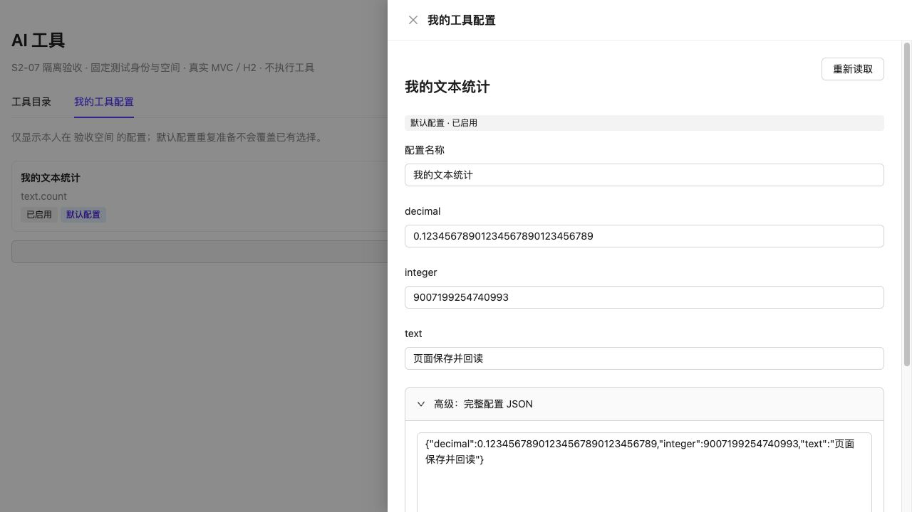

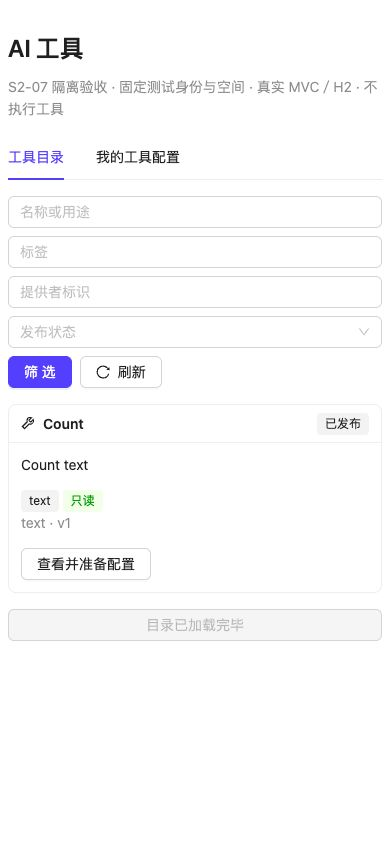

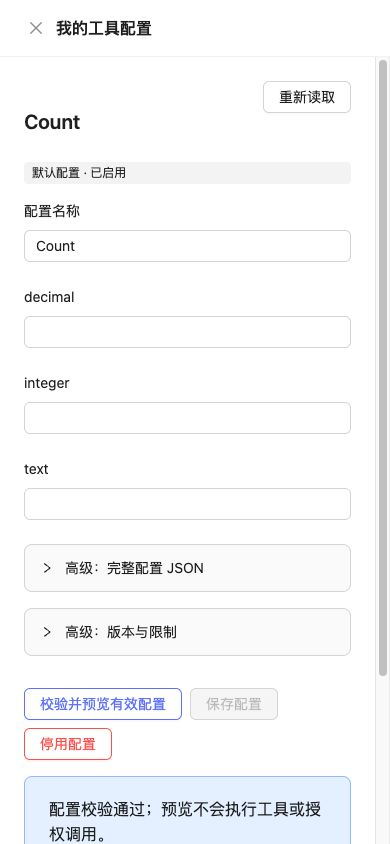

## 部署与未验证范围

菜单 DML 已交付，未执行：`backend/arte-app/scripts/arte-ai-tool-menu-dml-mysql.sql`；没有自动授予菜单或操作权限，没有开启
TOOL／分类调度。 默认命令的 tool-binding-receipt v2 要求先统一升级管理读写节点，回退构建须保留 v2 读取能力。 尚未验证真实
MySQL／Redis、多节点、宿主生产登录／RBAC／菜单授予、真实工具、性能或完整生产构建；这些不能由 H2、受控身份和单机页面测试替代。
普通未保存草稿只在当前页面内保存；关闭详情／切换空间／刷新离开前提示，未确认命令独立存储以恢复。

## S2-08 调用预览与结果（2026-10-19）

本批新增“工具调用”页签，目录／配置页面仍保留；覆盖预览、确认提交、原调用状态／结构化结果、错误、停止与刷新恢复。 前端相关测试共
157 项通过；后端兼容回归与最终 119 项受影响范围验证见 TOOL_IMPLEMENTATION.md §16。Biome lint 与差异检查通过； 全仓 tsc
仍有既有诊断，本批文件无诊断；未重跑完整 Umi 生产构建。

隔离运行方式（JDK 21；终端在仓库根、前端命令在 frontend）：

```sh
mvn -o -f backend/pom.xml -pl arte-ai -am -Dmaven.compiler.proc=full -Dmaven.compiler.release=21 \
  '-Dtest=ToolRunBrowserAcceptance#browserBridge' -Dsurefire.failIfNoSpecifiedTests=false test
node scripts/tool-s208-browser/server.mjs
```

桥仅绑定 127.0.0.1:15218，Vite 为 5218。固定测试身份与空间，真实 Controller／MyBatis／H2／Worker； fixture 的 Count
是受控测试适配器，不代表已登记生产文本计数工具或验证生产 RBAC。 通过 target/tool-run-browser-stop 停止桥并关闭本次 Vite，15
分钟有界自动退出。页面验证后临时服务已关闭。

| 场景 | 可观察事实 |
|---|---|
| 桌面预览 | 显示实际工具 v1、修订 r1、参数、有效配置、期限／尝试／输出上限与 FREE；预览不执行 |
| 修改参数 | 原确认方案消失，必须重新预览 |
| 公开提交至 Worker | 返回原调用编号，后续读取 SUCCEEDED、NOT_RESERVED 和结构化结果 |
| 页面刷新 | 保留 a5ddea03-87ed-4e78-98b4-62897d2782c1，按原 ID 读取成功结果，不产生第二次执行 |
| 390px | 卡片、参数与 JSON 换行，操作可用，结果及预览确认按钮可滚动到达 |
| 桥关闭统计 | invocations=1，reservations=0；新调用预览未增加执行次数 |

UNKNOWN、断网、恢复撤权、损坏存储及停止回执用自动化测试验证；本次浏览器未模拟全部故障。 新增最近 20 个本会话调用编号的只读恢复；UNKNOWN
明确确认结束查看后保留原编号，不自动重发。 真实业务权限／工具、生产构建、多节点／MySQL／Redis 和性能仍未验收，属于 S2-09；本批没有执行
DDL 或启用功能开关。

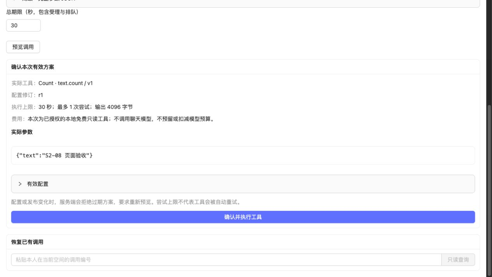

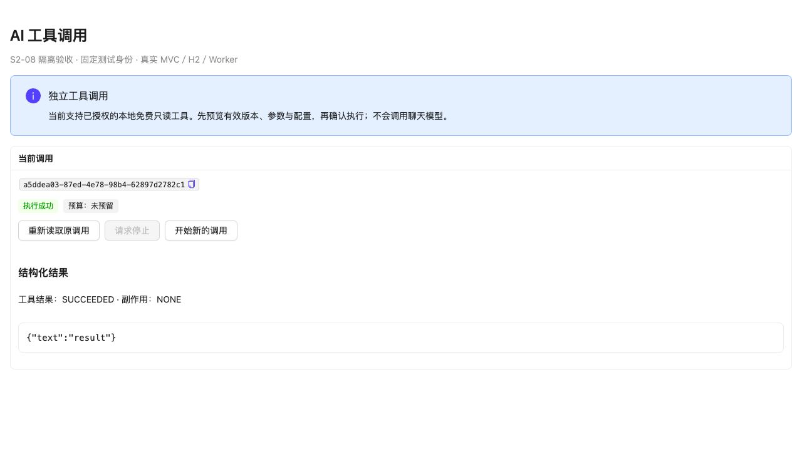

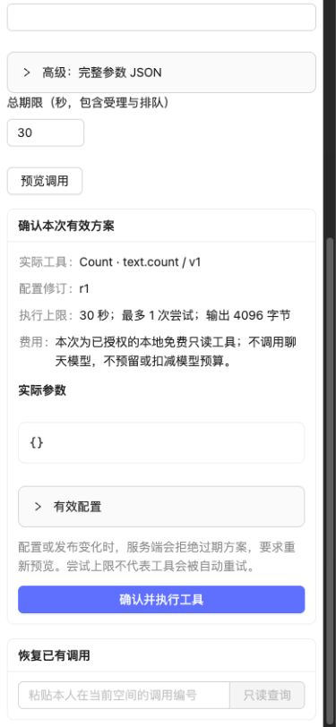

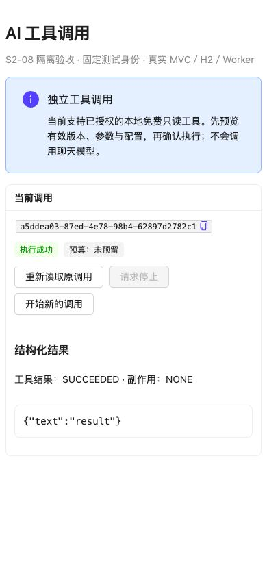

## S2-09 正式文本工具与 MySQL（2026-10-19）

本轮按确认范围验收本机集成与性能基线。使用 `ToolPlatformBrowserAcceptance#browserBridge`／`scripts/tool-s209-browser`
，固定测试登录会话、随机真实平台 scope、正式平台当前 RBAC／空间／AI 资格、真实 text.countCodePoints@v1、独立 MySQL 8.4.11 和实际
Worker。详细启用、发布 JSON、复现命令及边界见 [使用与验收](../../../../../backend/arte-ai/TOOL_ACCEPTANCE.md)。

| 场景 | 观察 |
|---|---|
| 首次使用 | 已发布文本工具可见，详情说明 Unicode 码点语义；显式准备本人默认空配置 |
| 调用预览 | 输入 A😀中；显示实际 v1／r1、5 秒／1 次／4096 字节、FREE 说明，不调用模型 |
| 提交结果 | SUCCEEDED，预算未预留，副作用 NONE，结构化结果 codePoints=3 |
| 刷新恢复 | 回到调用页恢复 bb588219-dafb-47ac-81d8-f0e7ea530d57 和同一结果 |
| 390px | 参数、费用／限制、确认按钮与结果可见，按钮换行，页面可滚动 |
| 只预览 | 窄屏另填参数仅预览，关闭桥时 invocations=1、attempts=1、reservations=0 |

前端相关 157 项测试通过，新页面桥 Biome check 通过；产品组件未改动。浏览器页、桥及 Vite 已关闭，测试随机数据库已清理。未验证真实登录／JWT
签名过滤、业务角色与菜单授予、完整 Umi 生产构建、跨主机事件传播或正式参考环境持续负载。双 Worker 为同 JVM
独立实例，不能据此宣称双应用节点或生产性能通过。

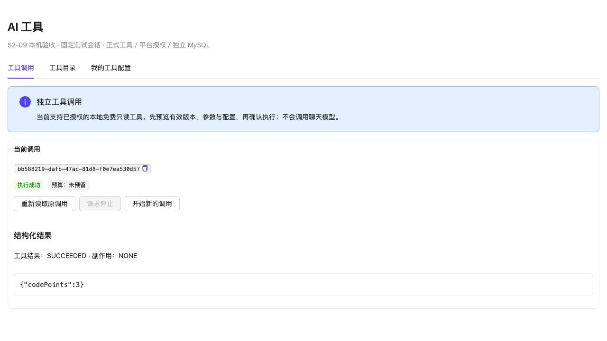

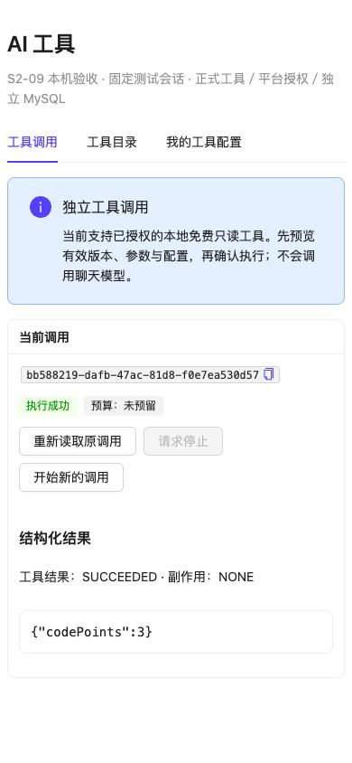

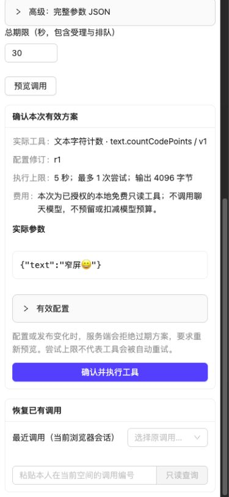

## 未确认提交退出与恢复（2026-10-19）

使用正式 ToolRunPanel、独立 loopback 页面及模拟 HTTP 响应；未连接业务服务或数据库。本轮只验证前端恢复行为，不代表真实后端调用成功。

已在浏览器操作：旧提交确认返回 504／205005 → 明确暂存 → 刷新仍可预览新调用 → 新独立调用成功展示结果且原提交仍保留 →
结束查看 → 恢复原提交。模拟入口仅收到一次旧键和一次新键提交，刷新与恢复没有自动提交。前端相关 40 项测试、修改文件 Biome lint
通过。

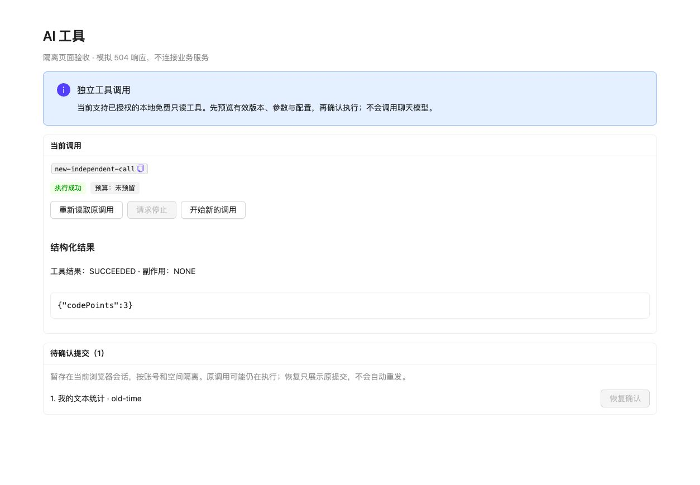

## 已受理调用读取失败后的退出（2026-10-19）

开发库重置后，浏览器仍保存原调用编号，查询 404 使页面拿不到终态，原界面无法释放当前调用入口。
现在读取失败时可明确选择“结束本次查看”→“保留编号并结束查看”，保留原编号到历史列表并开放新预览。
不推断原调用失败、不取消或重发原操作，待确认提交仍保留；保存历史失败时继续保留当前记录。

两文件定向测试共 25 项、四个修改文件 Biome lint 及差异检查通过，覆盖 403／404／500、刷新恢复和存储失败。 本次未进行浏览器或真实后端调用验收。
